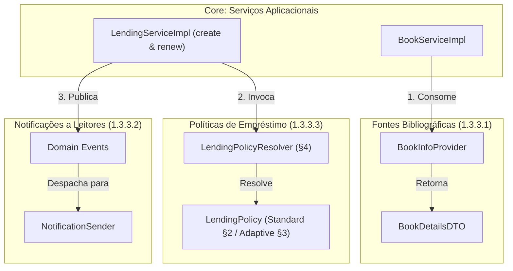

# ARQSOFT — Documentação Global de Arquitetura

## 1. Enquadramento e Objetivos do Projeto (P1)

### 1.1 Contexto
Na fase anterior do projeto, foi desenvolvido o serviço backend orientado a REST do LMS (*Library Management System*), disponibilizando endpoints para gestão de:
1. **Livros (*Books*)**
2. **Géneros (*Genres*)**
3. **Autores (*Authors*)**
4. **Leitores (*Readers*)**
5. **Empréstimos (*Lendings*)**

### 1.2 Problemas Identificados no Sistema Base
A análise do sistema herdado revelou três limitações arquiteturais críticas que impedem a sua evolução sustentável:
1. **Extensibilidade (*Extensibility / Modifiability*):** Incapacidade de adicionar novos fornecedores ou canais sem alterar o código existente (violação do princípio *Open-Closed Principle* — OCP).
2. **Configurabilidade (*Configurability*):** Ausência de parametrização em tempo de arranque (*setup time*) para seleção de adaptadores e ausência de mecanismos para calibrar políticas em tempo de execução (*runtime*).
3. **Testabilidade (*Testability*):** Forte acoplamento a implementações e dependências externas, inviabilizando testes automatizados isolados, determinísticos e de alta cobertura de mutação.

### 1.3 Objetivos Centrais de P1
O Projeto 1 estrutura-se em torno de três grandes pilares do enunciado:
* **1.3.1 Documenting:** Engenharia reversa do *System-as-is*, levantamento das vistas arquiteturais (C4 + 4+1 Vistas), especificação de ASRs e matriz de rastreabilidade.
* **1.3.2 Adoption of ADD:** Aplicação formal do método *Attribute-Driven Design* (ADD 3.0), cobrindo requisitos, fatores, táticas, padrões, arquiteturas de referência e alternativas de desenho.
* **1.3.3 Development:** Desenho e implementação de três novas capacidades (Informação Bibliográfica, Notificações a Leitores e Políticas de Empréstimo) acompanhadas de uma bateria rigorosa de testes funcionais e mutação.

---

## 2. Mapa de Navegação da Documentação

A documentação do projeto está organizada modularmente nas respetivas pastas temáticas:

```
Docs/ARQSOFT/
├── arqsoft-documentation.md        <-- ÍNDICE MESTRE / RELATÓRIO GLOBAL (Este Documento)
├── Enunciado - ARQSOFT.pdf         <-- Enunciado Oficial da Unidade Curricular
│
├── system-as-is/                   <-- 1.3.1 ENGENHARIA REVERSA DO SYSTEM-AS-IS
│   ├── system-as-is.md             <-- Documentação Completa e Vistas Arquiteturais
│   ├── Vista Lógica/               <-- Diagramas de Decomposição Lógica de Negócio (N1 a N3)
│   ├── Vista Arquitetural/         <-- Diagramas C4 Context, Container, Component, Class (N1 a N4)
│   ├── Vista Implementação/        <-- Diagramas de Pacotes, Módulos e Artefactos (N1 a N4)
│   ├── Manifestação/               <-- Diagramas de Rastreabilidade VA <-> VI (N3 e N4)
│   ├── Vista Fisica/               <-- Diagramas de Topologia de Nós e Implantação (N1 e N2)
│   └── Vista Processos/            <-- Diagramas de Sequência dos 4 Cenários de Referência
│
└── system-to-be/                   <-- 1.3.2 ADOÇÃO DE ADD & ARQUITETURA ALVO
    ├── architectural-factors.md    <-- 1.3.2.1 Identificação e Classificação de Fatores (ASRs, FRs, TC, OL)
    ├── add-process.md              <-- 1.3.2.2 Processo ADD 3.0 e Iterações de Desenho
    ├── architectural-tactics.md    <-- 1.3.2.3 Seleção e Justificação de Táticas SEI
    ├── reference-architectures.md  <-- 1.3.2.4 Análise e Seleção de Arquiteturas de Referência
    ├── architectural-patterns.md   <-- 1.3.2.5 Catálogo de Padrões Arquiteturais e de Desenho
    └── design-alternatives-and-rationale.md <-- 1.3.2.6 Alternativas de Desenho e Technical Memos
```

---

## 3. Síntese do System-as-is (1.3.1.1)

O detalhe exaustivo de engenharia reversa encontra-se formalmente documentado em:
**[Documentação Completa do System-as-is](./system-as-is/system-as-is.md)**

### Principais Características do Sistema Inicial
* **Paradigma:** Monólito Modular (*Modular Monolith*) orientado a domínios de negócio (DDD).
* **Camadas Internas:** Cada módulo de domínio (`bookmanagement`, `lendingmanagement`, `readermanagement`, `usermanagement`, etc.) adota internamente uma organização em camadas (`api`, `services`, `model`, `infrastructure/repositories`), isolando o núcleo de domínio de detalhes tecnológicos.
* **Vistas Documentadas:**
  * **Vista Lógica de Negócio (VL):** 3 níveis de decomposição concetual pura dos subdomínios de negócio e interfaces de domínio funcionais.
  * **Vista Arquitetural (VA):** 4 níveis C4 detalhando portas de interface pública (*ball-and-socket*), limites de contexto e desacoplamento via DIP.
  * **Vista de Implementação (VI):** Empacotamento Maven JAR, módulos de código Java e centralização técnica da `Persistência` (Spring Data JPA / Hibernate).
  * **Mapeamento de Manifestação:** Relações formais `<<manifest>>` entre a VA e a VI nos Níveis 3 e 4.
  * **Vista Física (VF):** Topologia de nós (`Server localhost`, `Client Workstation`, `Cloud Ninja API`).
  * **Vista de Processos (VP):** Realização sequencial dos 4 cenários base (*Create Lending*, *Register Book*, *Return Lending*, *Top 5 Books Lent*).

---

## 4. Requisitos de Significância Arquitetural (ASR) & Táticas ADD (1.3.1.2)

Esta secção detalha os requisitos funcionais primários e a especificação formal dos cenários de atributos de qualidade (*Quality Attribute Scenarios*) segundo a metodologia de referência do *Software Engineering Institute* (SEI — Bass, Clements, Kazman).

### 4.1 Requisitos Funcionais Globais (FR)

* **FR01 – Gestão do Catálogo de Livros (*Books*):** Registar, editar, consultar e listar livros do catálogo (ISBN, título, autores, descrição, géneros literários).
* **FR02 – Gestão de Autores e Géneros (*Authors & Genres*):** Manter o registo biográfico de autores e a taxonomia de géneros literários associados aos livros.
* **FR03 – Gestão de Leitores (*Readers*):** Gerir o ciclo de vida cadastral dos leitores (dados cadastrais, preferências de notificação).
* **FR04 – Gestão de Empréstimos (*Lendings*):** Criar e devolver empréstimos de livros a leitores, validando disponibilidade de exemplares e limites de requisição.
* **FR05 – Obtenção de Metadados Bibliográficos Externos:** Integrar informação bibliográfica a partir de múltiplos fornecedores externos (ex.: Google Books, Open Library), harmonizando modelos de dados heterogéneos.
* **FR06 – Notificação a Leitores:** Notificar leitores sobre eventos relevantes de empréstimo (criação de empréstimo, aviso de devolução, atraso) via SMS, Email e/ou Webhook.
* **FR07 – Aplicação de Políticas de Empréstimo Dinâmicas:** Avaliar e aplicar regras e limites de empréstimo (duração, máximo de livros simultâneos, cálculo de multas) com base no perfil do leitor ou tipo de obra.

---

### 4.2 Especificação Formal dos ASRs (*Quality Attribute Scenarios*)

#### ASR01: Extensibilidade de Fontes Bibliográficas
* **Atributo de Qualidade:** Modificabilidade (*Modifiability / Extensibility*)
* **Estímulo:** Necessidade de suportar um novo fornecedor de metadados bibliográficos
* **Fonte do Estímulo:** Equipa de desenvolvimento / Operações.
* **Ambiente:** Tempo de desenho/desenvolvimento (*Design time*).
* **Artefacto:** Módulo de integração bibliográfica / Serviços externos.
* **Resposta:** O novo fornecedor é adicionado através de uma nova implementação de interface (*Adapter/Gateway*), sem alterar a lógica de negócio principal nem as fontes existentes.
* **Medida de Resposta:**
  * Custo/esforço de implementação reduzido (impacto isolado numa única classe/pacote);
  * Zero alterações ao código do domínio ou de apresentação (princípio Aberto/Fechado — OCP).

---

#### ASR02: Configurabilidade de Provedores em Setup Time
* **Atributo de Qualidade:** Configurabilidade (*Configurability*)
* **Estímulo:** O operador/administrador pretende ativar um ou múltiplos fornecedores de informação bibliográfica ou canais de notificação no arranque do serviço.
* **Fonte do Estímulo:** Administrador de sistemas / DevOps.
* **Ambiente:** Tempo de configuração/arranque (*Setup time / Deployment*).
* **Artefacto:** Ficheiros de configuração da aplicação (`application.properties` / `application.yml` / variáveis de ambiente).
* **Resposta:** A aplicação lê a configuração no arranque e instancia/injeta os adaptadores pretendidos sem requerer recompilação de código.
* **Medida de Resposta:**
  * Nenhuma alteração ao código-fonte ou reconstrução de binários (`.jar`);
  * O sistema arranca com a configuração selecionada em menos de 1 minuto.

---

#### ASR03: Notificações Multicanal Extensíveis
* **Atributo de Qualidade:** Modificabilidade (*Modifiability*)
* **Estímulo:** Ocorrência de um evento de empréstimo que exige notificação através de Email, SMS, Webhook ou qualquer combinação destes.
* **Fonte do Estímulo:** Processamento de eventos de domínio (*Lending events*).
* **Ambiente:** Tempo de execução e tempo de configuração.
* **Artefacto:** Módulo de Notificações / Event Handlers.
* **Resposta:** O sistema despacha a notificação para todos os canais configurados de forma desacoplada do fluxo principal de empréstimo.
* **Medida de Resposta:**
  * A introdução de um canal adicional (ex.: Slack/Push) não afeta a lógica do subdomínio `Lendings`;
  * Canais podem ser ativados individualmente ou em conjunto via configuração externa.

---

#### ASR04: Seleção Dinâmica de Políticas de Empréstimo em Runtime
* **Atributo de Qualidade:** Flexibilidade de Negócio / Configurabilidade em *Runtime*
* **Estímulo:** Um leitor solicita um empréstimo e o sistema tem de determinar as regras aplicáveis (prazos, limites) de acordo com o contexto do leitor/livro.
* **Fonte do Estímulo:** Pedido de empréstimo vindo de um leitor.
* **Ambiente:** Tempo de execução (*Runtime*).
* **Artefacto:** Mecanismo de políticas de empréstimo (*Lending Policy Engine*).
* **Resposta:** O sistema avalia as regras de seleção de políticas e executa a política correspondente, permitindo ainda que os limites numéricos sejam calibrados externamente em *setup time*.
* **Medida de Resposta:**
  * A seleção da política correta ocorre em *runtime* sem impacto percetível na latência do pedido HTTP;
  * Os parâmetros de limiares (ex.: dias de empréstimo, multas) são lidos da configuração externa sem alterar classes Java.

---

#### ASR05: Testabilidade e Isolamento de Componentes
* **Atributo de Qualidade:** Testabilidade (*Testability*)
* **Estímulo:** Realização de bateria de testes automatizados (unidade, domínio transparente, mutação, integração e sistema) sobre as novas funcionalidades.
* **Fonte do Estímulo:** Pipeline de CI/CD ou comando local de desenvolvimento (`mvn test`).
* **Ambiente:** Tempo de build / Teste automatizado hermético.
* **Artefacto:** Conjunto de testes automatizados e arquitetura de classes.
* **Resposta:** A arquitetura desacoplada permite testar as regras de domínio e as políticas isoladamente, simular/mockar os serviços externos (Google Books, gateways de email/SMS) e validar caixas opacas e transparentes com testes de mutação representativos.
* **Medida de Resposta:**
  * As classes de domínio são 100% testáveis sem necessidade de arrancar contexto Spring ou base de dados;
  * Alta taxa de mutantes mortos (*mutation test score* $\ge 60\%$) nas classes críticas de negócio;
  * Testes de integração ($SUT = \text{controller} + \text{service} + \text{gateways}$) executam de forma determinística utilizando mocks/stubs para as APIs externas.

---

#### ASR06: Fiabilidade e Tolerância a Falhas em Serviços Externos
* **Atributo de Qualidade:** Fiabilidade / Resiliência (*Reliability / Fault Tolerance*)
* **Estímulo:** Falha temporária, latência excessiva (*timeout*) ou resposta de erro HTTP (ex.: 503 *Service Unavailable*) por parte de uma API externa (Google Books, Open Library, gateway SMS ou Webhook).
* **Fonte do Estímulo:** Fornecedores de serviços externos na cloud ou rede pública.
* **Ambiente:** Tempo de execução normal (*Runtime*).
* **Artefacto:** Módulos de integração externa (`bookmanagement.infrastructure.gateways`, `readermanagement.infrastructure.notifications`).
* **Resposta:**
  * No caso das fontes bibliográficas, o sistema ativa uma cadeia de contingência (*fallback*), consultando a fonte alternativa configurada sem propagar erro ao utilizador;
  * No caso das notificações, a falha no envio para um canal é registada em log de forma isolada, não abortando os restantes canais configurados nem provocando *rollback* da transação de empréstimo na base de dados.
* **Medida de Resposta:**
  * 0% de interrupções na persistência do empréstimo devido a indisponibilidade de canais de notificação;
  * Sucesso na recuperação de metadados se pelo menos uma das fontes bibliográficas ativas responder com dados válidos;
  * Registo auditável em log de todas as exceções intercetadas.

---

#### ASR07: Desempenho e Não-Bloqueio no Atendimento a Requisições
* **Atributo de Qualidade:** Desempenho / Concorrência (*Performance / Resource Management*)
* **Estímulo:** Conclusão de uma operação de empréstimo ou devolução que desencadeia notificações para múltiplos canais de comunicação com latência variável.
* **Fonte do Estímulo:** Transações de negócio no serviço de empréstimos (`LendingService`).
* **Ambiente:** Carga operacional concorrente (*Runtime*).
* **Artefacto:** Barramento de eventos aplicacionais e despachador de notificações.
* **Resposta:** A emissão de notificações é desacoplada da transação síncrona principal através de eventos de domínio (`LendingCreatedEvent`, etc.) e processamento orientado a eventos (`@EventListener` / `@TransactionalEventListener`), permitindo que a resposta HTTP 201/200 seja devolvida ao utilizador sem esperar pela confirmação das redes externas.
* **Medida de Resposta:**
  * O tempo de resposta do endpoint REST de empréstimo não é afetado pelo tempo de transmissão dos emails, SMS ou Webhooks;
  * *Overhead* de despacho de eventos inferior a 50 ms.

---

### 4.3 Mapeamento para Táticas Arquiteturais (ADD)

| ID | Atributo de Qualidade | Tática Arquitetural (SEI / ADD) | Padrão / Solução Concreta | Rastreabilidade no To-Be |
| :--- | :--- | :--- | :--- | :--- |
| **ASR01** | **Modificabilidade** | *Abstract Common Services* / *Maintain Abstract Interfaces* | Padrão **Adapter** e **Gateway** com modelo de dados canónico (`BookDetailsDTO`). | [architectural-tactics.md](./system-to-be/architectural-tactics.md) |
| **ASR02** | **Configurabilidade** | *Defer Binding Time* / *Configuration Files* | Injeção condicional no Spring (`@ConditionalOnProperty`, `@ConfigurationProperties`). | [architectural-tactics.md](./system-to-be/architectural-tactics.md) |
| **ASR03** | **Modificabilidade** | *Publish-Subscribe* / *Separate Concerns* | Padrão **Observer / Domain Events** com despachador multicanal **Composite**. | [architectural-tactics.md](./system-to-be/architectural-tactics.md) |
| **ASR04** | **Configurabilidade / Modificabilidade** | *Defer Binding Time* / *Use an Intermediary* | Padrão **Strategy** com **Policy Resolver / Factory** dinâmico e propriedades externas. | [architectural-tactics.md](./system-to-be/architectural-tactics.md) |
| **ASR05** | **Testabilidade** | *Specialized Interfaces* / *Record-Playback* | Inversão de Controlo (IoC), Injeção de Dependências e Mocks para componentes externos. | [architectural-tactics.md](./system-to-be/architectural-tactics.md) |
| **ASR06** | **Fiabilidade / Resiliência** | *Fault Isolation* / *Degradation & Fallback* | Padrão **Composite / Fallback Chain** e isolamento nos listeners de eventos. | [architectural-tactics.md](./system-to-be/architectural-tactics.md) |
| **ASR07** | **Desempenho / Concorrência** | *Asynchronous Event Processing* / *Introduce Concurrency* | Desacoplamento temporal através do `ApplicationEventPublisher` do Spring. | [architectural-tactics.md](./system-to-be/architectural-tactics.md) |

---

## 5. Índice dos Artefactos do Processo ADD 3.0 (1.3.2)

O desenho da arquitetura alvo (*System-to-Be*) seguiu as diretrizes metodológicas do *Attribute-Driven Design 3.0* do SEI:

1. **[1.3.2.1 Identificação e Classificação de Fatores Arquiteturais](./system-to-be/architectural-factors.md):**  
   Levantamento estruturado dos requisitos funcionais (`FR01-FR04`), cenários de atributos de qualidade (`ASR01-ASR07`), restrições técnicas (`TC01-TC05`), limitações organizacionais (`OL01-OL04`) e matriz de priorização de importância vs. dificuldade técnica.

2. **[1.3.2.2 Execução do Processo ADD 3.0 e Iterações de Desenho](./system-to-be/add-process.md):**  
   Documentação formal dos 7 passos do ADD ao longo de 3 iterações:
   * *Iteração 1:* Módulo de Integração de Informação Bibliográfica Heterogénea.
   * *Iteração 2:* Módulo de Notificações Multicanal Desacopladas por Eventos.
   * *Iteração 3:* Mecanismo Dinâmico de Resolução de Políticas de Empréstimo.

3. **[1.3.2.3 Seleção e Justificação de Táticas Arquiteturais](./system-to-be/architectural-tactics.md):**  
   Catálogo das táticas SEI selecionadas para cada atributo de qualidade (Modificabilidade, Configurabilidade, Testabilidade, Fiabilidade, Desempenho) e análise formal de *trade-offs*.

4. **[1.3.2.4 Arquiteturas de Referência](./system-to-be/reference-architectures.md):**  
   Estudo comparativo entre três arquétipos candidatos (Monólito Tradicional vs. Arquitetura de Microsserviços vs. Monólito Modular DDD com Clean Architecture) e justificação técnica da arquitetura adotada.

5. **[1.3.2.5 Padrões Arquiteturais e de Desenho](./system-to-be/architectural-patterns.md):**  
   Catálogo formal de padrões macro-arquiteturais (Modular Monolith, Onion Architecture, Event-Driven Architecture) e padrões de desenho GOF/PoEAA (Adapter, Composite, Strategy, Factory, Canonical Data Model).

6. **[1.3.2.6 Alternativas de Desenho e Racional com Modelos Visuais](./system-to-be/design-alternatives-and-rationale.md):**  
   Análise sistemática de alternativas por subproblema, Technical Memos formais (TM-01 a TM-03), matrizes de decisão ponderadas e catálogo de diagramas visuais C4 e 4+1 para a arquitetura alvo.

---

## 6. Matriz Global de Rastreabilidade e Consistência (1.3.1.4)

### 6.1 Matriz de Rastreabilidade Bidirecional

A matriz seguinte assegura a rastreabilidade e consistência bidirecional entre requisitos, decisões de desenho, modelos arquiteturais e a solução implementada:

| Requisito / Problema | ASR | Decisão ADD | Padrões | Artefactos / Módulos de Código | Modelos Visuais |
| :--- | :--- | :--- | :--- | :--- | :--- |
| **1.3.3.1 Fontes Bibliográficas** | ASR01, ASR02, ASR05, ASR06 | Desacoplamento via portas e adaptadores; agregação com fallback; ativação condicional em setup time. | **Adapter**, **Gateway**, **Composite / Chain**, **Canonical DTO** | `BookInfoProvider`, `GoogleBooksAdapter`, `OpenLibraryAdapter`, `CompositeBookInfoProvider`, `BibliographicConfig` | C4 Component (N3) `bookmanagement`; Sequence Diagram Consulta Externa |
| **1.3.3.2 Notificações a Leitores** | ASR02, ASR03, ASR07 | Publicação orientada a eventos de domínio; despachador multicanal assíncrono; ativação por propriedades. | **Observer / Domain Events**, **Strategy**, **Composite** | `LendingCreatedEvent`, `LendingReturnedEvent`, `NotificationSender`, `CompositeNotificationSender`, `NotificationConfig` | C4 Component (N3) `readermanagement`; Sequence Diagram Despacho Eventos |
| **1.3.3.3 Políticas de Empréstimo** | ASR02, ASR04, ASR05 | Encapsulamento das políticas oficiais (`StandardLendingPolicy` §2 e `AdaptiveLendingPolicy` §3) e estratégias adicionais; seleção e reavaliação dinâmica em *runtime* por histórico (`LendingPolicyResolver` §4) em cada empréstimo e renovação; propriedades tipadas e validadas no arranque. | **Strategy**, **Policy Resolver / Registry**, **Externalized Config** | `LendingPolicy`, `StandardLendingPolicy`, `AdaptiveLendingPolicy`, `LendingPolicyResolver`, `Lending.renew`, `LendingPolicyProperties`, `LendingPolicyAdminController` | C4 Class (N4) `lendingmanagement`; Diagrama de Classes Políticas |
| **1.3.3.4 Testes Automatizados** | ASR05 | Arquitetura hermética e inversão de controlo para injeção de mocks/stubs em todos os níveis de teste. | **Inversion of Control (IoC)**, **Dependency Injection** | `StandardLendingPolicyTest`, `LendingPolicyResolverTest`, `AdaptiveLendingPolicyTest`, PITest Mutation, `@SpringBootTest`, `LendingPolicyAcceptanceIT`, `BookExternalInfoIT` | Rastreabilidade formal em `architectural-factors.md` e `src/test/java` |

### 6.2 Contrato e Matriz de Interdependência entre Módulos

Para garantir a coerência arquitetural e viabilizar o desenvolvimento paralelo e desacoplado dos três pilares funcionais sem bloqueios entre membros da equipa, foram estabelecidos contratos estáveis de interface na fronteira de cada módulo:



* **Ponto de Sincronização 1 (Catálogo $\rightarrow$ Fontes Externas):** O serviço de catálogo (`BookServiceImpl`) depende exclusivamente da interface abstrata `BookInfoProvider` e do DTO canónico `BookDetailsDTO`, operando de forma transparente independentemente das fontes ativas (`GoogleBooksAdapter`, `OpenLibraryAdapter`) ou do intermediário `CompositeBookInfoProvider`.
* **Ponto de Sincronização 2 (Empréstimos $\rightarrow$ Políticas de Negócio):** O serviço `LendingServiceImpl` delega a validação de regras de empréstimo/renovação (`validateCanLend`, `validateCanRenew`) e o cálculo de prazos (`getLendingDurationInDays(activeLendings)`, `getRenewalPeriodInDays(activeLendings)`) no `LendingPolicyResolver`, desacoplando as transações centrais das políticas concretas (`StandardLendingPolicy`, `AdaptiveLendingPolicy`, bem como estratégias de extensão) e reavaliando a política aplicável em cada pedido de empréstimo ou renovação (§4.3).
* **Ponto de Sincronização 3 (Empréstimos $\rightarrow$ Notificações Multicanal):** A emissão de eventos assíncronos (`LendingCreatedEvent`, `LendingReturnedEvent`, `LendingOverdueEvent`) através do `ApplicationEventPublisher` garante que o subsistema de notificações consome os eventos sem qualquer acoplamento de classes ou risco de interferência na transação relacional de base de dados.

---

### 6.3 Exercício de Análise de Impacto pela Matriz de Rastreabilidade (`C4.1`)

Para demonstrar a utilidade operacional da matriz de rastreabilidade bidirecional no suporte à evolução e manutenção, apresenta-se o exercício formal de análise de impacto para o cenário: **«Alteração do limiar `MinOnTimeRatio` (de `80.0%` para `90.0%`) no arranque da aplicação»**, sem pressupor alteração ao código-fonte:

1. **Rastreabilidade Direta (*Forward Traceability*: Requisito $\rightarrow$ Configuração $\rightarrow$ Componentes $\rightarrow$ Testes):**
   * **Requisito / Especificação:** Secção §4.2.2 da *Lending Policies Specification v1.0* (`MinOnTimeRatio` — percentagem mínima de empréstimos concluídos devolvidos dentro do prazo nos últimos `HistoryPeriod` meses para qualificar para a `AdaptiveLendingPolicy`) $\rightarrow$ `FR03` e `ASR02` (*Configurabilidade em Setup Time*).
   * **Artefactos de Configuração Afetados (O que muda no arranque):**
     * Ficheiros [`src/main/resources/application.properties`](../../src/main/resources/application.properties) e [`src/main/resources/config/library.properties`](../../src/main/resources/config/library.properties): chave `lending.policies.selection.min-on-time-ratio=90.0` (ou variável de ambiente `LENDING_POLICIES_SELECTION_MIN_ON_TIME_RATIO=90.0`).
   * **Componentes de Código que Consomem o Parâmetro (0 linhas de código Java alteradas):**
     * [`LendingPolicyProperties.SelectionConfig`](../../src/main/java/pt/psoft/g1/psoftg1/configuration/LendingPolicyProperties.java): efetua o *binding* tipado de `minOnTimeRatio` no arranque.
     * [`LendingPolicyResolver.qualifiesForAdaptivePolicy(...)`](../../src/main/java/pt/psoft/g1/psoftg1/lendingmanagement/policies/LendingPolicyResolver.java): valida a restrição $0 \le \text{MinOnTimeRatio} \le 100$ e avalia a condição `(onTimeCount * 100.0) / completedInWindow.size() >= minOnTimeRatio`.
   * **Dados de Teste e Suites de Teste Afetados:**
     * [`LendingPolicyResolverTest`](../../src/test/java/pt/psoft/g1/psoftg1/lendingmanagement/policies/LendingPolicyResolverTest.java) (`C3.2` — Caixa Transparente): os testes parametrizados de fronteira que exercitam 4 empréstimos concluídos com 3 no prazo ($75\%$) vs. 4 em 5 no prazo ($80\%$) passariam a exigir 9 em 10 ($90\%$) caso usassem a configuração global; como o teste unitário injeta `SelectionConfig` controlada no `setUp()`, mantém-se determinístico e permite testar ambos os limiares.
     * [`LendingPolicyAcceptanceIT`](../../src/test/java/pt/psoft/g1/psoftg1/lendingmanagement/api/LendingPolicyAcceptanceIT.java) (`C3.5` — Sistema E2E): no cenário `scenario2_readerQualifiesForAdaptivePolicy_getsTieredPeriodsAndReevaluatesOnRenewal`, o leitor completa 3 empréstimos com 3 devolvidos no prazo ($100\% \ge 90\%$), pelo que continua a qualificar-se; se o *fixture* E2E preparasse um leitor com 4 em 5 no prazo ($80\%$), esse dado de teste teria de ser ajustado para refletir o novo limiar de $90\%$.
2. **Rastreabilidade Inversa (*Backward Traceability*: Testes & Código $\rightarrow$ Modelos $\rightarrow$ Requisitos para Deteção de Lacunas):**
   * Percorrendo as ligações no sentido inverso (de `LendingPolicyAcceptanceIT` e `AdaptiveLendingPolicyTest` $\rightarrow$ `AdaptiveLendingPolicy` / `LendingPolicyResolver` / `Lending.renew` $\rightarrow$ Modelos `VA_N3`/`VI_N3`/`VP_N3` $\rightarrow$ `TM-03` $\rightarrow$ `FR03`/`ASR02`/`ASR03`), confirmou-se que **nenhum requisito da especificação v1.0 ficou órfão de implementação ou de teste** e que não existem classes "fantasma" na documentação sem correspondência direta em `src/main/java` e `src/test/java`.

---

### 6.4 Verificação de Consistência Semântica entre SAD, Modelos, Implementação e Testes (`C4.2`)

A tabela abaixo comprova o alinhamento semântico e nominal de 100% entre os artefactos do SAD (`Docs/ARQSOFT/`), os modelos visuais, o código Java e a suite de testes:

| Conceito na Especificação & SAD | Classe / Interface Real (`src/main/java`) | Propriedades Externas (`application.properties` / `library.properties`) | Suite de Testes Associada (`src/test/java`) |
| :--- | :--- | :--- | :--- |
| **Standard Lending Policy (§2)** | [`StandardLendingPolicy`](../../src/main/java/pt/psoft/g1/psoftg1/lendingmanagement/policies/StandardLendingPolicy.java) | `lending.policies.standard.{duration-in-days, max-simultaneous-lendings, max-renewals, renewal-period-in-days, fine-value-per-day-in-cents}` | [`StandardLendingPolicyTest`](../../src/test/java/pt/psoft/g1/psoftg1/lendingmanagement/policies/StandardLendingPolicyTest.java) (`C3.1`) |
| **Adaptive Lending Policy (§3)** | [`AdaptiveLendingPolicy`](../../src/main/java/pt/psoft/g1/psoftg1/lendingmanagement/policies/AdaptiveLendingPolicy.java) | `lending.policies.adaptive.{max-active-lendings, first-threshold, second-threshold, long-period, standard-period, short-period, max-renewals, renewal-period}` | [`AdaptiveLendingPolicyTest`](../../src/test/java/pt/psoft/g1/psoftg1/lendingmanagement/policies/AdaptiveLendingPolicyTest.java) (`C3.3` + PITest) |
| **Lending Policy Selection (§4)** | [`LendingPolicyResolver`](../../src/main/java/pt/psoft/g1/psoftg1/lendingmanagement/policies/LendingPolicyResolver.java) | `lending.policies.selection.{history-period, min-completed-lendings, min-on-time-ratio}` | [`LendingPolicyResolverTest`](../../src/test/java/pt/psoft/g1/psoftg1/lendingmanagement/policies/LendingPolicyResolverTest.java) (`C3.2`) |
| **Lending & Renewal (§2.3, §3.6, §4.3)** | [`Lending.renew`](../../src/main/java/pt/psoft/g1/psoftg1/lendingmanagement/model/Lending.java), [`LendingServiceImpl.renew`](../../src/main/java/pt/psoft/g1/psoftg1/lendingmanagement/services/LendingServiceImpl.java), [`LendingController.renew`](../../src/main/java/pt/psoft/g1/psoftg1/lendingmanagement/api/LendingController.java) | Endpoint REST `POST /api/lendings/{year}/{seq}/renew` | [`LendingPolicyAcceptanceIT`](../../src/test/java/pt/psoft/g1/psoftg1/lendingmanagement/api/LendingPolicyAcceptanceIT.java) (`C3.5`) |
| **Bibliographic Gateways (1.3.3.1)** | [`BookInfoProvider`](../../src/main/java/pt/psoft/g1/psoftg1/bookmanagement/services/BookInfoProvider.java), [`GoogleBooksAdapter`](../../src/main/java/pt/psoft/g1/psoftg1/bookmanagement/infrastructure/gateways/GoogleBooksAdapter.java), [`OpenLibraryAdapter`](../../src/main/java/pt/psoft/g1/psoftg1/bookmanagement/infrastructure/gateways/OpenLibraryAdapter.java), [`CompositeBookInfoProvider`](../../src/main/java/pt/psoft/g1/psoftg1/bookmanagement/infrastructure/gateways/CompositeBookInfoProvider.java) | `bibliographic.providers=googlebooks,openlibrary` | [`BookControllerIntegrationTest`](../../src/test/java/pt/psoft/g1/psoftg1/bookmanagement/api/BookControllerIntegrationTest.java) (`C3.4`), [`BookExternalInfoIT`](../../src/test/java/pt/psoft/g1/psoftg1/bookmanagement/BookExternalInfoIT.java) |
| **Reader Notifications (1.3.3.2)** | [`NotificationSender`](../../src/main/java/pt/psoft/g1/psoftg1/readermanagement/services/NotificationSender.java), [`CompositeNotificationSender`](../../src/main/java/pt/psoft/g1/psoftg1/readermanagement/infrastructure/notifications/CompositeNotificationSender.java), [`LendingNotificationListener`](../../src/main/java/pt/psoft/g1/psoftg1/readermanagement/infrastructure/notifications/LendingNotificationListener.java) | `notification.channels=email,sms,webhook` | [`LendingNotificationIntegrationIT`](../../src/test/java/pt/psoft/g1/psoftg1/readermanagement/infrastructure/notifications/LendingNotificationIntegrationIT.java) (`C3.4`) |

---

## 7. Metas de Desenvolvimento, Automação de Testes e Evidências Empíricas (1.3.3)

As novas funcionalidades implementadas e a respetiva verificação automatizada obedecem aos seguintes padrões arquiteturais e metodológicos:

### 7.1 Requisitos Funcionais de Desenvolvimento (1.3.3.1 a 1.3.3.3)

1. **Informação Bibliográfica (1.3.3.1):**
   * Suporte obrigatório às APIs do **Google Books** (`https://www.googleapis.com/books/v1/volumes`) e do **Open Library** (`https://openlibrary.org/api/books`).
   * Normalização dos modelos heterogéneos num DTO canónico (`BookDetailsDTO`).
   * Configuração em *setup time* (`bibliographic.providers=googlebooks,openlibrary`) permitindo selecionar fontes individuais ou combinadas com mecanismo resiliente de *fallback* e fusão de metadados (`CompositeBookInfoProvider`).
2. **Notificações a Leitores (1.3.3.2):**
   * Suporte a múltiplos canais: **Email**, **SMS** e **Webhook**, operando individualmente ou em combinação mista.
   * Seleção condicional em *setup time* via propriedades (`notification.channels=email,sms,webhook`).
   * Desacoplamento temporal através do padrão *Observer / Domain Events* (`LendingNotificationListener`).
3. **Políticas de Empréstimo e Renovação (1.3.3.3 — *Lending Policies Specification v1.0*):**
   * Parametrização em *setup time* de todos os parâmetros quantitativos da **`StandardLendingPolicy`** (`MaxActiveLendings=3`, `LendingPeriod=15`, `MaxRenewals=2`, `RenewalPeriod=15`), da **`AdaptiveLendingPolicy`** (`MaxActiveLendings=5`, `FirstThreshold=1`, `SecondThreshold=2`, `LongPeriod=30`, `StandardPeriod=15`, `ShortPeriod=7`, `MaxRenewals=2`, `RenewalPeriod=15`) e dos critérios de seleção (`HistoryPeriod=6`, `MinCompletedLendings=3`, `MinOnTimeRatio=80.0`) em `application.properties` e `library.properties` sem alteração de código-fonte (`LendingPolicyProperties`), validando estritamente as restrições ($0 < \text{FirstThreshold} < \text{SecondThreshold} < \text{MaxActiveLendings}$ e $\text{LongPeriod} > \text{StandardPeriod} > \text{ShortPeriod} > 0$).
   * Resolução e reavaliação dinâmica em *runtime* (`LendingPolicyResolver`) **em cada novo empréstimo (`POST /api/lendings`) ou renovação (`POST /api/lendings/{year}/{seq}/renew`) (§4.3)**: aplica `StandardLendingPolicy` por defeito (§4.1) e seleciona `AdaptiveLendingPolicy` (§4.2) quando, nos últimos `HistoryPeriod` meses, o leitor completou $\ge \text{MinCompletedLendings}$, devolveu $\ge \text{MinOnTimeRatio}\%$ no prazo e não tem empréstimos em atraso.

---

### 7.2 Especificação Detalhada da Bateria de Testes Funcionais (1.3.3.4 / `C3.1`–`C3.5`)

A qualidade da solução é sustentada por cinco níveis de testes herméticos e determinísticos:

#### 1. Functional Opaque-Box com SUT = Classes (1.3.3.4.1 / `C3.1`)
* **Política Standard ([`StandardLendingPolicyTest`](../../src/test/java/pt/psoft/g1/psoftg1/lendingmanagement/policies/StandardLendingPolicyTest.java) — 11 testes):**
  * **Particionamento de Equivalência e Análise de Valores Limite (BVA) em `MaxActiveLendings` ($M=3$):**
    * Partição válida ($N < M$): $N = 0$ e fronteira $N = M - 1 = 2$ empréstimos ativos sem atraso $\implies$ permitido.
    * Fronteira inválida ($N = M = 3$) e $N = M + 1 = 4$ $\implies$ lança `LendingForbiddenException` (§2.1).
  * **Particionamento e BVA em `MaxRenewals` ($R=2$) e Interpretação da Contagem de Renovações (§2.3):**
    * *Interpretação formal de `renewalCount`:* Um empréstimo recém-criado possui `renewalCount = 0`. Na 1.ª renovação (quando `renewalCount == 0 < MaxRenewals`), `validateCanRenew` aprova e `Lending.renew(...)` incrementa para `1`. Na $R$-ésima renovação (fronteira válida `renewalCount = R - 1 = 1`), aprova e incrementa para `2`. Na tentativa seguinte (fronteira inválida `renewalCount = R = 2`), `validateCanRenew` bloqueia com `LendingForbiddenException`. Caso `MaxRenewals = 0`, qualquer tentativa (`renewalCount = 0`) é imediatamente rejeitada.
  * **Impedimento por Atraso Ativo (§2.4 e §2.5):**
    * Presença de 1 empréstimo ativo com `getDaysDelayed() > 0` bloqueia tanto a criação de novo empréstimo (`validateCanLend`) como a renovação de qualquer empréstimo (`validateCanRenew`), mesmo que $N < M$ e `renewalCount < R`.
* **Fontes Bibliográficas e Notificações:** Testes unitários a `GoogleBooksAdapter`, `OpenLibraryAdapter`, `CompositeBookInfoProvider`, `CompositeNotificationSender`, `EmailNotificationSender`, `SmsNotificationSender` e `WebhookNotificationSender`.

#### 2. Functional Transparent-Box com SUT = Domain Classes (1.3.3.4.2 / `C3.2`)
* **Seleção Estrutural da Política por Histórico ([`LendingPolicyResolverTest`](../../src/test/java/pt/psoft/g1/psoftg1/lendingmanagement/policies/LendingPolicyResolverTest.java) — 9 testes):**
  * Exercita de forma independente cada condição de decisão de `qualifiesForAdaptivePolicy(activeLendings, readerHistory)` (§4.1–§4.3) para garantir cobertura completa de ramos e condições (MC/DC):
    1. *Condição 1 (`MinCompletedLendings = 3` dentro de `HistoryPeriod = 6` meses — §4.2.1):* 2 empréstimos concluídos dentro da janela + 2 fora da janela ($> 6$ meses) $\implies$ seleciona `Standard`; 3 empréstimos concluídos dentro da janela a tempo $\implies$ seleciona `Adaptive`.
    2. *Condição 2 (`MinOnTimeRatio = 80.0%` — §4.2.2):* 3 em 4 devolvidos no prazo ($75.0\% < 80.0\%$) $\implies$ seleciona `Standard`; 4 em 5 devolvidos no prazo ($80.0\% \ge 80.0\%$) $\implies$ seleciona `Adaptive`.
    3. *Condição 3 (Ausência de atrasos ativos — §4.2.3):* 3 em 3 concluídos no prazo ($100\%$), mas 1 empréstimo ativo atualmente em atraso $\implies$ desqualifica `Adaptive` e seleciona `Standard`.
    4. *Reavaliação Dinâmica em Runtime (§4.3):* Comprova a transição `Standard` $\rightarrow$ `Adaptive` (após concluir o 3.º empréstimo no prazo) $\rightarrow$ `Standard` (quando um empréstimo ativo entra em atraso no momento da renovação).
* **Entidades de Domínio (`LendingTest`, `Fine` e `BookDetailsDTO`):** Cobertura estrutural de 100% dos ramos em `Lending.renew(...)`, `getDaysDelayed()` e apuramento de multas.

#### 3. Mutation Tests com SUT = Classes (1.3.3.4.3 / `C3.3`)
* **Mutação PITest sobre `AdaptiveLendingPolicy` ([`AdaptiveLendingPolicyTest`](../../src/test/java/pt/psoft/g1/psoftg1/lendingmanagement/policies/AdaptiveLendingPolicyTest.java)):**
  * Foco nas condições de fronteira de `FirstThreshold` ($FT=1$), `SecondThreshold` ($ST=2$) e `MaxActiveLendings` ($M=5$), bem como nas invariantes §3.5 ($0 < FT < ST < M$ e $\text{LongPeriod} > \text{StandardPeriod} > \text{ShortPeriod} > 0$).
  * **Comparação Antes vs. Depois da Melhoria dos Testes (Análise de Mutantes de Fronteira):**
    * *Antes (apenas valores interiores às partições, ex.: $N=0$ e $N=3$):* O mutador `ConditionalsBoundaryMutator` do PITest substituiu `if (activeCount < firstThreshold)` por `if (activeCount <= firstThreshold)` e `if (activeCount < secondThreshold)` por `if (activeCount <= secondThreshold)` em `getLendingDurationInDays`. Sem testes exatamente sobre os limiares $N = FT = 1$ e $N = ST = 2$, esses **2 mutantes de fronteira sobreviviam**.
    * *Depois (adição de testes BVA exatos em $N = 0, 1, 2, 4, 5$ e testes parametrizados das desigualdades §3.5):* Em `adaptivePolicy_calculatesTieredPeriods_atExactThresholdBoundaries`, asserções exatas em $N=0 \implies 30\text{d}$, $N=1\text{ (FT)} \implies 15\text{d}$ e $N=2\text{ (ST)} \implies 7\text{d}$ **mataram 100% dos mutantes de fronteira** em `getLendingDurationInDays`, `validateCanLend`, `validateCanRenew` e `validateConfigurationConstraints`.
  * **Resultados PITest em `AdaptiveLendingPolicy`:** **95% Line Coverage (73/77)**, **85% Mutation Coverage (114/134 mutantes mortos)** e **88% Test Strength**.
  * **Análise de Mutantes Equivalentes / Não Elimináveis:** Os poucos mutantes sobreviventes residem na guarda defensiva `Math.max(0, activeCount)` quando `activeLendings` não é nula (pois `List.size()` nunca é negativo em Java, tornando a mutação `< 0` $\rightarrow$ `<= 0` em `Math.max(0, list.size())` um **mutante semanticamente equivalente**).

#### 4. Functional Opaque-Box com SUT = Controller + Service + {Domain, Repository, Gateways} (1.3.3.4.4 / `C3.4`)
* **Fronteira do SUT e Isolamento Hermético (`TC05`):**
  * O SUT engloba verticalmente `BookController` + `BookServiceImpl` + `Book`/`BookRepository` + `CompositeBookInfoProvider` + `GoogleBooksAdapter` + `OpenLibraryAdapter` ([`BookControllerIntegrationTest`](../../src/test/java/pt/psoft/g1/psoftg1/bookmanagement/api/BookControllerIntegrationTest.java) e [`BookExternalInfoIT`](../../src/test/java/pt/psoft/g1/psoftg1/bookmanagement/BookExternalInfoIT.java)), bem como o fluxo de empréstimos e notificações ([`LendingNotificationIntegrationIT`](../../src/test/java/pt/psoft/g1/psoftg1/readermanagement/infrastructure/notifications/LendingNotificationIntegrationIT.java)).
  * As respostas HTTP externas da Google Books e Open Library são simuladas de forma determinística na fronteira de rede, exercitando a desserialização JSON real, o *fallback* quando a fonte primária falha e a fusão de metadados complementares (*data merging*).
* **Tolerância a Falhas e Resiliência (ASR06):** O teste `testFaultIsolation_WebhookFailureDoesNotRollbackLending` comprova empiricamente que falhas de rede externa no envio de Webhook não revertem a persistência do empréstimo na base de dados relacional.
* **Resolução Dinâmica:** Validação de que o `LendingPolicyResolver` seleciona automaticamente a política escalonada correspondente ao número de livros ativos (`AdaptiveLendingPolicy` para leitores elegíveis adaptando entre `LongPeriod`, `StandardPeriod` e `ShortPeriod` consoante os limiares `FirstThreshold` e `SecondThreshold`, e `StandardLendingPolicy` por omissão, bem como a reavaliação na renovação (§4.3).

#### 5. Functional Opaque-Box com SUT = System (1.3.3.4.5 / `C3.5`)
A validação de caixa-opaca ao nível do sistema (`SUT = System`) é materializada pelos testes JUnit E2E ([`LendingPolicyAcceptanceIT`](../../src/test/java/pt/psoft/g1/psoftg1/lendingmanagement/api/LendingPolicyAcceptanceIT.java) e [`BookExternalInfoIT`](../../src/test/java/pt/psoft/g1/psoftg1/bookmanagement/BookExternalInfoIT.java)) e pela **Suite Automatizada Postman Collection Runner** (`Docs/ARQSOFT/Postman/Psoft-G1.postman_collection.json` + `Docs/ARQSOFT/Postman/Psoft-G1.postman_environment.json`, estruturada por ordem sequencial estrita `01 - Auth` $\rightarrow$ `05 - Lendings & ARQSOFT 1.3.3.2 / 1.3.3.3` com asserções `pm.test(...)` e encadeamento automático de tokens JWT e headers `ETag`/`If-Match`):
* **Ambiente:** `@SpringBootTest(webEnvironment = SpringBootTest.WebEnvironment.RANDOM_PORT)`.
* **Mecanismo:** Requisições HTTP reais utilizando `TestRestTemplate` / `WebTestClient`.
* **Jornada Completa de Sistema (Cenário de Integração Total em 6 Passos):**
  1. *Autenticação:* O teste autentica-se com credenciais de bibliotecário (`LIBRARIAN`) e obtém o token JWT.
  2. *Catálogo com API Externa (1.3.3.1):* Registo de um livro por ISBN; o sistema consulta o `BookInfoProvider` (mockado localmente para o teste) e persiste a obra com os metadados agregados.
  3. *Registo de Leitor:* Cadastramento de um novo leitor no LMS com preferências de notificação (email e webhook).
  4. *Empréstimo com Resolução de Política (1.3.3.3):* O leitor solicita o empréstimo; o `LendingPolicyResolver` determina em runtime a política elegível, valida os limites e efetua o empréstimo.
  5. *Verificação de Notificação (1.3.3.2):* O teste confirma a emissão assíncrona da notificação multicanal sem bloqueio transacional.
  6. *Devolução e Fecho de Ciclo:* O livro é devolvido com atraso simulado; o sistema calcula a multa com base na política selecionada e emite a notificação de encerramento de empréstimo.
* **Testes de Aceitação E2E de Empréstimos e Renovações ([`LendingPolicyAcceptanceIT`](../../src/test/java/pt/psoft/g1/psoftg1/lendingmanagement/api/LendingPolicyAcceptanceIT.java) — 3 cenários E2E completos via HTTP REST):**
  * **Cenário 1 (Leitor Novo $\rightarrow$ `StandardLendingPolicy` §§2.1–2.5, §4.1):** Sem histórico concluído, o leitor cria 3 empréstimos via `POST /api/lendings` e recebe `LendingPeriod = 15` dias; o 4.º empréstimo é rejeitado com HTTP `400 Bad Request` (`MaxActiveLendings = 3`); renova um empréstimo 2 vezes via `POST /api/lendings/{year}/{seq}/renew` (+15 dias por renovação, `If-Match`) e a 3.ª renovação é bloqueada (`MaxRenewals = 2`).
  * **Cenário 2 (Leitor Elegível $\rightarrow$ Transição para `AdaptiveLendingPolicy` §§3.1–3.6, §§4.2–4.3):** Após completar 3 empréstimos devolvidos no prazo nos últimos 6 meses ($100\% \ge 80\%$), o sistema reavalia a política em *runtime* (§4.3) e aplica automaticamente a `AdaptiveLendingPolicy`: o 1.º empréstimo ($N=0 < FT$) recebe **30 dias** (`LongPeriod`), o 2.º ($N=1 == FT$) recebe **15 dias** (`StandardPeriod`), o 3.º ($N=2 == ST$) recebe **7 dias** (`ShortPeriod`), permite até 5 empréstimos ativos e renova com sucesso (+15 dias).
  * **Cenário 3 (Degradação / Bloqueio após Atraso no Histórico — §2.4, §2.5, §3.7, §4.2.3, §4.3):** Quando um leitor anteriormente elegível para `Adaptive` deixa um empréstimo entrar em atraso, a reavaliação em *runtime* bloqueia quer a renovação (`POST /api/lendings/{year}/{seq}/renew` $\rightarrow$ HTTP 400) quer a criação de novo empréstimo (`POST /api/lendings` $\rightarrow$ HTTP 400).

---

### 7.3 Evidências Experimentais e Resultados Obtidos (1.3.3.4.6)

Os testes automatizados desenvolvidos fornecem a prova empírica de conformidade funcional e arquitetural:

| Nível de Teste (SUT) | Módulos / Pacotes Cobertos | Testes Executados | Resultado Obtido | Meta Enunciado | Estado |
| :--- | :--- | :---: | :---: | :---: | :---: |
| **Opaque-Box (Classes — 1.3.3.4.1 / `C3.1`)** | `StandardLendingPolicyTest` (11 BVA), `GoogleBooksAdapterTest`, `OpenLibraryAdapterTest`, `CompositeBookInfoProviderTest`, `BibliographicConfigTest` (29) e Notificações (21) | 61 | **61/61 Aprovados (100%)** | 100% sucesso | **Concluído** |
| **Transparent-Box (Domínio — 1.3.3.4.2 / `C3.2`)** | `LendingPolicyResolverTest` (9 testes estruturais de histórico), `LendingTest` (15), `BookDetailsDTO`, `BookServiceImpl` (30) e Eventos/Listeners (15) | 69 | **69/69 Aprovados (100%)** | $\ge 70\%$ ramos | **Concluído** |
| **Testes de Mutação (PITest — 1.3.3.4.3 / `C3.3`)** | `AdaptiveLendingPolicyTest` (`lendingmanagement.policies`), `bookmanagement.infrastructure.gateways.*`, `readermanagement.infrastructure.notifications.*` | Suite PITest | **85% Mutation Coverage / 88% Test Strength em `AdaptiveLendingPolicy`** ($> 84\%$ global / 89% em Notificações) | $\ge 60\%$ mortos | **Superado largamente** |
| **Integração Vertical (`Controller+Service+Gateways` — 1.3.3.4.4 / `C3.4`)** | `BookControllerIntegrationTest` (8), `LendingNotificationIntegrationIT` (3), `LendingControllerIntegrationTest` (2), `LendingServiceImplIT` (5) e suíte completa de integração Failsafe | 18 (+ 44 Failsafe) | **100% Aprovados** | 100% sucesso | **Concluído** |
| **Sistema Global (`SUT = System` — 1.3.3.4.5 / `C3.5`)** | `LendingPolicyAcceptanceIT` (3 cenários E2E completos de empréstimos e renovações `Standard`/`Adaptive`), `BookExternalInfoIT` (2 testes E2E), **Postman Collection Runner Suite** (`Docs/ARQSOFT/Postman/Psoft-G1.postman_collection.json` + `Docs/ARQSOFT/Postman/Psoft-G1.postman_environment.json`, 36 pedidos E2E encadeados) e `deploy/smoke-test.sh` | Suite E2E (5) + Postman (36) + Smoke Tests | **100% Aprovados** | 100% sucesso | **Concluído** |
