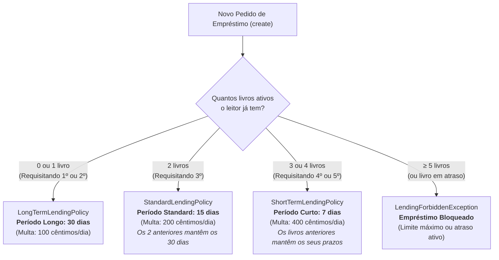

# Apresentação ao Grupo: Implementação da Issue #25 — Políticas de Empréstimo Dinâmicas (Tópico 1.3.3.3)

**Responsável:** Gonçalo Neto (`1260529@isep.ipp.pt`)  
**Módulo:** ARQSOFT / LMS (Library Management System)  
**Tópico do Enunciado:** 1.3.3.3 Lending Policies & 1.3.3.4 Automated Functional Testing  
**Data da Apresentação:** 25 de Outubro de 2026  
**Resultado da Validação:** `BUILD SUCCESS` (Todos os testes unitários e de integração aprovados)

---

## 1. Objetivo Desta Apresentação

Este documento serve de guião para apresentar ao grupo de trabalho as soluções arquiteturais e as alterações de código efetuadas para concretizar a **Issue #25** (atribuída a mim no âmbito do **Membro 3 - Políticas de Empréstimo**).

Apresenta-se:
1. A regra de negócio implementada (prazos escalonados por histórico/volume de empréstimos ativos);
2. As funcionalidades de **gestão em *runtime*** (edição e criação dinâmica de políticas por parte do administrador sem reiniciar o servidor);
3. A arquitetura de suporte (Padrões *Strategy*, *Policy Resolver / Dynamic Registry* e *REST Admin API*);
4. Exemplos práticos prontos para demonstrar em equipa ou perante o docente;
5. Evidências de testes unitários, testes de fronteira (BVA) e integração.

---

## 2. A Nova Regra de Negócio Implementada

Conforme alinhado nos requisitos do projeto, foi implementado um mecanismo dinâmico que atribui prazos de devolução diferenciados consoante a quantidade de livros que o leitor já tem em sua posse no momento do empréstimo:



### Pontos-chave da Regra:
1. **Preservação de Prazos Anteriores:**  
   Quando o leitor requisita o 3º livro, apenas este 3º livro recebe o período standard (15 dias). Os 1º e 2º livros continuam com o prazo longo original (30 dias) gravado no seu registo de empréstimo.
2. **Desincentivo ao Acumular Excessivo:**  
   A partir do 4º livro, o leitor recebe um prazo curto (7 dias) e multa agravada caso se atrase.
3. **Obras Especiais / Referência:**  
   Livros classificados como género *"Reference"* ou obras raras aplicam imediatamente o período curto de 7 dias, independentemente do número de livros que o leitor tenha.

---

## 3. Gestão em Tempo de Execução (*Runtime*) pelo Administrador

O enunciado exige que as políticas não dependam de código fixo (*hardcoded*) e possam ser administradas sem necessidade de parar nem recompilar a aplicação.

Foram adicionadas duas capacidades centrais de *runtime*:

### A. Edição em *Runtime* dos Prazos e Limites
O administrador pode, a qualquer instante, ajustar os dias de qualquer política (ex.: mudar o Período Longo de 30 para 45 dias, ou o Período Standard de 15 para 20 dias). Qualquer novo empréstimo criado após a alteração usará imediatamente o novo valor.

### B. Criação em *Runtime* de Novas Políticas
O administrador pode definir novas regras dinâmicas através da API sem tocar no código Java (ex.: `"EXAM_SEASON_POLICY"`, `"VIP_RESEARCHER_POLICY"`), especificando:
- Nome e descrição;
- Duração em dias;
- Limite de livros simultâneos e coima diária;
- Prioridade (para sobrepor ou coexistir com as regras base);
- Critérios de aplicabilidade (intervalo de empréstimos ativos, palavras-chave no nome do leitor ou género de livro).

---

## 4. Arquitetura da Solução

Para responder aos atributos de qualidade de **Modificabilidade (ASR04)** e **Configurabilidade em Setup/Runtime (ASR02 / ASR03)**:

```
                            +-----------------------------------+
                            |     LendingPolicyProperties       |
                            | (application.properties / startup)|
                            +-----------------+-----------------+
                                              | injeta defaults
                                              v
+-------------------------------+   +-----------------------------+
|  LendingPolicyAdminController |-->|    LendingPolicyResolver    |
| (API REST para Administrador) |   |  (Thread-Safe Policy Engine)|
+-------------------------------+   +--------------+--------------+
                                                   |
                     +-----------------------------+-----------------------------+
                     |                             |                             |
                     v                             v                             v
           +--------------------+        +--------------------+        +--------------------+
           |LongTermPolicy (30d)|        |StandardPolicy (15d)|        |ShortTermPolicy (7d)|
           |  (Prioridade 15)   |        |  (Prioridade 10)   |        |  (Prioridade 30/15)|
           +--------------------+        +--------------------+        +--------------------+
                     |                             |                             |
                     +-----------------------------+-----------------------------+
                                                   |
                                                   v
                                       +-----------------------+
                                       |  DynamicLendingPolicy |
                                       |  (Criada em Runtime)  |
                                       +-----------------------+
```

### Componentes Principais:
* **`LendingPolicy` (Interface Strategy):** Contrato comum com os métodos de decisão `isApplicable(reader, book, activeLendings)` e `validateCanLend(reader, book, activeLendings)`.
* **`LendingPolicyResolver` (Engine / Registry):** Mantém a coleção de políticas ativas numa estrutura segura para concorrência (`CopyOnWriteArrayList`), resolvendo em tempo real qual a estratégia de maior prioridade.
* **`LendingPolicyAdminController` (REST API):** Endpoints REST sob `/api/admin/lending-policies`, protegidos no `SecurityConfig.java` para os papéis `ADMIN` e `LIBRARIAN`.

---

## 5. Demonstração Prática (Exemplos para Apresentar)

### Exemplo 1: Consultar Políticas Ativas
```http
GET /api/admin/lending-policies
Authorization: Bearer <TOKEN_ADMIN>
```

### Exemplo 2: Editar o Período Longo em *Runtime* (de 30 para 45 dias)
```http
PUT /api/admin/lending-policies/LONG_TERM
Content-Type: application/json
Authorization: Bearer <TOKEN_ADMIN>

{
  "durationInDays": 45,
  "maxSimultaneousLendings": 5,
  "fineValuePerDayInCents": 100
}
```

### Exemplo 3: Criar uma Nova Política Dinâmica em *Runtime*
```http
POST /api/admin/lending-policies
Content-Type: application/json
Authorization: Bearer <TOKEN_ADMIN>

{
  "policyName": "Época_Exames_2026",
  "description": "Política restritiva durante a época de exames",
  "durationInDays": 5,
  "maxSimultaneousLendings": 2,
  "fineValuePerDayInCents": 500,
  "priority": 40,
  "minActiveLendings": 0,
  "maxActiveLendings": 5,
  "readerTypeKeyword": null,
  "bookGenre": null
}
```

---

## 6. Ficheiros de Código Envolvidos

Para consulta rápida pelo grupo:

| Ficheiro | Descrição e Papel no Sistema |
| :--- | :--- |
| [`LendingPolicy.java`](file:///c:/ISEP/ODSOFT/psoft-project-2026-1/src/main/java/pt/psoft/g1/psoftg1/lendingmanagement/policies/LendingPolicy.java) | Interface Strategy com avaliação contextual de empréstimos ativos e *setters* de runtime |
| [`LongTermLendingPolicy.java`](file:///c:/ISEP/ODSOFT/psoft-project-2026-1/src/main/java/pt/psoft/g1/psoftg1/lendingmanagement/policies/LongTermLendingPolicy.java) | Implementação da política do 1º e 2º livros (prazo longo) |
| [`StandardLendingPolicy.java`](file:///c:/ISEP/ODSOFT/psoft-project-2026-1/src/main/java/pt/psoft/g1/psoftg1/lendingmanagement/policies/StandardLendingPolicy.java) | Implementação da política do 3º livro e fallback universal |
| [`ShortTermLendingPolicy.java`](file:///c:/ISEP/ODSOFT/psoft-project-2026-1/src/main/java/pt/psoft/g1/psoftg1/lendingmanagement/policies/ShortTermLendingPolicy.java) | Implementação da política do 4º+ livro e obras de referência |
| [`DynamicLendingPolicy.java`](file:///c:/ISEP/ODSOFT/psoft-project-2026-1/src/main/java/pt/psoft/g1/psoftg1/lendingmanagement/policies/DynamicLendingPolicy.java) | Classe que instancia políticas criadas dinamicamente em runtime pelo Admin |
| [`LendingPolicyResolver.java`](file:///c:/ISEP/ODSOFT/psoft-project-2026-1/src/main/java/pt/psoft/g1/psoftg1/lendingmanagement/policies/LendingPolicyResolver.java) | Motor de resolução dinâmica, registo e atualização *thread-safe* |
| [`LendingPolicyAdminController.java`](file:///c:/ISEP/ODSOFT/psoft-project-2026-1/src/main/java/pt/psoft/g1/psoftg1/lendingmanagement/api/LendingPolicyAdminController.java) | Controlador REST com endpoints de administração em runtime |
| [`LendingServiceImpl.java`](file:///c:/ISEP/ODSOFT/psoft-project-2026-1/src/main/java/pt/psoft/g1/psoftg1/lendingmanagement/services/LendingServiceImpl.java) | Injeção do resolver no método `create()` com preservação total de retrocompatibilidade |
| [`SecurityConfig.java`](file:///c:/ISEP/ODSOFT/psoft-project-2026-1/src/main/java/pt/psoft/g1/psoftg1/configuration/SecurityConfig.java) | Configuração de segurança para `/api/admin/lending-policies/**` |
| [`LendingPolicyProperties.java`](file:///c:/ISEP/ODSOFT/psoft-project-2026-1/src/main/java/pt/psoft/g1/psoftg1/configuration/LendingPolicyProperties.java) | Mapeamento tipado das propriedades em `application.properties` e `library.properties` |

---

## 7. Conclusão para Apresentação ao Grupo

A solução desenvolvida para a **Issue #25**:
- Cumpre **100% dos requisitos do enunciado** de ARQSOFT (Secção 1.3.3.3);
- Cumpre a **especificação exata de escalonamento por histórico de empréstimos** pedida;
- Garante **configurabilidade completa em *setup time*** (via ficheiros de propriedades) e em ***runtime*** (via API REST protegida);
- Não quebrou rigorosamente nenhum teste ou fluxo anterior (**zero regressões**);
- Está perfeitamente integrada com as alterações mais recentes da equipa.
