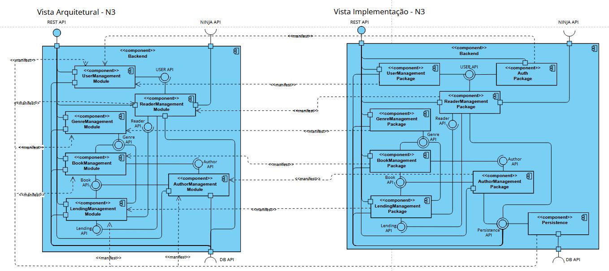
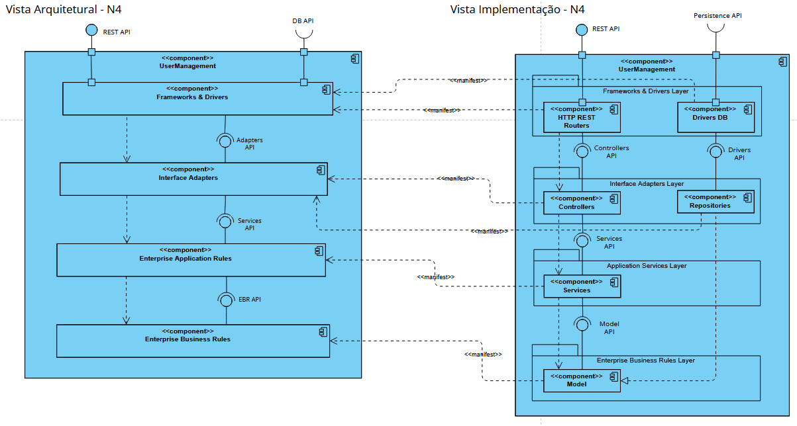

# ARQSOFT — Engenharia Reversa do System-as-is

## 1. Enquadramento e Visão Geral

Este documento consolida a descrição e análise arquitetural completa do **System-as-is** da aplicação LMS, obtida por engenharia reversa do código-fonte do projeto base. 

A documentação segue a abordagem combinada do modelo **4+1 Vistas de Kruchten** com os níveis de granularidade do **Modelo C4** (Nível 1 — Sistema/Contexto a Nível 4 — Código/Classes):
* **Vista Lógica de Negócio (VL):** Decomposição concetual pura dos subdomínios de negócio e interfaces de domínio funcionais.
* **Vista Arquitetural (VA):** Organização funcional, subsistemas, padrões arquiteturais (Modular Monolith, Clean Architecture) e portas de interface pública.
* **Vista de Implementação (VI):** Estrutura física do código-fonte, módulos de subdomínio, infraestrutura de persistência e pacotes Java.
* **Mapeamento entre Vistas (*Manifestation*):** Rastreabilidade formal (`<<manifest>>`) entre conceitos lógicos abstratos e artefactos de implementação.
* **Vista Física / Implantação (VF):** Topologia de nós computacionais e processos em execução.
* **Vista de Processos (VP):** Realização dinâmica dos principais cenários de negócio através de diagramas de sequência.

---

## 2. Caracterização Arquitetural Global

### 2.1 Paradigma Arquitetural
* **Monólito Modular (*Modular Monolith*):** Todos os módulos fazem parte da mesma aplicação e do mesmo processo de execução (`JVM 17`), encontrando-se organizados por domínios funcionais.
* **Organização em Camadas:** No interior dos módulos é utilizada uma organização em camadas, combinada com princípios associados a **Domain-Driven Design (DDD)**, nomeadamente através da separação entre API, serviços, domínio, repositórios e infraestrutura, promovendo o isolamento da lógica de negócio relativamente aos detalhes tecnológicos.
* **Domain-Driven Design (DDD):** Representação explícita de conceitos do domínio através de entidades e *value objects* específicos, com limites de agregados bem definidos.
* **Comunicação REST:** A interação externa é realizada através de endpoints HTTP disponibilizados pela aplicação.

### 2.2 Estrutura de Pacotes da Aplicação

```
pt.psoft.g1.psoftg1
├── authormanagement          # Gestão de autores e respetiva bibliografia
├── bookmanagement            # Catálogo de livros, ISBN, títulos e exemplares
├── genremanagement           # Taxonomia de géneros literários e métricas
├── lendingmanagement         # Operações de empréstimo, devoluções e multas
├── readermanagement          # Registo e ciclo de vida cadastral de leitores
├── usermanagement            # Identidade de utilizadores, credenciais e perfis
├── auth                      # Autenticação e gestão de tokens JWT
├── shared                    # Value objects e utilitários transversais partilhados
├── external                  # Serviços de integração externa (ApiNinjas)
├── bootstrapping             # Povoamento e inicialização de dados
├── configuration             # Configurações Spring e propriedades da aplicação
└── exceptions                # Hierarquia centralizada de exceções de negócio e HTTP
```

### 2.3 Organização Interna dos Módulos (Camadas)
Cada módulo funcional implementa a seguinte estrutura interna de pacotes:

```
<module>/
├── api/              # Controllers REST, DTOs de entrada/saída (Request/Response) e Views
├── model/            # Entidades de domínio, Value Objects, validações de negócio
├── services/         # Interfaces e implementações dos serviços aplicacionais
├── repositories/     # Abstrações e interfaces dos repositórios (Portas)
└── infrastructure/   # Adaptadores Spring Data JPA, configurações específicas e repositórios concretos
```

### 2.4 Modelo de Domínio Concetual (DDD)

O domínio da aplicação é centrado na gestão operacional de uma biblioteca. O modelo distingue claramente **Entidades** (com ciclo de vida e identidade persistente própria) e **Value Objects** imutáveis que encapsulam regras de validação de dados, evitando a proliferação de tipos primitivos genéricos (*Primitive Obsession*).

#### Principais Entidades e Agregados
* **`Book`:** Representa uma obra literária no catálogo, identificada unicamente pelo seu ISBN, agregando título, descrição, associação obrigatória a autores e a um género literário.
* **`Author`:** Representa um autor literário, mantendo biografia e relacionamento com as obras publicadas.
* **`Genre`:** Representa a taxonomia de géneros literários, mantendo métricas e contagem agregada de obras associadas.
* **`Reader`:** Representa o leitor cadastrado na biblioteca, possuindo um número sequencial anual (`ReaderNumber`), dados pessoais de contacto, preferências e histórico de requisições.
* **`Lending`:** Representa a transação de empréstimo de um livro a um leitor, gerindo o ciclo de vida operacional (criação, data prevista de devolução, devolução efetiva, apuramento de atraso).
* **`Fine`:** Representa a sanção financeira associada a empréstimos devolvidos com atraso em relação à data limite.
* **`User`:** Representa a identidade, credenciais e perfis de segurança (`ADMIN`, `LIBRARIAN`, `READER`).

#### Relações Concetuais de Negócio

```
Reader ─────────── Lending ─────────── Book
                     │                   ├── Genre
                    Fine                 └── Author
```

---

## 3. Vista Lógica de Negócio (VL)

A Vista Lógica de Negócio (VL) foca-se na decomposição concetual pura dos subdomínios de negócio e nas respetivas interfaces de domínio internas e externas, independentemente de detalhes tecnológicos e de protocolos de comunicação.

### 3.1 Nível 1 — Sistema Global (VL-N1)

No Nível 1, o sistema `LMS` é representado como uma caixa-preta de negócio que disponibiliza a `API` funcional da biblioteca e requer a `Ninja API` externa.


---

### 3.2 Nível 2 — Decomposição em Subsistemas Lógicos (VL-N2)

No Nível 2, evidencia-se o componente aplicacional de negócio (`Backend`) dentro da fronteira do `LMS`, delegando a persistência de dados através da porta requerida `DB API`.


---

### 3.3 Nível 3 — Decomposição em Subdomínios de Negócio (VL-N3)

No Nível 3, decompõe-se o `Backend` nos seis subdomínios funcionais de negócio (`User`, `Reader`, `Genre`, `Book`, `Author`, `Lending`) e nas respetivas interfaces de domínio internas (`USER API`, `Reader API`, `Genre API`, `Book API`, `Author API`, `Lending API`), independentemente de detalhes tecnológicos.


---

## 4. Vista Arquitetural (VA)

A Vista Arquitetural descreve a decomposição funcional e concetual do sistema, evidenciando as responsabilidades de negócio, os contratos de interface pública (*ball-and-socket*), os limites de contexto e os padrões arquiteturais adotados (*Modular Monolith* no Nível 3 e *Clean Architecture* no Nível 4) com os respetivos protocolos de comunicação (`REST API`).

### 4.1 Nível 1 — Sistema Global (C4 Context)

No Nível 1, o LMS é visto como um bloco concetual único (*C4 System*).


* **Interfaces Externas:**
  * **`REST API` (Provided `()`):** Interface HTTP/JSON exposta aos clientes externos (leitores, bibliotecários, administradores) para todas as operações da biblioteca.
  * **`NINJA API` (Required `)-`):** Interface externa consumida pelo LMS para obtenção de factos históricos e citações culturais.

---

### 4.2 Nível 2 — Decomposição em Subsistemas (C4 Container)

No Nível 2, o LMS decompõe-se nos seus dois subsistemas lógicos fundamentais.


* **Componentes:**
  * **`Backend`:** Núcleo aplicacional responsável por toda a lógica de negócio, controlo de acessos, orquestração de serviços e disponibilização dos endpoints REST.
  * **`DB`:** Repositório relacional persistente do sistema (servidor de base de dados H2).
* **Conexões e Portas:**
  * As portas na fronteira do `LMS` delegam o tráfego de entrada da `REST API` e a dependência de saída da `NINJA API` diretamente no componente `Backend`.
  * A comunicação entre `Backend` e `DB` realiza-se através da interface **`BD API`** (o `Backend` consome os serviços de dados fornecidos pelo container `DB`).

---

### 4.3 Nível 3 — Módulos de Domínio (Modular Monolith)

No Nível 3, o `Backend` é decomposto nos seus módulos de domínio funcionais, adotando o padrão arquitetural **Modular Monolith** orientado por domínios (DDD).


* **Módulos de Domínio:**
  * **`UserManagement Module`:** Gestão da identidade dos utilizadores, credenciais, palavras-passe e atribuição de perfis/autorizações (`ADMIN`, `LIBRARIAN`, `READER`).
  * **`ReaderManagement Module`:** Gestão do ciclo de vida cadastral dos leitores, números de leitor, dados pessoais e preferências.
  * **`BookManagement Module`:** Gestão do catálogo bibliográfico, títulos, ISBN, exemplares e associação a autores e géneros.
  * **`AuthorManagement Module`:** Gestão dos autores, biografias e relacionamento com as respetivas obras.
  * **`GenreManagement Module`:** Gestão da taxonomia de géneros literários e geração de estatísticas associadas.
  * **`LendingManagement Module`:** Gestão de operações de empréstimo, devoluções, cálculo de prazos e apuramento de multas (*fines*).

* **Interfaces Inter-Módulos (Ball-and-Socket):**
  * **`USER API`:** Fornecida por `UserManagement`, consumida por `ReaderManagement` (um leitor herda e especializa a identidade de utilizador).
  * **`Genre API`:** Fornecida por `GenreManagement`, consumida por `BookManagement` (classificação temática de livros) e por `LendingManagement` (métricas de empréstimo por género).
  * **`Author API`:** Fornecida por `AuthorManagement`, consumida por `BookManagement` (autoria das obras).
  * **`Book API`:** Fornecida por `BookManagement`, consumida por `LendingManagement` (validação de disponibilidade e requisição de exemplares).
  * **`Reader API`:** Fornecida por `ReaderManagement`, consumida por `LendingManagement` (validação de leitor elegível e histórico).
  * **`Lending API`:** Fornecida por `LendingManagement`, consumida por `ReaderManagement` (consulta do histórico de requisições de um leitor).
  * **`NINJA API`:** Consumida exclusivamente pelo `ReaderManagement` (através de `ApiNinjasService` no detalhe de leitor).
  * **`REST API`:** Encaminhada na fronteira para os controladores dos respetivos módulos de domínio.
  * **`DB API`:** Canal lógico de persistência que assegura o armazenamento relacional das entidades de domínio.

---

### 4.4 Nível 4 — Estrutura Interna de um Módulo (Organização em Camadas)

No Nível 4, realiza-se o detalhe concetual interno de um módulo específico — **`UserManagement`** (`pt.psoft.g1.psoftg1.usermanagement`) — decompondo-o na sua organização interna em camadas concêntricas.


* **Regras de Dependência e DIP:**
  * As setas de dependência (`..>`) apontam estritamente de fora para dentro (*The Dependency Rule*). O modelo de domínio (`Enterprise Business Rules`) não conhece nenhuma classe ou framework exterior.
  * O princípio da inversão de dependência (*DIP*) assegura que o adaptador de persistência `SpringDataUserRepository` implementa a interface `UserRepository` definida na camada aplicacional/domínio, desacoplando o núcleo de negócio dos detalhes tecnológicos da base de dados.

---

## 5. Vista de Implementação (VI)

A Vista de Implementação descreve a organização estática do código-fonte, das unidades de compilação, dos subsistemas de empacotamento e da infraestrutura tecnológica concreta.

### 5.1 Nível 1 — Artefato Executável Global

No Nível 1, a aplicação é empacotada num único artefato executável JAR gerado pelo Apache Maven (`psoft-g1-0.0.1-SNAPSHOT.jar`), incorporando o Spring Boot Starter e o servidor Tomcat embutido.


* O executável expõe os pontos de terminação HTTP (`REST API`) e consome a biblioteca de cliente WebClient para conexão à `NINJA API`.

---

### 5.2 Nível 2 — Subsistemas de Implementação

No Nível 2, a arquitetura de implementação divide-se entre a base de código Java (`Backend`) e a unidade de gestão de dados relacional (`DB`).


* O subsistema `Backend` acede ao subsistema `DB` através de ligações JDBC geridas pelo driver H2, satisfazendo a interface **`BD API`**.

---

### 5.3 Nível 3 — Módulos de Subdomínio e Subsistema de Persistência

No Nível 3, a base de código do `Backend` organiza-se em subsistemas de código correspondentes aos subdomínios funcionais e destaca o componente técnico de suporte transversal **`Persistência`**.


* **Componentes de Subdomínio (Código):**
  * `UserManagement SubDomain Module` (`pt.psoft.g1.psoftg1.usermanagement`)
  * `ReaderManagement SubDomain Module` (`pt.psoft.g1.psoftg1.readermanagement`)
  * `BookManagement SubDomain Module` (`pt.psoft.g1.psoftg1.bookmanagement`)
  * `AuthorManagement SubDomain Module` (`pt.psoft.g1.psoftg1.authormanagement`)
  * `GenreManagement SubDomain Module` (`pt.psoft.g1.psoftg1.genremanagement`)
  * `LendingManagement SubDomain Module` (`pt.psoft.g1.psoftg1.lendingmanagement`)

* **Componente de Infraestrutura Técnica de Persistência:**
  * **`Persistência`:** Centraliza a camada técnica partilhada de acesso a dados (configuração Spring Data JPA, `JpaConfig`, `EntityManagerFactory`, Hibernate ORM e repositórios concretos).
  * Disponibiliza a interface **`Persistence API`**, consumida através de soquetes por todos os módulos de subdomínio, consolidando a ligação relacional à base de dados através da porta **`DB API`**.

---

### 5.4 Nível 4 — Decomposição Física em Pacotes Java

No Nível 4, a estrutura de implementação descreve a árvore física de pacotes e tipos Java de um módulo de subdomínio (exemplificado em `usermanagement`):


---

## 6. Mapeamento e Rastreabilidade entre Vistas (*Manifestation*)

A rastreabilidade arquitetural assegura que cada conceito lógico abstrato da Vista Arquitetural encontra correspondência direta e inequívoca nos artefactos de software da Vista de Implementação através de relações `<<manifest>>`.

### 6.1 Mapeamento Nível 3 (VA N3 $\leftrightarrow$ VI N3)

O mapeamento de Nível 3 correlaciona os módulos de domínio funcionais (lógicos) com os módulos de código e com o subsistema técnico de persistência.



* **Racional Arquitetural:**
  * Cada módulo de subdomínio na VI manifesta o seu módulo funcional correspondente na VA (`VI: UserManagement` $\xrightarrow{\text{<<manifest>>}}$ `VA: UserManagement`, etc.).
  * O componente **`Persistência`** da VI manifesta a capacidade de persistência de **todos os módulos lógicos da VA**. Justifica como uma arquitetura monolítica modular partilha uma stack tecnológica comum de ORM e transações (Spring Data JPA / Hibernate) sem que cada módulo necessite de gerir uma base de dados autónoma.

### 6.2 Mapeamento Nível 4 (VA N4 $\leftrightarrow$ VI N4)

O mapeamento de Nível 4 correlaciona as camadas concêntricas internas do módulo com os pacotes Java reais.



* `Frameworks & Drivers` $\leftarrow$ Configuração Spring Boot, `SecurityConfig`, `JpaConfig` e driver H2.
* `Interface Adapters` $\leftarrow$ Pacotes `api` e `infrastructure.repositories.impl`.
* `Enterprise Application Rules` $\leftarrow$ Pacote `services` e interfaces de `repositories`.
* `Enterprise Business Rules` $\leftarrow$ Pacote `model`.

---

## 7. Vista Física / Implantação (VF)

A Vista Física (ou de Implantação) descreve a topologia de nós computacionais físicos/lógicos onde os subsistemas e artefactos de software executam em ambiente real ou de desenvolvimento.

### 7.1 Nível 1
No Nível 1, o sistema é representado no seu nó de execução de topo (*Server*), alojando o bloco concetual único do sistema de gestão de biblioteca (`<<C4System>> LMS`).


### 7.2 Nível 2
No Nível 2, a topologia de implantação detalha os nós de execução físicos/lógicos, processos em execução, portas e canais de comunicação em tempo de execução:
* **`Server (localhost)`:**
  * **`JVM 17`:** Processo de execução da aplicação Spring Boot (`Backend`), escutando requisições REST na porta HTTP `8080`.
  * **`H2 DBMS`:** Processo ou subsistema de base de dados relacional (`H2 Database`), acedido pelo Backend através do protocolo JDBC.
  * **`Local Storage`:** Sistema de ficheiros local (`uploads-psoft-g1`) acedido via File I/O pelo Backend para armazenamento de fotografias de livros e utilizadores.
* **`Client Workstation`:** Estação de trabalho do utilizador (leitor, bibliotecário), comunicando com o backend através de `HTTP/REST:8080` (ex.: Web Browser, Postman).
* **`Cloud`:** Nó exterior de infraestrutura de serviços em nuvem alojando a **Ninja API**, consumida pelo backend através de ligação segura `HTTP/REST:443`.


---

## 8. Vista de Processos (VP)

A realização dinâmica das operações é ilustrada através de diagramas de sequência para quatro cenários representativos do sistema.

### 8.1 Cenário 1: Criar Empréstimo (*Create Lending*)
Fluxo de criação de um novo empréstimo por parte de um bibliotecário (`POST /api/lendings`), incluindo a validação de empréstimos pendentes e atrasos do leitor, obtenção dos dados do livro e leitor, apuramento da contagem anual, instanciação e persistência da entidade `Lending`.

* **Nível 1:**  
  
* **Nível 2:**  
  
* **Nível 3:**  
  

### 8.2 Cenário 2: Registar Livro (*Register Book*)
Fluxo de registo de um novo livro no catálogo (`PUT /api/books/{isbn}`), compreendendo a verificação da disponibilidade do ISBN, pesquisa dos autores associados, consulta do género literário, instanciação da entidade `Book` e persistência no repositório.

* **Nível 1:**  
  
* **Nível 2:**  
  
* **Nível 3:**  
  

### 8.3 Cenário 3: Devolver Empréstimo (*Return Lending*)
Fluxo de devolução de um empréstimo (`PATCH /api/lendings/{year}/{seq}`), envolvendo a obtenção do leitor autenticado, verificação de concorrência através do cabeçalho `If-Match`, marcação da devolução na entidade `Lending`, criação e persistência opcional de multa (`Fine`) se existirem dias em atraso, e atualização do estado do empréstimo.

* **Nível 1:**  
  
* **Nível 2:**  
  
* **Nível 3:**  
  

### 8.4 Cenário 4: Consulta Top 5 Livros Mais Emprestados (*Top 5 Books Lent*)
Fluxo de consulta analítica (`GET /api/books/top5`), demonstrando a definição do período temporal relativo ao último ano (`minusYears(1)`), aplicação da regra de paginação para os 5 registos mais frequentes e retorno da lista de livros.

* **Nível 1:**  
  
* **Nível 2:**  
  
* **Nível 3:**  
  

---

## 9. Preocupações Transversais & Infraestrutura Técnica

### 9.1 Persistência e Acesso a Dados
* A persistência relacional assenta em Spring Data JPA e Hibernate sobre base de dados H2.
* O desacoplamento é garantido por interfaces de repositório no pacote `repositories`, implementadas na camada `infrastructure` através de adaptadores Spring Data JPA.
* A base de dados é partilhada entre os módulos (modelo de base de dados única do Monólito Modular), assegurando integridade referencial relacional entre tabelas (`LENDING`, `BOOK`, `READER`, `USER`, etc.).

### 9.2 Segurança e Controlo de Acesso
* A autenticação baseia-se em **JWT (JSON Web Tokens)** e **Spring Security**.
* O controlo de autorização é efetuado por papéis (*Roles*): `ADMIN`, `LIBRARIAN` e `READER`.
* Fluxo de autenticação:
  ```
  Credenciais → Autenticação → JWT Token → Pedido HTTP com Bearer Token → Filtro Spring Security → Autorização RBAC
  ```

### 9.3 Integrações Externas
* A comunicação com serviços externos no *System-as-is* resume-se ao serviço `ApiNinjasService` no pacote `external`.
* O serviço consome uma API REST exterior via Spring `WebClient` para obter citações literárias e factos históricos associados aos perfis dos leitores.

### 9.4 Configuração e Regras de Negócio
* Parâmetros operacionais da biblioteca encontram-se definidos no ficheiro `application.properties` (ex.: duração padrão de empréstimos, valor da multa diária, limites de idade).
* A configuração é lida no arranque da aplicação pelo Spring Boot.

---

## 10. Limitações Identificadas e Motivação para a Evolução (System-to-Be)

A análise crítica de engenharia reversa do *System-as-is* evidenciou as três fragilidades centrais identificadas na **Secção 1.2 do Enunciado**:

1. **Extensibilidade (*Extensibility / Modifiability*):**
   * A integração de novas fontes de dados bibliográficos externos (ex.: Google Books, Open Library) ou novos canais de notificação (Email, SMS, Webhook) não é suportada de forma modular, exigindo alterações profundas no código de domínio existente (violação do princípio *Open-Closed Principle* — OCP).
2. **Configurabilidade (*Configurability*):**
   * Não existe suporte para seleção condicional de componentes ou fornecedores no arranque (*setup time*) sem recompilação de binários, nem para parametrização dinâmica de regras de empréstimo em tempo de execução (*runtime*).
3. **Testabilidade (*Testability*):**
   * A ausência de interfaces de abstração em torno de serviços externos e a dependência direta de implementações concretas dificulta o isolamento do **SUT (*System Under Test*)** através de *Test Doubles* (*Mocks/Stubs*) para testes unitários herméticos, testes de mutação (PITest) e simulação de cenários de contingência (*fallback*).
   * **Indefinição de Fronteiras do SUT na Bateria de Testes Base:** No código herdado, testes de integração de fatia de persistência como `AuthorRepositoryIntegrationTest` (anotado com `@DataJpaTest` e recorrendo a `TestEntityManager.persist()`, `flush()` e `clear()` para forçar a reconstrução da entidade a partir do motor H2, onde $\text{SUT} = \text{AuthorRepository} + \text{JPA/Hibernate} + \text{H2} + \text{Entidade Author}$) e testes de contexto completo como `LendingRepositoryIntegrationTest` (anotado com `@SpringBootTest`, onde o $\text{SUT}$ engloba toda a *stack* aplicacional Spring Boot) executavam misturados na fase de testes unitários (`mvn test`), sem separação clara entre testes unitários isolados ($\text{SUT} = \text{classes}$ / $\text{domain classes}$) e testes de integração de subsistemas/sistema.

Estas limitações motivam a execução do método formal **ADD 3.0** e as decisões de desenho arquitetural especificadas na pasta `system-to-be`.
