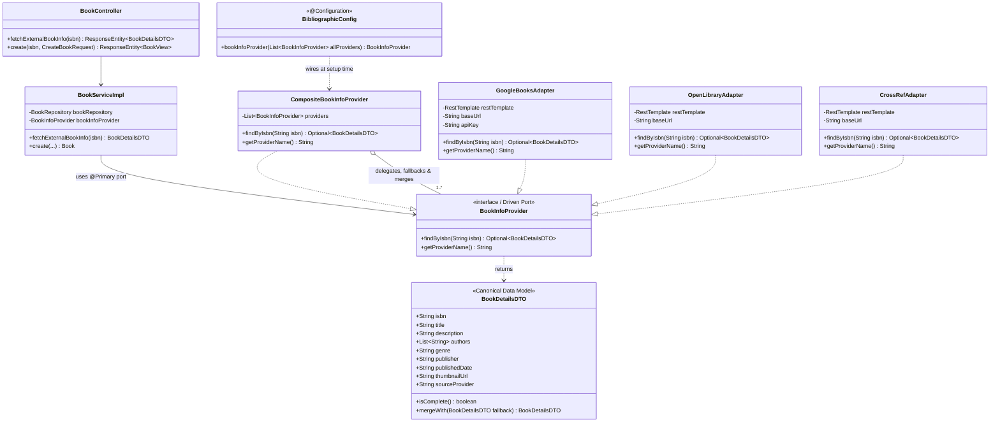
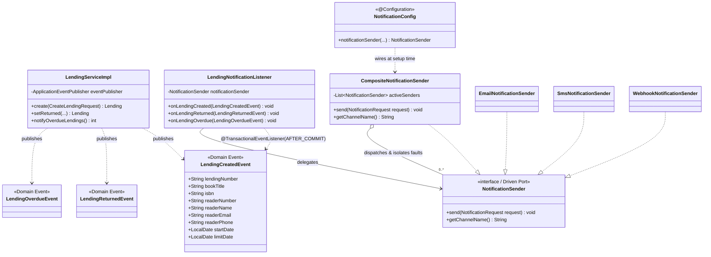
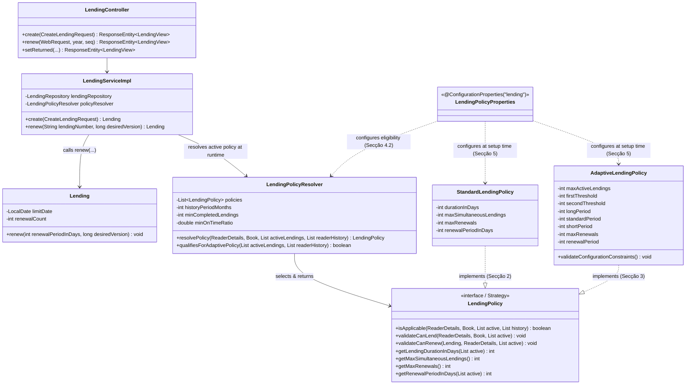

# ARQSOFT — Processo Attribute-Driven Design (ADD 3.0) para o System-to-Be

## 1. Enquadramento do Processo ADD 3.0 (Secção 1.3.2 do Enunciado)

A evolução arquitetural do LMS (`psoft-g1`) segue o método **Attribute-Driven Design (ADD 3.0)** em contexto *Brownfield* (*Design for an Existing System*), estruturado em três fases conforme a **Secção 1.3.2 do Enunciado**:
1. **1.3.2.1 Inputs:** Requisitos funcionais (`FR01`–`FR04`), cenários de atributos de qualidade (`ASR01`–`ASR07`), restrições técnicas (`TC01`–`TC05`), limitações organizacionais (`OL01`–`OL04`) e arquitetura existente ([`system-as-is.md`](../System-as-is/system-as-is.md)).
2. **1.3.2.2 Iterations:** Execução dos **Passos 2 a 7 do ADD 3.0** ao longo de **3 iterações**, abordando sequencialmente:
   * **Iteração 1:** Integração de Fontes Bibliográficas Externas (`1.3.3.1`);
   * **Iteração 2:** Notificações Multicanal a Leitores Baseadas em Eventos (`1.3.3.2`);
   * **Iteração 3:** Políticas de Empréstimo e Renovação Parametrizáveis e Dinâmicas (`1.3.3.3` & Especificação v1.0).
3. **1.3.2.3 Outputs:** Elementos instanciados, interfaces de contrato, vistas arquiteturais atualizadas e verificação dos drivers.

*(Nota: A avaliação comparativa detalhada das alternativas rejeitadas `A1.1–A3.3` e as vistas completas do System-to-Be encontram-se em [`design-alternatives-and-rationale.md`](./design-alternatives-and-rationale.md)).*

---

## 2. Passo 1: Rever as Entradas do ADD (*Review Inputs* — 1.3.2.1)

A tabela seguinte resume o catálogo de entradas validadas no Passo 1 (detalhadas em [`architectural-factors.md`](./architectural-factors.md)):

| Categoria de Entrada | Identificadores | Resumo | Prioridade |
| :--- | :--- | :--- | :---: |
| **Requisitos Funcionais** | `FR01`, `FR02`, `FR03`, `FR04` | Fontes bibliográficas (Google Books, Open Library, CrossRef), notificações (Email, SMS, Webhook), políticas de empréstimo/renovação (`Standard` e `Adaptive`) e serviços base do LMS. | `(H, H)` |
| **Atributos de Qualidade (ASRs)** | `ASR01`–`ASR07` | Extensibilidade (`ASR01`), Configurabilidade em *Setup Time* (`ASR02`) e *Runtime* (`ASR03`), Testabilidade Offline (`ASR04`), Interoperabilidade (`ASR05`), Resiliência (`ASR06`) e Desempenho Pós-Commit (`ASR07`). | `(H, H)` a `(M, M)` |
| **Restrições Técnicas** | `TC01`–`TC05` | Java 17 / Spring Boot 3.2.5 (`TC01`), Monólito Modular DDD (`TC02`), JPA/H2 ACID (`TC03`), REST/JSON (`TC04`) e Testes 100% Offline (`TC05`). | Obrigatórias |
| **Limitações do System-as-is** | `L01`–`L05` | Ausência de portas bibliográficas (`L01`), ausência de eventos/notificações (`L02`), regras de empréstimo fixas em código (`L03`), acoplamento a `WebClient` (`L04`) e mistura de âmbitos de teste (`L05`). | Alvos de Refinamento |

---

## 3. Iteração 1: Integração de Fontes Bibliográficas Externas (1.3.3.1)

### Passo 2: Estabelecer Objetivo da Iteração e Selecionar Drivers
* **Objetivo:** Dotar o módulo `bookmanagement` da capacidade de obter metadados bibliográficos de múltiplos sistemas externos heterogéneos (**Google Books API**, **Open Library API** e **CrossRef API**), selecionando as fontes em *setup time*, fundindo subconjuntos de metadados e suportando novas fontes com impacto limitado.
* **Drivers Selecionados:** `FR01`, `ASR01` (Extensibilidade), `ASR02` (Configurabilidade em *Setup Time*), `ASR04` (Testabilidade), `ASR05` (Interoperabilidade), `ASR06` (*Fallback* e Fusão), `TC01`, `TC02`, `TC05`.

### Passo 3: Escolher Elementos do Sistema a Refinar
* **Elemento Alvo:** Subdomínio **`bookmanagement`** (`pt.psoft.g1.psoftg1.bookmanagement`), especificamente `BookServiceImpl` e a fronteira de integração externa (`services.external` e `infrastructure.external`), articulados com `configuration`.

### Passo 4: Escolher Conceitos de Desenho
* **Decisão Selecionada (`A1.3` — ver [`design-alternatives-and-rationale.md`](./design-alternatives-and-rationale.md#21-iteração-1--integração-de-fontes-bibliográficas-externas-1331)):**
  * **Arquitetura de Referência:** *Clean / Hexagonal Architecture (Ports and Adapters)*.
  * **Padrões:** *Adapter* (`GoogleBooksAdapter`, `OpenLibraryAdapter`, `CrossRefAdapter`), *Composite / Fallback & Merge Chain* (`CompositeBookInfoProvider`), *Canonical Data Model* (`BookDetailsDTO`) e *Setup-Time Factory* (`BibliographicConfig`).
  * **Táticas SEI:** *Abstract Common Services*, *Encapsulate*, *Use an Intermediary*, *Defer Binding (Configuration Files)*, *Degradation / Fallback*.

### Passo 5: Instanciar Elementos Arquiteturais, Atribuir Responsabilidades e Definir Interfaces



#### Atribuição de Responsabilidades (Iteração 1)

| Elemento Instanciado | Camada / Pacote | Responsabilidade | Drivers Satisfeitos |
| :--- | :--- | :--- | :--- |
| [`BookInfoProvider`](../../../src/main/java/pt/psoft/g1/psoftg1/bookmanagement/services/external/BookInfoProvider.java) | `bookmanagement.services.external` | Porta de saída (*Driven Port*) para obtenção de metadados bibliográficos por ISBN. | `ASR01`, `ASR04`, `TC02` |
| [`BookDetailsDTO`](../../../src/main/java/pt/psoft/g1/psoftg1/bookmanagement/services/external/BookDetailsDTO.java) | `bookmanagement.services.external` | Modelo canónico imutável com verificação de completude (`isComplete()`) e fusão campo-a-campo (`mergeWith`). | `FR01`, `ASR05` |
| [`GoogleBooksAdapter`](../../../src/main/java/pt/psoft/g1/psoftg1/bookmanagement/infrastructure/external/GoogleBooksAdapter.java) | `bookmanagement.infrastructure.external` | Adaptador REST para Google Books API (`/volumes?q=isbn:{isbn}`, com suporte opcional a `GOOGLE_BOOKS_API_KEY`). | `FR01`, `ASR01`, `ASR05` |
| [`OpenLibraryAdapter`](../../../src/main/java/pt/psoft/g1/psoftg1/bookmanagement/infrastructure/external/OpenLibraryAdapter.java) | `bookmanagement.infrastructure.external` | Adaptador REST para Open Library API (`/api/books?bibkeys=ISBN:{isbn}&format=json&jscmd=data`). | `FR01`, `ASR01`, `ASR05` |
| [`CrossRefAdapter`](../../../src/main/java/pt/psoft/g1/psoftg1/bookmanagement/infrastructure/external/CrossRefAdapter.java) | `bookmanagement.infrastructure.external` | Adaptador REST para CrossRef API (`/works?filter=isbn:{isbn}`), demonstrando a inclusão de uma 3.ª fonte com zero impacto em classes existentes. | `FR01`, `ASR01`, `ASR05` |
| [`CompositeBookInfoProvider`](../../../src/main/java/pt/psoft/g1/psoftg1/bookmanagement/infrastructure/external/CompositeBookInfoProvider.java) | `bookmanagement.infrastructure.external` | Intermediário `@Primary` que consulta as fontes ativas pela ordem configurada, aplicando *fallback* em caso de erro e fusão de campos quando incompleto. | `FR01`, `ASR06` |
| [`BibliographicConfig`](../../../src/main/java/pt/psoft/g1/psoftg1/configuration/BibliographicConfig.java) | `configuration` | Descobre automaticamente todos os beans `BookInfoProvider` (`List<BookInfoProvider>`) e seleciona/ordena os ativos segundo `bibliographic.providers`. | `FR01`, `ASR02` |

#### Contrato de Interface e Configuração (Iteração 1)
```java
public interface BookInfoProvider {
    Optional<BookDetailsDTO> findByIsbn(String isbn);
    String getProviderName();
}
```
```properties
# application.properties — Seleção declarativa em setup time (1.3.3.1)
bibliographic.providers=${BIBLIOGRAPHIC_PROVIDERS:googlebooks,openlibrary}
bibliographic.googlebooks.base-url=https://www.googleapis.com/books/v1/volumes
bibliographic.googlebooks.api-key=${GOOGLE_BOOKS_API_KEY:}
bibliographic.openlibrary.base-url=https://openlibrary.org/api/books
bibliographic.crossref.base-url=https://api.crossref.org/works
```

### Passos 6 e 7: Esboçar Vistas e Verificar Conclusão da Iteração 1
* **Evidência de Extensibilidade (`ASR01`):** A adição do [`CrossRefAdapter`](../../../src/main/java/pt/psoft/g1/psoftg1/bookmanagement/infrastructure/external/CrossRefAdapter.java) exigiu apenas a criação da classe anotada com `@Component("crossref")`, sendo descoberta automaticamente por `BibliographicConfig` via `List<BookInfoProvider>` com **0 linhas modificadas** em `BookServiceImpl`, `CompositeBookInfoProvider` ou nas entidades de domínio.
* **Evidência de Testes (`ASR04`):** Validado por `GoogleBooksAdapterTest` (7), `OpenLibraryAdapterTest` (10), `CrossRefAdapterTest` (8), `CompositeBookInfoProviderTest` (6), `BibliographicConfigTest` (7), `BookDetailsDTOTest` (8) e `BookExternalInfoIT` (5).

---

## 4. Iteração 2: Notificações Multicanal a Leitores Baseadas em Eventos (1.3.3.2)

### Passo 2: Estabelecer Objetivo da Iteração e Selecionar Drivers
* **Objetivo:** Notificar os leitores sobre eventos relevantes de empréstimos (criação, devolução e atraso), formatando a mensagem segundo o canal (**Email**, **SMS**, **Webhook**), selecionando os canais ativos em *setup time* e isolando falhas por canal sem impactar a transação JPA do empréstimo.
* **Drivers Selecionados:** `FR02`, `ASR01` (Extensibilidade), `ASR02` (Configurabilidade em *Setup Time*), `ASR04` (Testabilidade), `ASR06` (Isolamento de Falhas), `ASR07` (Desacoplamento Pós-Commit), `TC01`, `TC02`, `TC03`, `TC05`.

### Passo 3: Escolher Elementos do Sistema a Refinar
* **Elementos Alvo:** Subdomínio **`lendingmanagement`** (publicação de eventos de domínio em `LendingServiceImpl`) e novo módulo **`notificationmanagement`** (`services`, `listeners`, `infrastructure`), articulados com `configuration`.

### Passo 4: Escolher Conceitos de Desenho
* **Decisão Selecionada (`A2.3` — ver [`design-alternatives-and-rationale.md`](./design-alternatives-and-rationale.md#22-iteração-2--notificações-multicanal-a-leitores-1332)):**
  * **Padrões:** *In-Process Domain Events / Observer* (`LendingCreatedEvent`, `LendingReturnedEvent`, `LendingOverdueEvent` + `LendingNotificationListener` com `@TransactionalEventListener(phase = AFTER_COMMIT)`), *Adapter / Strategy* (`EmailNotificationSender`, `SmsNotificationSender`, `WebhookNotificationSender`), *Composite* (`CompositeNotificationSender`) e *Setup-Time Factory* (`NotificationConfig`).
  * **Táticas SEI:** *Publish-Subscribe*, *Abstract Common Services*, *Encapsulate*, *Use an Intermediary*, *Fault Isolation*, *Defer Binding (Configuration Files)*.

### Passo 5: Instanciar Elementos Arquiteturais, Atribuir Responsabilidades e Definir Interfaces



#### Atribuição de Responsabilidades (Iteração 2)

| Elemento Instanciado | Camada / Pacote | Responsabilidade | Drivers Satisfeitos |
| :--- | :--- | :--- | :--- |
| `LendingCreatedEvent`, `LendingReturnedEvent`, `LendingOverdueEvent` | `lendingmanagement.events` | Eventos de domínio imutáveis transportando os dados do empréstimo e contacto do leitor. | `FR02`, `ASR01`, `ASR07` |
| [`LendingNotificationListener`](../../../src/main/java/pt/psoft/g1/psoftg1/notificationmanagement/listeners/LendingNotificationListener.java) | `notificationmanagement.listeners` | Escuta eventos após o commit transacional (`AFTER_COMMIT`), constrói `NotificationRequest` e delega em `NotificationSender`. | `FR02`, `ASR06`, `ASR07` |
| [`NotificationSender`](../../../src/main/java/pt/psoft/g1/psoftg1/notificationmanagement/services/NotificationSender.java) & [`NotificationRequest`](../../../src/main/java/pt/psoft/g1/psoftg1/notificationmanagement/services/NotificationRequest.java) | `notificationmanagement.services` | Porta de saída e payload canónico para envio de notificações. | `ASR01`, `ASR04` |
| [`EmailNotificationSender`](../../../src/main/java/pt/psoft/g1/psoftg1/notificationmanagement/infrastructure/EmailNotificationSender.java), [`SmsNotificationSender`](../../../src/main/java/pt/psoft/g1/psoftg1/notificationmanagement/infrastructure/SmsNotificationSender.java), [`WebhookNotificationSender`](../../../src/main/java/pt/psoft/g1/psoftg1/notificationmanagement/infrastructure/WebhookNotificationSender.java) | `notificationmanagement.infrastructure` | Adaptadores de canal com formatação específica (E-mail estruturado, SMS conciso $\le 160$ chars, payload JSON HTTP POST). | `FR02`, `ASR01` |
| [`CompositeNotificationSender`](../../../src/main/java/pt/psoft/g1/psoftg1/notificationmanagement/infrastructure/CompositeNotificationSender.java) | `notificationmanagement.infrastructure` | Despacha para todos os canais ativos com isolamento individual de falhas (`try-catch` por canal). | `FR02`, `ASR06` |
| [`NotificationConfig`](../../../src/main/java/pt/psoft/g1/psoftg1/configuration/NotificationConfig.java) | `configuration` | Regista no arranque os canais listados em `notification.channels`. | `FR02`, `ASR02` |

#### Contrato de Interface e Configuração (Iteração 2)
```java
public interface NotificationSender {
    void send(NotificationRequest request);
    String getChannelName();
}
```
```properties
# application.properties — Seleção declarativa de canais em setup time (1.3.3.2)
notification.channels=${NOTIFICATION_CHANNELS:email,sms}
notification.webhook.url=${NOTIFICATION_WEBHOOK_URL:http://localhost:9999/webhook/notifications}
notification.email.from=${NOTIFICATION_EMAIL_FROM:noreply@lms-psoft.pt}
notification.sms.sender-id=${NOTIFICATION_SMS_SENDER:LMS-PSOFT}
```

### Passos 6 e 7: Esboçar Vistas e Verificar Conclusão da Iteração 2
* **Isolamento Transacional (`ASR06`, `ASR07`):** O uso de `@TransactionalEventListener(phase = TransactionPhase.AFTER_COMMIT, fallbackExecution = true)` garante que falhas num canal externo nunca provocam *rollback* na criação/devolução do empréstimo na base de dados H2.
* **Evidência de Testes (`ASR04`):** Validado por `LendingNotificationListenerTest` (9), `EmailNotificationSenderTest` (7), `SmsNotificationSenderTest` (8), `WebhookNotificationSenderTest` (7), `CompositeNotificationSenderTest` (6), `LendingEventsTest` (6), `NotificationConfigTest` (8) e `LendingNotificationIntegrationIT` (3).

---

## 5. Iteração 3: Políticas de Empréstimo e Renovação Parametrizáveis e Dinâmicas (1.3.3.3)

### Passo 2: Estabelecer Objetivo da Iteração e Selecionar Drivers
* **Objetivo:** Implementar a **Especificação Oficial de Políticas de Empréstimo v1.0 (Secções 1 a 5)**, suportando a parametrização em *setup time* da **`StandardLendingPolicy` (Secção 2)** e da **`AdaptiveLendingPolicy` (Secção 3)**, a validação de invariantes de configuração, a seleção e reavaliação dinâmica em *runtime* (Secção 4) em cada criação e renovação de empréstimo (`POST /api/lendings/{year}/{seq}/renew`) e a extensibilidade para novas políticas.
* **Drivers Selecionados:** `FR03`, `ASR01` (Extensibilidade), `ASR02` (Parametrização em *Setup Time*), `ASR03` (Seleção Dinâmica em *Runtime*), `ASR04` (Testabilidade Estrutural e Mutação PITest), `TC01`, `TC02`, `TC03`.

### Passo 3: Escolher Elementos do Sistema a Refinar
* **Elementos Alvo:** Subdomínio **`lendingmanagement`** (`LendingServiceImpl`, entidade `Lending`, controlador `LendingController` e pacote `lendingmanagement.policies`), articulado com [`LendingPolicyProperties`](../../../src/main/java/pt/psoft/g1/psoftg1/configuration/LendingPolicyProperties.java) em `configuration`.

### Passo 4: Escolher Conceitos de Desenho
* **Decisão Selecionada (`A3.3` — ver [`design-alternatives-and-rationale.md`](./design-alternatives-and-rationale.md#23-iteração-3--políticas-de-empréstimo-e-renovação-parametrizáveis-1333)):**
  * **Padrões:** *Strategy* (`LendingPolicy`, `StandardLendingPolicy`, `AdaptiveLendingPolicy` e estratégias de extensão), *Policy Resolver / Dynamic Intermediary* (`LendingPolicyResolver`) e *Externalized Typed Configuration* (`LendingPolicyProperties`).
  * **Táticas SEI:** *Split Module*, *Abstract Common Services*, *Polymorphism*, *Dynamic Resolution via Intermediary*, *Configuration Files / Parameterization*, *Executable Assertions*.

### Passo 5: Instanciar Elementos Arquiteturais, Atribuir Responsabilidades e Definir Interfaces



#### Atribuição de Responsabilidades (Iteração 3)

| Elemento Instanciado | Camada / Pacote | Responsabilidade | Drivers Satisfeitos |
| :--- | :--- | :--- | :--- |
| [`LendingPolicy`](../../../src/main/java/pt/psoft/g1/psoftg1/lendingmanagement/policies/LendingPolicy.java) | `lendingmanagement.policies` | Contrato *Strategy* para validação de empréstimos, renovações e cálculo de prazos/multas. | `FR03`, `ASR01`, `ASR03` |
| [`StandardLendingPolicy`](../../../src/main/java/pt/psoft/g1/psoftg1/lendingmanagement/policies/StandardLendingPolicy.java) | `lendingmanagement.policies` | Implementa a política padrão (Secção 2): prazo fixo (`LendingPeriod`), limite ativo (`MaxActiveLendings`), renovações (`MaxRenewals`, `RenewalPeriod`) e bloqueio por atraso. | `FR03`, `ASR02`, `ASR04` |
| [`AdaptiveLendingPolicy`](../../../src/main/java/pt/psoft/g1/psoftg1/lendingmanagement/policies/AdaptiveLendingPolicy.java) | `lendingmanagement.policies` | Implementa a política adaptativa (Secção 3): valida $0 < FT < ST < MaxActiveLendings$ e $LongPeriod > StandardPeriod > ShortPeriod > 0$, atribuindo `LongPeriod`, `StandardPeriod` ou `ShortPeriod` consoante os empréstimos ativos. | `FR03`, `ASR02`, `ASR03`, `ASR04` |
| [`LendingPolicyResolver`](../../../src/main/java/pt/psoft/g1/psoftg1/lendingmanagement/policies/LendingPolicyResolver.java) | `lendingmanagement.policies` | Avalia em cada pedido de criação ou renovação (Secções 4.2 e 4.3) a janela `HistoryPeriod`, `MinCompletedLendings`, `MinOnTimeRatio` e ausência de atrasos ativos para selecionar `Adaptive` ou `Standard`. | `FR03`, `ASR03` |
| [`LendingPolicyProperties`](../../../src/main/java/pt/psoft/g1/psoftg1/configuration/LendingPolicyProperties.java) | `configuration` | Vincula em *setup time* (Secção 5) os parâmetros `lending.policy.selection.*`, `lending.policy.standard.*` e `lending.policy.adaptive.*`. | `FR03`, `ASR02` |
| [`Lending.renew`](../../../src/main/java/pt/psoft/g1/psoftg1/lendingmanagement/model/Lending.java) & [`LendingController.renew`](../../../src/main/java/pt/psoft/g1/psoftg1/lendingmanagement/api/LendingController.java) | `lendingmanagement.model` / `api` | Endpoint `POST /api/lendings/{year}/{seq}/renew` e método de domínio que estende `limitDate` por `RenewalPeriod` e incrementa `renewalCount` com controlo otimista `@Version`. | `FR03`, `TC03`, `TC04` |

#### Configuração Paramétrica (Iteração 3 — Especificação v1.0 Secção 5)
```properties
# Secção 4.2 - Lending Policy Selection
lending.policy.selection.history-period-months=6
lending.policy.selection.min-completed-lendings=3
lending.policy.selection.min-on-time-ratio=80.0

# Secção 2 - Standard Lending Policy
lending.policy.standard.max-active-lendings=3
lending.policy.standard.lending-period=15
lending.policy.standard.max-renewals=1
lending.policy.standard.renewal-period=7

# Secção 3 - Adaptive Lending Policy (0 < FT < ST < MaxActive; Long > Standard > Short > 0)
lending.policy.adaptive.max-active-lendings=5
lending.policy.adaptive.first-threshold=1
lending.policy.adaptive.second-threshold=3
lending.policy.adaptive.long-period=21
lending.policy.adaptive.standard-period=14
lending.policy.adaptive.short-period=7
lending.policy.adaptive.max-renewals=2
lending.policy.adaptive.renewal-period=7
```

### Passos 6 e 7: Esboçar Vistas e Verificar Conclusão da Iteração 3
* **Evidência de Testes (`ASR04`):** Validado por `StandardLendingPolicyTest` (11), `AdaptiveLendingPolicyTest` (34 — com **85% mutation coverage e 88% test strength no PITest**), `LendingPolicyResolverTest` (9), `LendingTest` (21) e `LendingPolicyAcceptanceIT` (3 cenários E2E).

---

## 6. Passo 7 Global: Kanban de Evolução dos Drivers Arquiteturais (1.3.2.3)

| Driver Arquitetural | Antes da Iteração 1 (*As-Is*) | Fim da Iteração 1 | Fim da Iteração 2 | Fim da Iteração 3 (*To-Be*) |
| :--- | :---: | :---: | :---: | :---: |
| **`FR01` + `ASR05` (Fontes Bibliográficas e Fusão)** | *Not Addressed* | **Completely Addressed** | **Completely Addressed** | **Completely Addressed** |
| **`FR02` + `ASR07` (Notificações Pós-Commit)** | *Not Addressed* | *Not Addressed* | **Completely Addressed** | **Completely Addressed** |
| **`FR03` + `ASR03` (Políticas Standard/Adaptive em Runtime)** | *Not Addressed* | *Not Addressed* | *Not Addressed* | **Completely Addressed** |
| **`ASR01` (Extensibilidade / OCP)** | *Not Addressed* | *Partially Addressed* (Fontes) | *Partially Addressed* (+Canais) | **Completely Addressed** (+Políticas) |
| **`ASR02` (Configurabilidade em Setup Time)** | *Partially Addressed* | *Partially Addressed* (`BibliographicConfig`) | *Partially Addressed* (+`NotificationConfig`) | **Completely Addressed** (+`LendingPolicyProperties`) |
| **`ASR04` + `TC05` (Testabilidade Multi-Nível Offline)** | *Partially Addressed* (102 testes misturados) | *Partially Addressed* (+Gateways) | *Partially Addressed* (+Notificações) | **Completely Addressed** (**433 testes**, 82% PITest strength) |
| **`ASR06` (Resiliência e Isolamento de Falhas)** | *Not Addressed* | *Partially Addressed* (*Fallback* de fontes) | **Completely Addressed** (+Isolamento por canal) | **Completely Addressed** |
