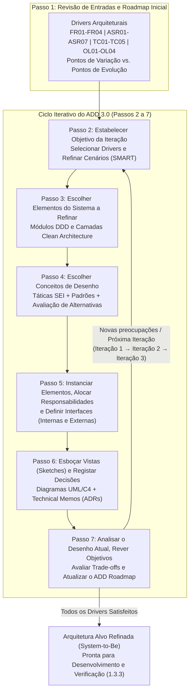
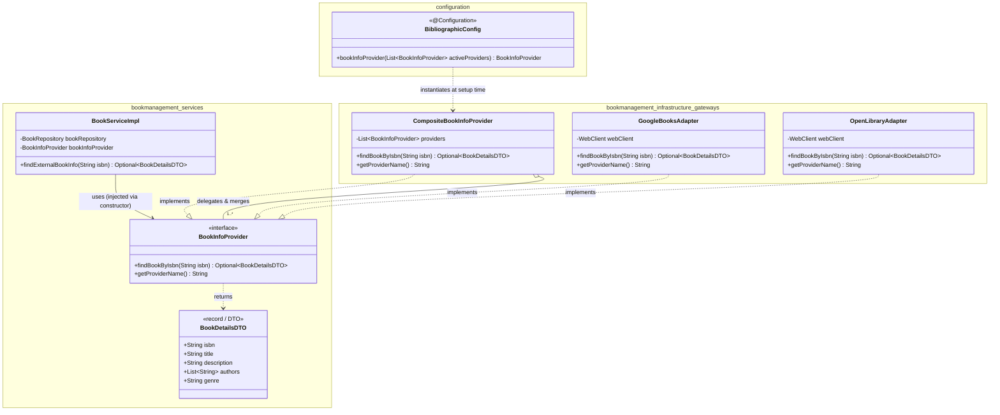
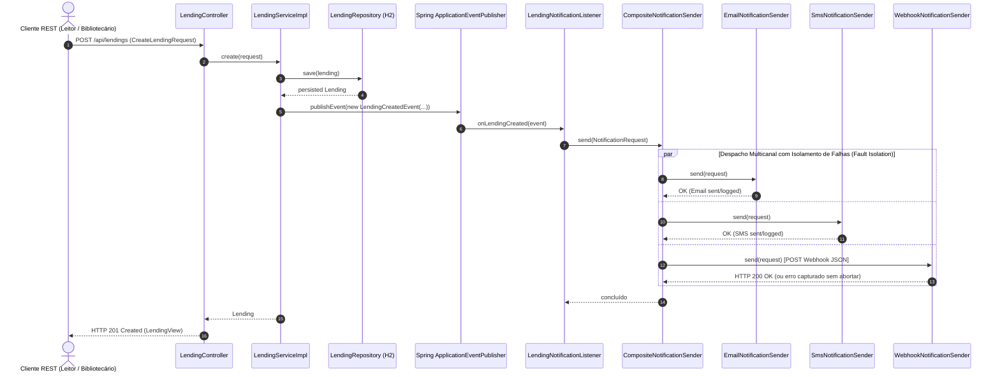
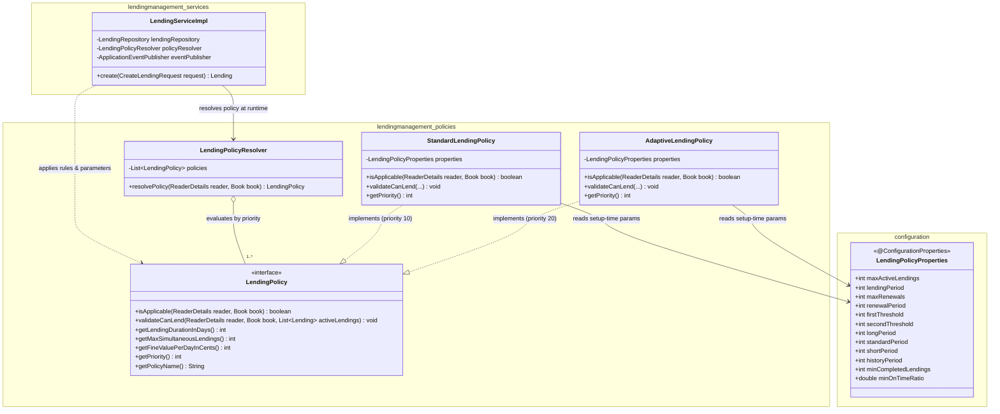

# ARQSOFT — Execução do Processo Attribute-Driven Design (ADD 3.0) e Iterações de Desenho (System-to-Be)

## 1. Enquadramento Metodológico: Adoção do ADD 3.0 num Sistema *Brownfield*

### 1.1. Justificação do ADD 3.0 face ao ADD 2.0
O desenho arquitetural do *System-to-Be* adota o método **Attribute-Driven Design (ADD), versão 3.0**, desenvolvido pelo *Software Engineering Institute* (SEI — Cervantes & Kazman, 2016; Bass, Clements & Kazman, 2021). A escolha do **ADD 3.0** em detrimento do ADD 2.0 fundamenta-se em quatro melhorias metodológicas essenciais para o contexto do projeto `psoft-g1`:

| Limitação do ADD 2.0 | Evolução no ADD 3.0 | Relevância Direta no Projeto `psoft-g1` (LMS) |
| :--- | :--- | :--- |
| **Entradas restritas** apenas a QAs, requisitos funcionais e restrições. | Inclui **Objetivos de Desenho (*Design Objectives*)** e **Preocupações Arquiteturais Transversais (*Cross-Cutting Concerns*)**. | Permite incorporar preocupações transversais de testabilidade hermética (`TC05`), isolamento de falhas (`ASR06`), e objetivos de paralelização de trabalho entre os 3 elementos do grupo (`OL01`). |
| **Decomposição de um único elemento** por iteração (Passo 2 do ADD 2.0). | Permite **refinar múltiplos elementos em simultâneo** numa mesma iteração. | Para suportar uma funcionalidade ponta-a-ponta (ex.: fontes bibliográficas), é necessário decompor simultaneamente a camada de Serviços Aplicacionais, Portas de Domínio, Adaptadores de Infraestrutura e Configuração Spring. |
| **Escolha do elemento antes dos drivers** a abordar. | Os **drivers prioritários são selecionados primeiro** (Passo 2), determinando quais os elementos do sistema a refinar (Passo 3). | Cada iteração é guiada pelos cenários de qualidade prioritários (`ASR01` a `ASR07`) e requisitos funcionais (`FR01` a `FR03`). |
| Conceitos de desenho limitados a **padrões abstratos e táticas**. | Inclui **primitivas concretas**, tais como *Frameworks*, Arquiteturas de Referência e Componentes Externos. | Permite instanciar decisões diretamente sobre mecanismos nativos do ecossistema **Spring Boot** (`@ConditionalOnProperty`, `@ConfigurationProperties`, `ApplicationEventPublisher`, `WebClient`). |

### 1.2. Estratégia *Brownfield* e Omissão da Iteração Estrutural Inicial ("Iteração 0")
De acordo com a literatura do ADD 3.0 (*Design for an Existing System / Brownfield Roadmap*), quando se evolui um sistema existente cuja arquitetura base é conhecida e documentada — neste caso, um **Monólito Modular orientado a Domínios (DDD)** com camadas internas **Clean / Onion Architecture** (levantado na Secção 3 de [`arqsoft-documentation.md`](../arqsoft-documentation.md) e em detalhe no documento [`system-as-is.md`](../system-as-is/system-as-is.md)) — **não é necessário estabelecer uma nova estrutura global de raiz**.

Consequentemente:
1. A arquitetura de referência global (**Monólito Modular + Clean/Hexagonal Architecture**) é preservada como restrição estrutural (`TC01`, `TC02`).
2. As iterações de desenho focam-se diretamente na **identificação e refinamento de estruturas internas, portas e adaptadores** para satisfazer os novos requisitos funcionais (`1.3.3.1` a `1.3.3.3`) e sanar os défices de **Extensibilidade**, **Configurabilidade** e **Testabilidade** (`1.2`).
3. Distingue-se formalmente, ao longo de todo o registo de desenho, a **plausibilidade arquitetural** (avaliada analiticamente no Passo 7 de cada iteração) da **verificação empírica/experimental** (comprovada através da bateria de testes automatizados e testes de mutação PITest especificados para a fase 1.3.3.4).



---

## 2. Passo 1 do ADD: Revisão das Entradas (*Review Inputs*) e Pontos de Variação vs. Evolução

### 2.1. Síntese dos *Architectural Drivers* de Entrada
Os condutores arquiteturais identificados e classificados no documento [`architectural-factors.md`](./architectural-factors.md) são revistos quanto à sua clareza, quantificação (critérios SMART) e completude:

* **Propósito do Desenho (*Design Purpose*):** Evoluir o serviço backend do LMS (`psoft-g1`) num sistema extensível, configurável (em *setup time* e *runtime*) e altamente testável, suportando múltiplas fontes bibliográficas externas, notificações multicanal a leitores e políticas de empréstimo dinâmicas.
* **Requisitos Funcionais Primários:** `FR01` (Fontes Bibliográficas: Google Books e Open Library), `FR02` (Notificações: Email, SMS e Webhook), `FR03` (Políticas de Empréstimo parametrizáveis e dinâmicas), `FR04` (Preservação das funcionalidades core de Livros, Autores, Géneros, Leitores e Empréstimos).
* **Cenários de Atributos de Qualidade (ASRs):** `ASR01` (Extensibilidade / OCP), `ASR02` (Configurabilidade em *Setup Time*), `ASR03` (Configurabilidade em *Runtime*), `ASR04` (Testabilidade Automatizada multinível e mutação), `ASR05` (Interoperabilidade de modelos heterogéneos), `ASR06` (Fiabilidade, *fallback* e isolamento de falhas), `ASR07` (Desempenho e não-bloqueio transacional).
* **Restrições e Preocupações (*Constraints & Concerns*):** `TC01` (Java 17 + Spring Boot 3.2.5), `TC02` (Monólito Modular DDD + Clean Architecture), `TC03` (JPA/H2), `TC04` (REST/JSON), `TC05` (Testes 100% offline/herméticos), `OL01`–`OL04` (Divisão por 3 estudantes, prazo 2026-11-01, cobertura $\ge 70\%$ e mutação PITest $\ge 60\%$).

### 2.2. Identificação de Pontos de Variação (*Variation Points*) vs. Pontos de Evolução (*Evolution Points*)
Seguindo as boas práticas de arquitetura de software (evitando *over-engineering* e respeitando o princípio *"Do The Simplest Thing That Could Possibly Work"*), distinguem-se explicitamente as escolhas já conhecidas no enunciado das extensões futuras previstas:

| Domínio / Sub-problema | Ponto de Variação (*Variation Point*)<br/>*(Alternativas já conhecidas e vinculadas em Setup/Runtime)* | Ponto de Evolução (*Evolution Point*)<br/>*(Extensões futuras sem impacto no código existente — OCP)* |
| :--- | :--- | :--- |
| **1.3.3.1 Informação Bibliográfica** | Seleção em *setup time* (`application.properties`) entre **Google Books API**, **Open Library API**, ou ambas em conjunto (agregação / *fallback*). | Inclusão futura de um novo fornecedor bibliográfico (ex.: *WorldCat*, *Biblioteca Nacional de Portugal*, *ISBNdb*) adicionando apenas 1 novo *Adapter*. |
| **1.3.3.2 Notificações a Leitores** | Ativação em *setup time* dos canais **Email**, **SMS** e **Webhook**, individualmente ou em qualquer combinação simultânea. | Suporte futuro a novos mecanismos de entrega (ex.: *WhatsApp*, *Push Notifications*, *Slack/Telegram*) adicionando apenas 1 novo `NotificationSender`. |
| **1.3.3.3 Políticas de Empréstimo** | Parametrização em *setup time* de limites numéricos (`MaxActiveLendings`, `LendingPeriod`, `FirstThreshold`, `SecondThreshold`, `HistoryPeriod`, `MinCompletedLendings`, `MinOnTimeRatio`, etc.) e seleção em *runtime* entre políticas especificadas (**Standard Lending Policy** e **Adaptive Lending Policy**). | Introdução futura de novas políticas de empréstimo (ex.: *Política Sazonal de Férias*, *Política de Investigador*) adicionando 1 nova classe `LendingPolicy`. |

### 2.3. ADD Roadmap Inicial (*Tentative & Driver-Based*)
O **ADD Roadmap** organiza o tratamento sequencial dos *drivers* pelas iterações de acordo com a sua **Importância**, **Risco Técnico**, **Impacto Arquitetural** e **Custo de Adiamento (*Cost of Postponement*)**:

```
+--------------------------------------------------------------------------------------------------------------------+
|                                                        ADD ROADMAP                                                 |
+--------------------------------------------------------------------------------------------------------------------+
| ITERAÇÃO 1 (Prioridade P1: H, H)         | ITERAÇÃO 2 (Prioridade P1: H, H)      | ITERAÇÃO 3 (Prioridade P2: H, M)|
| Foco: Integração Bibliográfica Externa   | Foco: Notificações Multicanal         | Foco: Políticas de Empréstimo   |
| - Drivers Primários: FR01, ASR01, ASR05  | - Drivers Primários: FR02, ASR01,     | - Drivers Primários: FR03,      |
| - Drivers Associados: ASR02, ASR06       |   ASR07 (Desacoplamento Event-Driven) |   ASR03 (Runtime), ASR02 (Setup)|
| - Restrições/Transversais: ASR04, TC05   | - Drivers Associados: ASR02, ASR06    | - Drivers Associados: ASR01     |
|                                          | - Restrições/Transversais: ASR04, TC05| - Restrições/Transversais: ASR04|
+--------------------------------------------------------------------------------------------------------------------+
```

---

## 3. Iteração 1 do ADD: Suporte a Fontes Bibliográficas Externas Plugáveis

### 3.1. Passo 2 — Estabelecer o Objetivo da Iteração e Selecionar/Refinar *Drivers*
* **Seleção de *Drivers* e Relações:**
  * **Drivers Primários:** `FR01` (Recuperação de dados da Google Books e Open Library), `ASR01` (Extensibilidade para novas fontes) e `ASR05` (Interoperabilidade entre esquemas JSON heterogéneos).
  * **Drivers Relacionados:** `ASR02` (Seleção em *setup time* de uma ou mais fontes) e `ASR06` (Resiliência/*fallback* quando uma fonte falha ou não possui o ISBN).
  * **Preocupações Transversais:** `ASR04` e `TC05` (Capacidade de testar os adaptadores e serviços sem chamadas HTTP reais à internet).
* **Custo de Adiamento (*Cost of Postponement*):** Elevado. Se o módulo `bookmanagement` invocar diretamente clientes HTTP específicos (como acontece no *system-as-is* com `ApiNinjasService` em `readermanagement`), o modelo de dados externo contaminará a lógica aplicacional, obrigando a refatorações invasivas posteriores.
* **Objetivo da Iteração 1:** Desenhar o subsistema de integração bibliográfica de modo a que múltiplos fornecedores externos heterogéneos possam ser selecionados e combinados em *setup time* (com *fallback* resiliente), e que novos fornecedores possam ser adicionados no futuro sem modificar a lógica de negócio do módulo `bookmanagement`.
* **Refinamento Formal dos Cenários de Qualidade (`S1.1` e `S1.2`):**

| Elemento do Cenário | Cenário `S1.1` — Extensibilidade e Configurabilidade (`ASR01` + `ASR02`) | Cenário `S1.2` — Interoperabilidade e Contingência entre Fontes (`ASR05` + `ASR06`) |
| :--- | :--- | :--- |
| **Fonte do Estímulo** | Equipa de desenvolvimento / Administrador de sistemas (DevOps). | Pedido de consulta/registo de livro quando múltiplas fontes estão ativas e a fonte primária falha ou devolve dados incompletos. |
| **Estímulo** | Adição de uma nova fonte bibliográfica ou alteração das fontes ativas (`googlebooks`, `openlibrary`, ou ambas) no ficheiro de propriedades. | A API primária (ex.: Google Books) responde com erro HTTP/timeout ou não possui certos campos (ex.: descrição) que existem na fonte secundária (Open Library). |
| **Ambiente** | Tempo de manutenção (*Design time*) e tempo de arranque (*Setup time*). | Operação normal em *runtime*, com pelo menos uma fonte alternativa saudável ou complementar configurada. |
| **Artefacto** | Subsistema de integração bibliográfica (`bookmanagement.services` e `bookmanagement.infrastructure.gateways`) e `application.properties`. | Componente intermediário de coordenação (`CompositeBookInfoProvider`) e adaptadores externos. |
| **Resposta** | O novo fornecedor é integrado como um novo adaptador isolado; no arranque, o contentor IoC instancia e combina apenas as fontes configuradas. | O sistema interceta a falha/omissão da fonte primária, consulta automaticamente a fonte seguinte na cadeia configurada e devolve os metadados consolidados no modelo canónico. |
| **Medida de Resposta** | **Zero linhas de código alteradas** em `BookServiceImpl`, `BookController` ou `Book`; reconfiguração de fontes ativas aplicada em **< 1 minuto** sem recompilação. | Pedido concluído com sucesso e transparência para o cliente REST (**0 exceções não tratadas** propagadas ao controlador enquanto houver fonte alternativa válida). |

### 3.2. Passo 3 — Escolher os Elementos do Sistema a Refinar
Para satisfazer os drivers selecionados respeitando a *Clean Architecture* do monólito modular (`TC02`), selecionam-se três elementos estruturais para refinamento:
1. **Camada de Serviços Aplicacionais do Módulo de Livros (`pt.psoft.g1.psoftg1.bookmanagement.services`):** Onde reside `BookServiceImpl` e onde devem ser definidos os contratos de saída (*Output Ports*) e o modelo canónico.
2. **Camada de Infraestrutura / Gateways Externos (`pt.psoft.g1.psoftg1.bookmanagement.infrastructure.gateways`):** Novo pacote para alojar as implementações concretas dos clientes HTTP e o mecanismo de agregação/contingência.
3. **Módulo Transversal de Configuração (`pt.psoft.g1.psoftg1.configuration`):** Para gerir a leitura de propriedades e a cablagem condicional de *beans* no arranque.

### 3.3. Passo 4 — Escolher Conceitos de Desenho (Táticas, Padrões e Alternativas)
* **Táticas Arquiteturais Selecionadas (conforme [`architectural-tactics.md`](./architectural-tactics.md)):**
  * *Modificabilidade:* **Abstract Common Services** (contrato único + modelo canónico), **Encapsulate** (isolar protocolo HTTP e JSON), **Use an Intermediary** (desacoplar consumidor de múltiplos fornecedores), **Restrict Dependencies** (DIP).
  * *Configurabilidade:* **Configuration Files / Parameterization** e **Conditional Component Registration** (vinculação em *setup time*).
  * *Fiabilidade & Testabilidade:* **Degradation / Fallback** (cadeia de contingência), **Specialized Interfaces & DI** e **Sandbox / Record-Playback** (stubs offline).
* **Avaliação de Alternativas de Desenho:**

| Alternativa de Desenho | Prós (Vantagens) | Contras (Limitações e Riscos) | Custo | Decisão |
| :--- | :--- | :--- | :---: | :---: |
| **A1.1 — Dependência Direta no Serviço**<br/>*(Instanciar e chamar `WebClient` diretamente dentro de `BookServiceImpl`, à semelhança de `ApiNinjasService` no system-as-is)* | Implementação inicial rápida; menor número de classes. | **Viola frontalmente `ASR01`, `ASR02` e `ASR04`:** acopla o negócio aos formatos JSON externos; exige `if/else` no serviço para alternar fontes; dificulta testes unitários isolados. | Baixo | **Rejeitada** |
| **A1.2 — Gateway Central Único Monolítico**<br/>*(Uma única classe `ExternalBookGateway` com métodos e ramos internos para Google Books, Open Library e fallback)* | Centraliza o código HTTP fora do `BookServiceImpl`. | **Viola o OCP (`ASR01`) e Coesão (`Split Module`):** adicionar uma 3.ª fonte obriga a modificar a classe existente, aumentando o risco de regressão nas fontes já testadas. | Médio | **Rejeitada** |
| **A1.3 — Porta Estável (`BookInfoProvider`) + Adaptadores Específicos + Intermediário Composto (`CompositeBookInfoProvider`) + Fábrica de Configuração (`BibliographicConfig`)** | **Cumpre 100% dos drivers:** isola cada API no seu *Adapter*; permite 1 ou $N$ fontes ativas de forma transparente para o serviço; suporta *fallback* e agregação; cumpre estritamente o OCP. | Introduz uma camada adicional de indireção (1 interface, 1 DTO canónico, 1 classe Composite e 1 classe Config). | Médio | **Selecionada** |

### 3.4. Passo 5 — Instanciar Elementos, Alocar Responsabilidades e Definir Interfaces

#### A. Tabela de Racional de Atribuição de Responsabilidades (*Responsibility Assignment Rationale*)

| Elemento Instanciado | Camada / Pacote | Responsabilidade e Racional Arquitetural | Propriedades (Padrão / Tecnologia) | Drivers Associados |
| :--- | :--- | :--- | :--- | :--- |
| **`BookInfoProvider`** | `bookmanagement.services` *(Output Port)* | Define o contrato abstrato e estável para obtenção de metadados bibliográficos por ISBN, protegendo o domínio de variações externas. | Padrão: *Port / Gateway Interface*<br/>Tecnologia: Java Interface | `ASR01`, `ASR04`, `TC02` |
| **`BookDetailsDTO`** | `bookmanagement.services` *(Canonical DTO)* | Representa o modelo de dados canónico interno normalizado (título, lista de autores, descrição, género/categoria, editora, ISBN). | Padrão: *Canonical Data Model*<br/>Tecnologia: Java Record / DTO | `FR01`, `ASR05` |
| **`GoogleBooksAdapter`** | `bookmanagement.infrastructure.gateways` | Consome a REST API do Google Books (`volumes?q=isbn:{isbn}`), desserializa o JSON específico (`volumeInfo`) e converte-o para `BookDetailsDTO`. | Padrão: *Adapter*<br/>Tecnologia: Spring `WebClient`, Jackson | `FR01`, `ASR01`, `ASR05` |
| **`OpenLibraryAdapter`** | `bookmanagement.infrastructure.gateways` | Consome a REST API da Open Library (`api/books?bibkeys=ISBN:{isbn}`), desserializa o JSON próprio e converte-o para `BookDetailsDTO`. | Padrão: *Adapter*<br/>Tecnologia: Spring `WebClient`, Jackson | `FR01`, `ASR01`, `ASR05` |
| **`CompositeBookInfoProvider`** | `bookmanagement.infrastructure.gateways` | Implementa `BookInfoProvider` e agrega uma lista ordenada de provedores ativos. Executa estratégia de *fallback* e fusão de campos em falta. | Padrão: *Composite* + *Chain of Responsibility* | `FR01`, `ASR02`, `ASR06` |
| **`BibliographicConfig`** | `configuration` | Lê a configuração de *setup time* (`bibliographic.providers`), instancia os adaptadores selecionados e expõe o `@Primary` `BookInfoProvider`. | Padrão: *Factory / Startup Binding*<br/>Tecnologia: Spring `@Configuration`, `@Bean` | `ASR02`, `TC01` |
| **`BookServiceImpl`** *(Refinado)* | `bookmanagement.services` | Orquestra os casos de uso de livros, dependendo exclusivamente da abstração `BookInfoProvider` injetada via construtor. | Padrão: *Application Service (DI)*<br/>Tecnologia: Spring `@Service` | `FR01`, `ASR04`, `TC02` |

#### B. Especificação de Interfaces Externas e Internas
* **Interfaces Externas Requeridas (*Required External Interfaces*):**
  * **Google Books API:** `GET https://www.googleapis.com/books/v1/volumes?q=isbn:{isbn}` (Formato JSON hierárquico `items[].volumeInfo`).
  * **Open Library Books API:** `GET https://openlibrary.org/api/books?bibkeys=ISBN:{isbn}&format=json&jscmd=data` (Formato JSON indexado por chave `ISBN:{isbn}`).
* **Interfaces Internas (*Internal Contracts*):**
  ```java
  package pt.psoft.g1.psoftg1.bookmanagement.services;

  import java.util.Optional;

  public interface BookInfoProvider {
      Optional<BookDetailsDTO> findBookByIsbn(String isbn);
      String getProviderName();
  }
  ```

### 3.5. Passo 6 — Esboçar Vistas (*Sketch Views*) e Registar Decisões (*Technical Memo*)

#### A. Esboço Estrutural e Comportamental da Iteração 1 (Vista Lógica / Classes e Sequência)



#### B. Registo de Decisão Arquitetural — *Technical Memo* 1 (Iteração 1)

| Campo do *Technical Memo* | Especificação e Racional |
| :--- | :--- |
| **Issue / ID** | **TM-01:** Integração Extensível e Configurável de Fontes Bibliográficas Heterogéneas (Enunciado 1.3.3.1). |
| **Problem** | Como recuperar metadados bibliográficos de sistemas externos com modelos de dados distintos (Google Books, Open Library), permitindo selecionar uma ou várias fontes em *setup time* e adicionar novas fontes no futuro com impacto mínimo na funcionalidade existente? |
| **Summary of Solution** | Adotar as táticas **Abstract Common Services**, **Encapsulate**, **Use an Intermediary**, **Fallback** e **Defer Binding (Startup)**, materializadas nos padrões **Adapter**, **Canonical Data Model** e **Composite**. |
| **Factors (Drivers)** | `FR01` (Google Books + Open Library), `ASR01` (Extensibilidade OCP), `ASR02` (Seleção em *setup time*), `ASR05` (Modelos heterogéneos), `ASR06` (Tolerância a falhas externas), `ASR04` + `TC05` (Testabilidade offline sem rede). |
| **Solution** | 1. Definir a interface `BookInfoProvider` e o DTO canónico `BookDetailsDTO` na camada `services`.<br/>2. Implementar `GoogleBooksAdapter` e `OpenLibraryAdapter` em `infrastructure.gateways`, encapsulando `WebClient` e o mapeamento JSON.<br/>3. Implementar `CompositeBookInfoProvider` que itera sobre os provedores ativos pela ordem definida em `bibliographic.providers=googlebooks,openlibrary`, realizando *fallback* em caso de erro/ausência e complementando campos nulos.<br/>4. Configurar os *beans* ativos no arranque através de `BibliographicConfig`. |
| **Motivation** | `BookServiceImpl` fica 100% agnóstico a quantas ou quais fontes estão ativas. A adição de uma 3.ª fonte exige apenas criar uma nova classe que implemente `BookInfoProvider` e registar o seu identificador na configuração. |
| **Alternatives** | Chamadas diretas no serviço (rejeitada por alto acoplamento) ou Gateway único com condicionais internos (rejeitada por violar o OCP). |
| **Traceability** | `FR01, ASR01, ASR02, ASR05, ASR06` $\rightarrow$ *Abstract Common Services + Encapsulate + Use Intermediary + Defer Binding* $\rightarrow$ `BookInfoProvider` + Adapters + `CompositeBookInfoProvider` $\rightarrow$ Mudanças confinadas à infraestrutura. |
| **Pending Issues / Carry-forward** | O tempo de espera (*timeout*) quando a fonte primária está indisponível pode aumentar a latência se não for limitado. É necessário configurar *timeouts* curtos no `WebClient` (ex.: 2–3 segundos) e validar o comportamento de *fallback* através de testes de injeção de falhas com *stubs* locais (`1.3.3.4`). |

### 3.6. Passo 7 — Análise do Desenho Atual, Revisão de Objetivos e Atualização do Roadmap (Subcritério C1.2)
* **Avaliação face aos Cenários (`S1.1` e `S1.2`):**
  * *Plausibilidade Arquitetural:* `S1.1` (Extensibilidade e Configurabilidade) está plenamente garantido pela inversão de dependências e pelo padrão *Composite*. `S1.2` (Interoperabilidade e Contingência) é suportado pelo modelo canónico `BookDetailsDTO` e pela captura de exceções no `CompositeBookInfoProvider`.
  * *Critério de Verificação Experimental (`1.3.3.4`):* A eficácia real da normalização de dados e da lógica de *fallback* será verificada empiricamente através de testes unitários de caixa-opaca (partições de equivalência para respostas parciais/corrompidas), testes de mutação PITest sobre os adaptadores e o *Composite*, e testes de integração com `MockMvc` + *stubs* HTTP offline (`TC05`).
* **Riscos Residuais e Limites das Opções Adotadas (Nível 5):**
  * *Latência Acumulada em Cascata:* A estratégia de *fallback* sequencial no `CompositeBookInfoProvider` pode somar os tempos de resposta de cada fonte externa quando a primária falha por timeout. Mitigação adotada: configuração de timeouts curtos no `WebClient` ($\le 2.5\text{ s}$).
  * *Divergência Semântica de Dados Parciais:* APIs externas devolvem granularidades distintas de dados (ex.: Google Books fornece múltiplos autores e categorias detalhadas, enquanto certas entradas da Open Library contêm apenas o primeiro autor). O DTO canónico preserva apenas a interseção segura de atributos fundamentais.
* **Atualização do ADD Roadmap:** Concluído o desenho da integração síncrona de consulta externa (Iteração 1), o foco avança para o segundo problema de prioridade crítica `(H, H)`: o desacoplamento de efeitos secundários aquando de eventos de negócio no módulo de empréstimos (**Iteração 2 — Notificações Multicanal**).

---

## 4. Iteração 2 do ADD: Sistema de Notificações Multicanal Extensível

### 4.1. Passo 2 — Estabelecer o Objetivo da Iteração e Selecionar/Refinar *Drivers*
* **Seleção de *Drivers* e Relações:**
  * **Drivers Primários:** `FR02` (Notificar leitores sobre eventos relevantes de empréstimo via Email, SMS e Webhook, individualmente ou em combinação), `ASR01` (Extensibilidade para novos canais) e `ASR07` (Desacoplamento temporal e estrutural / Não-bloqueio do fluxo de empréstimo).
  * **Drivers Relacionados:** `ASR02` (Seleção dos canais ativos em *setup time*) e `ASR06` (Isolamento de falhas: o erro num canal externo de notificação não pode abortar os outros canais nem reverter a transação de empréstimo).
  * **Restrições a Preservar:** `TC02` (Limites entre `lendingmanagement` e `readermanagement`), `TC03` (Consistência transacional ACID na base de dados H2), `ASR04` e `TC05` (Testabilidade hermética sem servidores SMTP/SMS reais).
* **Custo de Adiamento (*Cost of Postponement*):** Elevado. Acoplar chamadas de envio de Email/SMS/Webhook diretamente dentro de `LendingServiceImpl.create()` e `setReturned()` violaria a responsabilidade única do subdomínio de empréstimos e criaria fragilidade transacional.
* **Objetivo da Iteração 2:** Desenhar uma arquitetura orientada a eventos de domínio (*Event-Driven*) que permita despachar notificações de eventos de empréstimo para um ou múltiplos canais configurados em *setup time*, isolando falhas de envio e permitindo acrescentar novos mecanismos de notificação sem qualquer alteração ao módulo `lendingmanagement`.
* **Refinamento Formal dos Cenários de Qualidade (`S2.1` e `S2.2`):**

| Elemento do Cenário | Cenário `S2.1` — Extensibilidade e Combinação de Canais em *Setup Time* (`ASR01` + `ASR02`) | Cenário `S2.2` — Isolamento de Falhas Transacionais e Multicanal (`ASR06` + `ASR07`) |
| :--- | :--- | :--- |
| **Fonte do Estímulo** | Administrador de sistemas (em *setup time*) / Equipa de desenvolvimento (em manutenção). | Ocorrência de um evento de empréstimo (criação, devolução ou atraso) em *runtime* quando um dos canais configurados (ex.: Webhook externo) falha. |
| **Estímulo** | Configuração simultânea de múltiplos canais (`notification.channels=email,sms,webhook`) ou adição de um 4.º canal (ex.: Push/WhatsApp). | O endpoint HTTP do Webhook devolve erro `503 Service Unavailable` ou sofre *timeout* durante a criação de um empréstimo. |
| **Ambiente** | Tempo de arranque (*Setup time*) e tempo de desenvolvimento (*Design time*). | Operação normal em *runtime* com múltiplos canais ativos (`email,sms,webhook`). |
| **Artefacto** | Subsistema de notificações (`readermanagement.infrastructure.notifications` e `readermanagement.services`) e `NotificationConfig`. | `LendingServiceImpl`, `LendingNotificationListener` e `CompositeNotificationSender`. |
| **Resposta** | O sistema ativa e agrega todos os canais especificados no arranque; novos canais são adicionados apenas implementando `NotificationSender`. | A transação de empréstimo na BD é confirmada com sucesso (HTTP `201 Created`), as notificações por Email e SMS são entregues normalmente, e a falha do Webhook é isolada e registada em log. |
| **Medida de Resposta** | **Zero alterações** em `LendingServiceImpl` ou `LendingNotificationListener`; alteração de canais ativos via ficheiro de propriedades em **< 1 minuto**. | **100% das transações de empréstimo válidas são persistidas** mesmo com indisponibilidade total de 1 ou mais canais de notificação; **100% dos canais saudáveis** recebem a notificação. |

### 4.2. Passo 3 — Escolher os Elementos do Sistema a Refinar
1. **Módulo de Gestão de Empréstimos (`pt.psoft.g1.psoftg1.lendingmanagement`):**
   * `LendingServiceImpl`: Refinado apenas para publicar eventos de domínio através do barramento de eventos do Spring.
   * Novo pacote `lendingmanagement.events`: Para definir os eventos imutáveis do ciclo de vida do empréstimo.
2. **Subsistema de Notificações (`pt.psoft.g1.psoftg1.readermanagement.infrastructure.notifications` e `readermanagement.services`):**
   * Novo pacote contendo o *Event Listener*, o contrato `NotificationSender`, o DTO `NotificationRequest`, o despachador `CompositeNotificationSender` e os adaptadores concretos (`Email`, `Sms`, `Webhook`).
3. **Módulo de Configuração (`pt.psoft.g1.psoftg1.configuration`):**
   * `NotificationConfig`: Para ler `notification.channels` e compor os canais ativos em *setup time*.

### 4.3. Passo 4 — Escolher Conceitos de Desenho (Táticas, Padrões e Alternativas)
* **Táticas Arquiteturais Selecionadas:**
  * *Modificabilidade:* **Publish-Subscribe** (desacoplar produtor `lendingmanagement` do consumidor `notifications`), **Abstract Common Services** e **Encapsulate** (unificar canais sob `NotificationSender`), **Use an Intermediary** (`CompositeNotificationSender`).
  * *Configurabilidade:* **Configuration Files** e **Conditional Component Registration** (`notification.channels=email,sms,webhook`).
  * *Fiabilidade e Desempenho:* **Exception Prevention & Fault Isolation** (*try/catch* isolado por canal no *Composite* e no *Listener*) e **Asynchronous Event Processing** (reagir a eventos após o fluxo principal).
* **Avaliação de Alternativas de Desenho:**

| Alternativa de Desenho | Prós (Vantagens) | Contras (Limitações e Riscos) | Custo | Decisão |
| :--- | :--- | :--- | :---: | :---: |
| **A2.1 — Invocação Síncrona Direta no `LendingServiceImpl`**<br/>*(Injetar `EmailService`, `SmsService`, `WebhookService` diretamente no serviço de empréstimos)* | Fluxo sequencial simples de seguir. | **Elevado acoplamento inter-módulos:** `lendingmanagement` passa a conhecer detalhes de canais de comunicação; uma exceção no envio reverte o `@Transactional` do empréstimo (`ASR06`). | Baixo | **Rejeitada** |
| **A2.2 — Broker de Mensagens Externo (RabbitMQ / Kafka)**<br/>*(Publicar eventos num broker distribuído externo)* | Desacoplamento físico total e persistência de filas de mensagens. | **Viola as restrições `TC02` (Monólito Modular) e `TC05` (Testes simples/offline):** introduz complexidade operacional desproporcionada (*over-engineering*) para um monólito modular. | Muito Alto | **Rejeitada** |
| **A2.3 — Eventos de Domínio In-Process (`ApplicationEventPublisher` / `@EventListener`) + Padrão `Composite` + `Strategy` (`NotificationSender`)** | **Equilíbrio ótimo:** desacopla totalmente `lendingmanagement` do subsistema de notificações dentro do monólito; suporta 1 ou $N$ canais em simultâneo; isola falhas por canal; 100% testável em memória (`TC05`). | Requer cuidado para capturar exceções no *listener* para não afetar a thread chamadora. | Médio | **Selecionada** |

### 4.4. Passo 5 — Instanciar Elementos, Alocar Responsabilidades e Definir Interfaces

#### A. Tabela de Racional de Atribuição de Responsabilidades (*Responsibility Assignment Rationale*)

| Elemento Instanciado | Camada / Pacote | Responsabilidade e Racional Arquitetural | Propriedades (Padrão / Tecnologia) | Drivers Associados |
| :--- | :--- | :--- | :--- | :--- |
| **`LendingCreatedEvent`<br/>`LendingReturnedEvent`<br/>`LendingOverdueEvent`** | `lendingmanagement.events` | Transportam de forma imutável os dados do evento de domínio (leitor, livro, número de empréstimo, data limite, multa). | Padrão: *Domain Event*<br/>Tecnologia: Java POJO / Record | `FR02`, `ASR01`, `ASR07` |
| **`LendingNotificationListener`** | `readermanagement.infrastructure.notifications` | Escuta os eventos de empréstimo publicados no barramento Spring (`@TransactionalEventListener(phase = AFTER_COMMIT)`), constrói o `NotificationRequest` e delega no `NotificationSender`. | Padrão: *Observer / Event Subscriber*<br/>Tecnologia: Spring `@Component`, `@TransactionalEventListener` | `FR02`, `ASR01`, `ASR07` |
| **`NotificationSender`** | `readermanagement.services` | Interface contratual comum para qualquer mecanismo de entrega de notificações a leitores. | Padrão: *Strategy Interface / Port*<br/>Tecnologia: Java Interface | `ASR01`, `ASR04` |
| **`EmailNotificationSender`<br/>`SmsNotificationSender`<br/>`WebhookNotificationSender`** | `readermanagement.infrastructure.notifications` | Implementam a formatação e entrega específica para Email, SMS (texto curto) e Webhook (HTTP POST JSON via `WebClient`). | Padrão: *Concrete Strategy / Adapter*<br/>Tecnologia: Spring Beans, `WebClient` | `FR02`, `ASR01` |
| **`CompositeNotificationSender`** | `readermanagement.infrastructure.notifications` | Agrupa todos os canais ativos em *setup time* e despacha a notificação para cada um dentro de blocos de isolamento de falhas (*fault isolation*). | Padrão: *Composite*<br/>Tática: *Use an Intermediary + Fault Isolation* | `FR02`, `ASR02`, `ASR06` |
| **`NotificationConfig`** | `configuration` | Lê `notification.channels` no arranque, seleciona os *senders* correspondentes e regista o `CompositeNotificationSender` primário. | Padrão: *Startup Configuration Binding*<br/>Tecnologia: Spring `@Configuration` | `ASR02`, `TC01` |

#### B. Especificação de Interfaces Internas e Externas
* **Interface Externa de Saída (*Webhook Endpoint*):** `POST {notification.webhook.url}` com payload JSON contendo `{ "recipient": "...", "eventType": "LENDING_CREATED", "subject": "...", "message": "...", "timestamp": "..." }`.
* **Interface Interna Contratual (`NotificationSender`):**
  ```java
  package pt.psoft.g1.psoftg1.readermanagement.services;

  public interface NotificationSender {
      void send(NotificationRequest request);
      String getChannelName();
  }
  ```

### 4.5. Passo 6 — Esboçar Vistas (*Sketch Views*) e Registar Decisões (*Technical Memo*)

#### A. Esboço Comportamental e Estrutural da Iteração 2 (Diagrama de Sequência C&C)



#### B. Registo de Decisão Arquitetural — *Technical Memo* 2 (Iteração 2)

| Campo do *Technical Memo* | Especificação e Racional |
| :--- | :--- |
| **Issue / ID** | **TM-02:** Subsistema Desacoplado de Notificações Multicanal a Leitores (Enunciado 1.3.3.2). |
| **Problem** | Como notificar leitores sobre eventos relevantes de empréstimo através de Email, SMS e Webhook (individualmente ou combinados), selecionando os canais em *setup time* e suportando novos canais sem impactar o módulo `lendingmanagement`? |
| **Summary of Solution** | Adotar as táticas **Publish-Subscribe**, **Abstract Common Services**, **Encapsulate**, **Use an Intermediary**, **Fault Isolation** e **Defer Binding (Startup)**, combinando **Domain Events** do Spring com os padrões **Observer**, **Strategy** e **Composite**. |
| **Factors (Drivers)** | `FR02` (Notificações Email, SMS, Webhook), `ASR01` (Extensibilidade OCP), `ASR02` (Seleção em *setup time*), `ASR06` (Isolamento de falhas), `ASR07` (Desacoplamento), `ASR04` + `TC05` (Testabilidade hermética). |
| **Solution** | 1. `LendingServiceImpl` publica eventos (`LendingCreatedEvent`, `LendingReturnedEvent`, `LendingOverdueEvent`) via `ApplicationEventPublisher`.<br/>2. `LendingNotificationListener` subscreve os eventos via `@EventListener` e invoca a abstração `NotificationSender`.<br/>3. `CompositeNotificationSender` itera sobre os canais ativos configurados em `notification.channels`, envolvendo cada envio num bloco `try-catch` individual para garantir que a falha de um canal não afeta os restantes nem a transação de empréstimo. |
| **Motivation** | O módulo `lendingmanagement` mantém coesão pura de negócio e zero dependências de infraestrutura de comunicação. A combinação de 1, 2 ou $N$ canais é controlada exclusivamente por configuração externa. |
| **Alternatives** | Chamadas diretas no serviço (rejeitada por acoplamento) ou Message Broker externo RabbitMQ/Kafka (rejeitada por violar `TC02` e `TC05`). |
| **Traceability** | `FR02, ASR01, ASR02, ASR06, ASR07` $\rightarrow$ *Publish-Subscribe + Use Intermediary + Fault Isolation + Defer Binding* $\rightarrow$ Domain Events + `LendingNotificationListener` + `CompositeNotificationSender` $\rightarrow$ Notificações multicanal resilientes e extensíveis. |
| **Pending Issues / Carry-forward** | Garantir nos testes de integração (`1.3.3.4.4`) que, mesmo quando um `NotificationSender` lança `RuntimeException`, o empréstimo permanece gravado na base de dados H2 e os restantes canais são invocados. |

### 4.6. Passo 7 — Análise do Desenho Atual, Revisão de Objetivos e Atualização do Roadmap (Subcritério C1.2)
* **Avaliação face aos Cenários (`S2.1` e `S2.2`):**
  * *Plausibilidade Arquitetural:* `S2.1` e `S2.2` são plenamente satisfeitos. O acoplamento entre `lendingmanagement` e `notifications` é reduzido exclusivamente ao contrato de dados dos eventos de domínio.
  * *Critério de Verificação Experimental (`1.3.3.4`):* Será validado através de testes unitários de caixa-opaca a cada *sender* e ao *Composite* (incluindo simulação de falha num canal para provar que os restantes executam), testes de mutação PITest no *listener* e *composite*, e testes de integração `@SpringBootTest` verificando o disparo automático de eventos após `create()` e `setReturned()`.
* **Riscos Residuais e Limites das Opções Adotadas (Nível 5):**
  * *Durabilidade de Mensagens In-Memory:* A publicação assíncrona baseada em eventos Spring (`ApplicationEventPublisher`) opera na memória da JVM. Caso ocorra uma interrupção catastrófica do servidor (falha de energia, reinício de container ou SIGKILL) logo após o commit da transação na BD mas antes da execução do *listener*, a notificação pode perder-se. A introdução de um broker distribuído persistente (RabbitMQ/Kafka) ou padrão *Transactional Outbox* foi deliberadamente rejeitada nesta fase para respeitar a restrição de monólito modular (`TC02`) e testes herméticos (`TC05`), sendo assumida como risco residual aceitável para o domínio de notificações informativas de biblioteca.
* **Atualização do ADD Roadmap:** Com a integração bibliográfica (Iteração 1) e as notificações orientadas a eventos (Iteração 2) desenhadas, resta resolver o driver de **Configurabilidade em *Runtime* e Parametrização Externa das Regras de Negócio de Empréstimo** (**Iteração 3 — Políticas de Empréstimo Dinâmicas**).

---

## 5. Iteração 3 do ADD: Motor de Políticas de Empréstimo Dinâmicas e Configuráveis

### 5.1. Passo 2 — Estabelecer o Objetivo da Iteração e Selecionar/Refinar *Drivers*
* **Seleção de *Drivers* e Relações:**
  * **Drivers Primários:** `FR03` (Aplicar diferentes políticas de empréstimo segundo regras de negócio, parametrizáveis em *setup time* e selecionadas em *runtime*), `ASR03` (Configurabilidade e resolução dinâmica em *runtime*) e `ASR02` (Parametrização externa de limiares numéricos em *setup time* sem alterar código).
  * **Drivers Relacionados:** `ASR01` (Extensibilidade: suportar novas políticas de empréstimo com impacto mínimo) e `ASR04` (Testabilidade: testar exaustivamente valores-limite e ramos lógicos das políticas em caixa-opaca, caixa-transparente e mutação PITest).
* **Custo de Adiamento (*Cost of Postponement*):** No *system-as-is*, `LendingServiceImpl.create()` contém lógica rígida (*hardcoded*: limite fixo de 3 livros simultâneos, bloqueio estrito ao 1.º atraso, e duração/multa únicas globais). Manter esta estrutura impede qualquer diferenciação de regras por perfil de leitor ou tipo de livro.
* **Objetivo da Iteração 3:** Extrair e encapsular as regras de negócio de empréstimo num motor de políticas extensível, onde os parâmetros numéricos são injetados a partir de ficheiros de configuração em *setup time* e a política aplicável é selecionada dinamicamente em *runtime* para cada requisição de empréstimo.
* **Refinamento Formal dos Cenários de Qualidade (`S3.1` e `S3.2`):**

| Elemento do Cenário | Cenário `S3.1` — Parametrização Externa em *Setup Time* (`ASR02`) | Cenário `S3.2` — Seleção Dinâmica em *Runtime* e Extensibilidade (`ASR03` + `ASR01`) |
| :--- | :--- | :--- |
| **Fonte do Estímulo** | Administrador da biblioteca / Operador DevOps. | Pedido HTTP de criação de empréstimo (`POST /api/lendings`) para diferentes combinações de Leitor e Livro; ou adição de uma nova política de negócio. |
| **Estímulo** | Alteração dos parâmetros de duração (ex.: de 15 para 20 dias), limite de livros simultâneos (ex.: de 3 para 5) ou valor da multa diária no ficheiro `application.properties` / `library.properties`. | Submissão de pedido de empréstimo em *runtime* (ex.: leitor com perfil elegível para política *Premium* ou livro sujeito a *Short-Term*); ou criação de uma 4.ª política. |
| **Ambiente** | Tempo de configuração/arranque (*Setup time*). | Tempo de execução (*Runtime*) sob carga normal; e tempo de manutenção (*Design time*). |
| **Artefacto** | `LendingPolicyProperties` e implementações de `LendingPolicy`. | `LendingPolicyResolver`, implementações de `LendingPolicy` e `LendingServiceImpl`. |
| **Resposta** | O Spring vincula automaticamente os novos valores numéricos às políticas no arranque sem recompilar qualquer classe Java. | O `LendingPolicyResolver` avalia `isApplicable(reader, book)` e `getPriority()` sobre as políticas registadas, seleciona deterministicamente a política correta e aplica as suas regras de validação, prazo e multa. |
| **Medida de Resposta** | **0 ficheiros `.java` modificados ou recompilados** para calibrar prazos, limites ou taxas de multa. | Resolução em memória em **< 1 ms**; adição de uma nova política requer **apenas 1 nova classe `@Component`** sem alterar `LendingServiceImpl` nem `LendingPolicyResolver`. |

### 5.2. Passo 3 — Escolher os Elementos do Sistema a Refinar
1. **Novo Pacote de Políticas de Domínio/Aplicação (`pt.psoft.g1.psoftg1.lendingmanagement.policies`):** Criado através da tática *Split Module* para isolar o contrato `LendingPolicy`, as estratégias concretas e o resolvedor `LendingPolicyResolver`.
2. **Serviço e Entidade de Empréstimo (`LendingServiceImpl` e `Lending`):** Refatorados para delegar a validação de elegibilidade, o cálculo da data limite (`limitDate`) e a taxa de multa diária (`fineValuePerDayInCents`) na política resolvida em *runtime*.
3. **Configuração Tipada (`pt.psoft.g1.psoftg1.configuration.LendingPolicyProperties`):** Classe `@ConfigurationProperties` para mapear hierarquicamente os parâmetros externos de cada política.

### 5.3. Passo 4 — Escolher Conceitos de Desenho (Táticas, Padrões e Alternativas)
* **Táticas Arquiteturais Selecionadas:**
  * *Modificabilidade:* **Split Module** (extrair regras de `LendingServiceImpl`), **Abstract Common Services** (`LendingPolicy`), **Use an Intermediary** (`LendingPolicyResolver`).
  * *Configurabilidade:* **Configuration Files / Parameterization** (`@ConfigurationProperties` em *setup time*), **Polymorphism** e **Dynamic Resolution / Runtime Registration** (seleção da política em *runtime*).
  * *Testabilidade:* **High Semantic Coherence**, **Limit Nondeterminism** e **Executable Assertions** (permitindo testar cada política isoladamente com Análise de Valores Limite — BVA — e atingir elevada pontuação no PITest).
* **Avaliação de Alternativas de Desenho:**

| Alternativa de Desenho | Prós (Vantagens) | Contras (Limitações e Riscos) | Custo | Decisão |
| :--- | :--- | :--- | :---: | :---: |
| **A3.1 — Estruturas Condicionais (`if/else` / `switch`) em `LendingServiceImpl`** | Simples para 1 ou 2 regras fixas. | **Viola `ASR01` (OCP) e `ASR04`:** o método `create()` cresce indefinidamente a cada nova política; impossível adicionar políticas sem modificar código crítico de serviço. | Baixo | **Rejeitada** |
| **A3.2 — Motor de Regras Externo Pesado (ex.: Drools / ficheiros `.drl`)** | Permite editar expressões lógicas complexas fora do Java. | **Excessivamente complexo (*Over-engineering*):** difícil de depurar, degrada o tempo de arranque e reduz a eficácia dos testes de mutação PITest sobre o código Java (`1.3.3.4.3`). | Alto | **Rejeitada** |
| **A3.3 — Padrão `Strategy` (`LendingPolicy`) + `LendingPolicyResolver` (Ordenado por Prioridade) + `@ConfigurationProperties` (`LendingPolicyProperties`)** | **Cumpre 100% dos drivers:** cada regra de negócio é uma classe coesa e 100% testável com JUnit e PITest; os limiares numéricos são externos (`setup time`); o `LendingPolicyResolver` descobre automaticamente todas as políticas via IoC e seleciona a aplicável em `runtime`. | Exige definir um critério de desempate caso mais do que uma política seja aplicável ao mesmo pedido (resolvido com `getPriority()`). | Médio | **Selecionada** |

### 5.4. Passo 5 — Instanciar Elementos, Alocar Responsabilidades e Definir Interfaces

#### A. Regras de Negócio das Políticas Instanciadas (1.3.3.3 & Políticas de Empréstimo v1.0)
Em conformidade estrita com o enunciado (`1.3.3.3`), o documento de especificação complementar *Lending Policies Specification v1.0* (§§2–5) e a grelha de avaliação de referência, instanciam-se as políticas centrais do domínio de biblioteca, coordenadas pelo resolvedor dinâmico `LendingPolicyResolver` e parametrizadas tipadamente por `LendingPolicyProperties`:

| Política de Empréstimo | Critério de Seleção em *Runtime* (`isApplicable`) | Parâmetros Configuráveis em *Setup Time* (sem alterar código) | Regras de Validação, Limites e Renovações |
| :--- | :--- | :--- | :--- |
| **`StandardLendingPolicy`**<br/>*(Políticas v1.0, §2 — Política Base / Default)* | **Política por omissão** (§4.1). Aplica-se a todos os leitores que não preencham cumulativamente os requisitos de histórico para aceder à política adaptativa. | • `MaxActiveLendings (> 0)` (ex.: 3)<br/>• `LendingPeriod (> 0)` (ex.: 15 dias)<br/>• `MaxRenewals (>= 0)` (ex.: 1 renovação)<br/>• `RenewalPeriod (> 0)` (ex.: 15 dias) | • Máximo de `MaxActiveLendings` empréstimos ativos simultâneos.<br/>• Prazo de empréstimo de `LendingPeriod` dias.<br/>• Renovação permitida no máximo `MaxRenewals` vezes, cada uma por `RenewalPeriod` dias.<br/>• Leitor com qualquer empréstimo em atraso fica **impedido de iniciar novo empréstimo** (§2.4) e **impossibilitado de renovar** (§2.5). |
| **`AdaptiveLendingPolicy`**<br/>*(Políticas v1.0, §3 — Política Dinâmica Adaptativa)* | **Ativada com base no histórico recente** (§4.2): nos últimos `HistoryPeriod` meses o leitor completou $\ge 	ext{MinCompletedLendings}$, devolveu $\ge 	ext{MinOnTimeRatio}\%$ a tempo e não tem atrasos ativos. | • `MaxActiveLendings (> 0)` (ex.: 5)<br/>• `FirstThreshold` (ex.: 2)<br/>• `SecondThreshold` (ex.: 4)<br/>• `LongPeriod` (ex.: 30 dias)<br/>• `StandardPeriod` (ex.: 15 dias)<br/>• `ShortPeriod` (ex.: 7 dias)<br/>*Restrições validadas:* $0 < 	ext{FirstThreshold} < 	ext{SecondThreshold} < 	ext{MaxActiveLendings}$ e $	ext{LongPeriod} > 	ext{StandardPeriod} > 	ext{ShortPeriod} > 0$ (§3.5). | • Adapta a duração do empréstimo consoante o número de livros ativos ($N$) em posse do leitor:<br/>  - Se $N < 	ext{FirstThreshold} \implies 	ext{LongPeriod}$ dias;<br/>  - Se $	ext{FirstThreshold} \le N < 	ext{SecondThreshold} \implies 	ext{StandardPeriod}$ dias;<br/>  - Se $N \ge 	ext{SecondThreshold} \implies 	ext{ShortPeriod}$ dias.<br/>• A renovação só é permitida se o empréstimo resultante continuar a satisfazer as condições aplicáveis (§3.6).<br/>• A política é **reavaliada dinamicamente a cada novo empréstimo ou renovação** (§4.3). |
| **Pontos de Extensão Futura**<br/>*(Padrão Strategy Open-Closed)* | Políticas especializadas adicionais (ex.: `PremiumReaderLendingPolicy` para docentes/investigadores ou novas estratégias sazonais). | Parâmetros configuráveis da estratégia respetiva. | O `LendingPolicyResolver` interroga a lista polimórfica injetada e desempata por prioridade (`getPriority()`). |


#### B. Tabela de Racional de Atribuição de Responsabilidades (*Responsibility Assignment Rationale*)

| Elemento Instanciado | Camada / Pacote | Responsabilidade e Racional Arquitetural | Propriedades (Padrão / Tecnologia) | Drivers Associados |
| :--- | :--- | :--- | :--- | :--- |
| **`LendingPolicy`** | `lendingmanagement.policies` | Define o contrato de qualquer política de empréstimo: elegibilidade (`isApplicable`), validação (`validateCanLend`), parâmetros (duração, máximo de livros, multa) e prioridade (`getPriority`). | Padrão: *Strategy Interface*<br/>Tecnologia: Java Interface | `FR03`, `ASR01`, `ASR03`, `ASR04` |
| **`StandardLendingPolicy`<br/>`AdaptiveLendingPolicy`** | `lendingmanagement.policies` | Estratégias de domínio que concretizam as regras da especificação v1.0 (política base e adaptativa escalonada por FirstThreshold e SecondThreshold), com suporte a extensões polimórficas. | Padrão: *Concrete Strategy*<br/>Tecnologia: Spring `@Component` / Dynamic POJO | `FR03`, `ASR01`, `ASR02`, `ASR04` |
| **`LendingPolicyAdminController`** | `lendingmanagement.api` | Expõe endpoints REST (`GET/POST/PUT/DELETE /api/admin/lending-policies`) para gestão e calibração de políticas em tempo de execução sem reiniciar o servidor. | Padrão: *REST Controller*<br/>Tecnologia: Spring MVC | `ASR03`, `FR03` |
| **`LendingPolicyResolver`** | `lendingmanagement.policies` | Recebe por injeção todas as implementações ativas de `LendingPolicy`, avalia em *runtime* quais são aplicáveis ao par `(ReaderDetails, Book)` e seleciona a de maior prioridade. | Padrão: *Policy Resolver / Factory Intermediary*<br/>Tecnologia: Spring `@Component` | `FR03`, `ASR03` |
| **`LendingPolicyProperties`** | `configuration` | Faz o *binding* tipado das propriedades externas (`lending.policies.*`) definidas em `application.properties` / `library.properties` no arranque da aplicação. | Padrão: *Externalized Configuration*<br/>Tecnologia: `@ConfigurationProperties` | `FR03`, `ASR02`, `TC01` |

#### C. Especificação da Interface Interna (`LendingPolicy`)
```java
package pt.psoft.g1.psoftg1.lendingmanagement.policies;

import pt.psoft.g1.psoftg1.bookmanagement.model.Book;
import pt.psoft.g1.psoftg1.lendingmanagement.model.Lending;
import pt.psoft.g1.psoftg1.readermanagement.model.ReaderDetails;
import java.util.List;

public interface LendingPolicy {
    boolean isApplicable(ReaderDetails reader, Book book);
    void validateCanLend(ReaderDetails reader, Book book, List<Lending> activeLendings);
    int getLendingDurationInDays();
    int getMaxSimultaneousLendings();
    int getFineValuePerDayInCents();
    int getPriority();
    String getPolicyName();
}
```

### 5.5. Passo 6 — Esboçar Vistas (*Sketch Views*) e Registar Decisões (*Technical Memo*)

#### A. Esboço Estrutural da Iteração 3 (Diagrama de Classes UML)



#### B. Registo de Decisão Arquitetural — *Technical Memo* 3 (Iteração 3)

| Campo do *Technical Memo* | Especificação e Racional |
| :--- | :--- |
| **Issue / ID** | **TM-03:** Motor de Políticas de Empréstimo Parametrizáveis em *Setup Time* e Selecionáveis em *Runtime* (Enunciado 1.3.3.3). |
| **Problem** | Como suportar múltiplas políticas de empréstimo cujos parâmetros numéricos sejam configuráveis externamente em *setup time* (sem alterar código), cuja seleção ocorra dinamicamente em *runtime* consoante as regras definidas, e que permita adicionar novas políticas com impacto mínimo? |
| **Summary of Solution** | Adotar as táticas **Split Module**, **Abstract Common Services**, **Configuration Files**, **Polymorphism** e **Dynamic Resolution via Intermediary**, materializadas no padrão **Strategy** (`LendingPolicy`), num resolvedor ordenado por prioridade (`LendingPolicyResolver`) e em `@ConfigurationProperties` (`LendingPolicyProperties`). |
| **Factors (Drivers)** | `FR03` (Políticas de empréstimo), `ASR01` (Extensibilidade OCP), `ASR02` (Parâmetros em *setup time*), `ASR03` (Seleção em *runtime*), `ASR04` + `OL04` (Testabilidade BVA, domínio e mutação PITest $\ge 60\%$). |
| **Solution** | 1. Extrair a lógica de validação de `LendingServiceImpl` para estratégias que implementam `LendingPolicy`.<br/>2. Injetar parâmetros externos via `LendingPolicyProperties`.<br/>3. No momento de criar um empréstimo (`runtime`), `LendingPolicyResolver` filtra as políticas onde `isApplicable(reader, book) == true` e seleciona a de maior `getPriority()`.<br/>4. `LendingServiceImpl` executa `policy.validateCanLend(...)` e instancia `Lending` com `policy.getLendingDurationInDays()` e `policy.getFineValuePerDayInCents()`. |
| **Motivation** | Separa completamente a configuração numérica (ficheiro `.properties`), a lógica de cada regra de negócio (classes `LendingPolicy` independentes) e o fluxo transacional (`LendingServiceImpl`). |
| **Alternatives** | Condicionais `if/else` em `LendingServiceImpl` (rejeitada por violar OCP) ou motor externo Drools (rejeitada por complexidade excessiva e perda de testabilidade de mutação em Java). |
| **Traceability** | `FR03, ASR01, ASR02, ASR03, ASR04` $\rightarrow$ *Split Module + Polymorphism + Dynamic Resolution + Configuration Files* $\rightarrow$ `LendingPolicy` + `LendingPolicyResolver` + `LendingPolicyProperties` $\rightarrow$ Regras flexíveis e altamente testáveis. |
| **Pending Issues / Carry-forward** | Garantir que os testes unitários (`1.3.3.4.1` e `1.3.3.4.3`) testam explicitamente os valores de fronteira (ex.: $N-1$, $N$ e $N+1$ livros ativos; prioridades em caso de sobreposição) para eliminar todos os mutantes relacionais (`ConditionalsBoundaryMutator`) gerados pelo PITest. |

### 5.6. Passo 7 — Análise do Desenho Atual, Revisão de Objetivos e Conclusão das Iterações (Subcritério C1.2)
* **Avaliação face aos Cenários (`S3.1` e `S3.2`):**
  * *Plausibilidade Arquitetural:* `S3.1` (parametrização externa em *setup time* sem alteração de código) e `S3.2` (resolução dinâmica em *runtime* e reavaliação na renovação com extensibilidade OCP) estão integralmente satisfeitos.
  * *Critério de Verificação Experimental (`1.3.3.4`):* As políticas e entidades `Lending`/`Fine` operam como objetos de domínio puros sem acoplamento ao Spring Data ou HTTP, permitindo testes de caixa-opaca (BVA nos limiares `FirstThreshold` e `SecondThreshold`), testes de caixa-transparente com cobertura de 100% dos ramos de elegibilidade (`HistoryPeriod`, `MinCompletedLendings`, `MinOnTimeRatio`), e testes de mutação PITest eliminando operadores relacionais invertidos.
* **Riscos Residuais e Limites das Opções Adotadas (Nível 5):**
  * *Concorrência em Pedidos Simultâneos:* Se um leitor submeter dois pedidos de empréstimo em milissegundos idênticos através de clientes distintos, a leitura da contagem de empréstimos ativos antes do commit de ambos poderia levar a uma violação temporária do limite `MaxActiveLendings`. Este risco residual é mitigado pela camada de persistência com controlo de versão optimista (`@Version` em `ReaderDetails`) e isolamento transacional relacional ACID da BD (`TC03`).
  * *Custo Computacional da Consulta de Histórico:* A reavaliação da política a cada requisição ou renovação exige agregar o histórico de devoluções nos últimos `HistoryPeriod` meses para apurar `MinOnTimeRatio`. Para bases de dados com elevado volume de registos, este cálculo pode justificar no futuro a indexação na tabela de empréstimos (`reader_id, returned_date, start_date`).

---

## 6. Síntese Transversal das Iterações e Quadro Kanban de Progresso do ADD

### 6.1. Quadro de Síntese Cross-Iteration (Estilo *ADD Architectural Design Record*)

| Iteração do ADD | *Drivers* Abordados | Elementos Refinados | Conceitos de Desenho (Táticas SEI + Padrões) | Decisão Arquitetural Instanciada | Avaliação & Preocupações para Verificação (`1.3.3.4`) |
| :--- | :--- | :--- | :--- | :--- | :--- |
| **Iteração 1**<br/>*(1.3.3.1 Fontes Bibliográficas)* | **Primários:** `FR01`, `ASR01`, `ASR05`<br/>**Associados:** `ASR02`, `ASR06`, `ASR04`, `TC05` | `bookmanagement.services`, `bookmanagement.infrastructure.gateways`, `configuration` | *Abstract Common Services, Encapsulate, Use Intermediary, Fallback, Defer Binding (Startup)* $\rightarrow$ **Adapter + Canonical DTO + Composite** | `BookInfoProvider`, `BookDetailsDTO`, `GoogleBooksAdapter`, `OpenLibraryAdapter`, `CompositeBookInfoProvider`, `BibliographicConfig` | **Arquiteturalmente satisfeito.**<br/>*Verificação:* Testes com *stubs* JSON offline para validar *fallback*, fusão de dados e mutação PITest. |
| **Iteração 2**<br/>*(1.3.3.2 Notificações a Leitores)* | **Primários:** `FR02`, `ASR01`, `ASR07`<br/>**Associados:** `ASR02`, `ASR06`, `ASR04`, `TC05` | `lendingmanagement.services`, `lendingmanagement.events`, `readermanagement.infrastructure.notifications`, `configuration` | *Publish-Subscribe, Abstract Common Services, Use Intermediary, Fault Isolation, Defer Binding (Startup)* $\rightarrow$ **Domain Events + Observer + Strategy + Composite** | `LendingCreatedEvent` (e restantes), `LendingNotificationListener`, `NotificationSender` (`Email`, `Sms`, `Webhook`), `CompositeNotificationSender`, `NotificationConfig` | **Arquiteturalmente satisfeito.**<br/>*Verificação:* Testar isolamento de exceções num canal sem reverter transação H2 nem bloquear outros canais. |
| **Iteração 3**<br/>*(1.3.3.3 Políticas de Empréstimo)* | **Primários:** `FR03`, `ASR03`, `ASR02`<br/>**Associados:** `ASR01`, `ASR04`, `OL04` | `lendingmanagement.policies`, `lendingmanagement.services`, `lendingmanagement.model`, `configuration` | *Split Module, Polymorphism, Dynamic Resolution, Configuration Files, Limit Complexity* $\rightarrow$ **Strategy + Policy Resolver + `@ConfigurationProperties`** | `LendingPolicy`, `StandardLendingPolicy`, `AdaptiveLendingPolicy`, `LendingPolicyResolver`, `LendingPolicyProperties` | **Arquiteturalmente satisfeito.**<br/>*Verificação:* Análise de Valores Limite (BVA) para `FirstThreshold`, `SecondThreshold`, `MaxActiveLendings`, `MinOnTimeRatio` e PITest para matar mutantes de fronteira (`<` vs `<=`). |

### 6.2. Vista Arquitetural Integrada Pós-ADD (Nível 3 Refinado — *System-to-Be*)
O diagrama abaixo sintetiza como as estruturas produzidas nas 3 iterações do ADD se integram harmoniosamente na arquitetura do monólito modular:

```mermaid
flowchart TB
    subgraph External["Sistemas e Canais Externos"]
        GB["Google Books REST API"]
        OL["Open Library REST API"]
        SMTP["Servidor Email (SMTP / Mock)"]
        SMSGW["Gateway SMS"]
        WH["Endpoints HTTP Webhook"]
    end

    subgraph LMS["LMS Backend — Monólito Modular Refinado (System-to-Be)"]
        subgraph ConfigLayer["Configuração em Setup Time (ASR02)"]
            BC["BibliographicConfig<br/>(bibliographic.providers)"]
            NC["NotificationConfig<br/>(notification.channels)"]
            LP["LendingPolicyProperties<br/>(@ConfigurationProperties)"]
        end

        subgraph BookMod["Módulo BookManagement (Iteração 1)"]
            BS["BookServiceImpl"]
            BIP["«interface»<br/>BookInfoProvider"]
            CBIP["CompositeBookInfoProvider"]
            GBA["GoogleBooksAdapter"]
            OLA["OpenLibraryAdapter"]

            BS --> BIP
            CBIP -.->|implements| BIP
            GBA -.->|implements| BIP
            OLA -.->|implements| BIP
            CBIP --> GBA
            CBIP --> OLA
        end

        subgraph LendingMod["Módulo LendingManagement (Iterações 2 e 3)"]
            LS["LendingServiceImpl"]
            LPR["LendingPolicyResolver"]
            LPI["«interface»<br/>LendingPolicy"]
            SLP["StandardLendingPolicy"]
            ALP["AdaptiveLendingPolicy"]
            EV(("Barramento de Eventos<br/>Lending Domain Events"))

            LS --> LPR
            LPR --> LPI
            SLP -.->|implements| LPI
            ALP -.->|implements| LPI
            LS -.->|publishEvent| EV
        end

        subgraph ReaderMod["Módulo ReaderManagement / Notifications (Iteração 2)"]
            LNL["LendingNotificationListener<br/>(@EventListener)"]
            NS["«interface»<br/>NotificationSender"]
            CNS["CompositeNotificationSender"]
            ENS["EmailNotificationSender"]
            SNS["SmsNotificationSender"]
            WNS["WebhookNotificationSender"]

            EV -.->|notifies| LNL
            LNL --> NS
            CNS -.->|implements| NS
            ENS -.->|implements| NS
            SNS -.->|implements| NS
            WNS -.->|implements| NS
            CNS --> ENS
            CNS --> SNS
            CNS --> WNS
        end

        BC -.->|wires| CBIP
        NC -.->|wires| CNS
        LP -.->|injects params| SLP
        LP -.->|injects params| ALP
    end

    GBA -->|HTTPS GET JSON| GB
    OLA -->|HTTPS GET JSON| OL
    ENS -->|SMTP| SMTP
    SNS -->|API| SMSGW
    WNS -->|HTTP POST JSON| WH
```



### 6.3. Estado Final do Kanban Board do ADD (Passo 7 — Atualização do Roadmap e Conclusão)
Conforme preconizado no método ADD 3.0 (Cervantes & Kazman, 2016) para acompanhamento ágil do progresso arquitetural ao longo das iterações de desenho:

| Iteração / Foco | Drivers Alocados | Estado do Desenho | Decisão Arquitetural / Plausibilidade Validada (*Done*) | Verificação Experimental Planeada (*1.3.3.4*) |
| :--- | :--- | :---: | :--- | :--- |
| **Iteração 1**<br/>*(1.3.3.1 Fontes Bibliográficas)* | `FR01`, `ASR01`, `ASR02`, `ASR05`, `ASR06` | **Concluído** | **Decisão `TM-01`:** Porta estável `BookInfoProvider`, Adaptadores Google Books/Open Library e `CompositeBookInfoProvider` com *fallback*. | Testes Opaque-Box de adaptadores e composite, testes de mutação PITest e testes de integração com stubs HTTP (`TC05`). |
| **Iteração 2**<br/>*(1.3.3.2 Notificações a Leitores)* | `FR02`, `ASR01`, `ASR02`, `ASR06`, `ASR07` | **Concluído** | **Decisão `TM-02`:** Publicação assíncrona por eventos de domínio, listeners desacoplados e despachador multicanal `CompositeNotificationSender`. | Testes Opaque-Box dos canais, Transparent-Box de eventos, PITest ($\ge 60\%$) e testes de integração com isolamento de falhas. |
| **Iteração 3**<br/>*(1.3.3.3 Políticas de Empréstimo)* | `FR03`, `ASR01`, `ASR02`, `ASR03`, `ASR04` | **Concluído** | **Decisão `TM-03`:** Padrão Strategy para políticas, `LendingPolicyResolver` dinâmico em *runtime* e `@ConfigurationProperties` em *setup time*. | Testes Opaque-Box BVA de limites, Transparent-Box de `Lending`/`Fine`, PITest e Testes de Sistema de Ponta a Ponta (`SUT = system`). |
| **Backlog Global** | *(Todos os drivers alocados)* | **100% Fechado** | Todos os drivers de P1 foram satisfeitos arquiteturalmente sem pendências remanescentes. | Bateria completa de testes automatizados executada e validada empiricamente. |


