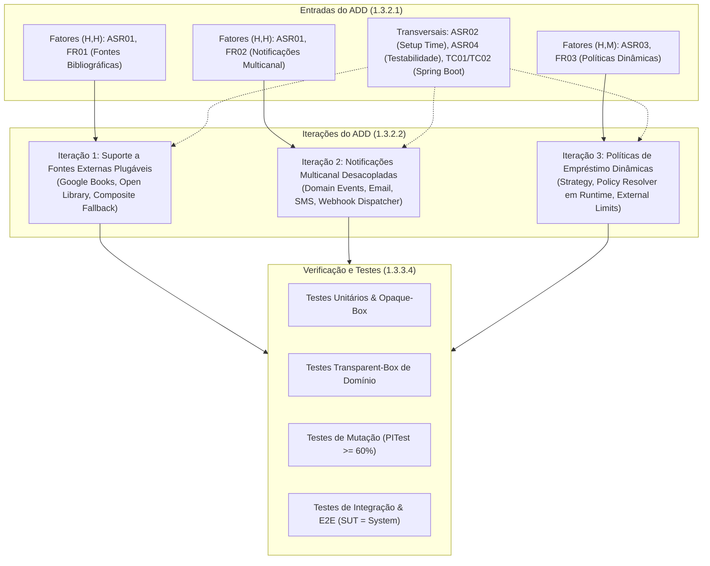

# ARQSOFT — Identificação e Classificação de Requisitos e Fatores Arquiteturais (System-to-Be)

## 1. Enquadramento e Metodologia ADD 3.0 (Passo 1: Review Inputs)

No método **Attribute-Driven Design (ADD 3.0)** do *Software Engineering Institute* (SEI), a arquitetura do *System-to-Be* é orientada por um conjunto de forças motrizes (*Architectural Drivers*). 

Conforme preconizado na literatura de referência (Bass, Clements, Kazman), estes condutores de desenho estruturam-se em duas grandes vertentes:
1. **Requisitos de Software (*Requirements*):**
   * **Requisitos Funcionais com Significância Arquitetural (*Architecturally Significant Functional Requirements — ASR/FR*):** Funcionalidades requeridas na secção 1.3.3 do enunciado que moldam as interfaces e a modularidade.
   * **Requisitos de Atributos de Qualidade (*Quality Attribute Requirements — QAR / ASR*):** Requisitos não funcionais prioritários, com especial destaque para a tríade identificada na **secção 1.2 (Problem)** do enunciado: **Extensibilidade (*Extensibility*)**, **Configurabilidade (*Configurability*)** e **Testabilidade (*Testability*)**.
2. **Fatores Arquiteturais e Restrições (*Architectural Factors & Constraints*):**
   * **Restrições Técnicas e Tecnológicas (*Technical Constraints*):** Limitações obrigatórias impostas pela stack tecnológica Java 17, Spring Boot, modelo de dados relacional e execução em ambiente de testes isolado.
   * **Limitações Organizacionais e de Negócio (*Organizational / Business Limitations*):** Limitações de prazos de entrega, dimensão da equipa de desenvolvimento e critérios metodológicos de avaliação.

---

## 2. Parte I — Identificação e Classificação de Requisitos (*Requirements*)

### 2.1. Requisitos Funcionais Primários (FR — 1.3.3)

* **FR01 — Recuperação de Informação Bibliográfica Heterogénea (1.3.3.1):**
  * O sistema deve obter informação bibliográfica a partir de múltiplos sistemas externos heterogéneos, suportando obrigatoriamente a **Google Books API** e a **Open Library API**.
  * Deve permitir agregação de modelos de dados distintos e estratégia de contingência (*fallback*).
* **FR02 — Notificação a Leitores sobre Eventos de Empréstimo (1.3.3.2):**
  * O sistema deve notificar os leitores acerca de eventos críticos do ciclo de vida dos empréstimos (novo empréstimo, aviso de prazo de devolução, notificação de atraso com apuramento de multas e confirmação de devolução).
  * Deve suportar mecanismos distintos de notificação: **Email**, **SMS** e **Webhook**, operando individualmente ou em qualquer combinação configurada.
* **FR03 — Aplicação de Políticas de Empréstimo Flexíveis e Dinâmicas (1.3.3.3 & Políticas v1.0):**
  * O sistema deve aplicar políticas de empréstimo distintas em conformidade com a *Lending Policies Specification v1.0*: a **Standard Lending Policy** (política por omissão com `MaxActiveLendings`, `LendingPeriod`, `MaxRenewals`, `RenewalPeriod`) e a **Adaptive Lending Policy** (com `FirstThreshold`, `SecondThreshold`, escalonando entre `LongPeriod`, `StandardPeriod` e `ShortPeriod`).
  * O sistema deve suportar a **renovação de empréstimos** (`renew`), permitida até `MaxRenewals` vezes por `RenewalPeriod` dias (Standard) ou desde que as condições da política continuem satisfeitas (Adaptive).
  * O sistema deve reavaliar dinamicamente em *runtime* a política aplicável a cada novo empréstimo ou renovação com base no histórico do leitor nos últimos `HistoryPeriod` meses (`MinCompletedLendings`, `MinOnTimeRatio` e ausência de atrasos ativos).
  * Todos os parâmetros quantitativos devem ser configuráveis externamente em *setup time* sem alteração de código-fonte, satisfazendo as restrições: $0 < \text{FirstThreshold} < \text{SecondThreshold} < \text{MaxActiveLendings}$ e $\text{LongPeriod} > \text{StandardPeriod} > \text{ShortPeriod} > 0$.
* **FR04 — Catálogo e Serviços Globais de Biblioteca (1.1 Context):**
  * Manutenção dos serviços existentes de gestão do ciclo de vida de Livros, Géneros, Autores, Leitores e Empréstimos.

---

### 2.2. Requisitos de Atributos de Qualidade (QAR / ASR — 1.2 Problem)

Estes requisitos respondem diretamente aos problemas estruturais identificados no *system-as-is*:

* **ASR01 — Extensibilidade (*Extensibility / Modifiability*) — [Problema 1.2.1]:**
  * *Contexto:* Capacidade de suportar novos fornecedores bibliográficos (ex.: WorldCat, Biblioteca Nacional), novos canais de notificação (ex.: WhatsApp, Push, Slack) e novas políticas de negócio sem alterar o código existente, cumprindo o princípio *Open-Closed Principle* (OCP).
* **ASR02 — Configurabilidade em Setup Time (*Configurability at Startup*) — [Problema 1.2.2]:**
  * *Contexto:* Capacidade de selecionar e parametrizar quais os fornecedores bibliográficos ativos, quais os canais de notificação em uso e quais os limiares numéricos das políticas de empréstimo através de ficheiros externos (`application.properties` / `library.properties`), sem necessidade de recompilação do código.
* **ASR03 — Configurabilidade em Runtime (*Dynamic Runtime Flexibility*) — [Problema 1.2.2]:**
  * *Contexto:* Capacidade de selecionar e resolver em tempo de execução (*runtime*) a política de empréstimo aplicável em cada requisição (com base em regras de perfil do leitor, idade ou tipo de livro), sem interrupção de serviço.
* **ASR04 — Testabilidade Automatizada (*Testability*) — [Problema 1.2.3 / 1.3.3.4]:**
  * *Contexto:* Estruturação modular orientada a *Inversion of Control* (IoC) que permite testes funcionais em caixa-opaca (SUT = classes, controller+service+gateways, e system global E2E), caixa-transparente de domínio, e testes de mutação com PITest ($\ge 60\%$ de mutantes eliminados e cobertura $\ge 70\%$).
* **ASR05 — Interoperabilidade de Dados Heterogéneos (*Interoperability*):**
  * *Contexto:* Capacidade de normalizar esquemas de dados externos díspares (Google Books vs. Open Library) para um modelo canónico interno (*Canonical Data Model*).
* **ASR06 — Resiliência e Tolerância a Falhas (*Reliability / Fault Tolerance*):**
  * *Contexto:* A falha temporária ou erro num serviço externo (ex.: indisponibilidade do Google Books ou falha no envio de um SMS) não pode corromper a transação de negócio principal de criação do empréstimo na base de dados.
* **ASR07 — Desempenho e Não-Bloqueio (*Performance / Concurrency*):**
  * *Contexto:* Garantir que a latência dos pedidos HTTP REST aos clientes da biblioteca permanece baixa, desacoplando o envio de notificações através de execução orientada a eventos assíncronos.

---

## 3. Parte II — Identificação e Classificação de Fatores Arquiteturais e Restrições (*Architectural Factors & Constraints*)

### 3.1. Restrições Técnicas e Tecnológicas (Technical Constraints — TC)

* **TC01 — Plataforma Java e Spring Boot:**
  * Uso obrigatório de **Java 17 (LTS)** e ecossistema **Spring Boot** (Spring Web, Spring Data JPA, Spring Events, `@ConditionalOnProperty`, `@ConfigurationProperties`).
* **TC02 — Arquitetura Monolítica Modular (*Modular Monolith*):**
  * Manutenção do paradigma monolítico modular orientado a domínios (DDD), preservando os limites dos subdomínios (`bookmanagement`, `lendingmanagement`, `readermanagement`, `usermanagement`, etc.) sem introduzir arquitetura distribuída de microsserviços.
* **TC03 — Persistência Relacional com Hibernate/JPA:**
  * Armazenamento de dados em base de dados relacional (H2 Database) através de Spring Data JPA e Hibernate ORM, mantendo a consistência transacional ACID e preservando o esquema de dados das entidades base.
* **TC04 — Padrão de Comunicação RESTful:**
  * Exposição dos serviços públicos do LMS através de endpoints HTTP seguindo as convenções REST e payloads no formato JSON.
* **TC05 — Isolamento Offline do Build e Testes Automatizados:**
  * A bateria de testes (`mvn test`) deve executar de forma determinística e em ambiente hermético/offline, sendo expressamente proibida a dependência de chamadas HTTP reais a serviços externos na internet durante os testes unitários e de integração (uso obrigatório de Mocks, Stubs e WireMock).

---

### 3.2. Limitações Organizacionais e de Processo (Organizational Limitations — OL)

* **OL01 — Dimensão e Organização da Equipa:**
  * Desenvolvimento realizado por uma equipa de 3 estudantes, exigindo a definição rigorosa de contratos de interface prévios (APIs e DTOs) para viabilizar trabalho paralelo sem bloqueios entre membros.
* **OL02 — Prazos de Entrega Académicos:**
  * Submissão e primeira avaliação presencial obrigatória agendada para **2026-11-01**.
* **OL03 — Rigor Metodológico e Notacional:**
  * Adoção obrigatória do método formal **ADD 3.0** e documentação arquitetural no modelo **C4 + 4+1 Vistas de Kruchten**, garantindo rastreabilidade formal (`<<manifest>>`).
* **OL04 — Critérios Quantitativos de Qualidade de Código:**
  * Zero erros de compilação em JDK 17, cobertura de código $\ge 70\%$ nas novas funcionalidades e taxa de mutação com PITest $\ge 60\%$.

---

## 4. Tabela de Classificação Global de Requisitos e Fatores

| ID | Classificação Formal | Designação | Descrição Resumida no Domínio do LMS | Impacto Arquitetural Primário |
| :--- | :--- | :--- | :--- | :--- |
| **FR01** | Requisito Funcional | Catálogo Multi-Fonte Heterogéneo | Integração obrigatória de Google Books e Open Library. | Introdução de camada de tradução e modelo de dados canónico. |
| **FR02** | Requisito Funcional | Notificações Multicanal | Envio de mensagens via Email, SMS e Webhooks. | Desacoplamento do fluxo transacional através de eventos. |
| **FR03** | Requisito Funcional | Políticas de Empréstimo Flexíveis | Parametrização de limites de livros, prazos e taxas. | Eliminação de lógica fixa; introdução de motor de regras. |
| **FR04** | Requisito Funcional | Gestão Central do LMS | Manutenção do catálogo, autores, leitores e empréstimos. | Coesão funcional dentro dos subdomínios existentes. |
| **ASR01** | Atributo de Qualidade | Extensibilidade (Modificabilidade) | Novas fontes, canais ou políticas adicionadas via OCP. | Padrões Adapter, Strategy e Observer com interfaces desacopladas. |
| **ASR02** | Atributo de Qualidade | Configurabilidade em Setup Time | Parametrização sem recompilar (`application.properties`). | Injeção condicional no arranque (`@ConditionalOnProperty`). |
| **ASR03** | Atributo de Qualidade | Configurabilidade em Runtime | Seleção da política de empréstimo no momento do pedido. | Padrão Strategy associado a Factory / Policy Resolver dinâmico. |
| **ASR04** | Atributo de Qualidade | Testabilidade Automatizada | Bateria de testes em múltiplos níveis e mutação PITest $\ge 60\%$. | Arquitetura hexagonal/portas-e-adaptadores facilitando mocks. |
| **ASR05** | Atributo de Qualidade | Interoperabilidade | Harmonização de contratos JSON externos díspares. | Mappers dedicados e interfaces de Gateway. |
| **ASR06** | Atributo de Qualidade | Fiabilidade / Resiliência | Tolerância a falhas externas e fallback entre fontes. | Padrão Composite / Fallback Chain; isolamento de exceções. |
| **ASR07** | Atributo de Qualidade | Desempenho / Não-Bloqueio | Envio de notificações sem abrandar requisições REST. | Publicação de eventos de domínio com listeners desacoplados. |
| **TC01** | Restrição Técnica | Spring Boot & Java 17 | Tecnologias base obrigatórias da solução. | Adoção de anotações e componentes do ecossistema Spring. |
| **TC02** | Restrição Técnica | Monolito Modular (DDD) | Manutenção de subdomínios coesos num único artefacto. | Respeito pelos limites de módulos e visibilidade de pacotes. |
| **TC03** | Restrição Técnica | Persistência Relacional JPA/H2 | Armazenamento relacional com transações ACID. | Repositórios abstratos (Spring Data JPA) isolados do domínio. |
| **TC04** | Restrição Técnica | Exposição RESTful / JSON | Comunicação com clientes via HTTP e JSON. | Controladores REST desacoplados dos serviços de domínio. |
| **TC05** | Restrição Técnica | Testes Offline Herméticos | Testes não podem falhar por falta de conectividade externa. | Mocks e stubs locais obrigatórios para todas as APIs externas. |
| **OL01** | Limitação Organizacional | Divisão por 3 Estudantes | Trabalho distribuído por tópicos (Fontes, Notificações, Políticas). | Contratos de interface e DTOs definidos antecipadamente. |
| **OL02** | Limitação Organizacional | Prazo de Avaliação (2026-11-01) | Data limite para apresentação e avaliação presencial. | Priorização estrita das iterações mais críticas do ADD. |
| **OL03** | Limitação Organizacional | Metodologia ADD 3.0 & C4 | Adoção formal do processo SEI e 4+1 Vistas de Kruchten. | Rastreabilidade sistemática entre requisitos, decisões e código. |
| **OL04** | Limitação Organizacional | Metas de Qualidade de Código | Cobertura $\ge 70\%$ e eliminação de mutantes PITest $\ge 60\%$. | Escrita contínua de testes defensivos de valores-limite e branches. |

---

## 5. Priorização dos Fatores para o Processo ADD (Passo 2 do ADD)

No **Passo 2 do método ADD (Categorização e Priorização dos Drivers)**, os requisitos e fatores identificados são cruzados numa matriz de duas dimensões:
1. **Importância para os Stakeholders / Negócio (*Business Importance*):** Alta (H), Média (M), Baixa (L)
2. **Impacto no Desenho Arquitetural / Risco Técnico (*Architectural Impact / Risk*):** Alto (H), Médio (M), Baixo (L)

Esta priorização determina a ordem de execução das **Iterações do ADD (1.3.2.2)**:

### 5.1. Matriz de Priorização

| Driver Arquitetural | Importância Negócio | Impacto Arquitetural | Prioridade Global | Mapeamento no Processo ADD |
| :--- | :---: | :---: | :---: | :--- |
| **ASR01 + FR01** (Fontes Bibliográficas Heterogéneas Plugáveis) | **H** | **H** | **(H, H) — Crítica (P1)** | **Iteração 1 do ADD** (Mapeamento canónico, Adapter & Composite) |
| **ASR01 + FR02** (Notificações Multicanal Desacopladas) | **H** | **H** | **(H, H) — Crítica (P1)** | **Iteração 2 do ADD** (Domain Events, Observer & Multichannel Dispatcher) |
| **ASR03 + FR03** (Políticas de Empréstimo Dinâmicas em Runtime) | **H** | **M** | **(H, M) — Alta (P2)** | **Iteração 3 do ADD** (Strategy Pattern & Policy Engine) |
| **ASR02** (Configurabilidade em Setup Time) | **H** | **M** | **(H, M) — Alta (P2)** | **Transversal** (Binding de propriedades e instanciação condicional) |
| **ASR04 + TC05** (Testabilidade e Execução Hermética) | **H** | **M** | **(H, M) — Alta (P2)** | **Transversal** (Arquitetura orientada a mocks, IoC e isolamento) |
| **ASR05** (Interoperabilidade de Modelos Heterogéneos) | **M** | **M** | **(M, M) — Média (P3)** | Suporte à Iteração 1 (DTOs canónicos e Mappers) |
| **ASR06** (Fiabilidade e Fallback de Fontes) | **M** | **M** | **(M, M) — Média (P3)** | Suporte à Iteração 1 (Fallback Chain) e Iteração 2 (Isolamento de falhas) |
| **ASR07** (Desempenho / Envio Assíncrono) | **M** | **M** | **(M, M) — Média (P3)** | Suporte à Iteração 2 (Execução de listeners sem bloqueio transacional) |
| **TC01 + TC02** (Spring Boot & Monolito Modular) | **H** | **H** | **(H, H) — Estrutural** | Restrições que governam a estrutura global em todas as iterações |
| **OL01 + OL02** (Divisão por 3 Estudantes e Prazos) | **H** | **M** | **(H, M) — Processual** | Condicionam a definição de contratos antecipados e roadmap |

---

## 5.2. Critério Operacional de «Impacto Limitado» e Análise de Extensibilidade (Subcritério C1.1)

Em conformidade com o subcritério **C1.1 (Requisitos e Drivers Arquiteturais — Nível 5)** da grelha de avaliação, o conceito de «impacto limitado» na adição de uma nova fonte bibliográfica, novo canal de notificação ou nova política de empréstimo não é um limiar arbitrário, sendo definido e justificado operacionalmente pelo grupo com base nos seguintes critérios verificáveis:

### 1. Definição Operacional e Métricas de «Impacto Limitado»
Uma extensão ao sistema é classificada como de **«Impacto Limitado»** se e só se verificar cumulativamente:
1. **Zero Modificações no Núcleo de Domínio e Serviços Aplicacionais:** Nenhuma linha de código existente em `BookServiceImpl`, `LendingServiceImpl`, `Book`, `Lending` ou `Reader` é alterada (conformidade estrita com o princípio Aberto/Fechado — OCP).
2. **Confinamento a 1 Novo Adaptador de Infraestrutura:** A integração de uma 3.ª fonte (ex.: *WorldCat*), 4.º canal de notificação (ex.: *Push*) ou nova política requer estritamente a criação de **uma única classe** que implemente a interface contratual respetiva (`BookInfoProvider`, `NotificationSender` ou `LendingPolicy`).
3. **Configuração Externa Isolada:** Ativação da nova capacidade através de **uma única linha de configuração** em *setup time* (ex.: `bibliographic.providers=googlebooks,openlibrary,worldcat`) ou registo no contentor IoC.
4. **Isolamento de Regressões e Testabilidade Hermética:** A adição da nova capacidade não quebra nenhum dos testes existentes (100% de retrocompatibilidade) e a nova classe é testada de forma isolada com mocks/stubs offline (`TC05`).

### 2. Cenário Verificável de Extensão (Adição de 3.ª Fonte: WorldCat)
* **Estímulo:** Necessidade de integrar o catálogo WorldCat para pesquisa de livros por ISBN.
* **Ações Necessárias:**
  1. Criar a classe `WorldCatAdapter` no pacote `bookmanagement.infrastructure.gateways`, implementando `BookInfoProvider` e convertendo a resposta da API para `BookDetailsDTO`;
  2. Adicionar `worldcat` à lista `bibliographic.providers` em `application.properties`;
  3. Adicionar o teste unitário isolado `WorldCatAdapterTest` com stubs JSON.
* **Resultado Mensurável:** `BookServiceImpl` e `CompositeBookInfoProvider` consom o novo adaptador sem qualquer alteração. O esforço é confinado a $< 1$ dia de desenvolvimento e 0 riscos de regressão.

### 3. Compromissos (*Trade-offs*) entre Extensibilidade e Complexidade
* **Extensibilidade Adquirida:** O desacoplamento através de portas (`BookInfoProvider`), DTO canónico (`BookDetailsDTO`) e o intermediário `CompositeBookInfoProvider` permite plugar e desligar fontes livremente, suportar *fallback* resiliente (`ASR06`) e manter testes herméticos (`TC05`).
* **Complexidade Introduzida (*Overhead*):** 
  * Aumento no número de classes e indireções estruturais (interfaces adicionais, DTOs de transporte e adaptadores dedicados);
  * Custo de normalização de dados heterogéneos: campos parciais devolvidos por certas APIs (ex.: Open Library não ter descrição em certos registos ou Google Books formatar autores diferentemente) exigem lógica defensiva de fusão (*merging*) no *Composite*;
  * Gestão de *timeouts*: a execução sequencial de *fallback* entre múltiplas fontes externas pode acumular latência se cada chamada demorar até 2.5s, justificando *timeouts* curtos e configuráveis.

### 4. Limitações da Análise
* A análise assume disponibilidade e estabilidade mínima das APIs REST externas com formatos JSON previsíveis. APIs que exijam autenticação OAuth2 complexa por sessão de utilizador ou protocolos SOAP requereriam adaptadores com gestão de estado adicional, introduzindo dependências de infraestrutura de segurança.

---

## 6. Rastreabilidade com as Iterações do ADD

A priorização formal acima estabelecida justifica diretamente as três iterações do processo ADD:

1. **Iteração 1 — Fontes Bibliográficas Plugáveis:** Aborda os drivers `ASR01`, `FR01`, `ASR05`, `ASR02` e `TC05`. Resolve a heterogeneidade e a contingência através dos padrões **Adapter**, **Gateway** e **Composite**.
2. **Iteração 2 — Notificações Multicanal Desacopladas:** Aborda os drivers `ASR01`, `FR02`, `ASR06`, `ASR07` e `ASR02`. Resolve o desacoplamento de canais externos através do padrão **Observer / Domain Events** com Spring Events e **Strategy / Composite**.
3. **Iteração 3 — Políticas de Empréstimo Dinâmicas em Runtime:** Aborda os drivers `ASR03`, `FR03`, `ASR02` e `ASR01`. Resolve a flexibilidade de regras de empréstimo através dos padrões **Strategy** e **Factory / Policy Resolver**, suportados por `@ConfigurationProperties`.
4. **Decisões Transversais de Testabilidade:** Aborda `ASR04`, `TC05` e `OL04`, garantindo que todas as interfaces expostas nas iterações 1, 2 e 3 permitem substituição direta por mocks sem necessidade de rede externa.
