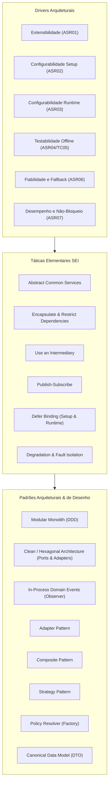
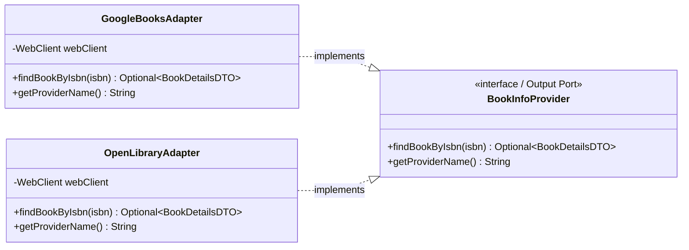
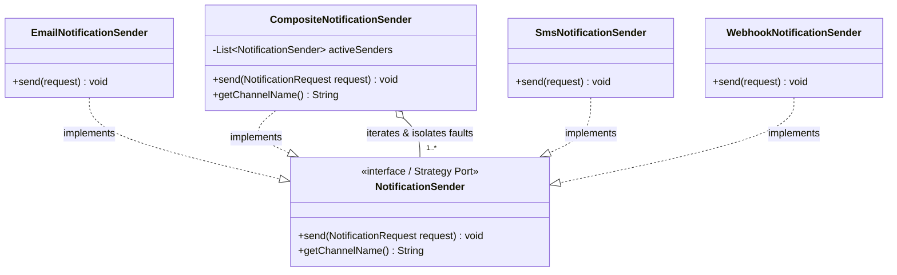
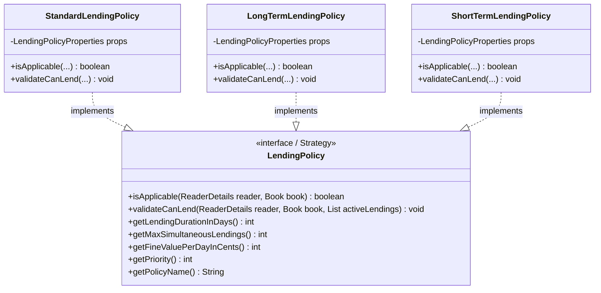

# ARQSOFT — Padrões Arquiteturais e de Desenho (System-to-Be)

## 1. Enquadramento dos Padrões no ADD 3.0 (Passo 4: *Choose Design Concepts*)

No método **Attribute-Driven Design (ADD 3.0)** do *Software Engineering Institute* (SEI — Cervantes & Kazman, 2016; Bass, Clements & Kazman, 2021), os **Padrões (*Patterns*)** representam soluções comprovadas, documentadas e parametrizáveis para problemas recorrentes de organização de software:
* **Definição Formal:** Um padrão é uma solução concetual reutilizável que descreve uma configuração de elementos estruturais, as suas responsabilidades mútuas e as regras de colaboração necessárias para resolver um problema num contexto específico.
* **A Relação Indissociável entre Táticas e Padrões:**
  * Uma **Tática Arquitetural** (analisada em [`architectural-tactics.md`](./architectural-tactics.md)) é uma decisão de desenho elementar focada no controlo de **um único atributo de qualidade**.
  * Um **Padrão de Desenho ou Arquitetural** empacota e combina **uma sinergia de táticas**, oferecendo uma estrutura concreta que equilibra múltiplos requisitos de qualidade em simultâneo (ex.: o padrão *Adapter* combina as táticas *Encapsulate*, *Restrict Dependencies* e *Data Transformation*).
* **Continuidade entre Padrões Arquiteturais e Padrões de Desenho:**
  * Na arquitetura e desenho de software não existe uma fronteira rígida. No método ADD, os padrões dividem-se pela sua granularidade e impacto estrutural:
    1. **Padrões Arquiteturais (Macro-Estrutura):** Organizam subsistemas, módulos de domínio e limites de contexto.
    2. **Padrões de Desenho / Padrões Táticos (Micro-Estrutura):** Organizam a colaboração entre classes, interfaces e objetos para resolver sub-problemas específicos.

---

## 2. Catálogo de Padrões Arquiteturais Macro-Estruturais

Estes padrões estabelecem a topologia global do sistema e o modelo de organização do código-fonte, garantindo o cumprimento estrito das restrições `TC01` (Java/Spring Boot), `TC02` (Monólito Modular) e `TC05` (Testes herméticos).

### 2.1. Padrão Arquitetural *Modular Monolith (Domain-Driven Design — DDD)*
* **Problema Resolvido:** Como estruturar uma aplicação de gestão empresarial rica e coesa sem cair no antipadrão da "grande bola de lama" (*Big Ball of Mud*) nem incorrer na complexidade desnecessária de microsserviços distribuídos (*over-engineering*).
* **Solução:** O sistema executa num processo único JVM, mas o código-fonte decompõe-se em pacotes de primeiro nível correspondentes aos **Subdomínios / Limites de Contexto (*Bounded Contexts*)** da biblioteca:
  * `bookmanagement`: Agregado `Book`, `Genre`, `Isbn`.
  * `lendingmanagement`: Agregado `Lending`, `Fine`, cálculo de datas e políticas.
  * `readermanagement`: Agregado `ReaderDetails`, perfis e notificações.
  * `usermanagement`, `authormanagement`, `genremanagement`.
* **Regras Arquiteturais:**
  1. Cada módulo encapsula as suas próprias tabelas de persistência e repositórios.
  2. Nenhuma entidade de um subdomínio referencia diretamente entidades internas de outro subdomínio (utilizam-se IDs de negócio ou contratos de serviço).
  3. A comunicação síncrona entre módulos efetua-se exclusivamente através de interfaces públicas da camada `services` (Inversão de Dependências — DIP).
* **Táticas SEI Materializadas:** *Split Module by Domain*, *Increase Semantic Coherence*, *Restrict Dependencies*.

---

### 2.2. Padrão *Clean Architecture / Ports & Adapters (Hexagonal Architecture)*
* **Problema Resolvido:** Como isolar as regras de negócio essenciais e os casos de uso de dependências voláteis de infraestrutura (APIs HTTP externas, frameworks web, controladores REST e bases de dados).
* **Solução:** Cada módulo de subdomínio organiza-se segundo quatro círculos concêntricos de responsabilidade, governados pela **Regra da Dependência (*Dependency Rule*)**: o código fonte só pode apontar para dentro (em direção ao domínio puro).
  * **Driving Ports (Portas de Entrada):** Interfaces de serviços aplicacionais (`BookService`, `LendingService`, `ReaderService`) invocadas pelos adaptadores de entrada (REST Controllers).
  * **Driven Ports (Portas de Saída):** Interfaces abstratas que definem o que a camada de negócio precisa da infraestrutura externa:
    * `BookInfoProvider`: Obtenção de metadados bibliográficos;
    * `NotificationSender`: Entrega multicanal de mensagens a leitores;
    * `BookRepository`, `LendingRepository`: Contratos de persistência de dados.
  * **Adapters (Adaptadores Concretos):** Componentes da camada de infraestrutura que implementam as portas de saída (`GoogleBooksAdapter`, `OpenLibraryAdapter`, `EmailNotificationSender`, `SmsNotificationSender`, `WebhookNotificationSender`, repositórios JPA) ou que acionam as portas de entrada (`BookController`, `LendingController`).
* **Táticas SEI Materializadas:** *Abstract Common Services*, *Encapsulate*, *Restrict Dependencies*, *Maintain Abstract Interfaces*.

---

### 2.3. Padrão *In-Process Event-Driven Architecture (Domain Events / Observer)*
* **Problema Resolvido:** Como propagar efeitos secundários após transações de negócio críticas (ex.: envio de notificações após criação de empréstimo) sem acoplar os módulos de domínio nem arriscar o aborto da transação de persistência caso o efeito secundário falhe.
* **Solução:** O módulo de empréstimos (`lendingmanagement`) emite **Eventos de Domínio imutáveis** através do barramento interno do Spring (`ApplicationEventPublisher`), e o módulo de leitores (`readermanagement`) subscreve esses eventos através de `@EventListener`:
  1. `LendingServiceImpl` executa a validação, grava o empréstimo na base de dados H2 (`TC03`) e emite `LendingCreatedEvent(lendingId, readerNumber, isbn, limitDate)`.
  2. O barramento de eventos notifica de forma síncrona ou assíncrona o componente `LendingNotificationListener`.
  3. O listener formata o pedido e delega no subsistema de notificações multicanal.
* **Táticas SEI Materializadas:** *Publish-Subscribe*, *Fault Isolation*, *Asynchronous Event Processing*, *Encapsulate*.

---

## 3. Catálogo de Padrões de Desenho Táticos (Micro-Estruturais)

Abaixo catalogam-se os padrões táticos de nível de componente e classes utilizados para responder às exigências específicas do enunciado 1.3.3.

### 3.1. Padrão *Adapter* (GoF Estrutural)

* **Intenção do Padrão:** Converter a interface e o formato de dados de uma API externa incompatível numa interface contratual padrão esperada pelos consumidores internos.
* **Instanciações no Projeto:**
  1. **Tópico 1.3.3.1 (Fontes Bibliográficas):**
     * `GoogleBooksAdapter`: Consome o endpoint REST do Google Books (`/volumes?q=isbn:{isbn}`), faz o parsing do JSON em árvore (`items[0].volumeInfo`) e converte os campos para `BookDetailsDTO`.
     * `OpenLibraryAdapter`: Consome a REST API da Open Library (`/api/books?bibkeys=ISBN:{isbn}`), trata o JSON indexado por chave e mapeia para `BookDetailsDTO`.
  2. **Tópico 1.3.3.2 (Notificações a Leitores):**
     * `EmailNotificationSender`: Implementa `NotificationSender`, integrando com a infraestrutura de email/SMTP.
     * `SmsNotificationSender`: Implementa `NotificationSender`, formatando a mensagem para formato SMS conciso.
     * `WebhookNotificationSender`: Implementa `NotificationSender`, serializando o pedido para JSON e executando HTTP POST via `WebClient`.
* **Benefício Arquitetural:** Cumpre estritamente o princípio OCP (`ASR01`). Se a biblioteca quiser suportar uma nova fonte (ex.: *WorldCat*) ou um novo canal (ex.: *Push*), basta criar uma nova classe *Adapter*, sem modificar uma única linha de código existente.
* **Táticas SEI Materializadas:** *Encapsulate*, *Restrict Dependencies*, *Data Transformation*.

---

### 3.2. Padrão *Composite* (GoF Estrutural)

* **Intenção do Padrão:** Permitir que clientes tratem objetos individuais e composições de múltiplos objetos de forma uniforme através da mesma interface de contrato.
* **Instanciações no Projeto:**
  1. **Tópico 1.3.3.1 (`CompositeBookInfoProvider` — Suporte a Múltiplas Fontes e Contingência):**
     * Implementa a interface comum `BookInfoProvider` e encapsula a coleção ordenada de adaptadores ativos (`GoogleBooksAdapter`, `OpenLibraryAdapter`) definidos na configuração de arranque (`bibliographic.providers`).
     * **Comportamento Dual: Contingência (*Fallback*) e Enriquecimento (*Data Merging*):**
       * *Cenário de Contingência (Resiliência):* Caso a fonte primária se encontre inacessível, sofra timeout ou devolva erro HTTP (ex.: 404/503), o composite interceta a exceção de forma transparente e consulta automaticamente a fonte seguinte na lista, assegurando disponibilidade (`ASR06`).
       * *Cenário de Subconjuntos Heterogéneos (Enriquecimento de Dados):* Respondendo à exigência do enunciado de que diferentes sistemas expõem diferentes subconjuntos de metadados, caso o fornecedor primário devolva um registo com campos essenciais em falta (ex.: Google Books devolve título mas omite descrição detalhada ou capa), o composite consulta a fonte seguinte para preencher os atributos nulos no modelo canónico `BookDetailsDTO` antes de o entregar ao serviço de livros.
  2. **Tópico 1.3.3.2 (`CompositeNotificationSender` — Despacho Multicanal Isolado):**
     * Implementa `NotificationSender` e agrega todos os canais selecionados em *setup time* (`Email`, `SMS`, `Webhook`).
     * Itera sobre os *senders* ativos, envolvendo cada invocação num bloco protetor de isolamento de falhas (`try/catch`).
* **Benefício Arquitetural:** O consumidor (`BookServiceImpl` ou `LendingNotificationListener`) comunica com uma única referência abstrata, ignorando por completo se está ativa 1 fonte, 2 fontes, ou todos os canais de notificação em simultâneo (`ASR02`, `ASR06`).
* **Táticas SEI Materializadas:** *Use an Intermediary*, *Degradation / Fallback*, *Fault Isolation*.

---

### 3.3. Padrão *Strategy* (GoF Comportamental)

* **Intenção do Padrão:** Definir uma família de algoritmos ou regras de negócio, encapsular cada um numa classe separada e torná-los estritamente intermutáveis.
* **Instanciações no Projeto:**
  1. **Tópico 1.3.3.3 (Políticas de Empréstimo Flexíveis):**
     * A interface `LendingPolicy` encapsula o comportamento das regras de empréstimo: elegibilidade (`isApplicable`), validação de regras de bloqueio (`validateCanLend`), prazo de empréstimo (`getLendingDurationInDays`), número máximo de livros em simultâneo (`getMaxSimultaneousLendings`) e valor da multa diária (`getFineValuePerDayInCents`).
     * As implementações concretas (`StandardLendingPolicy`, `LongTermLendingPolicy`, `ShortTermLendingPolicy`, `PremiumReaderLendingPolicy` e `DynamicLendingPolicy`) isolam as variações de negócio em classes independentes.
  2. **Tópico 1.3.3.2 (Canais de Envio):**
     * Cada canal de notificação é uma estratégia concreta de entrega de dados sob a interface comum `NotificationSender`.
* **Benefício Arquitetural e Suporte a Testes Automatizados (1.3.3.4):**
  * Elimina blocos gigantescos de condicionais `if/else` ou `switch` no serviço de aplicação, assegurando conformidade com o OCP (`ASR01`).
  * **Testabilidade de Caixa Transparente e Mutação PITest (1.3.3.4.2 & 1.3.3.4.3):** Por serem classes de domínio puras sem dependências de infraestrutura nem contexto Spring, cada política é testável isoladamente com Análise de Valores Limite. Isto garante cobertura de ramos integral e permite aniquilar mutantes gerados pelo PITest (`ConditionalsBoundaryMutator`, `MathMutator`, `NegateConditionalsMutator`).
* **Táticas SEI Materializadas:** *Abstract Common Services*, *Polymorphism*, *High Semantic Coherence*.

---

### 3.4. Padrão *Factory / Policy Resolver* (GoF Criacional & Intermediário Dinâmico)
* **Intenção do Padrão:** Centralizar a lógica de identificação, instanciação e resolução dinâmica de componentes sem acoplar os consumidores às implementações concretas.
* **Instanciações no Projeto:**
  1. **`LendingPolicyResolver` (Seleção Dinâmica em *Runtime* — 1.3.3.3):**
     * Recebe por injeção de dependência todas as instâncias de `LendingPolicy` registadas no contentor Spring.
     * Quando um empréstimo é solicitado para um determinado `Reader` e `Book`, o resolvedor filtra as políticas candidatas (`policy.isApplicable(reader, book) == true`) e seleciona deterministicamente a política de maior prioridade (`getPriority()`).
     * *Regras de Exemplo:*
       * `ShortTermLendingPolicy` (Prioridade 30): Aplica-se se o livro for de consulta rápida / referência ou obra de alta procura;
       * `LongTermLendingPolicy` (Prioridade 15): Aplica-se se o leitor tiver <= 1 empréstimo ativo (prazo alargado de 30 dias);
       * `PremiumReaderLendingPolicy` (Prioridade 20): Aplica-se a leitores com perfil VIP, investigadores ou docentes (prazo de 30 dias e limite alargado);
       * `StandardLendingPolicy` (Prioridade 10): Política por omissão (*fallback*) para todos os restantes casos.
  2. **`BibliographicConfig` e `NotificationConfig` (Fábricas de Vinculação em *Setup Time* — 1.3.3.1 e 1.3.3.2):**
     * Classes `@Configuration` que leem as propriedades externas (`bibliographic.providers`, `notification.channels`) e montam dinamicamente os beans primários no arranque da aplicação.
* **Benefício Arquitetural:** Concretiza a tática de adiar a vinculação para *setup time* (`ASR02`) e *runtime* (`ASR03`), garantindo desacoplamento total.
* **Táticas SEI Materializadas:** *Use an Intermediary*, *Defer Binding Time (Startup & Runtime)*, *Conditional Component Registration*.

---

### 3.5. Padrão *Canonical Data Model* (EIP — Fowler / Hohpe)
* **Intenção do Padrão:** Definir uma representação de dados interna, comum e estável, protegendo o núcleo aplicacional de modelos externos proprietários e voláteis.
* **Instanciação no Projeto:**
  * O record/DTO `BookDetailsDTO` (em `bookmanagement.services`) normaliza os dados de livros recebidos do Google Books e da Open Library:
    * `isbn`: String normalizada (ISBN-10 ou ISBN-13);
    * `title`: String com o título da obra;
    * `description`: Texto descritivo/sinopse;
    * `authors`: Lista normalizada de nomes de autores;
    * `publisher`, `publishDate`, `coverImageUrl`.
* **Benefício Arquitetural:** O serviço de livros (`BookServiceImpl`) e o domínio (`Book`) apenas conhecem `BookDetailsDTO`. Alterações estruturais no JSON de terceiros têm impacto estritamente confinado ao respetivo *Adapter* (`ASR05`).
* **Táticas SEI Materializadas:** *Abstract Common Services*, *Encapsulate*, *Data Transformation*.

---

### 3.6. Padrões Complementares: Inversão de Controlo (IoC), Injeção de Dependências (DI) e Configuração Tipada
* **Spring IoC & Dependency Injection:** Todos os serviços recebem as suas dependências através do construtor, eliminando o uso de `new ConcreteClass()` no código aplicacional e permitindo a injeção trivial de *stubs* e *mocks* em testes (`TC05`).
* **Configuração Tipada (`@ConfigurationProperties`):** A classe `LendingPolicyProperties` efetua o mapeamento hierárquico das propriedades de ficheiros externos (`lending.policies.*`) para objetos Java imutáveis no arranque, eliminando o recurso a *hardcoded values* (`ASR02`).

---

## 4. Matriz de Rastreabilidade Cruzada: Padrões $\leftrightarrow$ Táticas $\leftrightarrow$ Drivers

A tabela seguinte estabelece a rastreabilidade formal e bidirecional exigida pela metodologia ADD 3.0:

| Padrão Arquitetural / de Desenho | Iteração do ADD / Sub-Problema | Táticas Arquiteturais SEI Subjacentes | Drivers e Cenários Satisfeitos | Classes Concretas no LMS |
| :--- | :--- | :--- | :--- | :--- |
| **Modular Monolith (DDD)** | Estrutura Global | *Split Module by Domain*, *Increase Semantic Coherence*, *Restrict Dependencies* | `TC02`, `TC03`, `FR04`, `ASR04` | Pacotes `bookmanagement`, `lendingmanagement`, `readermanagement`, etc. |
| **Clean Architecture (Ports & Adapters)** | Iterações 1, 2 e 3 | *Abstract Common Services*, *Encapsulate*, *Restrict Dependencies* | `ASR01`, `ASR04`, `TC02`, `TC05` | Interfaces de Portas em `services`, Controladores e Gateways em `infrastructure`. |
| **In-Process Domain Events (Observer)** | Iteração 2 (1.3.3.2) | *Publish-Subscribe*, *Fault Isolation*, *Asynchronous Event Processing* | `FR02`, `ASR01`, `ASR06`, `ASR07` | `LendingCreatedEvent`, `LendingReturnedEvent`, `ApplicationEventPublisher`, `LendingNotificationListener`. |
| **Adapter Pattern** | Iteração 1 (1.3.3.1) e Iteração 2 (1.3.3.2) | *Encapsulate*, *Restrict Dependencies*, *Data Transformation* | `FR01`, `FR02`, `ASR01`, `ASR05` | `GoogleBooksAdapter`, `OpenLibraryAdapter`, `EmailNotificationSender`, `SmsNotificationSender`, `WebhookNotificationSender`. |
| **Composite Pattern** | Iteração 1 (1.3.3.1) e Iteração 2 (1.3.3.2) | *Use an Intermediary*, *Degradation / Fallback*, *Fault Isolation* | `FR01`, `FR02`, `ASR02`, `ASR06` | `CompositeBookInfoProvider`, `CompositeNotificationSender`. |
| **Strategy Pattern** | Iteração 2 (1.3.3.2) e Iteração 3 (1.3.3.3) | *Abstract Common Services*, *Polymorphism*, *High Semantic Coherence* | `FR02`, `FR03`, `ASR01`, `ASR03`, `ASR04` | `NotificationSender` (e senders), `LendingPolicy`, `StandardLendingPolicy`, `LongTermLendingPolicy`, `ShortTermLendingPolicy`, `PremiumReaderLendingPolicy`, `DynamicLendingPolicy`. |
| **Factory / Policy Resolver** | Iteração 3 (1.3.3.3) e Configurações | *Use an Intermediary*, *Dynamic Runtime Registration*, *Defer Binding* | `FR03`, `ASR02`, `ASR03` | `LendingPolicyResolver`, `BibliographicConfig`, `NotificationConfig`. |
| **Canonical Data Model (DTO)** | Iteração 1 (1.3.3.1) | *Abstract Common Services*, *Encapsulate*, *Data Transformation* | `FR01`, `ASR05`, `ASR01` | `BookDetailsDTO`. |
| **Externalized Configuration Binding** | Iterações 1, 2 e 3 | *Configuration Files / Parameterization*, *Conditional Component Registration* | `ASR02`, `TC01` | `LendingPolicyProperties`, ficheiros `application.properties` e `library.properties`. |