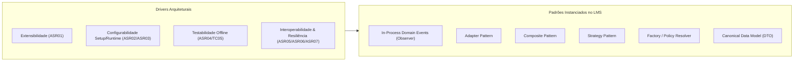
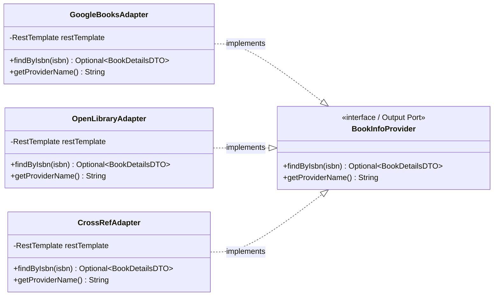
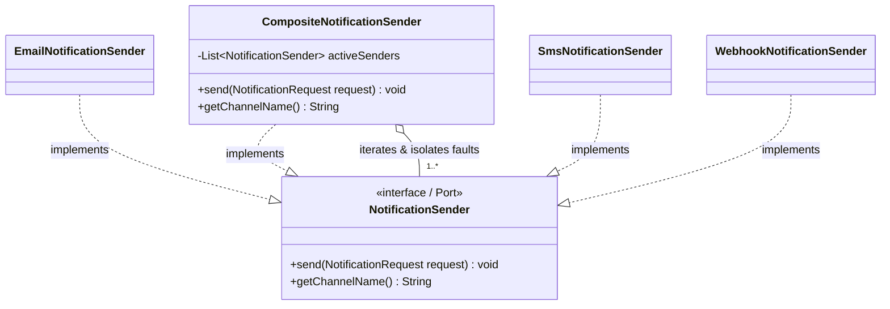
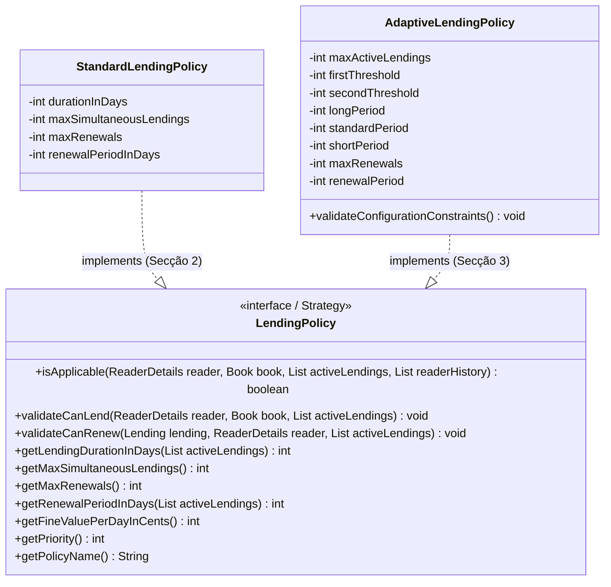

# ARQSOFT — Padrões Arquiteturais e de Desenho (System-to-Be)

## 1. Enquadramento (ADD 3.0 — Passo 4: *Choose Design Concepts*)

Enquanto as [Táticas Arquiteturais](./architectural-tactics.md) endereçam decisões elementares por atributo de qualidade e as [Arquiteturas de Referência](./reference-architectures.md) definem a macro-estrutura (*Modular Monolith* e *Clean / Hexagonal Architecture*), os **Padrões Arquiteturais e de Desenho** combinam táticas complementares em estruturas concretas de classes, interfaces e colaborações.

---

## 2. Catálogo de Padrões Instanciados no LMS

### 2.1. *In-Process Event-Driven Pattern (Domain Events / Observer)*
* **Problema:** Propagar notificações de empréstimo (`1.3.3.2`) sem acoplar `lendingmanagement` aos canais de envio nem abortar a transação JPA caso um canal falhe.
* **Solução:** `LendingServiceImpl` publica eventos imutáveis (`LendingCreatedEvent`, `LendingReturnedEvent`, `LendingOverdueEvent`) via `ApplicationEventPublisher`. O [`LendingNotificationListener`](../../../src/main/java/pt/psoft/g1/psoftg1/notificationmanagement/listeners/LendingNotificationListener.java) no módulo `notificationmanagement` subscreve os eventos com `@TransactionalEventListener(phase = TransactionPhase.AFTER_COMMIT)` e delega na porta `NotificationSender`.
* **Táticas SEI Materializadas:** *Publish-Subscribe*, *Fault Isolation*, *Asynchronous/Post-Commit Processing*.

---

### 2.2. Padrão *Adapter* (GoF Estrutural)

* **Problema:** Consumir sistemas externos com protocolos, endpoints e formatos JSON heterogéneos (`1.3.3.1` e `1.3.3.2`) através de um contrato uniforme.
* **Instanciações no LMS:**
  1. **Fontes Bibliográficas (`1.3.3.1`):**
     * [`GoogleBooksAdapter`](../../../src/main/java/pt/psoft/g1/psoftg1/bookmanagement/infrastructure/external/GoogleBooksAdapter.java): Consome `/volumes?q=isbn:{isbn}` (com suporte opcional a `apiKey`), extrai `items[0].volumeInfo` e converte para `BookDetailsDTO`.
     * [`OpenLibraryAdapter`](../../../src/main/java/pt/psoft/g1/psoftg1/bookmanagement/infrastructure/external/OpenLibraryAdapter.java): Consome `/api/books?bibkeys=ISBN:{isbn}&format=json&jscmd=data` e converte para `BookDetailsDTO`.
     * [`CrossRefAdapter`](../../../src/main/java/pt/psoft/g1/psoftg1/bookmanagement/infrastructure/external/CrossRefAdapter.java): Consome `/works?filter=isbn:{isbn}`, extrai `message.items[0]`, limpa tags JATS/XML e converte para `BookDetailsDTO`.
  2. **Canais de Notificação (`1.3.3.2`):**
     * [`EmailNotificationSender`](../../../src/main/java/pt/psoft/g1/psoftg1/notificationmanagement/infrastructure/EmailNotificationSender.java), [`SmsNotificationSender`](../../../src/main/java/pt/psoft/g1/psoftg1/notificationmanagement/infrastructure/SmsNotificationSender.java) e [`WebhookNotificationSender`](../../../src/main/java/pt/psoft/g1/psoftg1/notificationmanagement/infrastructure/WebhookNotificationSender.java): Adaptam `NotificationRequest` para o formato específico de cada canal (cabeçalhos de e-mail, texto curto SMS $\le 160$ chars, payload JSON HTTP POST).
* **Táticas SEI Materializadas:** *Encapsulate*, *Restrict Dependencies*, *Abstract Common Services*.

---

### 2.3. Padrão *Composite* (GoF Estrutural)

* **Problema:** Permitir que o serviço consumidor invoque uma única porta abstrata enquanto o sistema coordena múltiplas fontes bibliográficas (com *fallback* e fusão de campos) ou múltiplos canais de notificação (com isolamento de falhas).
* **Instanciações no LMS:**
  1. **[`CompositeBookInfoProvider`](../../../src/main/java/pt/psoft/g1/psoftg1/bookmanagement/infrastructure/external/CompositeBookInfoProvider.java) (`1.3.3.1`):** Percorre a lista ordenada de fornecedores configurados em `bibliographic.providers`. Se o primeiro fornecedor falhar, avança para o seguinte (*fallback*); se devolver um `BookDetailsDTO` incompleto (`!dto.isComplete()`), consulta as fontes seguintes para fundir os campos em falta (`mergeWith`).
  2. **[`CompositeNotificationSender`](../../../src/main/java/pt/psoft/g1/psoftg1/notificationmanagement/infrastructure/CompositeNotificationSender.java) (`1.3.3.2`):** Itera sobre os canais configurados em `notification.channels`, isolando exceções individuais em cada envio (`try-catch`).
* **Táticas SEI Materializadas:** *Use an Intermediary*, *Degradation / Fallback*, *Fault Isolation*.

---

### 2.4. Padrão *Strategy* (GoF Comportamental)

* **Problema:** Encapsular diferentes algoritmos de validação de empréstimos, cálculo de prazos escalonados e renovações (`1.3.3.3` & Especificação v1.0 Secções 2 e 3) em classes intermutáveis e testáveis isoladamente.
* **Instanciações no LMS:**
  * [`StandardLendingPolicy`](../../../src/main/java/pt/psoft/g1/psoftg1/lendingmanagement/policies/StandardLendingPolicy.java) (Secção 2): Aplica prazo fixo (`LendingPeriod`), limite máximo (`MaxActiveLendings`) e limite de renovações (`MaxRenewals`, `RenewalPeriod`).
  * [`AdaptiveLendingPolicy`](../../../src/main/java/pt/psoft/g1/psoftg1/lendingmanagement/policies/AdaptiveLendingPolicy.java) (Secção 3): Valida os invariantes $0 < \text{FirstThreshold} < \text{SecondThreshold} < \text{MaxActiveLendings}$ e $\text{LongPeriod} > \text{StandardPeriod} > \text{ShortPeriod} > 0$, atribuindo `LongPeriod`, `StandardPeriod` ou `ShortPeriod` consoante a carga ativa de empréstimos do leitor.
  * Estratégias adicionais de extensão (`LongTermLendingPolicy`, `ShortTermLendingPolicy`, `PremiumReaderLendingPolicy`, `DynamicLendingPolicy`) comprovam a abertura à extensão (OCP).
* **Táticas SEI Materializadas:** *Split Module*, *Abstract Common Services*, *Polymorphism*, *High Semantic Coherence*.

---

### 2.5. Padrão *Factory / Policy Resolver* e *Canonical Data Model*
* **`LendingPolicyResolver` (Resolução em *Runtime* — Secção 4):** Avalia em cada pedido de criação ou renovação se o leitor cumpre os critérios de histórico nos últimos `HistoryPeriod` meses (`MinCompletedLendings`, `MinOnTimeRatio`, 0 empréstimos em atraso), selecionando `AdaptiveLendingPolicy` ou `StandardLendingPolicy`.
* **`BibliographicConfig` e `NotificationConfig` (Fábricas em *Setup Time*):** Descobrem automaticamente todos os beans `BookInfoProvider` / `NotificationSender` registados no contentor Spring e compõem a cadeia ativa segundo a ordem declarada em `application.properties`.
* **`BookDetailsDTO` (*Canonical Data Model*):** Record imutável com métodos de completude (`isComplete()`) e fusão campo-a-campo (`mergeWith(BookDetailsDTO)`), isolando o domínio dos esquemas JSON externos.

---

## 3. Matriz de Rastreabilidade: Padrões $\leftrightarrow$ Táticas $\leftrightarrow$ Drivers $\leftrightarrow$ Código

| Padrão | Iteração ADD | Táticas SEI Subjacentes | Drivers Satisfeitos | Artefactos Concretos no LMS |
| :--- | :--- | :--- | :--- | :--- |
| **In-Process Domain Events (Observer)** | Iteração 2 (`1.3.3.2`) | *Publish-Subscribe*, *Fault Isolation* | `FR02`, `ASR01`, `ASR06`, `ASR07` | `LendingCreatedEvent`, `LendingReturnedEvent`, `LendingOverdueEvent`, `LendingNotificationListener`. |
| **Adapter Pattern** | Iterações 1 e 2 (`1.3.3.1`, `1.3.3.2`) | *Encapsulate*, *Restrict Dependencies* | `FR01`, `FR02`, `ASR01`, `ASR05` | `GoogleBooksAdapter`, `OpenLibraryAdapter`, `CrossRefAdapter`, `Email/Sms/WebhookNotificationSender`. |
| **Composite Pattern** | Iterações 1 e 2 (`1.3.3.1`, `1.3.3.2`) | *Use an Intermediary*, *Fallback*, *Fault Isolation* | `FR01`, `FR02`, `ASR02`, `ASR06` | `CompositeBookInfoProvider`, `CompositeNotificationSender`. |
| **Strategy Pattern** | Iteração 3 (`1.3.3.3`) | *Split Module*, *Polymorphism*, *High Coherence* | `FR03`, `ASR01`, `ASR03`, `ASR04` | `LendingPolicy`, `StandardLendingPolicy`, `AdaptiveLendingPolicy`. |
| **Factory / Policy Resolver** | Iterações 1, 2 e 3 | *Defer Binding (Setup & Runtime)* | `FR01–FR03`, `ASR02`, `ASR03` | `LendingPolicyResolver`, `BibliographicConfig`, `NotificationConfig`, `LendingPolicyProperties`. |
| **Canonical Data Model** | Iteração 1 (`1.3.3.1`) | *Abstract Common Services*, *Encapsulate* | `FR01`, `ASR05` | `BookDetailsDTO`. |

---

## 4. Custos, Limitações e Condições de Limite dos Padrões Adotados

* **Padrão *Composite* Síncrono (`CompositeBookInfoProvider` e `CompositeNotificationSender`):** Executa os adaptadores sequencialmente na mesma *thread*. É adequado para 2–3 fornecedores/canais com timeouts curtos (`5s`), mas deixaria de ser adequado se o sistema escalasse para dezenas de integrações lentas, onde seria necessário paralelismo assíncrono (`CompletableFuture`) e *circuit breakers*.
* **Padrão *Strategy* + *Policy Resolver* (`LendingPolicy` e `LendingPolicyResolver`):** Transporte explícito de `(reader, book, activeLendings, readerHistory)` nos métodos da interface. Se futuras políticas exigirem múltiplas fontes de contexto distintas, a assinatura deve ser encapsulada num objeto `LendingEvaluationContext`.
* **Padrão *In-Process Domain Events* (`ApplicationEventPublisher`):** Executa em memória dentro do processo JVM; caso o sistema exigisse entrega garantida (*at-least-once*) resistente a falhas abruptas do processo após o commit, seria necessário adotar o padrão *Transactional Outbox* ou um *message broker* persistente.
