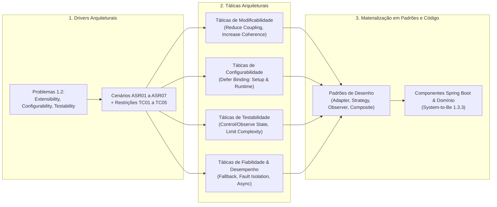
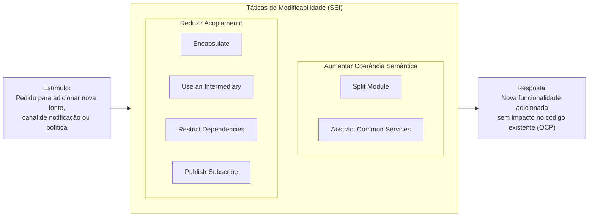
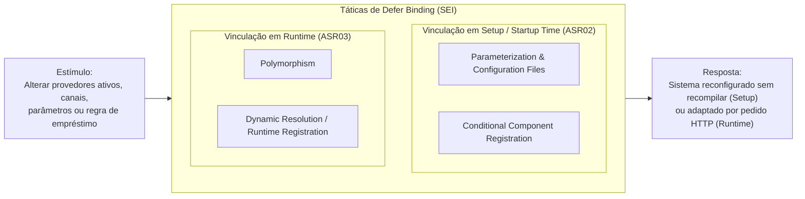
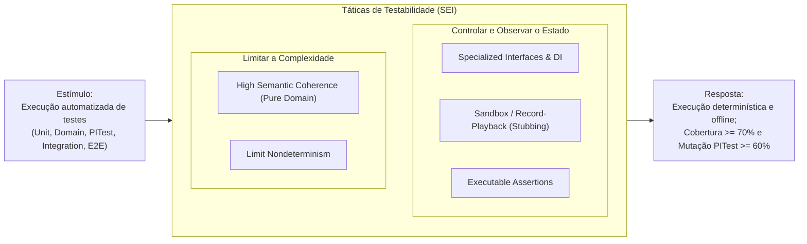
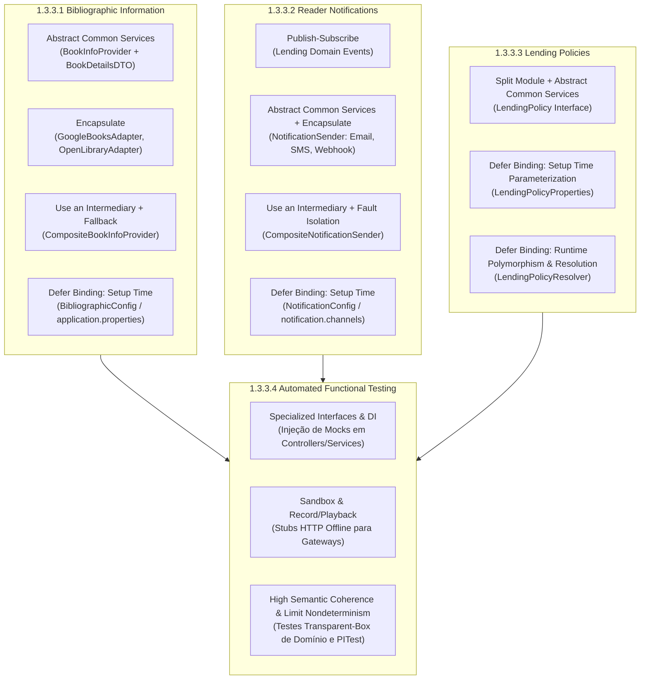

# ARQSOFT — Seleção de Táticas Arquiteturais (System-to-Be)

## 1. Enquadramento Metodológico no ADD 3.0 (Passo 4: *Choose Design Concepts*)

No método **Attribute-Driven Design (ADD 3.0)** do *Software Engineering Institute* (SEI — Bass, Clements, Kazman), após a identificação e priorização dos *Architectural Drivers* (documentados em [`architectural-factors.md`](./architectural-factors.md)), o arquiteto seleciona os conceitos de desenho que permitem satisfazer os cenários de atributos de qualidade (*Quality Attribute Scenarios — ASRs*).

As **Táticas Arquiteturais (*Architectural Tactics*)** constituem os blocos de construção mais elementares da arquitetura de software:
* **Definição Formal (SEI):** Uma tática arquitetural é uma decisão de desenho que influencia diretamente o controlo de uma resposta de atributo de qualidade face a um estímulo específico:
  $$\text{Estímulo (Stimulus)} \longrightarrow \boxed{\text{Tática Arquitetural (Tactic)}} \longrightarrow \text{Resposta Controlada (Measured Response)}$$
* **Distinção entre Táticas e Padrões:**
  * Uma **Tática** foca-se na resolução de **uma única preocupação de qualidade** (ex.: *Adiar o Tempo de Vinculação / Defer Binding*, *Encapsular / Encapsulate*, *Injetar Dependências*).
  * Um **Padrão Arquitetural ou de Desenho** (ex.: *Adapter*, *Strategy*, *Observer*, *Composite*) é uma solução estrutural composta que empacota e materializa **uma combinação de táticas** para equilibrar múltiplos requisitos em simultâneo.

---

## 2. Seleção e Justificação de Táticas por Atributo de Qualidade (Taxonomia SEI)

Abaixo apresenta-se a seleção sistemática das táticas arquiteturais a partir do catálogo oficial do SEI (*Software Architecture in Practice*), agrupadas pelos atributos de qualidade que resolvem os problemas descritos.

---

### 2.1. Táticas para Extensibilidade / Modificabilidade (*Modifiability*)

> **Alinhamento:** Resolve o **Problema 1.2.1 (*Extensibility*)**, **ASR01** (*Extensibilidade de Fontes, Canais e Políticas*) e **ASR05** (*Interoperabilidade de Dados Heterogéneos*).

O objetivo das táticas de modificabilidade é controlar o custo e o risco de introduzir alterações futuras, garantindo que novas fontes bibliográficas (1.3.3.1), novos mecanismos de notificação (1.3.3.2) e novas políticas de empréstimo (1.3.3.3) sejam adicionados sem modificar os módulos existentes (*Open-Closed Principle — OCP*).

#### Categoria A: Aumentar a Coerência Semântica (*Increase Semantic Coherence*)
1. ***Split Module* (Dividir Módulo):**
   * **Justificação Teórica:** Quando um módulo acumula responsabilidades que mudam por razões diferentes, o custo de modificação aumenta. Dividir o módulo isola as responsabilidades coesas.
   * **Aplicação no LMS:** No *system-as-is*, as regras de validação de empréstimos (duração fixa, limite de 3 livros, bloqueio por atraso) estavam embutidas diretamente em `LendingServiceImpl` e `Lending`. A tática *Split Module* extrai a lógica de avaliação de políticas de empréstimo para um pacote dedicado (`lendingmanagement.policies`), separando a orquestração transacional do empréstimo da avaliação das regras de negócio.
2. ***Abstract Common Services* (Abstrair Serviços Comuns):**
   * **Justificação Teórica:** Quando múltiplos componentes externos ou variantes fornecem capacidades semelhantes através de contratos ou formatos heterogéneos, abstrair o serviço comum unifica a vista para os consumidores.
   * **Aplicação no LMS:** As APIs externas Google Books e Open Library expõem esquemas JSON díspares (`ASR05`). A criação do contrato comum `BookInfoProvider` e do modelo canónico `BookDetailsDTO` abstrai as diferenças, permitindo que `BookServiceImpl` consuma qualquer fornecedor de forma transparente. O mesmo aplica-se a `NotificationSender` (para Email, SMS, Webhook) e `LendingPolicy`.

#### Categoria B: Reduzir o Acoplamento (*Reduce Coupling*)
3. ***Encapsulate* (Encapsular):**
   * **Justificação Teórica:** Introduz uma interface explícita para um módulo, ocultando a sua estrutura interna, detalhes de protocolo HTTP, autenticação ou formatação de mensagens. Reduz a probabilidade de uma alteração num serviço externo se propagar ao domínio.
   * **Aplicação no LMS:** Os detalhes de chamada via `WebClient`, *endpoints* específicos e *parsing* JSON do Google Books ficam estritamente encapsulados em `GoogleBooksAdapter`, e os do Open Library em `OpenLibraryAdapter`. De igual modo, a formatação de SMTP, SMS ou payloads HTTP Webhook fica encapsulada em cada adaptador de notificação.
4. ***Use an Intermediary* (Usar um Intermediário):**
   * **Justificação Teórica:** Quebra uma dependência direta entre um componente consumidor ($A$) e os componentes fornecedores ($B_1, B_2, \dots, B_n$), interpondo um intermediário que gere a coordenação, seleção ou agregação.
   * **Aplicação no LMS:**
     * Em **1.3.3.1**, `CompositeBookInfoProvider` atua como intermediário entre `BookServiceImpl` e os vários adaptadores bibliográficos ativos, gerindo a consulta sequencial e a agregação.
     * Em **1.3.3.2**, `CompositeNotificationSender` atua como intermediário para despachar uma notificação para múltiplos canais em simultâneo.
     * Em **1.3.3.3**, `LendingPolicyResolver` atua como intermediário para descobrir e selecionar a política de empréstimo adequada ao contexto.
5. ***Restrict Dependencies* (Restringir Dependências):**
   * **Justificação Teórica:** Restringe os módulos dos quais um determinado componente pode depender, aplicando o Princípio da Inversão de Dependências (*DIP*) e as regras de camadas da *Clean Architecture*.
   * **Aplicação no LMS:** As camadas internas (`model` e `services`) estão proibidas de importar classes de `infrastructure.gateways` ou `infrastructure.notifications`. Todas as dependências apontam das camadas externas de infraestrutura para as abstrações definidas no núcleo.
6. ***Publish-Subscribe* (Publicar-Subscrever):**
   * **Justificação Teórica:** Remove o acoplamento direto entre o produtor de um evento de negócio e os múltiplos consumidores interessados nesse evento, mediando a comunicação através de um barramento de eventos (*Event Bus*).
   * **Aplicação no LMS:** Em **1.3.3.2**, quando um empréstimo é criado ou devolvido, `LendingServiceImpl` limita-se a publicar eventos de domínio (`LendingCreatedEvent`, `LendingReturnedEvent`, `LendingOverdueEvent`) através do `ApplicationEventPublisher`. O módulo `lendingmanagement` desconhece totalmente a existência de notificações ou de leitores subscritos.

---

### 2.2. Táticas para Configurabilidade (*Configurability — Defer Binding*)

> **Alinhamento:** Resolve o **Problema 1.2.2 (*Configurability*)**, **ASR02** (*Configurabilidade em Setup Time*) e **ASR03** (*Seleção Dinâmica em Runtime*).

Na taxonomia do SEI, a **Configurabilidade** é uma especialização da Modificabilidade alcançada através da família de táticas **Adiar o Tempo de Vinculação (*Defer Binding*)**. Quanto mais tarde uma decisão é vinculada (passando de *compile time* para *setup/startup time* ou *runtime*), maior é a flexibilidade operacional sem tocar no código-fonte.

#### Categoria A: Vinculação em Tempo de Configuração / Arranque (*Setup / Startup Time Binding* — `ASR02`)
1. ***Configuration Files / Parameterization* (Ficheiros de Configuração e Parametrização Externa):**
   * **Justificação Teórica:** Adia a definição de valores, limites e opções operacionais do tempo de codificação (*compile time*) para o tempo de implantação/arranque (*setup time*), lendo parâmetros de ficheiros externos ou variáveis de ambiente.
   * **Aplicação no LMS:**
     * Externalização dos parâmetros das políticas de empréstimo em **1.3.3.3** (duração em dias, número máximo de livros simultâneos, valor diário da multa em cêntimos) através de `LendingPolicyProperties` (`@ConfigurationProperties`), lidos a partir de `application.properties` / `library.properties`.
     * Parametrização dos endpoints externos, chaves de API e URLs de webhook sem valores *hardcoded*.
2. ***Conditional Component Registration / Startup Binding* (Instanciação Condicional no Arranque):**
   * **Justificação Teórica:** Permite que o contentor de Inversão de Controlo (IoC) decida no arranque da aplicação quais as implementações concretas que devem ser instanciadas e ligadas, com base na configuração ativa.
   * **Aplicação no LMS:**
     * Em **1.3.3.1**, `BibliographicConfig` lê a propriedade `bibliographic.providers` (ex.: `googlebooks,openlibrary`) no arranque e compõe dinamicamente a lista de adaptadores ativos no `CompositeBookInfoProvider`.
     * Em **1.3.3.2**, `NotificationConfig` (e/ou `@ConditionalOnProperty`) ativa individualmente ou em combinação os beans `EmailNotificationSender`, `SmsNotificationSender` e `WebhookNotificationSender` conforme definido em `notification.channels`.

#### Categoria B: Vinculação em Tempo de Execução (*Runtime Binding* — `ASR03`)
3. ***Polymorphism* (Polimorfismo):**
   * **Justificação Teórica:** Adia a vinculação da chamada de um método para o tempo de execução (*late binding*), delegando o comportamento na instância concreta que implementa uma interface abstrata.
   * **Aplicação no LMS:** `LendingServiceImpl` invoca `policy.validateCanLend(...)` e `policy.getLendingDurationInDays(...)` sobre a abstração `LendingPolicy`, permitindo que `StandardLendingPolicy` e `AdaptiveLendingPolicy` (ou extensões futuras como `ShortTermLendingPolicy`) executem lógicas distintas sem estruturas condicionais (`if/else` ou `switch`) no serviço.
4. ***Dynamic Resolution / Runtime Registration* (Resolução Dinâmica em Runtime via Intermediário):**
   * **Justificação Teórica:** Permite avaliar critérios de contexto dos dados de entrada de cada pedido em *runtime* para selecionar qual a implementação registada que deve responder a essa transação específica.
   * **Aplicação no LMS:** Em **1.3.3.3**, o componente `LendingPolicyResolver` mantém o registo de todas as estratégias `LendingPolicy` disponíveis e, a cada requisição HTTP de empréstimo, avalia dinamicamente `policy.isApplicable(reader, book)` e `policy.getPriority()` para selecionar em *runtime* a política aplicável.

---

### 2.3. Táticas para Testabilidade (*Testability*)

> **Alinhamento:** Resolve o **Problema 1.2.3 (*Testability*)**, a secção **1.3.3.4 (*Automated Functional Testing*)**, **ASR04** (*Testabilidade Automatizada*) e a restrição **TC05** (*Isolamento Offline Hermético*).

Para viabilizar todos os níveis de teste exigidos no enunciado (caixa-opaca de classes, caixa-transparente de domínio, testes de mutação com PITest, testes de integração de *controller+service+gateways* e testes de sistema E2E), selecionam-se táticas das duas grandes categorias de **Testabilidade** do SEI:

#### Categoria A: Controlar e Observar o Estado do Sistema (*Control and Observe System State*)
1. ***Specialized Interfaces & Dependency Injection* (Interfaces Especializadas e Injeção de Dependências):**
   * **Justificação Teórica:** Permite que a cablagem (*wiring*) das dependências de uma classe seja controlada externamente pelo código de teste (via construtor ou *setters*), facilitando a injeção de duplos de teste (*Test Doubles*: Mocks, Stubs, Spies) e a observação das interações.
   * **Aplicação no LMS:** Todos os serviços (`BookServiceImpl`, `LendingServiceImpl`, `LendingNotificationListener`) recebem as suas dependências (`BookInfoProvider`, `NotificationSender`, `LendingPolicyResolver`, repositórios) exclusivamente por injeção via construtor. Nos testes unitários e de integração (`1.3.3.4.1` e `1.3.3.4.4`), isto permite injetar mocks Mockito/`@MockBean` e verificar com precisão o estado e os argumentos invocados.
2. ***Sandbox & Record/Playback* (Isolamento de Ambientes Externos e Simulação de Respostas):**
   * **Justificação Teórica:** Isola o *System Under Test* (SUT) de sistemas externos reais cuja disponibilidade, latência ou estado mutável tornariam os testes frágeis, lentos ou não-determinísticos. *Record/Playback* consiste em capturar payloads reais das APIs externas e reproduzi-los localmente através de *stubs*.
   * **Aplicação no LMS:** Cumpre diretamente a restrição **TC05** (*Testes Offline Herméticos*). As respostas JSON reais da Google Books API e da Open Library API são capturadas e reproduzidas localmente nos testes de `GoogleBooksAdapter` e `OpenLibraryAdapter` (usando mocks do cliente HTTP ou `WireMock`), e os envios de Email/SMS/Webhook são intercetados em ambiente de *sandbox* durante os testes de integração e E2E (`1.3.3.4.4` e `1.3.3.4.5`).
3. ***Executable Assertions* (Asserções Executáveis e Contratos de Domínio):**
   * **Justificação Teórica:** Incorpora validações explícitas de pré-condições, pós-condições e invariantes diretamente no modelo de domínio, lançando exceções claras sempre que um estado inválido é tentado.
   * **Aplicação no LMS:** Os *Value Objects* (`Isbn`, `Title`, `LendingNumber`) e as entidades/políticas validam estritamente os seus invariantes (lançando `IllegalArgumentException` ou `LendingForbiddenException`), tornando as fronteiras de erro imediatamente observáveis nos testes de Análise de Valores Limite (BVA) e Particionamento de Equivalência.

#### Categoria B: Limitar a Complexidade (*Limit Complexity*)
4. ***Limit Structural Complexity / High Semantic Coherence* (Isolamento Puro do Modelo de Domínio):**
   * **Justificação Teórica:** Reduzir o acoplamento estrutural e as dependências tecnológicas de uma classe reduz o espaço de estados necessários para a instanciar e testar, aumentando a eficácia dos testes estruturais e de mutação.
   * **Aplicação no LMS:** As classes de domínio (`Book`, `Lending`, `Fine`, `Reader`) e as estratégias de política (`StandardLendingPolicy`, etc.) não dependem do contexto Spring nem da base de dados H2. Isto viabiliza diretamente os requisitos **1.3.3.4.2 (*Functional transparent-box with SUT = domain classes*)** e **1.3.3.4.3 (*Mutation tests with SUT = classes*)**, permitindo que o **PITest** execute milhares de mutações em milissegundos e atinja um *mutation score* $\ge 60\%$.
5. ***Limit Nondeterminism* (Limitar o Não-Determinismo):**
   * **Justificação Teórica:** Elimina fontes de comportamento imprevisível (como chamadas de rede externas, concorrência descontrolada, geração aleatória não parametrizada ou dependência rígida do relógio de sistema) durante a execução dos testes.
   * **Aplicação no LMS:** Os cálculos de prazos, dias de atraso (`getDaysDelayed()`) e multas nas classes `Lending`, `Fine` e `LendingPolicy` recebem os dados de entrada de forma explícita e determinística, garantindo que a bateria de testes produz sempre o mesmo resultado independentemente da hora ou máquina onde corre o pipeline CI/CD.

---

### 2.4. Táticas Complementares: Fiabilidade (`ASR06`) e Desempenho (`ASR07`)

Para além da tríade principal do enunciado, os requisitos funcionais **1.3.3.1** (múltiplas fontes externas) e **1.3.3.2** (múltiplos canais de notificação) exigem táticas de suporte para **Resiliência (`ASR06`)** e **Não-Bloqueio (`ASR07`)**:

1. **Tática de Fiabilidade — *Degradation / Fallback* (Contingência entre Fontes):**
   * **Categoria SEI:** *Recover from Faults (Preparation and Repair)*.
   * **Aplicação no LMS (1.3.3.1):** Quando mais do que uma fonte bibliográfica está configurada (ex.: Google Books + Open Library), o `CompositeBookInfoProvider` implementa uma cadeia de *fallback*: se a primeira fonte falhar por *timeout* HTTP ou devolver dados incompletos para um ISBN, o sistema recorre automaticamente à fonte seguinte sem propagar falha ao utilizador.
2. **Tática de Fiabilidade — *Exception Prevention & Fault Isolation* (Isolamento de Falhas de Canais):**
   * **Categoria SEI:** *Prevent Faults*.
   * **Aplicação no LMS (1.3.3.2):** No `CompositeNotificationSender` e no `LendingNotificationListener`, a falha no envio através de um canal externo (ex.: um servidor Webhook indisponível) é capturada e registada em log de forma isolada, impedindo que aborte o envio para os restantes canais (ex.: Email/SMS) ou que faça *rollback* à transação principal de criação do empréstimo na base de dados.
3. **Tática de Desempenho — *Asynchronous Event Processing / Introduce Concurrency*:**
   * **Categoria SEI:** *Control Resource Demand / Manage Resources*.
   * **Aplicação no LMS (1.3.3.2):** O despacho de notificações ocorre em reação a eventos de domínio após a conclusão da lógica de empréstimo (`@EventListener` / `@TransactionalEventListener`), evitando que a latência das chamadas externas de notificação degrade o tempo de resposta da transação principal.

---

## 3. Síntese de Aplicação aos Requisitos de Desenvolvimento (Enunciado 1.3.3)

O diagrama seguinte ilustra como as táticas selecionadas convergem nos quatro blocos de desenvolvimento exigidos na secção **1.3.3 Development** do enunciado:

---

## 4. Matriz Global de Rastreabilidade (Drivers $\leftrightarrow$ Táticas SEI $\leftrightarrow$ Padrões $\leftrightarrow$ LMS)

A tabela seguinte estabelece a rastreabilidade completa, ligando os requisitos e ASRs ([`architectural-factors.md`](./architectural-factors.md)), as **Táticas Arquiteturais SEI** selecionadas neste documento e a sua realização através de padrões e componentes de código.

| Driver / ASR | Atributo de Qualidade | Categoria da Tática (SEI) | Tática Arquitetural Selecionada | Padrão / Mecanismo de Realização | Artefactos Concretos no LMS (`psoft-g1`) |
| :--- | :--- | :--- | :--- | :--- | :--- |
| **ASR01, ASR05, FR01** | Extensibilidade & Interoperabilidade | *Increase Semantic Coherence* | **Abstract Common Services** | **Gateway / Canonical Data Model** | Interface `BookInfoProvider` e DTO canónico `BookDetailsDTO`. |
| **ASR01, FR01** | Extensibilidade | *Reduce Coupling* | **Encapsulate** | **Adapter Pattern** | `GoogleBooksAdapter` e `OpenLibraryAdapter` isolam chamadas HTTP e *parsing* JSON. |
| **ASR01, ASR06, FR01** | Extensibilidade & Fiabilidade | *Reduce Coupling* / *Recover from Faults* | **Use an Intermediary** + **Fallback / Degradation** | **Composite / Chain of Responsibility** | `CompositeBookInfoProvider` agrega múltiplas fontes e faz *fallback* automático. |
| **ASR01, ASR07, FR02** | Extensibilidade & Desempenho | *Reduce Coupling* | **Publish-Subscribe** | **Observer / Domain Events** | `LendingCreatedEvent`, `LendingReturnedEvent`, `LendingOverdueEvent` e `LendingNotificationListener`. |
| **ASR01, FR02** | Extensibilidade | *Increase Semantic Coherence* & *Reduce Coupling* | **Abstract Common Services** + **Encapsulate** | **Strategy / Adapter Pattern** | Interface `NotificationSender` e implementações `EmailNotificationSender`, `SmsNotificationSender`, `WebhookNotificationSender`. |
| **ASR01, ASR06, FR02** | Extensibilidade & Fiabilidade | *Reduce Coupling* / *Prevent Faults* | **Use an Intermediary** + **Fault Isolation** | **Composite Pattern** | `CompositeNotificationSender` despacha para todos os canais ativos isolando exceções individuais. |
| **ASR01, FR03** | Extensibilidade | *Increase Semantic Coherence* | **Split Module** + **Abstract Common Services** | **Strategy Pattern** | Pacote `lendingmanagement.policies` e interface `LendingPolicy`. |
| **ASR02, FR01, FR02, FR03** | Configurabilidade (*Setup Time*) | *Defer Binding* | **Configuration Files / Parameterization** | **Externalized Configuration (`@ConfigurationProperties`)** | `LendingPolicyProperties` e chaves em `application.properties` / `library.properties`. |
| **ASR02, FR01, FR02** | Configurabilidade (*Setup Time*) | *Defer Binding* | **Conditional Component Registration (Startup Binding)** | **IoC Conditional Wiring (`@ConditionalOnProperty` / `@Bean`)** | `BibliographicConfig` e `NotificationConfig` instanciam apenas as fontes e canais selecionados no arranque. |
| **ASR03, FR03** | Configurabilidade (*Runtime*) | *Defer Binding* | **Polymorphism** + **Dynamic Resolution via Intermediary** | **Strategy** + **Factory / Policy Resolver** | `LendingPolicyResolver` seleciona em *runtime* entre `StandardLendingPolicy` e `AdaptiveLendingPolicy` (e políticas futuras). |
| **ASR01, ASR04, TC02** | Modificabilidade & Testabilidade | *Reduce Coupling* | **Restrict Dependencies** | **Clean / Hexagonal Architecture (DIP)** | O domínio (`model`) e aplicação (`services`) dependem apenas de abstrações, nunca de `infrastructure`. |
| **ASR04, TC05** | Testabilidade | *Control and Observe System State* | **Specialized Interfaces & Dependency Injection** | **Constructor Injection & Test Doubles (Mocks/Spies)** | Injeção via construtor em `BookServiceImpl` e `LendingServiceImpl` para testes *opaque-box* de classe e integração. |
| **ASR04, TC05** | Testabilidade | *Control and Observe System State* | **Sandbox & Record/Playback** | **HTTP Stubbing / WireMock / MockBeans** | Simulação offline determinística dos payloads da Google Books, Open Library e Webhooks sem acesso à internet. |
| **ASR04, OL04** | Testabilidade | *Limit Complexity* | **High Semantic Coherence** + **Limit Nondeterminism** + **Executable Assertions** | **Rich Domain Model & Value Objects** | Entidades `Lending`, `Fine`, `Book` e classes `LendingPolicy` testáveis em caixa-transparente e mutação **PITest** ($\ge 60\%$). |

---

## 5. Análise de Compromissos Arquiteturais (*Trade-offs* e Racional)

Toda a decisão arquitetural acarreta compromissos (*trade-offs*). A tabela abaixo documenta os benefícios alcançados pelas táticas selecionadas, os seus efeitos secundários potenciais e a forma como a arquitetura proposta os mitiga:

| Grupo de Táticas Selecionadas | Benefício Primário (Atributo Alvo) | Compromisso / Efeito Secundário (*Trade-off*) | Mitigação Adotada no Projeto |
| :--- | :--- | :--- | :--- |
| **Encapsulate + Abstract Common Services + Use an Intermediary** | **Alta Extensibilidade (`ASR01`):** Adicionar uma 3.ª fonte bibliográfica ou um 4.º canal de notificação exige criar apenas 1 classe nova, com zero impacto no domínio. | **Indireção e Número de Classes:** Aumenta o número de interfaces, DTOs e classes adaptadoras no projeto. | Organização clara por pacotes de subdomínio (*Package-by-Feature* + camadas *Clean Architecture*), mantendo elevada legibilidade. |
| **Defer Binding (Configuration Files & Startup Registration)** | **Alta Configurabilidade em Setup Time (`ASR02`):** Operadores mudam fontes, canais e parâmetros de empréstimo sem recompilar o `.jar`. | **Deteção Tardia de Erros de Configuração:** Erros de escrita no `application.properties` só são detetados no arranque (*startup*) em vez de *compile time*. | Validação defensiva no arranque e definição de valores por omissão seguros (*sensible defaults*, ex.: `StandardLendingPolicy` ativa por defeito). |
| **Defer Binding (Runtime Resolution via Intermediary)** | **Flexibilidade Dinâmica em Runtime (`ASR03`):** Seleção da política de empréstimo adaptada a cada leitor/livro por pedido HTTP. | **Sobrecarga de Avaliação e Conflito de Regras:** Avaliar múltiplas políticas em *runtime* pode criar ambiguidade se duas políticas forem aplicáveis ao mesmo tempo. | Método explícito `getPriority()` na interface `LendingPolicy` e ordenação determinística no `LendingPolicyResolver`, com *overhead* computacional desprezável ($O(n)$ em memória para $n$ pequeno). |
| **Publish-Subscribe (Eventos de Domínio)** | **Desacoplamento Temporal e Estrutural (`ASR01`, `ASR07`):** `LendingServiceImpl` não conhece canais de notificação. | **Rastreabilidade de Fluxo e Depuração:** O fluxo deixa de ser uma chamada sequencial explícita, exigindo atenção à consistência transacional. | Eventos fortemente tipados (`LendingCreatedEvent`, etc.), isolamento de exceções no *listener* e testes de integração dedicados que verificam a publicação e receção do evento. |
| **Specialized Interfaces, DI & Sandbox (Stubbing)** | **Alta Testabilidade e Hermeticidade (`ASR04`, `TC05`):** Execução rápida, determinística e 100% offline de testes unitários, de mutação (PITest) e de integração. | **Risco de Divergência de Contratos (*Contract Drift*):** Se a API real da Google Books mudar o seu formato JSON no futuro, os *stubs* locais não detetam a mudança automaticamente. | Utilização de payloads JSON capturados das respostas reais das APIs (*Record/Playback*) como base dos testes dos adaptadores e mapeamento defensivo tolerante a campos em falta (*Tolerant Reader*). |

