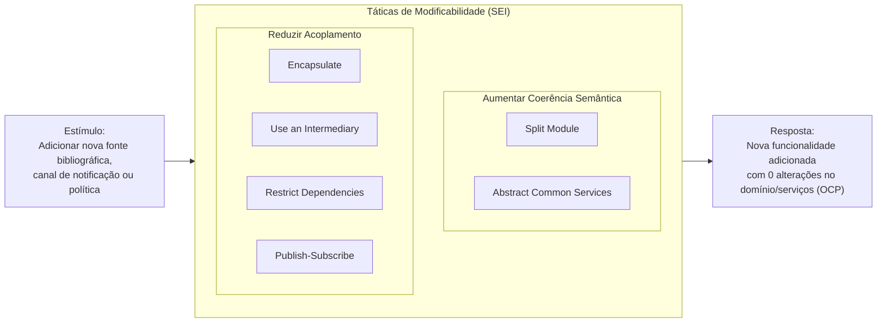
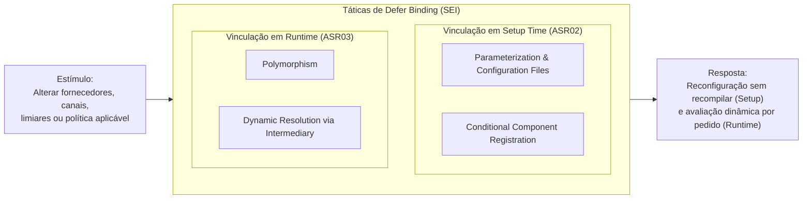
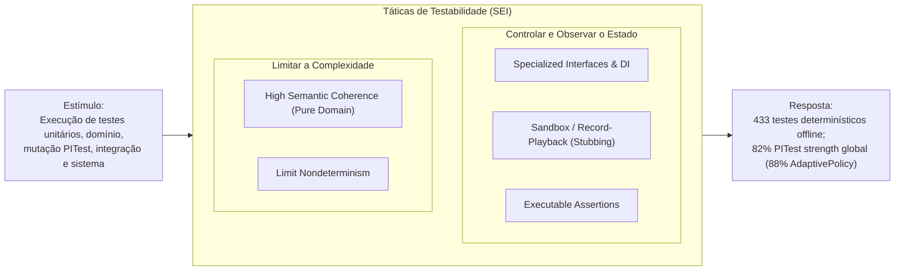

# ARQSOFT — Seleção de Táticas Arquiteturais (System-to-Be)

## 1. Enquadramento e Seleção de Táticas (ADD 3.0 — Passo 4)

A seleção de **Táticas Arquiteturais** (catálogo SEI — Bass, Clements & Kazman) responde diretamente aos cenários de atributos de qualidade (`ASR01`–`ASR07`) definidos em [`architectural-factors.md`](./architectural-factors.md), controlando as respostas de **Extensibilidade**, **Configurabilidade**, **Testabilidade**, **Interoperabilidade** e **Resiliência**.

---

## 2. Táticas por Atributo de Qualidade

### 2.1. Extensibilidade e Modificabilidade (`ASR01`, `ASR05` — Problemas 1.2.1, 1.3.3.1–1.3.3.3)

#### A. Aumentar a Coerência Semântica (*Increase Semantic Coherence*)
1. ***Split Module* (Dividir Módulo):**
   * **Aplicação no LMS:** Extração da lógica de validação e cálculo de prazos de empréstimo (anteriormente dispersa em `LendingServiceImpl` e `Lending`) para o pacote [`lendingmanagement.policies`](../../../src/main/java/pt/psoft/g1/psoftg1/lendingmanagement/policies) e extração do subsistema de notificações para o módulo [`notificationmanagement`](../../../src/main/java/pt/psoft/g1/psoftg1/notificationmanagement).
2. ***Abstract Common Services* (Abstrair Serviços Comuns):**
   * **Aplicação no LMS:** Definição das interfaces [`BookInfoProvider`](../../../src/main/java/pt/psoft/g1/psoftg1/bookmanagement/services/external/BookInfoProvider.java) (associada ao DTO canónico [`BookDetailsDTO`](../../../src/main/java/pt/psoft/g1/psoftg1/bookmanagement/services/external/BookDetailsDTO.java)), [`NotificationSender`](../../../src/main/java/pt/psoft/g1/psoftg1/notificationmanagement/services/NotificationSender.java) e [`LendingPolicy`](../../../src/main/java/pt/psoft/g1/psoftg1/lendingmanagement/policies/LendingPolicy.java), uniformizando o acesso a implementações heterogéneas.

#### B. Reduzir o Acoplamento (*Reduce Coupling*)
3. ***Encapsulate* (Encapsular):**
   * **Aplicação no LMS:** Os detalhes de chamada HTTP (`RestTemplate`), autenticação por API key e *parsing* JSON de cada API externa ficam encapsulados em [`GoogleBooksAdapter`](../../../src/main/java/pt/psoft/g1/psoftg1/bookmanagement/infrastructure/external/GoogleBooksAdapter.java), [`OpenLibraryAdapter`](../../../src/main/java/pt/psoft/g1/psoftg1/bookmanagement/infrastructure/external/OpenLibraryAdapter.java) e [`CrossRefAdapter`](../../../src/main/java/pt/psoft/g1/psoftg1/bookmanagement/infrastructure/external/CrossRefAdapter.java). De forma análoga, a formatação de Email, SMS e JSON Webhook fica encapsulada em `EmailNotificationSender`, `SmsNotificationSender` e `WebhookNotificationSender`.
4. ***Use an Intermediary* (Usar um Intermediário):**
   * **Aplicação no LMS:**
     * Em **1.3.3.1**, [`CompositeBookInfoProvider`](../../../src/main/java/pt/psoft/g1/psoftg1/bookmanagement/infrastructure/external/CompositeBookInfoProvider.java) coordena a consulta sequencial e a fusão de campos entre os adaptadores ativos.
     * Em **1.3.3.2**, [`CompositeNotificationSender`](../../../src/main/java/pt/psoft/g1/psoftg1/notificationmanagement/infrastructure/CompositeNotificationSender.java) despacha cada evento para todos os canais configurados.
     * Em **1.3.3.3**, [`LendingPolicyResolver`](../../../src/main/java/pt/psoft/g1/psoftg1/lendingmanagement/policies/LendingPolicyResolver.java) medeia entre `LendingServiceImpl` e as políticas concretas.
5. ***Restrict Dependencies* (Restringir Dependências):**
   * **Aplicação no LMS:** As camadas `model` e `services` dependem exclusivamente de abstrações, nunca importando classes de `infrastructure`.
6. ***Publish-Subscribe* (Publicar-Subscrever):**
   * **Aplicação no LMS:** `LendingServiceImpl` publica `LendingCreatedEvent`, `LendingReturnedEvent` e `LendingOverdueEvent` via `ApplicationEventPublisher`, desacoplando o módulo de empréstimos do módulo de notificações.

---

### 2.2. Configurabilidade — Adiar o Tempo de Vinculação (*Defer Binding* — `ASR02`, `ASR03`)

#### A. Vinculação no Arranque (*Setup / Startup Time Binding* — `ASR02`)
1. ***Configuration Files / Parameterization* (Ficheiros de Configuração e Parametrização):**
   * **Aplicação no LMS:** Externalização dos parâmetros das políticas `Standard` e `Adaptive` e critérios de elegibilidade através de [`LendingPolicyProperties`](../../../src/main/java/pt/psoft/g1/psoftg1/configuration/LendingPolicyProperties.java) (`@ConfigurationProperties(prefix = "lending")`), bem como URLs e chaves de API em `application.properties`.
2. ***Conditional Component Registration* (Composição Declarativa no Arranque):**
   * **Aplicação no LMS:**
     * [`BibliographicConfig`](../../../src/main/java/pt/psoft/g1/psoftg1/configuration/BibliographicConfig.java) lê `bibliographic.providers` (ex.: `googlebooks,openlibrary,crossref`) e monta a cadeia ordenada de beans `BookInfoProvider` no `CompositeBookInfoProvider`.
     * [`NotificationConfig`](../../../src/main/java/pt/psoft/g1/psoftg1/configuration/NotificationConfig.java) lê `notification.channels` (ex.: `email,sms,webhook`) e compõe a lista de `NotificationSender` ativa no `CompositeNotificationSender`.

#### B. Vinculação em Tempo de Execução (*Runtime Binding* — `ASR03`)
3. ***Polymorphism* (Polimorfismo):**
   * **Aplicação no LMS:** `LendingServiceImpl` invoca `policy.validateCanLend(...)`, `policy.validateCanRenew(...)`, `policy.getLendingDurationInDays(...)` e `policy.getRenewalPeriodInDays(...)` polimorficamente sobre `LendingPolicy`.
4. ***Dynamic Resolution via Intermediary* (Resolução Dinâmica em Runtime):**
   * **Aplicação no LMS:** Em cada pedido de criação ou renovação de empréstimo (Especificação v1.0 Secção 4.3), o [`LendingPolicyResolver`](../../../src/main/java/pt/psoft/g1/psoftg1/lendingmanagement/policies/LendingPolicyResolver.java) avalia o histórico de empréstimos concluídos do leitor nos últimos `HistoryPeriod` meses (`MinCompletedLendings`, `MinOnTimeRatio` e ausência de atrasos ativos) para resolver dinamicamente entre `AdaptiveLendingPolicy` e `StandardLendingPolicy`.

---

### 2.3. Testabilidade (`ASR04`, `TC05` — Problema 1.2.3 & Secção 1.3.3.4)

1. ***Specialized Interfaces & Dependency Injection*:** Injeção via construtor em `BookServiceImpl`, `LendingServiceImpl`, `LendingNotificationListener` e adaptadores HTTP (`RestTemplate` injetável), permitindo substituição direta por *Mocks*, *Stubs* e *Spies* nos testes de caixa opaca e integração (`1.3.3.4.1` e `1.3.3.4.4`).
2. ***Sandbox & Record/Playback*:** Reprodução offline de payloads JSON reais da Google Books, Open Library e CrossRef nos testes unitários e de integração (`GoogleBooksAdapterTest`, `OpenLibraryAdapterTest`, `CrossRefAdapterTest`, `BookExternalInfoIT`), cumprindo `TC05`.
3. ***Executable Assertions*:** Validação explícita de pré-condições e invariantes nos construtores de `Isbn`, `Title`, `StandardLendingPolicy`, `AdaptiveLendingPolicy` ($0 < FT < ST < MaxActiveLendings$, $LongPeriod > StandardPeriod > ShortPeriod > 0$) e `Lending.renew(...)`.
4. ***High Semantic Coherence & Limit Nondeterminism*:** Isolamento tecnológico das classes de domínio e políticas, permitindo que os testes transparentes (`1.3.3.4.2`) e de mutação PITest (`1.3.3.4.3`) executem em memória sem contexto Spring, atingindo **85% de cobertura de mutação e 88% de *test strength* em `AdaptiveLendingPolicy`** (e **82% de *test strength* global**).

---

### 2.4. Resiliência (`ASR06`) e Desempenho (`ASR07`)
1. ***Degradation / Fallback* (Contingência e Fusão entre Fontes — 1.3.3.1):** Se o fornecedor primário falhar ou devolver metadados parciais (`!dto.isComplete()`), o `CompositeBookInfoProvider` consulta o fornecedor seguinte e funde os campos em falta (`mergeWith`).
2. ***Fault Isolation* (Isolamento de Falhas por Canal — 1.3.3.2):** O `CompositeNotificationSender` envolve o envio de cada canal num bloco `try-catch` isolado, garantindo que a falha de um canal (ex.: Webhook HTTP 503) não impede a entrega nos restantes canais (Email e SMS).
3. ***Asynchronous / Post-Commit Event Processing* (Não-Bloqueio Transacional — 1.3.3.2):** O `LendingNotificationListener` processa os eventos em `@TransactionalEventListener(phase = TransactionPhase.AFTER_COMMIT)`, evitando reter locks na base de dados H2 durante o despacho de notificações.

---

## 3. Matriz de Rastreabilidade (Drivers $\leftrightarrow$ Táticas SEI $\leftrightarrow$ Padrões $\leftrightarrow$ Código)

| Driver / ASR | Atributo de Qualidade | Categoria SEI | Tática Selecionada | Padrão / Mecanismo | Artefactos Concretos no LMS (`psoft-g1`) |
| :--- | :--- | :--- | :--- | :--- | :--- |
| **ASR01, ASR05, FR01** | Extensibilidade & Interoperabilidade | *Increase Semantic Coherence* | **Abstract Common Services** | **Gateway / Canonical Data Model** | [`BookInfoProvider`](../../../src/main/java/pt/psoft/g1/psoftg1/bookmanagement/services/external/BookInfoProvider.java), [`BookDetailsDTO`](../../../src/main/java/pt/psoft/g1/psoftg1/bookmanagement/services/external/BookDetailsDTO.java). |
| **ASR01, FR01** | Extensibilidade | *Reduce Coupling* | **Encapsulate** | **Adapter Pattern** | [`GoogleBooksAdapter`](../../../src/main/java/pt/psoft/g1/psoftg1/bookmanagement/infrastructure/external/GoogleBooksAdapter.java), [`OpenLibraryAdapter`](../../../src/main/java/pt/psoft/g1/psoftg1/bookmanagement/infrastructure/external/OpenLibraryAdapter.java), [`CrossRefAdapter`](../../../src/main/java/pt/psoft/g1/psoftg1/bookmanagement/infrastructure/external/CrossRefAdapter.java). |
| **ASR01, ASR06, FR01** | Extensibilidade & Fiabilidade | *Reduce Coupling* / *Recover from Faults* | **Use an Intermediary** + **Fallback** | **Composite / Chain of Responsibility** | [`CompositeBookInfoProvider`](../../../src/main/java/pt/psoft/g1/psoftg1/bookmanagement/infrastructure/external/CompositeBookInfoProvider.java). |
| **ASR01, ASR07, FR02** | Extensibilidade & Desempenho | *Reduce Coupling* | **Publish-Subscribe** | **Observer / Domain Events** | `LendingCreatedEvent`, `LendingReturnedEvent`, `LendingOverdueEvent`, [`LendingNotificationListener`](../../../src/main/java/pt/psoft/g1/psoftg1/notificationmanagement/listeners/LendingNotificationListener.java). |
| **ASR01, FR02** | Extensibilidade | *Increase Coherence* & *Reduce Coupling* | **Abstract Common Services** + **Encapsulate** | **Strategy / Adapter Pattern** | [`NotificationSender`](../../../src/main/java/pt/psoft/g1/psoftg1/notificationmanagement/services/NotificationSender.java), `EmailNotificationSender`, `SmsNotificationSender`, `WebhookNotificationSender`. |
| **ASR01, ASR06, FR02** | Extensibilidade & Fiabilidade | *Reduce Coupling* / *Prevent Faults* | **Use an Intermediary** + **Fault Isolation** | **Composite Pattern** | [`CompositeNotificationSender`](../../../src/main/java/pt/psoft/g1/psoftg1/notificationmanagement/infrastructure/CompositeNotificationSender.java). |
| **ASR01, FR03** | Extensibilidade | *Increase Semantic Coherence* | **Split Module** + **Abstract Common Services** | **Strategy Pattern** | [`LendingPolicy`](../../../src/main/java/pt/psoft/g1/psoftg1/lendingmanagement/policies/LendingPolicy.java), [`StandardLendingPolicy`](../../../src/main/java/pt/psoft/g1/psoftg1/lendingmanagement/policies/StandardLendingPolicy.java), [`AdaptiveLendingPolicy`](../../../src/main/java/pt/psoft/g1/psoftg1/lendingmanagement/policies/AdaptiveLendingPolicy.java). |
| **ASR02, FR01–FR03** | Configurabilidade (*Setup Time*) | *Defer Binding* | **Configuration Files & Conditional Wiring** | **IoC Factory / `@ConfigurationProperties`** | [`BibliographicConfig`](../../../src/main/java/pt/psoft/g1/psoftg1/configuration/BibliographicConfig.java), [`NotificationConfig`](../../../src/main/java/pt/psoft/g1/psoftg1/configuration/NotificationConfig.java), [`LendingPolicyProperties`](../../../src/main/java/pt/psoft/g1/psoftg1/configuration/LendingPolicyProperties.java). |
| **ASR03, FR03** | Configurabilidade (*Runtime*) | *Defer Binding* | **Polymorphism** + **Dynamic Resolution** | **Strategy** + **Policy Resolver** | [`LendingPolicyResolver`](../../../src/main/java/pt/psoft/g1/psoftg1/lendingmanagement/policies/LendingPolicyResolver.java). |
| **ASR04, TC05** | Testabilidade | *Control/Observe State* & *Limit Complexity* | **Specialized Interfaces, DI, Sandbox & Assertions** | **Constructor Injection & Test Doubles** | 55 suites Surefire (`386` testes) + 12 suites Failsafe (`47` testes). |

---

## 4. Avaliação de Extensões Representativas e Condições de Limite

A tabela seguinte sintetiza o impacto prático de três extensões representativas nas três áreas do enunciado, demonstrando o isolamento obtido pelas táticas selecionadas:

| Extensão Representativa | Alterações no Código (`src/main`) | Alterações em Configuração (`application.properties`) | Alterações em Testes (`src/test`) | Artefactos Existentes Inalterados (Isolamento OCP) | Condição de Limite da Tática |
| :--- | :--- | :--- | :--- | :--- | :--- |
| **1. Nova Fonte Bibliográfica** *(implementado: [`CrossRefAdapter`](../../../src/main/java/pt/psoft/g1/psoftg1/bookmanagement/infrastructure/external/CrossRefAdapter.java))* | Criar 1 classe `@Component("crossref") CrossRefAdapter implements BookInfoProvider` (descoberta automaticamente pelo Spring via `List<BookInfoProvider>`). | Adicionar `crossref` a `bibliographic.providers` e `bibliographic.crossref.base-url`. | Adicionar [`CrossRefAdapterTest`](../../../src/test/java/pt/psoft/g1/psoftg1/bookmanagement/infrastructure/gateways/CrossRefAdapterTest.java) (8 testes unitários) + cenário em `BookExternalInfoIT`. | `BookServiceImpl`, `BookController`, `Book`, `BookDetailsDTO`, `CompositeBookInfoProvider`, `BibliographicConfig`, `GoogleBooksAdapter`, `OpenLibraryAdapter` (**0 linhas alteradas**). | Deixa de ser adequada se a fonte exigir callbacks assíncronos em vez de consulta síncrona por ISBN. |
| **2. Novo Canal de Notificação** *(ex.: `SlackNotificationSender`)* | Criar 1 classe `@Component SlackNotificationSender implements NotificationSender` e registar `"slack"` em `NotificationConfig`. | Adicionar `slack` a `notification.channels`. | Adicionar 1 classe `SlackNotificationSenderTest`. | `LendingServiceImpl`, `LendingCreatedEvent`, `LendingNotificationListener`, `CompositeNotificationSender`, `Email/Sms/WebhookNotificationSender` (**0 linhas alteradas**). | Deixa de ser adequada se o canal exigir confirmação bidirecional transacional (*two-phase commit*). |
| **3. Nova Política de Empréstimo** *(ex.: `PremiumReaderLendingPolicy`)* | Criar 1 classe `@Component PremiumReaderLendingPolicy implements LendingPolicy` com `getPriority()` próprio. | Adicionar propriedades opcionais em `application.properties`. | Adicionar 1 classe `PremiumReaderLendingPolicyTest`. | `LendingServiceImpl`, `LendingController`, `Lending`, `StandardLendingPolicy`, `AdaptiveLendingPolicy`, `LendingPolicyResolver` (**0 linhas alteradas**). | Deixa de ser adequada se a política exigir estado externo fora de `(ReaderDetails, Book, activeLendings, readerHistory)`. |
