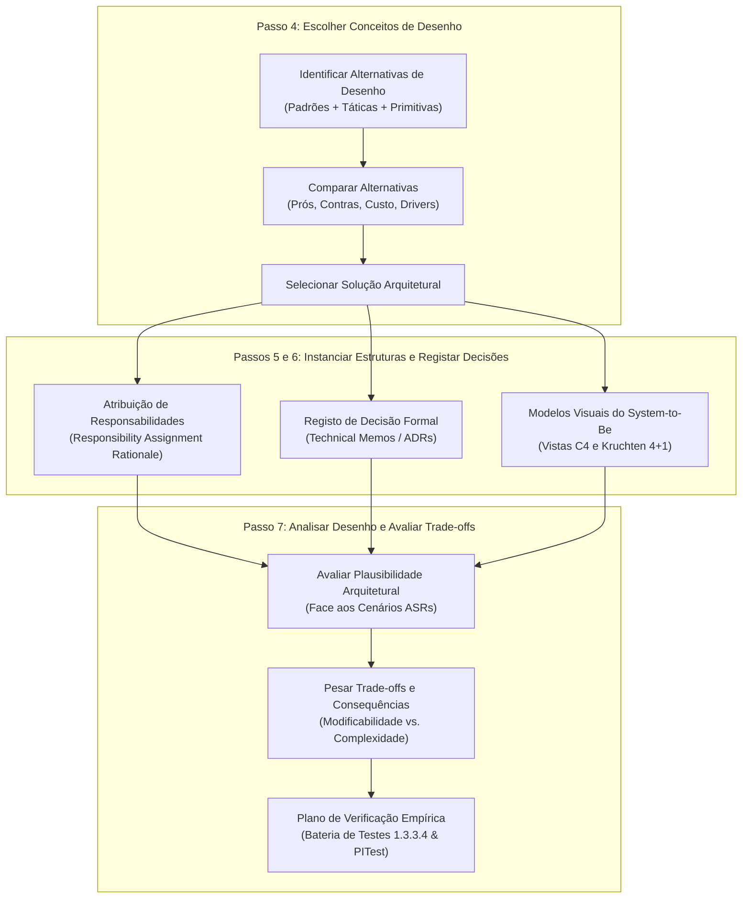

# ARQSOFT — Alternativas de Desenho Arquitetural e Racional (Modelos Visuais - System-to-Be)

## 1. Metodologia de Tomada de Decisão e Racional no ADD 3.0 (Passos 4, 6 e 7)

No método **Attribute-Driven Design (ADD 3.0)**, a construção da arquitetura do software decorre da análise sistemática das forças motrizes (*Architectural Drivers*) e da ponderação fundamentada entre opções estruturais viáveis.

### 1.1. Critérios de Avaliação Multidimensional de Alternativas
Perante cada sub-problema e iteração do ADD, as alternativas de desenho são formuladas e comparadas segundo quatro critérios objetivos:
1. **Aderência aos Drivers Arquiteturais:** Capacidade de satisfazer integralmente os requisitos funcionais (`FR01` a `FR04`) e os cenários de atributos de qualidade (`ASR01` a `ASR07`);
2. **Conformidade com Restrições (*Technical Constraints*):** Respeito por `TC01` (Java 17 / Spring Boot), `TC02` (Monólito Modular DDD), `TC03` (JPA/H2) e `TC05` (Testes 100% herméticos e determinísticos em ambiente offline);
3. **Custo e Complexidade de Implementação:** Avaliação do esforço de desenvolvimento, quantidade de abstrações introduzidas e risco de introdução de dívida técnica ou *over-engineering*;
4. **Viabilidade Operacional (`OL01`–`OL04`):** Possibilidade de paralelização equilibrada das tarefas entre os 3 elementos do grupo para cumprimento rigoroso da data de entrega.

### 1.2. Registo Formal do Racional Arquitetural
Para garantir a rastreabilidade e a transparência entre os requisitos de negócio e o código implementado, utilizam-se dois mecanismos formais:
* **Tabelas de Comparação de Alternativas (Passo 4):** Contrastam explicitamente os prós, contras, custo e decisão final face aos drivers;
* **Technical Memos (ADRs — *Architectural Decision Records* — Passo 6):** Consolidam a especificação da decisão, incluindo *Issue*, *Problem*, *Summary of Solution*, *Factors*, *Solution*, *Motivation*, *Alternatives Considered* e *Pending Issues / Carry-forward*.

---

## 2. Avaliação de Alternativas de Desenho e Racional por Sub-Problema

### 2.1. Sub-Problema 1: Recuperação e Agregação de Fontes Bibliográficas Heterogéneas (1.3.3.1 / Iteração 1)

* **Contexto do Problema:** O serviço de livros necessita de obter metadados bibliográficos a partir de APIs externas (Google Books e Open Library). Estas APIs expõem estruturas de dados heterogéneas; deve ser possível selecionar em *setup time* uma ou ambas as fontes ativas, realizar contingência (*fallback*) automática caso a primária falhe ou tenha dados incompletos, e permitir adicionar novas fontes futuras com impacto nulo na lógica existente (cumprimento estrito do OCP).

#### A. Tabela Comparativa de Alternativas de Desenho (Iteração 1)

| Alternativa de Desenho | Prós (Vantagens) | Contras (Limitações e Riscos) | Custo | Decisão Face aos Drivers |
| :--- | :--- | :--- | :---: | :--- |
| **A1.1 — Dependência Direta no Serviço Aplicacional** *(Instanciar e consumir `WebClient` diretamente dentro de `BookServiceImpl`, à semelhança do system-as-is)* | • Menor número inicial de ficheiros e interfaces. • Implementação imediata do pedido HTTP. | • **Viola `ASR01` (Extensibilidade/OCP):** Cada nova fonte exige alterar `BookServiceImpl`. • **Viola `ASR05` (Interoperabilidade):** O modelo JSON externo contamina o domínio interno. • **Viola `ASR04` e `TC05` (Testabilidade):** Torna impossível testar unitariamente o serviço sem mocks complexos de rede. | Baixo | **Rejeitada** *(Acoplamento inaceitável)* |
| **A1.2 — Gateway Monolítico Central Único** *(Uma única classe `ExternalBookGateway` contendo métodos e condicionais internos para Google Books, Open Library e fallback)* | • Remove o código HTTP direto de `BookServiceImpl`. • Centraliza as invocações externas numa só classe. | • **Viola a Coesão e o OCP (`ASR01`):** Adicionar uma 3.ª fonte obriga a modificar a classe existente, com risco de regressão nas fontes já testadas. • Não suporta vinculação condicional transparente no arranque (`ASR02`). | Médio | **Rejeitada** *(Violação de modularidade)* |
| **A1.3 — Porta Estável (`BookInfoProvider`) + Adaptadores Dedicados + Provedor Composto (`CompositeBookInfoProvider`) + Configuração em Setup Time (`BibliographicConfig`)** | • **Cumpre 100% dos drivers (`ASR01`, `ASR02`, `ASR05`, `ASR06`).** • Isola cada API no seu próprio *Adapter* coeso. • Normaliza dados num DTO canónico (`BookDetailsDTO`). • Permite 1, 2 ou $N$ fontes ativas com *fallback* automático transparente para o serviço aplicacional. • Permite testes de unidade, domínio e mutação PITest 100% isolados (`TC05`). | • Introduz mais classes e interfaces (1 porta, 2 adaptadores, 1 composite, 1 DTO canónico e 1 classe de configuração). | Médio | **SELECIONADA** *(Solução robusta e desacoplada)* |

#### B. Technical Memo 1 — Registo Formal da Decisão (TM-01)

| Campo | Especificação Técnica e Racional Arquitetural |
| :--- | :--- |
| **Issue / ID** | **TM-01:** Integração Extensível, Configurável e Resiliente de Fontes Bibliográficas Externas (1.3.3.1). |
| **Problem** | Como obter metadados de livros a partir de APIs externas heterogéneas (Google Books e Open Library), permitindo selecionar e combinar fontes em *setup time* e adicionar novas fontes no futuro sem modificar a lógica aplicacional do módulo `bookmanagement`? |
| **Summary of Solution** | Aplicar as táticas **Abstract Common Services**, **Encapsulate**, **Restrict Dependencies**, **Use an Intermediary**, **Degradation / Fallback** e **Defer Binding Time (Startup)**, materializadas na combinação dos padrões **Port & Adapter**, **Canonical Data Model (DTO)** e **Composite**. |
| **Factors (Drivers)** | `FR01` (Google Books + Open Library), `ASR01` (Extensibilidade OCP), `ASR02` (Configuração em *setup time*), `ASR05` (Modelos de dados heterogéneos), `ASR06` (Tolerância a falhas externas), `ASR04` e `TC05` (Testes 100% offline). |
| **Solution** | 1. Definir o contrato abstrato de saída `BookInfoProvider` e o modelo canónico `BookDetailsDTO` na camada `services`. 2. Implementar `GoogleBooksAdapter` e `OpenLibraryAdapter` na camada `infrastructure.gateways`, encapsulando `WebClient` e mapeando os esquemas JSON específicos para o DTO canónico. 3. Implementar `CompositeBookInfoProvider` que implementa `BookInfoProvider` e agrega a lista de provedores ativos pela ordem definida em `bibliographic.providers`. Realiza **contingência automática (*fallback*)** em caso de indisponibilidade/timeout e **enriquecimento/fusão (*data merging*)** caso a primeira fonte retorne dados parciais, preenchendo os atributos em falta a partir da fonte subsequente antes de entregar o DTO final ao serviço. 4. Criar `BibliographicConfig` para registar dinamicamente os beans com base nas propriedades ativas no arranque. |
| **Motivation** | O serviço aplicacional `BookServiceImpl` depende exclusivamente da abstração `BookInfoProvider`. Desconhece quantas ou quais fontes estão configuradas. A inclusão de uma 3.ª fonte futura exige apenas adicionar 1 nova classe adaptadora e atualizar o ficheiro de propriedades, garantindo OCP absoluto. |
| **Alternatives Considered** | Consumo direto com `WebClient` em `BookServiceImpl` (rejeitada por violar OCP e testabilidade) e Gateway único com condicionais internos (rejeitada por baixa coesão e acoplamento). |
| **Pending Issues / Carry-forward** | O encadeamento de fontes em caso de falha pode acumular tempos de espera (*timeout*). É necessário configurar tempos limites curtos no `WebClient` (ex.: 2 a 3 segundos) e validar o comportamento de *fallback* com testes de injeção de falhas com *stubs* HTTP locais (`1.3.3.4`). |
| **Decision Review Triggers (*Condições para Rever a Decisão* — `C1.3`)** | Rever esta decisão caso: (1) o número de fontes externas ativas em simultâneo ultrapasse 3–4 fornecedores síncronos (exigindo paralelização reativa com `Flux.merge` e *Circuit Breaker* distribuído); ou (2) as APIs externas imponham limites severos de *rate-limiting* (exigindo introduzir uma camada de *Caching* distribuído Redis entre o `CompositeBookInfoProvider` e os adaptadores). |

---

### 2.2. Sub-Problema 2: Sistema de Notificações a Leitores Desacoplado e Multicanal (1.3.3.2 / Iteração 2)

* **Contexto do Problema:** Quando ocorrem eventos no ciclo de vida de empréstimos (criação, devolução, prazo limite, atraso com multa), os leitores devem ser notificados através de canais distintos (**Email**, **SMS** e **Webhook**), funcionando individualmente ou em qualquer combinação configurada em *setup time*. A indisponibilidade de um canal externo não pode bloquear outros canais nem provocar o *rollback* da transação do empréstimo na base de dados (`ASR06`). Novos canais devem ser suportados sem modificar `lendingmanagement`.

#### A. Tabela Comparativa de Alternativas de Desenho (Iteração 2)

| Alternativa de Desenho | Prós (Vantagens) | Contras (Limitações e Riscos) | Custo | Decisão Face aos Drivers |
| :--- | :--- | :--- | :---: | :--- |
| **A2.1 — Invocação Síncrona Direta no Serviço de Empréstimos** *(Injetar classes concretas `EmailSender`, `SmsSender`, `WebhookSender` diretamente em `LendingServiceImpl`)* | • Fluxo de código sequencial simples de seguir em debug. | • **Grave Violação de Coesão e Acoplamento:** `lendingmanagement` passa a conhecer detalhes de telecomunicações. • **Violação de `ASR06` (Fiabilidade):** Uma falha no envio de SMS reverte o `@Transactional` do empréstimo. • **Violação de `ASR07` (Desempenho):** O utilizador fica bloqueado à espera da rede externa. | Baixo | **Rejeitada** *(Fragilidade transacional intolerável)* |
| **A2.2 — Message Broker Distribuído Externo (RabbitMQ / Apache Kafka)** *(Publicar eventos num broker distribuído fora do processo Java)* | • Desacoplamento físico e persistência em disco de filas de mensagens assíncronas. | • **Violação Frontal de `TC02` (Monólito Modular) e `TC05` (Testes herméticos):** Exige infraestrutura externa de containers e brokers em tempo de build/teste. • **Over-engineering:** Complexidade operacional desproporcionada para o âmbito do projeto. | Muito Alto | **Rejeitada** *(Complexidade desmedida)* |
| **A2.3 — Barramento de Eventos In-Process (`ApplicationEventPublisher`) com Sincronização Pós-Commit (`@TransactionalEventListener`) + Padrão `Strategy` (`NotificationSender`) + Despachador `Composite`** | • **Cumpre 100% dos drivers (`FR02`, `ASR01`, `ASR02`, `ASR06`, `ASR07`, `TC02`, `TC05`).** • Desacopla totalmente os módulos `lendingmanagement` e `readermanagement`. • Suporta 1, 2 ou 3 canais em simultâneo através de `notification.channels`. • A sincronização `@TransactionalEventListener(phase = AFTER_COMMIT)` impede o envio de notificações de empréstimos não consolidados. • Cada envio é isolado em `try/catch`, garantindo que uma falha externa não corrompe a BD H2. • Executa 100% em memória nos testes unitários e de integração. | • Requer definir classes formais de eventos de domínio imutáveis e garantir o tratamento de exceções no ouvinte. | Médio | **SELECIONADA** *(Arquitetura robusta e elegante)* |

#### B. Technical Memo 2 — Registo Formal da Decisão (TM-02)

| Campo | Especificação Técnica e Racional Arquitetural |
| :--- | :--- |
| **Issue / ID** | **TM-02:** Subsistema de Notificações Multicanal Desacoplado e Resiliente (1.3.3.2). |
| **Problem** | Como notificar leitores sobre eventos relevantes de empréstimo através de Email, SMS e Webhook (isolados ou combinados), selecionando os canais em *setup time* e permitindo novos canais futuros sem modificar o módulo de empréstimos nem comprometer as transações de dados? |
| **Summary of Solution** | Adotar as táticas **Publish-Subscribe**, **Abstract Common Services**, **Encapsulate**, **Use an Intermediary**, **Fault Isolation**, **Asynchronous Event Processing** e **Defer Binding Time (Startup)**, articulando os padrões **Domain Events / Observer**, **Strategy** e **Composite**. |
| **Factors (Drivers)** | `FR02` (Email, SMS, Webhook), `ASR01` (Extensibilidade OCP), `ASR02` (Configuração em *setup time*), `ASR06` (Isolamento de falhas), `ASR07` (Desempenho e não-bloqueio), `TC02` (Monólito Modular), `TC05` (Testes offline). |
| **Solution** | 1. `LendingServiceImpl` emite eventos de domínio imutáveis (`LendingCreatedEvent`, etc.) através do `ApplicationEventPublisher` do Spring após a persistência da entidade. 2. O componente `LendingNotificationListener` (em `readermanagement.infrastructure.notifications`) subscreve os eventos via anotação `@TransactionalEventListener(phase = TransactionPhase.AFTER_COMMIT)`. Isto assegura que nenhuma notificação é enviada caso a transação de base de dados sofra *rollback*. 3. O despachador `CompositeNotificationSender` agrega os canais ativados na propriedade `notification.channels=email,sms,webhook` e invoca cada `NotificationSender` protegido por bloco `try/catch` individual. 4. Adaptadores concretos (`EmailNotificationSender`, `SmsNotificationSender`, `WebhookNotificationSender`) realizam a formatação e entrega específica. |
| **Motivation** | O subdomínio `lendingmanagement` mantém-se 100% puro e focado em regras de negócio de empréstimos. A falha de um serviço externo de SMS ou Webhook nunca impede a emissão de um empréstimo válido na biblioteca. |
| **Alternatives Considered** | Chamadas diretas acopladas no serviço de empréstimo (rejeitada por quebra do OCP e risco transacional) e Message Broker RabbitMQ/Kafka (rejeitada por complexidade desnecessária e quebra de testes offline). |
| **Pending Issues / Carry-forward** | Validar nos testes de integração (`1.3.3.4.4`) que, mesmo simulando que o Webhook responde com HTTP 500 ou timeout, o empréstimo é criado na BD H2 com status 201 Created e os outros canais ativos são invocados normalmente. |
| **Decision Review Triggers (*Condições para Rever a Decisão* — `C1.3`)** | Rever esta decisão em favor de *Transactional Outbox* + Message Broker externo (RabbitMQ/Kafka) caso: (1) o negócio passe a exigir garantia estrita de entrega *at-least-once* com retentativas persistentes após falha ou reinício da JVM; ou (2) o sistema deixe de ser um monólito modular (`TC02`) e seja decomposto em microsserviços independentes. |

---

### 2.3. Sub-Problema 3: Motor de Políticas de Empréstimo e Renovação (`Standard` & `Adaptive` — 1.3.3.3 / Iteração 3)

* **Contexto do Problema:** No *system-as-is*, as regras de empréstimo encontram-se fixas no código (*hardcoded* em `LendingServiceImpl`): limite global de 3 livros, bloqueio ao 1.º atraso, duração e taxas de multa imutáveis e ausência de renovação. De acordo com a especificação oficial *ARQSOFT 2026-2027 Lending Policies Specification v1.0*, o *System-to-Be* exige:
  1. Parametrização em *setup time* dos parâmetros de `StandardLendingPolicy` (`MaxActiveLendings`, `LendingPeriod`, `MaxRenewals`, `RenewalPeriod`), `AdaptiveLendingPolicy` (`MaxActiveLendings`, `FirstThreshold`, `SecondThreshold`, `LongPeriod`, `StandardPeriod`, `ShortPeriod`, `MaxRenewals`, `RenewalPeriod`) e critérios de seleção (`HistoryPeriod`, `MinCompletedLendings`, `MinOnTimeRatio`) sem alterar código (`ASR02`), validando as restrições ($0 < \text{FirstThreshold} < \text{SecondThreshold} < \text{MaxActiveLendings}$ e $\text{LongPeriod} > \text{StandardPeriod} > \text{ShortPeriod} > 0$);
  2. Seleção e reavaliação dinâmica em tempo de execução (*runtime*) entre `StandardLendingPolicy` e `AdaptiveLendingPolicy` **em cada pedido de empréstimo ou renovação (§4.3)** com base no histórico recente do leitor (`ASR03`);
  3. Suporte a novas políticas no futuro com impacto limitado (`ASR01`).

#### A. Tabela Comparativa de Alternativas de Desenho e Avaliação da Seleção `Standard` / `Adaptive` (`C1.3`)

| Alternativa de Desenho | Como Suporta a Seleção `Standard` vs. `Adaptive` em Empréstimos e Renovações (§4.3) | Prós (Vantagens) | Contras (Limitações e Riscos) | Custo | Decisão Face aos Drivers |
| :--- | :--- | :--- | :--- | :---: | :--- |
| **A3.1 — Estruturas Condicionais Complexas (`if/else` / `switch`) em `LendingServiceImpl`** | Os métodos `create()` e `renew()` de `LendingServiceImpl` calculam diretamente a percentagem de devoluções no prazo (`MinOnTimeRatio`) nos últimos `HistoryPeriod` meses e ramificam entre os blocos `Standard` e `Adaptive` (`FirstThreshold` / `SecondThreshold`). | • Fácil de programar para 1 ou 2 regras simples num primeiro momento. | • **Violação Crítica de `ASR01` (OCP) e `ASR04` (Testabilidade):** duplica ou acopla a avaliação de histórico entre `create()` e `renew()`. • Alta complexidade ciclomática e impossibilidade de testar `StandardLendingPolicy` e `AdaptiveLendingPolicy` isoladamente da persistência. | Baixo | **Rejeitada** *(Antipadrão de manutenibilidade)* |
| **A3.2 — Motor de Regras de Negócio Externo Pesado (ex.: Drools / ficheiros `.drl`)** | Factos (`ReaderDetails`, histórico de `Lending`, operação `CREATE` ou `RENEW`) são inseridos numa *Working Memory* Drools em cada pedido para ativar regras `.drl`. | • Permite editar expressões lógicas em ficheiros de texto externos. | • **Complexidade Excessiva (*Over-engineering*):** Curva de aprendizagem acentuada e impacto no tempo de arranque. • **Incompatibilidade com `ASR04` e PITest (`C3.3`):** Regras escritas em `.drl` não geram bytecode de domínio auditável pelo PITest para mutar os operadores de `FirstThreshold` e `SecondThreshold`. | Alto | **Rejeitada** *(Complexidade e perda de verificação estrita)* |
| **A3.3 — Padrão `Strategy` (`LendingPolicy`: `Standard` & `Adaptive`) + Intermediário `LendingPolicyResolver` + `@ConfigurationProperties`** | Em cada chamada a `create()` ou `renew()`, `LendingServiceImpl` invoca `LendingPolicyResolver.resolvePolicy(reader, book, active, history)`. O resolvedor avalia `qualifiesForAdaptivePolicy(active, history)` (§4.2) e delega polimorficamente em `AdaptiveLendingPolicy` (prioridade 25) ou `StandardLendingPolicy` (prioridade 10). | • **Cumpre 100% dos drivers (`FR03`, `ASR01`, `ASR02`, `ASR03`, `ASR04`).** • Reavalia automaticamente a política em cada empréstimo ou renovação (§4.3). • Cada política e o resolvedor são 100% testáveis isoladamente (BVA em `Standard`, White-Box em `Resolver`, PITest em `Adaptive`). • Novas políticas são adicionadas criando apenas 1 nova classe `@Component`. | • Requer consultar a lista de empréstimos do leitor para avaliar a janela temporal `HistoryPeriod` e definir prioridades claras. | Médio | **SELECIONADA** *(Arquitetura modular, limpa e altamente testável)* |

#### B. Technical Memo 3 — Registo Formal da Decisão (TM-03)

| Campo | Especificação Técnica e Racional Arquitetural |
| :--- | :--- |
| **Issue / ID** | **TM-03:** Motor de Políticas de Empréstimo e Renovação (`Standard` & `Adaptive`) Parametrizáveis em *Setup Time* e Selecionáveis em *Runtime* (1.3.3.3). |
| **Problem** | Como aplicar e selecionar dinamicamente entre `StandardLendingPolicy` (§2) e `AdaptiveLendingPolicy` (§3) em cada pedido de empréstimo ou renovação (§4.3) com base no histórico do leitor (`HistoryPeriod`, `MinCompletedLendings`, `MinOnTimeRatio`), calibrando todos os parâmetros quantitativos em *setup time* sem alterar código e suportando novas políticas com esforço mínimo? |
| **Summary of Solution** | Adotar as táticas **Split Module**, **Abstract Common Services**, **Use an Intermediary**, **Polymorphism**, **Dynamic Resolution / Runtime Registration** e **Configuration Files**, materializadas nos padrões **Strategy**, **Policy Resolver** e **Externalized Configuration Binding**. |
| **Factors (Drivers)** | `FR03` (Políticas `Standard` e `Adaptive` + Renovação), `ASR01` (Extensibilidade OCP), `ASR02` (Parâmetros e restrições em *setup time*), `ASR03` (Seleção e reavaliação em *runtime*), `ASR04` (Testabilidade BVA, caixa-transparente e mutação PITest $\ge 60\%$). |
| **Solution** | 1. Isolar o contrato `LendingPolicy` em `lendingmanagement.policies`, contendo `isApplicable(reader, book, activeLendings, readerHistory)`, `validateCanLend(...)`, `validateCanRenew(...)`, `getLendingDurationInDays(activeLendings)`, `getMaxRenewals()` e `getRenewalPeriodInDays(activeLendings)`. 2. Implementar `StandardLendingPolicy` (§2: `MaxActiveLendings=3`, `LendingPeriod=15`, `MaxRenewals=2`, `RenewalPeriod=15`) e `AdaptiveLendingPolicy` (§3: `MaxActiveLendings=5`, `FirstThreshold=1`, `SecondThreshold=2`, `LongPeriod=30`, `StandardPeriod=15`, `ShortPeriod=7`, `MaxRenewals=2`, `RenewalPeriod=15`, com validação estrita de restrições §3.5), mantendo suporte a políticas adicionais (`LongTermLendingPolicy`, `ShortTermLendingPolicy`, `PremiumReaderLendingPolicy`, `DynamicLendingPolicy`). 3. Implementar `LendingPolicyResolver` que avalia em cada empréstimo ou renovação se o leitor cumpre §4.2 (`HistoryPeriod=6`, `MinCompletedLendings=3`, `MinOnTimeRatio=80%`, 0 atrasos ativos). 4. Adicionar suporte a renovação em `Lending.renew(...)`, `LendingServiceImpl.renew(...)` e `POST /api/lendings/{year}/{seq}/renew`. 5. Mapear parâmetros externos via `LendingPolicyProperties` (`@ConfigurationProperties(prefix = "lending.policies")`). |
| **Motivation** | Separa de forma irrevogável quatro preocupações distintas: (a) a calibração de valores numéricos no arranque (`.properties`); (b) os critérios de seleção por histórico (`LendingPolicyResolver`); (c) as regras escalonadas de duração, limite e renovação (`StandardLendingPolicy` e `AdaptiveLendingPolicy`); e (d) o fluxo transacional (`LendingServiceImpl`). |
| **Alternatives Considered** | Ramificações condicionais internas em `LendingServiceImpl` (rejeitada por violação do OCP e duplicação entre `create` e `renew`) e motor Drools (rejeitada por quebra do ambiente de mutação Java). |
| **Pending Issues / Carry-forward** | Garantir que a bateria de testes de unidade (`1.3.3.4.1`–`1.3.3.4.3`) testa exaustivamente os valores de fronteira de `MaxActiveLendings`, `MaxRenewals`, `FirstThreshold`, `SecondThreshold`, `MinCompletedLendings` e `MinOnTimeRatio` para matar 100% dos mutantes de fronteira no PITest. |
| **Decision Review Triggers (*Condições para Rever a Decisão* — `C1.3`)** | Rever esta decisão caso: (1) o histórico por leitor cresça para milhares de registos e a avaliação de `qualifiesForAdaptivePolicy` em memória aumente a latência do pedido acima de 50 ms (justificando mover o cálculo de elegibilidade para uma vista materializada/query SQL agregada); ou (2) bibliotecários não-técnicos precisem de compor expressões booleanas arbitrárias sobre novos atributos sem deploy de classes Java (justificando um avaliador de expressões SpEL persistido em base de dados). |

---

### 2.4. Atribuição de Responsabilidades e Racional Estrutural (Passo 5 do ADD: *Responsibility Assignment Rationale — RAR*)

Conforme estipulado no Passo 5 do método ADD 3.0 (*Instantiate architectural elements, allocate responsibilities and define interfaces*), a tabela formal abaixo consolida cada elemento estrutural introduzido no *System-to-Be*, explicitando a responsabilidade atribuída, propriedades técnicas e o driver arquitetural que motivou a sua criação:

| Elemento Arquitetural Instanciado | Camada / Pacote (Clean Architecture) | Responsabilidade Principal & Racional | Propriedades Técnicas | Driver / ASR Satisfeito |
| :--- | :--- | :--- | :--- | :--- |
| **`BookInfoProvider`** *(Interface)* | Camada 2: *Application Services* (`bookmanagement.services`) | Contrato abstrato estável para consulta de metadados bibliográficos; desacopla as regras aplicacionais das APIs externas. | Porta de saída (*Driven Port*); Java puro sem dependências externas. | `ASR01` (Extensibilidade OCP), `TC05` (Testes herméticos). |
| **`BookDetailsDTO`** *(Record/DTO)* | Camada 2: *Application Services* (`bookmanagement.services`) | Modelo canónico de dados que normaliza atributos bibliográficos (título, autores, sinopse, ISBN). | Imutável (`record` Java); independente de esquemas JSON externos. | `ASR05` (Interoperabilidade de esquemas), `ASR01`. |
| **`GoogleBooksAdapter`** *(Classe)* | Camada 3: *Interface Adapters* (`bookmanagement.infrastructure.gateways`) | Converte pedidos do LMS para a API Google Books e transforma a resposta JSON no modelo `BookDetailsDTO`. | Adaptador de saída (*Driven Adapter*); consome `WebClient` com timeout estrito ($\le 2.5\text{ s}$). | `FR01`, `ASR01`, `ASR05`. |
| **`OpenLibraryAdapter`** *(Classe)* | Camada 3: *Interface Adapters* (`bookmanagement.infrastructure.gateways`) | Converte pedidos do LMS para a API Open Library e transforma o JSON indexado no modelo `BookDetailsDTO`. | Adaptador de saída (*Driven Adapter*); consome `WebClient` com timeout estrito ($\le 2.5\text{ s}$). | `FR01`, `ASR01`, `ASR05`. |
| **`CompositeBookInfoProvider`** *(Classe)* | Camada 3: *Interface Adapters* (`bookmanagement.infrastructure.gateways`) | Orquestra a coleção ordenada de provedores ativos em *setup time*; executa contingência (*fallback*) e fusão de dados parciais (*metadata merging*). | Implementa `BookInfoProvider`; encapsula `List<BookInfoProvider>`. | `FR01`, `ASR02` (Setup config), `ASR06` (Fiabilidade). |
| **`BibliographicConfig`** *(Classe)* | Camada 4: *Frameworks* (`configuration`) | Fábrica de vinculação em tempo de arranque que instancia os adaptadores e o composite com base nas propriedades externas. | `@Configuration`; utiliza `@ConditionalOnProperty` e le `bibliographic.providers`. | `ASR02` (Configuração sem recompilação). |
| **`LendingCreatedEvent`** *(Record)* | Camada 2: *Application Services* (`lendingmanagement.events`) | Evento de domínio imutável representativo do sucesso da criação e persistência de um empréstimo. | Evento in-process POJO; transporta apenas IDs de negócio (`lendingId`, `readerNumber`, etc.). | `FR02`, `ASR01`, `ASR07` (Desacoplamento). |
| **`LendingNotificationListener`** *(Classe)* | Camada 3: *Interface Adapters* (`readermanagement.infrastructure.notifications`) | Captura eventos de ciclo de vida de empréstimos após o commit da transação e delega no subsistema multicanal. | `@TransactionalEventListener(phase = AFTER_COMMIT)`; ouvinte isolado. | `ASR06` (Consistência transacional e isolamento). |
| **`NotificationSender`** *(Interface)* | Camada 2: *Application Services* (`readermanagement.services`) | Contrato abstrato de envio de mensagens a leitores; desacopla a notificação dos protocolos concretos. | Porta de saída (*Strategy Port*); define `send(NotificationRequest)`. | `ASR01` (Extensibilidade OCP), `TC05`. |
| **`CompositeNotificationSender`** *(Classe)* | Camada 3: *Interface Adapters* (`readermanagement.infrastructure.notifications`) | Despacha mensagens para os múltiplos canais ativos (Email, SMS, Webhook) sob proteção individual de exceções. | Implementa `NotificationSender`; isolamento individual em blocos `try/catch`. | `FR02`, `ASR02`, `ASR06` (Isolamento de falhas). |
| **`EmailNotificationSender`** / **`Sms...`** / **`Webhook...`** | Camada 3: *Interface Adapters* (`readermanagement.infrastructure.notifications`) | Estratégias concretas de entrega de mensagens via SMTP, gateway de telecomunicações e HTTP POST. | Implementam `NotificationSender`; utilizam MailSender e WebClient. | `FR02`, `ASR01`, `ASR02`. |
| **`NotificationConfig`** *(Classe)* | Camada 4: *Frameworks* (`configuration`) | Cria o bean primário `CompositeNotificationSender` injetando apenas os canais ativados em `notification.channels`. | `@Configuration` do Spring; suporte a seleção individual ou em combinação. | `ASR02` (Configuração em setup time). |
| **`LendingPolicy`** *(Interface)* | Camada 1: *Enterprise Business Rules* (`lendingmanagement.policies`) | Encapsula as regras de elegibilidade, validação de criação e renovação, cálculo de duração (`getLendingDurationInDays(activeLendings)`), limite máximo de requisições, renovações e multa. | Estratégia de domínio pura (Java puro sem frameworks); métodos sem efeitos colaterais. | `FR03`, `ASR01`, `ASR04` (Testabilidade BVA e PITest). |
| **`StandardLendingPolicy` `AdaptiveLendingPolicy` *(+ Estratégias de Extensão)* | Camada 1: *Enterprise Business Rules* (`lendingmanagement.policies`) | Concretizam a especificação v1.0 (`Standard` §2 e `Adaptive` §3 com limiares `FirstThreshold` e `SecondThreshold`, invariantes §3.5 e regras de renovação), além de políticas de extensão OCP. | Padrão *Strategy*; alimentadas por `LendingPolicyProperties` e testáveis em isolamento total. | `FR03`, `ASR01`, `ASR02`, `ASR04`. |
| **`LendingPolicyResolver`** *(Classe)* | Camada 2: *Application Services* (`lendingmanagement.policies`) | Avalia em cada pedido de empréstimo ou renovação (§4.3) o histórico do leitor nos últimos `HistoryPeriod` meses (`MinCompletedLendings`, `MinOnTimeRatio`, 0 atrasos) e seleciona a política aplicável de maior prioridade. | Intermediário de resolução dinâmica (*Policy Registry/Resolver*); coleção *thread-safe* `CopyOnWriteArrayList`. | `FR03`, `ASR03` (Seleção e reavaliação dinâmica em runtime). |
| **`Lending.renew(...)` & `LendingController`** | Camada 1 & 3 (`lendingmanagement.model` / `api`) | Suportam a renovação de empréstimos (`POST /api/lendings/{year}/{seq}/renew`) com validação de atrasos, `MaxRenewals`, `RenewalPeriod` e controlo de concorrência otimista (`If-Match`). | Entidade de domínio rica + Controlador REST Spring MVC. | `FR03`, `ASR03`, `ASR04`. |
| **`LendingPolicyProperties`** *(Classe)* | Camada 4: *Frameworks* (`configuration`) | Mapeamento tipado de `standard.*`, `adaptive.*` e `selection.*` definidos em `application.properties` / `library.properties`. | `@ConfigurationProperties(prefix = "lending.policies")`; validado no arranque. | `ASR02` (Configurabilidade externa sem alteração de código). |

---

## 3. Análise de Trade-Offs Arquiteturais e Consequências (Passo 7 do ADD)

A consolidação das decisões no Passo 7 do ADD exige avaliar as consequências globais das escolhas face aos múltiplos atributos de qualidade do sistema:

| Balanço / Trade-Off | Decisão Arquitetural Tomada | Benefício Obtido | Custo / Consequência Aceite | Mecanismo de Mitigação |
| :--- | :--- | :--- | :--- | :--- |
| **Extensibilidade (*ASR01*) vs. Complexidade de Classes** | Adoção generalizada de Portas, Adaptadores, Composites e Estratégias nas 3 iterações. | Cumprimento estrito do OCP. Zero impacto nos módulos core aquando de extensões. | Aumento do número total de classes e interfaces no projeto. | Pacotes semânticos organizados e injeção automática de dependências pelo Spring. |
| **Configurabilidade em Setup (*ASR02*) vs. Validação no Arranque** | Parametrização via `application.properties` e `@ConfigurationProperties`. | Alteração de fontes, canais e limiares sem necessidade de recompilar código Java. | Risco de erros de digitação (*typos*) nos ficheiros `.properties` impedirem o arranque. | Validação tipada com `@Validated` e testes de integração de contexto Spring (`@SpringBootTest`). |
| **Tolerância a Falhas / Fallback (*ASR06*) vs. Latência de Resposta** | Encadeamento sequencial de fontes bibliográficas no `CompositeBookInfoProvider`. | O sistema responde com sucesso mesmo quando o Google Books falha, recorrendo à Open Library. | Se o fornecedor primário sofrer *timeout*, o utilizador aguarda a soma dos tempos de espera. | Configuração de *timeouts* agressivos no `WebClient` (máx. 2 a 3 segundos). |
| **Isolamento de Falhas (*ASR06*) vs. Complexidade Transacional** | Notificações desacopladas via `ApplicationEventPublisher` e tratamento isolado por canal. | Falha num Webhook externo nunca reverte o empréstimo gravado na base de dados H2. | Exige capturar e registar exceções no listener sem mascarar problemas graves de sistema. | Registo detalhado em log com severidade `WARN`/`ERROR` de todas as falhas intercetadas. |

---

## 4. Distinção Formal: Plausibilidade Arquitetural vs. Verificação Empírica

No rigor do método ADD, distingue-se explicitamente duas fases da garantia de qualidade arquitetural:
1. **Plausibilidade Arquitetural (*Architectural Plausibility* — Fase de Desenho / ADD):**
   * Avaliada analiticamente nos Passos 4 a 7 de cada iteração.
   * Conclui que a combinação de táticas e padrões (Inversão de Dependências, Padrão Composite, Eventos de Domínio) **fornece os mecanismos estruturais adequados** para satisfazer as medidas de resposta dos cenários (`S1.1`, `S2.1`, `S3.1`).
2. **Verificação Empírica / Experimental (*Empirical Verification* — Fase 1.3.3.4 Testing):**
   * A plausibilidade concetual é uma hipótese que tem de ser comprovada na prática através de evidências empíricas e executáveis, correspondendo aos cinco níveis de testes:

| Nível de Teste Exigido (1.3.3.4) | SUT (*System Under Test*) | Decisão Arquitetural Subjacente | Estratégia de Verificação Empírica & Evidência |
| :--- | :--- | :--- | :--- |
| **1. Functional Opaque-Box** (1.3.3.4.1) | $SUT = \text{classes}$ (`GoogleBooksAdapter`, `OpenLibraryAdapter`, `CompositeNotificationSender`) | Padrão *Adapter* e contratos de porta | Testes de partição de equivalência com entradas nulas, campos em falta, respostas HTTP corrompidas e simulação de *timeouts* locais. |
| **2. Functional Transparent-Box** (1.3.3.4.2) | $SUT = \text{domain classes}$ (`StandardLendingPolicy`, `ShortTermLendingPolicy`, `BookDetailsDTO`) | Padrão *Strategy* e domínio puro sem frameworks | Testes baseados em caminhos e ramos lógicos. Aplicação rigorosa de **Análise de Valores Limite (BVA)** sobre os limiares de dias e quantidades de empréstimo ($N-1, N, N+1$). |
| **3. Mutation Tests** (1.3.3.4.3) | $SUT = \text{classes}$ (Políticas, Resolvers, Adapters) | Padrão *Strategy* e *Policy Resolver* desacoplados | Execução do **PITest**: as asserções fortes de BVA garantem a aniquilação de $\ge 60\%$ dos mutantes relacionais (`ConditionalsBoundaryMutator`, `MathMutator`, `InvertNegativesMutator`). |
| **4. Functional Opaque-Box Integrado** (1.3.3.4.4) | $SUT = \text{controller} + \text{service} + \{\text{domain, repo, gateways}\}$ | Inversão de Controlo (IoC) e Portas de Saída | Testes de integração em contexto Spring com *stubs* em memória (MockMvc + Gateways mockados). Comprovam o fluxo de *fallback* bibliográfico e envio multicanal 100% offline (`TC05`). |
| **5. Functional Opaque-Box Sistema** (1.3.3.4.5) | $SUT = \text{system}$ (Instância global em execução) | Monólito Modular em processo único | Testes end-to-end (E2E) através de requisições HTTP REST contra o binário executável em ambiente controlado. |

---

## 5. Catálogo de Modelos Visuais de Arquitetura (System-to-Be)

Esta secção apresenta a **relação dos 24 modelos visuais do *System-to-Be***, atualizados com as novas decisões arquiteturais de extensibilidade, configurabilidade e testabilidade decorrentes do método ADD.

Os diagramas encontram-se estruturados nas respetivas subpastas de `Docs/ARQSOFT/system-to-be/`:
* `Vista Arquitetural/` (4 diagramas)
* `Vista Lógica/` (3 diagramas)
* `Vista Implementação/` (4 diagramas)
* `Manifestação/` (2 diagramas)
* `Vista Fisica/` (2 diagramas)
* `Vista Processos/` (9 diagramas de sequência: 3 cenários evoluídos $\times$ 3 níveis)

---

### 5.1. Vista Arquitetural (VA)

#### 5.1.1. Nível 1 — Sistema Global
* **Objetivo:** Representar o LMS como sistema único no seu contexto operacional, identificando os atores e as novas interfaces externas introduzidas.
* **Alterações no System-to-Be:** Expansão das fronteiras do sistema. Para além da `REST API` e da `NINJA API`, são incluídas as interfaces externas requeridas com a **Google Books API**, **Open Library API**, **Servidores SMTP**, **Gateways SMS** e **Endpoints HTTP Webhook**.

> *Elementos a representar:* Componente central `<<component>> <<C4System>> LMS`, com a porta fornecida no topo `REST API` e as portas requeridas (*sockets*) no topo: `NINJA API`, `Google Books API`, `Open Library API`, `SMTP API` (Email), `SMS API`, `Webhook API`. (Diagrama de Componentes UML sem nós físicos ou atores, consistente com `VA_N1.png`).

---

#### 5.1.2. Nível 2 — Decomposição em Subsistemas
* **Objetivo:** Representar os contentores de alto nível que compõem o LMS e as suas portas de ligação.
* **Alterações no System-to-Be:** O container `Backend` assume a responsabilidade de gerir as novas portas de integração bibliográfica externa e os canais de despacho de notificações, mantendo a ligação relacional à base de dados `DB` (H2 Database) através da interface `BD API`.

> *Elementos a representar:* Componente fronteira `<<component>> <<C4System>> LMS` contendo internamente `<<component>> Backend` e `<<component>> DB` ligados pela interface `BD API` (`Backend` consome, `DB` fornece). Na fronteira do `LMS`, a porta de entrada `REST API` e as portas requeridas de saída (`NINJA API`, `Google Books API`, `Open Library API`, `SMTP API`, `SMS API`, `Webhook API`) delegam diretamente para o `Backend`.

---

#### 5.1.3. Nível 3 — Módulos de Domínio (Modular Monolith)
* **Objetivo:** Representar a decomposição do Backend nos seus módulos de subdomínio e a malha de comunicação inter-módulos.
* **Alterações no System-to-Be:**
  * `BookManagement`: Adição das portas de saída para Google Books API e Open Library API via adaptador e composite;
  * `LendingManagement`: Disparo de eventos de domínio imutáveis no barramento interno e incorporação do motor de políticas dinâmicas (`policies`);
  * `ReaderManagement`: Incorporação do listener e adaptadores de notificações multicanal (Email, SMS, Webhook);
  * Manutenção dos módulos `UserManagement`, `AuthorManagement` e `GenreManagement`.

> *Elementos a representar:* Componente fronteira `<<component>> Backend` contendo os 6 módulos DDD (`UserManagement`, `ReaderManagement`, `GenreManagement`, `BookManagement`, `AuthorManagement`, `LendingManagement`). Na fronteira do `Backend`: porta de entrada `REST API` (incluindo as rotas `/api/admin/lending-policies`), porta de persistência `DB API` no fundo, e portas de saída no topo: `Google Books API` e `Open Library API` ligadas ao `BookManagement`; `NINJA API`, `SMTP API`, `SMS API` e `Webhook API` ligadas ao `ReaderManagement`. Comunicação inter-módulos: interfaces existentes (*ball-and-socket*) e o novo canal desacoplado por eventos (`Lending Domain Events` / `Notification Event API`) entre `LendingManagement` (publisher) e `ReaderManagement` (listener).

---

#### 5.1.4. Nível 4 — Estrutura Interna dos Módulos Refinados (Clean Architecture)
* **Objetivo:** Ilustrar a organização concêntrica interna dos módulos de subdomínio refinados segundo o padrão Clean Architecture / Portas e Adaptadores.
* **Alterações no System-to-Be:** Evidencia as 4 camadas concêntricas aplicadas aos módulos refinados (`bookmanagement`, `lendingmanagement`, `readermanagement`):
  * *Camada 1 (Enterprise Business Rules):* Entidades puras (`Book`, `Lending`, `ReaderDetails`) e estratégias de política (`StandardLendingPolicy`, `LongTermLendingPolicy`, `ShortTermLendingPolicy`, `PremiumReaderLendingPolicy`, `DynamicLendingPolicy`);
  * *Camada 2 (Application Business Rules):* Serviços (`BookServiceImpl`, `LendingServiceImpl`), DTOs canónicos (`BookDetailsDTO`) e contratos abstratos de saída (`BookInfoProvider`, `NotificationSender`, `LendingPolicyResolver`);
  * *Camada 3 (Interface Adapters):* REST Controllers (`BookController`, `LendingPolicyAdminController`), adaptadores HTTP (`GoogleBooksAdapter`, `OpenLibraryAdapter`), despachadores (`CompositeBookInfoProvider`, `CompositeNotificationSender`), senders (`Email`, `SMS`, `Webhook`) e repositórios JPA;
  * *Camada 4 (Frameworks & Drivers):* Spring Boot, Spring Web, Spring Data JPA, H2, Spring Events, WebClient.

> *Elementos a representar:* Componente fronteira `<<component>> Module i` (organização em camadas verticais empilhadas consistente com `VA_N4.png` e com a grelha da professora): (1) Topo: `Frameworks & Drivers` conectado a `REST API` e à porta externa requerida, consumindo `Adapters API`; (2) `Interface Adapters` fornecendo `Adapters API` e consumindo `Services API`; (3) `Enterprise Application Rules` fornecendo `Services API` e consumindo `EBR API`; (4) Base: `Enterprise Business Rules` fornecendo `EBR API`. No fundo do módulo: ligação à porta `DB API`. Setas de dependência tracejadas `..>` estritamente de cima para baixo (*The Dependency Rule*).

---

### 5.2. Vista Lógica (VL)

#### 5.2.1. Nível 1 — Visão Lógica Global
* **Objetivo:** Representar concetualmente os limites lógicos do LMS e as suas interações funcionais de alto nível com utilizadores e sistemas externos.
* **Alterações no System-to-Be:** Inclusão dos fluxos lógicos de metadados bibliográficos e de entrega de mensagens a leitores.

> *Elementos a representar:* Fronteira lógica do LMS, fluxos de informação de utilizadores e interações com serviços externos.

---

#### 5.2.2. Nível 2 — Subsistemas Lógicos
* **Objetivo:** Representar a divisão lógica entre a aplicação de serviços de negócio (Backend) e a persistência relacional (DB).
* **Alterações no System-to-Be:** Integração das portas lógicas de comunicação externa no Backend.

> *Elementos a representar:* Decomposição lógica em Backend e DB, especificando interfaces lógicas de entrada e saída.

---

#### 5.2.3. Nível 3 — Subdomínios Lógicos e Barramento de Eventos
* **Objetivo:** Ilustrar a topologia lógica dos subdomínios, evidenciando o desacoplamento promovido pelo barramento de eventos de domínio.
* **Alterações no System-to-Be:** O subdomínio de empréstimos emite eventos de ciclo de vida que são transmitidos logicamente ao subdomínio de leitores para acionamento das notificações, eliminando o acoplamento direto entre eles.

> *Elementos a representar:* Subdomínios lógicos, portas lógicas e barramento de eventos aplicacionais.

---

### 5.3. Vista de Implementação (VI)

#### 5.3.1. Nível 1 — Artefato Executável Global
* **Objetivo:** Representar o sistema de software sob a perspetiva de implementação de topo (Nível 1), identificando as portas físicas e interfaces externas de entrada e saída.
* **Alterações no System-to-Be:** O executável incorpora as novas dependências de infraestrutura: Spring WebFlux / `WebClient` para chamadas HTTP não-bloqueantes, barramento Spring Events, e classes de binding de propriedades.

> *Elementos a representar:* Componente de implementação `<<component>> <<C4System>> LMS` (consistente com `VI_N1.png`), com a porta física de entrada `REST API` e as portas físicas de saída (*sockets*): `NINJA API`, `Google Books API`, `Open Library API`, `SMTP API` (Email), `SMS API`, `Webhook API`.

---

#### 5.3.2. Nível 2 — Subsistemas de Implementação
* **Objetivo:** Evidenciar a divisão entre a base de código da aplicação e a base de dados relacional H2.
* **Alterações no System-to-Be:** O subsistema `Backend` assume a receção das novas portas de saída de rede para integração de dados bibliográficos e canais de notificação, preservando a ligação relacional ao subsistema `DB` via `BD API`.

> *Elementos a representar:* Componente fronteira `<<component>> <<C4System>> LMS` contendo `<<component>> Backend` e `<<component>> DB` ligados por `BD API` (consistente com `VI_N2.png`). Delegação das portas externas da fronteira física do `LMS` para o `Backend`: `REST API` (entrada) e `NINJA API`, `Google Books API`, `Open Library API`, `SMTP API`, `SMS API`, `Webhook API` (saídas).

---

#### 5.3.3. Nível 3 — Módulos de Subdomínio e Persistência Técnica
* **Objetivo:** Representar os pacotes de código correspondentes aos subdomínios e a infraestrutura técnica partilhada de persistência.
* **Alterações no System-to-Be:**
  * Pacote `bookmanagement`: inclusão de `infrastructure.gateways`;
  * Pacote `lendingmanagement`: inclusão de `events` e `policies`;
  * Pacote `readermanagement`: inclusão de `infrastructure.notifications`;
  * Pacote `configuration`: classes `BibliographicConfig`, `NotificationConfig` e `LendingPolicyProperties`;
  * Pacote `Persistência`: infraestrutura técnica Spring Data JPA / Hibernate partilhada.

> *Elementos a representar:* Componente fronteira `<<component>> Backend` contendo os 6 pacotes de subdomínio (`UserManagement Package`, `ReaderManagement Package`, `GenreManagement Package`, `BookManagement Package`, `AuthorManagement Package`, `LendingManagement Package`), o novo `<<component>> Configuration Package` (com `BibliographicConfig`, `NotificationConfig`, `LendingPolicyProperties`) e o componente técnico `<<component>> Persistence` (fornecendo `Persistence API` a todos os pacotes e conectando à porta `DB API` no fundo). No topo do `Backend`: portas de saída ligadas a `BookManagement` (`Google Books API`, `Open Library API`) e a `ReaderManagement` (`NINJA API`, `SMTP API`, `SMS API`, `Webhook API`). (Consistente com `VI_N3.png`).

---

#### 5.3.4. Nível 4 — Decomposição Física em Camadas e Componentes Técnicos (Clean Architecture)
* **Objetivo:** Descrever a estrutura interna de implementação de um módulo refinado, evidenciando os pacotes das camadas concêntricas e a introdução dos novos componentes técnicos de gateways e clientes HTTP (consistente com `VI_N4.png` e o canto inferior direito do PDF da professora).
* **Alterações no System-to-Be:** Dentro do componente `<<component>> Module i`, as 4 camadas de pacotes integram:
  * **`Frameworks & Drivers Layer` (Topo):** `<<component>> HTTP REST Routers` (porta `REST API`), `<<component>> Drivers DB` (porta `Persistence API`), e o novo **`<<component>> HTTP Client`** (WebClient/JavaMail, ligado à porta externa de saída e requerendo `HTTP Client API`);
  * **`Interface Adapters Layer`:** `<<component>> Controllers` (fornece `Controllers API`, requer `Services API`), `<<component>> Repositories` (fornece `Drivers API`, dependência tracejada para `Model`), e o novo **`<<component>> Gateways`** (adaptadores bibliográficos ou de notificação, fornece `HTTP Client API` e conecta com `Services`);
  * **`Application Services Layer`:** `<<component>> Services` (fornece `Services API`, requer `Model API` / `Policies API`);
  * **`Enterprise Business Rules Layer` (Base):** `<<component>> Model` (fornece `Model API`) e **`<<component>> Policies`** (no caso do `LendingManagement`, fornece `Policies API` encapsulando as classes `LendingPolicy`, `StandardLendingPolicy`, `LongTermLendingPolicy`, `ShortTermLendingPolicy`, `PremiumReaderLendingPolicy`, `DynamicLendingPolicy`).

> *Elementos a representar:* Os 4 pacotes de camada concêntrica e os blocos internos com destaque para a nova coluna de integração à direita: `<<component>> HTTP Client` (na camada Frameworks) ligado via `HTTP Client API` a `<<component>> Gateways` (na camada Interface Adapters), refletindo fielmente a grelha de vistas da professora.

---

### 5.4. Manifestação entre Vistas (VA $\to$ VI)

#### 5.4.1. Mapeamento Nível 3 (VA N3 $\leftrightarrow$ VI N3)
* **Objetivo:** Estabelecer a rastreabilidade formal `<<manifest>>` entre os módulos funcionais da Vista Arquitetural e os pacotes de código da Vista de Implementação.
* **Alterações no System-to-Be:** Atualização dos mapeamentos `<<manifest>>` para refletir as novas responsabilidades de integração bibliográfica, notificações e políticas de negócio.

---

#### 5.4.2. Mapeamento Nível 4 (VA N4 $\leftrightarrow$ VI N4)
* **Objetivo:** Estabelecer o mapeamento formal `<<manifest>>` entre as camadas concêntricas abstratas da VA N4 e os blocos e pacotes de implementação da VI N4 (consistente com `VA_to_VI_N4.png` e a grelha da professora).
* **Alterações no System-to-Be:** Mapeia `Frameworks & Drivers` $\leftarrow$ `HTTP REST Routers`, `Drivers DB`, `HTTP Client`; `Interface Adapters` $\leftarrow$ `Controllers`, `Repositories`, `Gateways`; `Enterprise Application Rules` $\leftarrow$ `Services`; `Enterprise Business Rules` $\leftarrow$ `Model`, `Policies`.

---

### 5.5. Vista Física / Implantação (VF)

A Vista Física (ou de Implantação) descreve a topologia de nós computacionais físicos e lógicos, processos de software em tempo de execução (*runtime*), canais de comunicação e protocolos de rede onde os subsistemas e artefactos da solução executam e interagem com a infraestrutura em nuvem.

#### 5.5.1. Nível 1 — Nó Computacional Global
* **Objetivo:** Representar a topologia física global de topo do sistema no seu nó hospedeiro principal (*Host/Server*), tratando o sistema como uma unidade concetual única em execução.
* **Descrição da Implantação:** O sistema LMS é implantado no nó físico `Server`, alojando o bloco concetual central de gestão de biblioteca.
* **Alterações no System-to-Be:** Mantém-se a topologia monolítica num único nó hospedeiro de topo (*Server*), preservando a coerência com a restrição `TC02` (Monólito Modular DDD executado como uma aplicação centralizada).

---

#### 5.5.2. Nível 2 — Topologia de Nós Físicos/Lógicos e Comunicação Externa
* **Objetivo:** Descrever a topologia de implantação detalhada em tempo de execução (*runtime*), mapeando os processos de software, subsistemas locais, canais de comunicação e a malha de serviços externos em nuvem.
* **Descrição da Topologia de Implantação:**
  * **`Client Workstation` (Estação de Trabalho do Cliente):**
    * Representa o nó computacional dos utilizadores do sistema (leitores, bibliotecários, administradores);
    * Aloja o componente `Web Browser` (ou ferramentas de API client como o Postman);
    * Comunica diretamente com o nó servidor através do canal `HTTP/REST:8080`.
  * **`Server (localhost)` (Nó Computacional Central):**
    * **`JVM 17`:** Processo de máquina virtual Java que executa a aplicação Spring Boot (`Backend`), escutando requisições REST na porta HTTP `8080`.
    * **`H2 DBMS`:** Processo/subsistema de gestão de base de dados relacional alojando o componente `H2 Database`, acedido pelo `Backend` através do protocolo `JDBC`.
    * **`Local Storage`:** Sistema de ficheiros local (`uploads-psoft-g1`), utilizado pelo `Backend` para persistência de ficheiros e imagens através de operações `FILE I/O`.
  * **`Cloud` (Infraestrutura de Serviços em Nuvem):**
    * Agrupa os múltiplos fornecedores externos de serviços com os quais o `Backend` comunica através de canais seguros:
      * **`Google Books API`:** Fornecedor primário de metadados bibliográficos, consumido via `HTTPS:443` (`ASR01`);
      * **`Open Library API`:** Fornecedor secundário/contingência (*fallback*) de metadados bibliográficos, consumido via `HTTPS:443` (`ASR01`);
      * **`Ninja API`:** Serviço externo legado para consulta e enriquecimento de dados de autores, consumido via `HTTPS:443` (mantido do *System-as-is*);
      * **`SMTP Server`:** Servidor de correio eletrónico transacional acedido via `TCP:587` para envio de emails de notificação (`FR02`, `ASR01`, `ASR06`);
      * **`SMS Gateway`:** Fornecedor de telecomunicações móveis acedido via `HTTPS:443` para envio de mensagens SMS a leitores (`FR02`, `ASR01`, `ASR06`);
      * **`Webhook Target Server`:** Servidores de destinos externos acedidos via chamadas HTTP *push* seguras `HTTPS:443` (`FR02`, `ASR01`, `ASR06`);
* **Alterações e Evolução face ao System-as-is:**
  * **Estabilidade da Topologia Local:** A organização do nó `Server (localhost)` mantém-se coesa e consistente, preservando o processo `JVM 17` com Spring Boot, o `H2 DBMS` via JDBC e o `Local Storage` via File I/O, garantindo simplicidade operacional.
  * **Expansão da Infraestrutura Cloud:** Enquanto no *System-as-is* o nó `Cloud` continha exclusivamente a `Ninja API`, no *System-to-Be* a infraestrutura externa é expandida para integrar seis serviços independentes, materializando a extensibilidade bibliográfica (*Strategy/Composite/Adapter*) e o despacho multicanal de notificações com tratamento de falhas em canais dedicados (`FR01`, `FR02`, `ASR01`, `ASR02`, `ASR06`).

---

### 5.6. Vista de Processos (VP)

A Vista de Processos ilustra a realização dinâmica das operações do sistema através de diagramas de sequência para os três cenários de negócio que sofrem evolução arquitetural no *System-to-Be* (Criação de Empréstimos, Registo de Livros e Devolução de Empréstimos), em três níveis de abstração cada (N1, N2 e N3), totalizando 9 modelos visuais.

---

#### 5.6.1. Cenário 1: Criar Empréstimo com Resolução Dinâmica de Política e Notificações Multicanal (*Create Lending*)
* **Descrição do Cenário no System-to-Be:**
  1. O Bibliotecário (`Librarian`) submete o pedido de criação via `POST /api/lendings` com o payload de requisição (`resource`);
  2. `LendingController` delega a execução no método `create(resource)` de `LendingServiceImpl`;
  3. O serviço pesquisa os empréstimos ativos/pendentes do leitor em `LendingRepository` (`listOutstandingByReaderNumber`) e valida as pré-condições base (verificação de dias de atraso nulos e cumprimento do limite base de requisições em aberto);
  4. Obtém os detalhes da obra literária via `BookRepository.findByIsbn` e do leitor via `ReaderRepository.findByReaderNumber`;
  5. Invoca em tempo de execução o intermediário `LendingPolicyResolver` (`resolvePolicy`) para selecionar deterministicamente a política de maior prioridade aplicável (`LongTermLendingPolicy`, `StandardLendingPolicy`, `ShortTermLendingPolicy`, `PremiumReaderLendingPolicy` ou `DynamicLendingPolicy`) em função do volume de empréstimos ativos e perfil do leitor;
  6. A política selecionada valida a elegibilidade da operação (`validateCanLend`) e fornece os parâmetros dinâmicos calculados de duração e taxa diária de multa (`getPolicyParameters`);
  7. É obtido o contador sequencial do ano corrente via `LendingRepository.getCountFromCurrentYear`, instanciada a entidade `lending:Lending` e persistida no `LendingRepository`;
  8. O serviço instancia o evento de domínio imutável `LendingCreatedEvent` e publica-o através do barramento de eventos `ApplicationEventPublisher`;
  9. O ouvinte assíncrono pós-commit `LendingNotificationListener` (`onLendingCreated`) interseta o evento e delega na porta `NotificationSender` (`CompositeNotificationSender`), que despacha a notificação para os canais ativados (`EmailNotificationSender`, `SmsNotificationSender`, `WebhookNotificationSender`) sob proteção individual de exceções (`try/catch`), garantindo que falhas de conectividade externa nunca afetam a transação de persistência (`ASR06`);
  10. O controlador retorna a resposta `201 Created` com a representação do empréstimo persistido.

* **Nível 1:**  
    

* **Nível 2:**  
    

* **Nível 3:**  
  

---

#### 5.6.2. Cenário 2: Consulta e Registo de Livro com Fontes Bibliográficas Externas e Fallback (*Create Book / Register Book*)
* **Descrição do Cenário no System-to-Be:**
  1. O Bibliotecário (`Librarian`) submete o registo de livro através de `PUT /api/books/{isbn}` acompanhado dos dados do recurso (`resource`);
  2. `BookController` invoca `BookServiceImpl.create(resource, isbn)`. O serviço consulta `BookRepository.findByIsbn(isbn)` para assegurar que a obra ainda não existe no catálogo;
  3. Caso o recurso necessite de enriquecimento de dados (`opt needsExternalEnrichment`), o serviço invoca o contrato abstrato de saída `BookInfoProvider`, materializado pelo `CompositeBookInfoProvider`;
  4. O intermediário composto consulta de forma orquestrada os adaptadores de integração configurados (`GoogleBooksAdapter` e `OpenLibraryAdapter`), obtendo as respostas JSON das APIs externas, aplicando contingência automática (*fallback*) e consolidando a fusão de metadados (*data merging*) antes de injetar as propriedades enriquecidas no recurso;
  5. O serviço resolve e valida os autores associados na persistência (`AuthorRepository.findByAuthorNumber`) e o género literário correspondente (`GenreRepository.findByString`);
  6. É instanciada a entidade de domínio `book:Book` e gravada com sucesso em `BookRepository`;
  7. O controlador retorna `201 Created` com os detalhes do livro registado.

* **Nível 1:**  
    

* **Nível 2:**  
    

* **Nível 3:**  
  

---

#### 5.6.3. Cenário 3: Devolver Empréstimo com Cálculo de Multa por Política Dinâmica (*Return Lending*)
* **Descrição do Cenário no System-to-Be:**
  1. O Leitor (`Reader`) submete o pedido de devolução do livro através de `PATCH /api/lendings/{year}/{seq}` acompanhado do cabeçalho de controlo de concorrência otimista `If-Match` e dos dados de comentário (`resource`);
  2. O controlador compõe o identificador de negócio (`ln = year + "/" + seq`) e invoca `LendingServiceImpl.findByLendingNumber(ln)`, que recupera o empréstimo a partir de `LendingRepository`;
  3. O controlador valida a identidade do utilizador autenticado (`UserService.getAuthenticatedUser` via `UserRepository`) e do respetivo registo cadastral de leitor (`ReaderServiceImpl.findByUsername` via `ReaderRepository`), garantindo que o leitor autenticado é o titular do empréstimo (`verify lending.getReader == reader`);
  4. A versão pretendida é obtida a partir do cabeçalho `If-Match` através de `ConcurrencyService.getVersionFromIfMatchHeader(ifMatch)`;
  5. O serviço executa `setReturned(ln, resource, desiredVersion)`, invocando o método de domínio `lending:Lending.setReturned(desiredVersion, commentary)`;
  6. Caso existam dias em atraso face ao prazo regulamentar (`opt lending.getDaysDelayed > 0`), calcula o montante da coima recorrendo à taxa diária parametrizada na política dinâmica do empréstimo, instancia a entidade `fine:Fine` e persiste-a no `FineRepository`;
  7. O estado atualizado do empréstimo é persistido no `LendingRepository`;
  8. O serviço instancia o evento de domínio imutável `LendingReturnedEvent` e publica-o via `ApplicationEventPublisher`;
  9. O ouvinte `LendingNotificationListener` (`onLendingReturned`) interseta o evento pós-commit e delega na porta `NotificationSender` (`CompositeNotificationSender`), efetuando o despacho multicanal da confirmação de devolução para os canais ativos (`EmailNotificationSender`, `SmsNotificationSender`, `WebhookNotificationSender`) com isolamento transacional estrito;
  10. O controlador devolve a resposta `200 OK` com a representação atualizada do empréstimo devolvido.

* **Nível 1:**  
    

* **Nível 2:**  
    

* **Nível 3:**  
  

---

### 5.7. Distinção nos Modelos entre Configuração no Arranque vs. Seleção em Execução e Limites das Abstrações (`C1.4`)

#### A. Configuração no Arranque (*Setup-Time Binding*) vs. Seleção de Política em Execução (*Runtime Resolution*)
Nos modelos arquiteturais do *System-to-Be* (Vistas `VA_N3`, `VI_N3` e `VP_CreateLending`), distinguem-se explicitamente dois momentos de vinculação (*binding times*) complementares:
1. **Vinculação em *Setup Time* (No Arranque da Aplicação — `VI_N3`):**
   * O pacote `Configuration Package` (`BibliographicConfig`, `NotificationConfig` e `LendingPolicyProperties`) atua uma única vez durante o *bootstrap* do contentor Spring IoC.
   * No caso das políticas de empréstimo, `LendingPolicyProperties` lê as propriedades de `application.properties` / `library.properties` (`lending.policies.standard.*`, `lending.policies.adaptive.*` e `lending.policies.selection.*`), injeta os limiares numéricos nas instâncias singleton `StandardLendingPolicy`, `AdaptiveLendingPolicy` e `LendingPolicyResolver`, e valida as restrições matemáticas (§2, §3.5 e §4.2).
2. **Seleção e Reavaliação em *Runtime* (Por Pedido HTTP de Empréstimo ou Renovação — `VP_N3_CreateLending`):**
   * Ambas as políticas (`StandardLendingPolicy` e `AdaptiveLendingPolicy`) estão instanciadas e registadas em memória no `LendingPolicyResolver`.
   * Em cada pedido HTTP (`POST /api/lendings` ou `POST /api/lendings/{year}/{seq}/renew`), o `LendingServiceImpl` recupera os empréstimos ativos e o histórico completo do leitor na base de dados H2 e invoca `LendingPolicyResolver.resolvePolicy(reader, book, activeLendings, readerHistory)`.
   * O resolvedor avalia dinamicamente se o leitor cumpre os três critérios cumulativos nos últimos `HistoryPeriod` meses ($\ge \text{MinCompletedLendings}$, $\ge \text{MinOnTimeRatio}\%$ no prazo e 0 atrasos ativos — §4.2), selecionando `AdaptiveLendingPolicy` ou `StandardLendingPolicy` (§4.1) e recalculando o prazo (`LongPeriod`, `StandardPeriod` ou `ShortPeriod`) em função dos empréstimos ativos no instante do pedido (§4.3).

#### B. Alcance e Limites das Abstrações Arquiteturais (O que os Modelos Permitem ou Não Concluir)
* **O que os modelos arquiteturais permitem concluir:**
  * Permitem verificar estaticamente o cumprimento da *Dependency Rule* (camadas `model` e `services` livres de dependências de `infrastructure`), o desacoplamento estrutural via portas (*ball-and-socket*) e eventos de domínio (`VA_N3`, `VL-N3`), a rastreabilidade `<<manifest>>` entre componentes arquiteturais e pacotes Java (`VA_to_VI_N3`, `VA_to_VI_N4`) e a sequência temporal de mensagens nos cenários principais (`VP`).
* **O que as abstrações NÃO permitem concluir isoladamente (exigindo verificação no código e testes):**
  * Os diagramas de componentes (`VA`, `VI`) e de sequência (`VP`) não demonstram a correção algorítmica das desigualdades matemáticas de fronteira ($N < \text{FirstThreshold}$ vs. $N \le \text{FirstThreshold}$ ou a validação de $0 < \text{FirstThreshold} < \text{SecondThreshold} < \text{MaxActiveLendings}$), nem provam a ausência de condições de corrida (*race conditions*) ou o tempo real de *timeout* de rede. Tais propriedades comportamentais finas requerem verificação empírica através dos testes de valores-limite (`StandardLendingPolicyTest`), caixa-transparente (`LendingPolicyResolverTest`), mutação PITest (`AdaptiveLendingPolicyTest`) e aceitação E2E (`LendingPolicyAcceptanceIT`).
