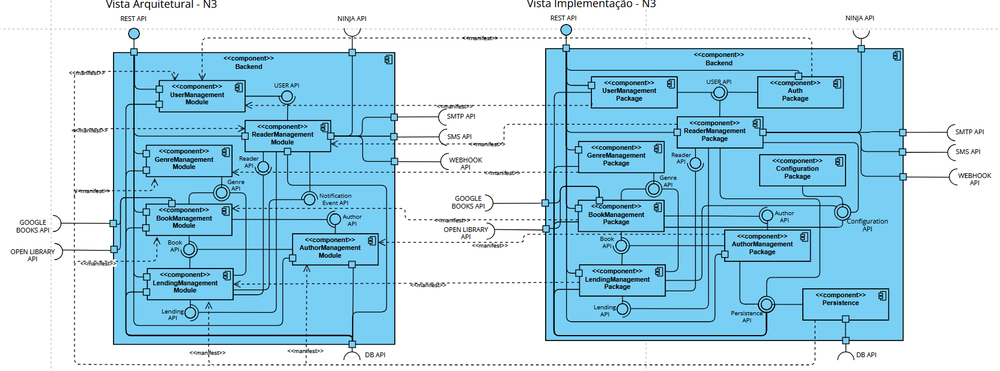
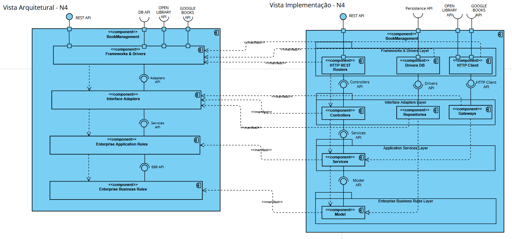

# ARQSOFT — Alternativas de Desenho, Decisões, Racional e Vistas do System-to-Be

## 1. Enquadramento e Critérios de Decisão

Para cada uma das três áreas funcionais do enunciado (`1.3.3.1`, `1.3.3.2`, `1.3.3.3`), as alternativas de desenho arquitetural foram comparadas segundo quatro critérios:
1. **Satisfação dos Drivers Arquiteturais:** Cumprimento dos requisitos funcionais (`FR01`–`FR04`) e dos cenários de atributos de qualidade (`ASR01`–`ASR07`).
2. **Conformidade com Restrições Técnicas (`TC01`–`TC05`):** Manutenção do Monólito Modular em Java 17 / Spring Boot, persistência relacional JPA/H2 e execução de testes 100% offline.
3. **Custo de Modificação e Impacto Limitado:** Zero alterações em classes de domínio ou serviços aplicacionais aquando da introdução de novas extensões ($M_{\text{core}} = 0$).
4. **Verificabilidade Empírica (`1.3.3.4`):** Capacidade de testar isoladamente cada unidade em caixa opaca, caixa transparente, mutação (PITest), integração de componentes e sistema E2E.

---

## 2. Alternativas de Desenho, Decisões e Racional (Technical Memos)

### 2.1. Iteração 1 — Integração de Fontes Bibliográficas Externas (1.3.3.1)

#### A. Comparação de Alternativas de Desenho

| Alternativa de Desenho | Prós | Contras e Riscos | Custo | Decisão |
| :--- | :--- | :--- | :---: | :--- |
| **A1.1 — Consumo HTTP Direto em `BookServiceImpl`** *(Invocar `RestTemplate` diretamente no serviço de livros, à semelhança de `ApiNinjasService` no System-as-is)* | • Menor número inicial de classes. | • **Viola `ASR01` (OCP):** Adicionar uma nova fonte obriga a alterar `BookServiceImpl`. • **Viola `ASR05`:** Payloads JSON externos contaminam a lógica aplicacional. • **Viola `ASR04`/`TC05`:** Dificulta o isolamento unitário do serviço. | Baixo | **Rejeitada** |
| **A1.2 — Gateway Monolítico Único** *(Classe única `ExternalBookGateway` com `if/else` internos para Google Books, Open Library e CrossRef)* | • Retira o cliente HTTP de `BookServiceImpl`. | • **Viola `ASR01` (OCP) e Coesão:** Adicionar uma 3.ª fonte obriga a modificar a mesma classe que contém a lógica das fontes anteriores. • Mistura *parsing* de esquemas JSON distintos com lógica de *fallback*. | Médio | **Rejeitada** |
| **A1.3 — Porta `BookInfoProvider` + Adaptadores Dedicados (`GoogleBooks`, `OpenLibrary`, `CrossRef`) + `CompositeBookInfoProvider` + `BibliographicConfig`** | • **Cumpre `FR01`, `ASR01`, `ASR02`, `ASR04`, `ASR05`, `ASR06`.** • Isola cada API externa no seu próprio `@Component` *Adapter*. • `CompositeBookInfoProvider` executa *fallback* e fusão campo-a-campo (`BookDetailsDTO.mergeWith`). • Novas fontes são descobertas automaticamente pelo Spring via `List<BookInfoProvider>`. | • Introduz mais classes (porta, DTO canónico, adaptadores, composite e configuração). | Médio | **SELECIONADA** |

#### B. Technical Memo 1 (`TM-01`)

| Campo | Especificação Técnica e Racional |
| :--- | :--- |
| **ID / Problema** | **TM-01:** Como recuperar e fundir informação bibliográfica de sistemas externos heterogéneos (Google Books, Open Library, CrossRef), selecionando-os em *setup time* e suportando novas fontes com impacto limitado? |
| **Drivers** | `FR01`, `ASR01` (Extensibilidade), `ASR02` (*Setup Time*), `ASR04` (Testabilidade), `ASR05` (Interoperabilidade), `ASR06` (*Fallback* / Resiliência), `TC05`. |
| **Solução Selecionada (`A1.3`)** | 1. Definir a porta [`BookInfoProvider`](../../../src/main/java/pt/psoft/g1/psoftg1/bookmanagement/services/external/BookInfoProvider.java) e o modelo canónico [`BookDetailsDTO`](../../../src/main/java/pt/psoft/g1/psoftg1/bookmanagement/services/external/BookDetailsDTO.java). 2. Implementar [`GoogleBooksAdapter`](../../../src/main/java/pt/psoft/g1/psoftg1/bookmanagement/infrastructure/external/GoogleBooksAdapter.java), [`OpenLibraryAdapter`](../../../src/main/java/pt/psoft/g1/psoftg1/bookmanagement/infrastructure/external/OpenLibraryAdapter.java) e [`CrossRefAdapter`](../../../src/main/java/pt/psoft/g1/psoftg1/bookmanagement/infrastructure/external/CrossRefAdapter.java) em `infrastructure.external`. 3. Implementar [`CompositeBookInfoProvider`](../../../src/main/java/pt/psoft/g1/psoftg1/bookmanagement/infrastructure/external/CompositeBookInfoProvider.java) para consulta sequencial, *fallback* automático e enriquecimento de campos nulos. 4. Configurar a seleção em *setup time* via [`BibliographicConfig`](../../../src/main/java/pt/psoft/g1/psoftg1/configuration/BibliographicConfig.java) (`bibliographic.providers`). |
| **Racional e Motivação** | `BookServiceImpl` depende apenas de `BookInfoProvider`. A inclusão real do 3.º fornecedor (`CrossRefAdapter`) comprovou que não é necessário alterar nenhuma linha em `BookServiceImpl`, `CompositeBookInfoProvider` ou `BibliographicConfig`. |
| **Compromissos e Limites** | A invocação sequencial no `CompositeBookInfoProvider` pode somar tempos de espera se múltiplas fontes falharem por timeout, mitigada por timeouts de `5s` no `RestTemplate`. |

---

### 2.2. Iteração 2 — Notificações Multicanal a Leitores (1.3.3.2)

#### A. Comparação de Alternativas de Desenho

| Alternativa de Desenho | Prós | Contras e Riscos | Custo | Decisão |
| :--- | :--- | :--- | :---: | :--- |
| **A2.1 — Invocação Síncrona Direta em `LendingServiceImpl`** *(Injetar `EmailSender`, `SmsSender`, `WebhookSender` diretamente no serviço de empréstimos)* | • Fluxo sequencial direto. | • **Viola `ASR01` e Coesão:** `lendingmanagement` fica acoplado a canais de comunicação. • **Viola `ASR06`:** Uma exceção num canal reverte a transação `@Transactional` do empréstimo. • **Viola `ASR07`:** Retém locks na BD durante o envio externo. | Baixo | **Rejeitada** |
| **A2.2 — Message Broker Externo (RabbitMQ / Kafka)** *(Publicar mensagens num broker fora do processo JVM)* | • Persistência de filas fora da JVM. | • **Viola `TC02` e `TC05`:** Exige infraestrutura distribuída externa e contentores adicionais nos testes. • Complexidade operacional excessiva para o escopo monolítico modular. | Muito Alto | **Rejeitada** |
| **A2.3 — Eventos de Domínio In-Process (`AFTER_COMMIT`) + Porta `NotificationSender` + `CompositeNotificationSender` + `NotificationConfig`** | • **Cumpre `FR02`, `ASR01`, `ASR02`, `ASR06`, `ASR07`, `TC02`, `TC05`.** • Desacopla `lendingmanagement` de `notificationmanagement`. • `@TransactionalEventListener(phase = AFTER_COMMIT)` garante que notificações só saem após commit e que falhas de envio nunca revertem o empréstimo. • Isolamento de falhas por canal em `CompositeNotificationSender`. | • Eventos em memória não sobrevivem a uma paragem abrupta da JVM entre o commit e o envio. | Médio | **SELECIONADA** |

#### B. Technical Memo 2 (`TM-02`)

| Campo | Especificação Técnica e Racional |
| :--- | :--- |
| **ID / Problema** | **TM-02:** Como notificar leitores sobre eventos de empréstimo através de múltiplos canais (Email, SMS, Webhook) selecionáveis em *setup time*, isolando falhas e suportando novos eventos/canais com impacto limitado? |
| **Drivers** | `FR02`, `ASR01` (Extensibilidade), `ASR02` (*Setup Time*), `ASR06` (Isolamento de Falhas), `ASR07` (Não-Bloqueio Pós-Commit), `TC02`, `TC05`. |
| **Solução Selecionada (`A2.3`)** | 1. Publicar eventos imutáveis (`LendingCreatedEvent`, `LendingReturnedEvent`, `LendingOverdueEvent`) via `ApplicationEventPublisher` em `LendingServiceImpl`. 2. Processar os eventos em [`LendingNotificationListener`](../../../src/main/java/pt/psoft/g1/psoftg1/notificationmanagement/listeners/LendingNotificationListener.java) com `@TransactionalEventListener(phase = TransactionPhase.AFTER_COMMIT)`. 3. Implementar [`EmailNotificationSender`](../../../src/main/java/pt/psoft/g1/psoftg1/notificationmanagement/infrastructure/EmailNotificationSender.java), [`SmsNotificationSender`](../../../src/main/java/pt/psoft/g1/psoftg1/notificationmanagement/infrastructure/SmsNotificationSender.java) e [`WebhookNotificationSender`](../../../src/main/java/pt/psoft/g1/psoftg1/notificationmanagement/infrastructure/WebhookNotificationSender.java) sob a porta [`NotificationSender`](../../../src/main/java/pt/psoft/g1/psoftg1/notificationmanagement/services/NotificationSender.java). 4. Agregar os canais ativos em [`CompositeNotificationSender`](../../../src/main/java/pt/psoft/g1/psoftg1/notificationmanagement/infrastructure/CompositeNotificationSender.java) via [`NotificationConfig`](../../../src/main/java/pt/psoft/g1/psoftg1/configuration/NotificationConfig.java) (`notification.channels`). |
| **Racional e Motivação** | Mantém `lendingmanagement` isento de lógica de notificações e protege a transação principal contra falhas de rede em gateways externos. |

---

### 2.3. Iteração 3 — Políticas de Empréstimo e Renovação Parametrizáveis (1.3.3.3)

#### A. Comparação de Alternativas de Desenho

| Alternativa de Desenho | Suporte à Seleção `Standard` vs. `Adaptive` (Secção 4.3) | Prós | Contras e Riscos | Custo | Decisão |
| :--- | :--- | :--- | :--- | :---: | :--- |
| **A3.1 — Condicionais `if/else` em `LendingServiceImpl`** | `create()` e `renew()` calculam diretamente o rácio de histórico e ramificam entre regras `Standard` e `Adaptive`. | • Sem novas classes de estratégia. | • **Viola `ASR01` (OCP) e `ASR04`:** Duplica/acopla lógica entre `create()` e `renew()` e impede testar as políticas isoladamente da persistência. | Baixo | **Rejeitada** |
| **A3.2 — Motor Externo de Regras (ex.: Drools `.drl`)** | Insere factos (`ReaderDetails`, histórico) numa *Working Memory* Drools em cada pedido. | • Regras editáveis fora de classes Java. | • **Incompatível com `ASR04` (PITest):** Ficheiros `.drl` não geram bytecode de domínio mutável pelo PITest para verificar as fronteiras `FirstThreshold` e `SecondThreshold`. | Alto | **Rejeitada** |
| **A3.3 — Padrão `Strategy` (`LendingPolicy`: `Standard` & `Adaptive`) + `LendingPolicyResolver` + `LendingPolicyProperties`** | `LendingServiceImpl` invoca `LendingPolicyResolver.resolvePolicy(...)` em cada criação e renovação; o resolvedor avalia `qualifiesForAdaptivePolicy` (Secção 4.2) e seleciona `Adaptive` ou `Standard`. | • **Cumpre 100% da Especificação v1.0 (Secções 1 a 5) e dos drivers `FR03`, `ASR01`–`ASR04`.** • Políticas são classes de domínio puras testáveis com BVA e PITest (85% mutation coverage / 88% test strength em `AdaptiveLendingPolicy`). | • Exige consultar o histórico do leitor (`listByReaderNumber`) em cada criação/renovação. | Médio | **SELECIONADA** |

#### B. Technical Memo 3 (`TM-03`)

| Campo | Especificação Técnica e Racional |
| :--- | :--- |
| **ID / Problema** | **TM-03:** Como suportar as políticas `Standard` (Secção 2) e `Adaptive` (Secção 3), parametrizando os seus limiares em *setup time* (Secção 5), validando restrições matemáticas (Secção 3.5) e reavaliando dinamicamente a política aplicável em cada empréstimo e renovação (Secção 4)? |
| **Drivers** | `FR03`, `ASR01` (Extensibilidade), `ASR02` (*Setup Time*), `ASR03` (*Runtime*), `ASR04` (Testabilidade BVA, Transparent-Box e PITest). |
| **Solução Selecionada (`A3.3`)** | 1. Definir [`LendingPolicy`](../../../src/main/java/pt/psoft/g1/psoftg1/lendingmanagement/policies/LendingPolicy.java) e as implementações [`StandardLendingPolicy`](../../../src/main/java/pt/psoft/g1/psoftg1/lendingmanagement/policies/StandardLendingPolicy.java) (Secção 2) e [`AdaptiveLendingPolicy`](../../../src/main/java/pt/psoft/g1/psoftg1/lendingmanagement/policies/AdaptiveLendingPolicy.java) (Secção 3, validando $0 < FT < ST < MaxActiveLendings$ e $LongPeriod > StandardPeriod > ShortPeriod > 0$). 2. Implementar [`LendingPolicyResolver`](../../../src/main/java/pt/psoft/g1/psoftg1/lendingmanagement/policies/LendingPolicyResolver.java) (Secção 4) para avaliar em cada `create` e `renew` a janela `HistoryPeriod`, `MinCompletedLendings`, `MinOnTimeRatio` e 0 atrasos ativos. 3. Mapear as propriedades externas em [`LendingPolicyProperties`](../../../src/main/java/pt/psoft/g1/psoftg1/configuration/LendingPolicyProperties.java) (Secção 5) e expor `POST /api/lendings/{year}/{seq}/renew` via `Lending.renew(...)`. |
| **Racional e Motivação** | Separa a configuração de parâmetros no arranque (`LendingPolicyProperties`), a regra de elegibilidade histórica (`LendingPolicyResolver`), o cálculo escalonado de prazos (`Standard` / `Adaptive`) e a persistência transacional (`LendingServiceImpl`). |

---

## 3. Síntese de Trade-Offs Arquiteturais

| Compromisso (*Trade-Off*) | Decisão Tomada | Benefício Obtido | Custo Aceite | Mitigação |
| :--- | :--- | :--- | :--- | :--- |
| **Extensibilidade (`ASR01`) vs. Número de Classes** | Portas, Adaptadores, Composites e Estratégias nas 3 iterações. | Zero modificações no domínio/serviços ao adicionar novas fontes (ex.: `CrossRefAdapter`), canais ou políticas. | Aumento do número de interfaces e classes adaptadoras. | Organização por subdomínio e descoberta automática via Spring IoC (`List<T>`). |
| **Configurabilidade em Setup (`ASR02`) vs. Erros de Configuração** | Externalização em `application.properties` via `@ConfigurationProperties`. | Alteração de fontes, canais e limiares sem recompilar o `.jar`. | Configurações inválidas ocorrem fora do tempo de compilação. | Validação *fail-fast* de invariantes nos construtores das políticas (`IllegalArgumentException`). |
| **Fallback / Fusão (`ASR06`) vs. Latência Externa** | Encadeamento sequencial em `CompositeBookInfoProvider`. | Enriquecimento completo e tolerância à falha do fornecedor primário. | Latência cumulativa quando o fornecedor primário falha por timeout. | Timeout máximo de `5s` no `RestTemplate` e paragem imediata quando `dto.isComplete() == true`. |
| **Reavaliação em Runtime (`ASR03`) vs. Leitura de Histórico** | `LendingPolicyResolver` invocado em cada `create` e `renew`. | Transição imediata entre `Adaptive` e `Standard` sempre que o leitor cumpre ou incumpre prazos. | Consulta adicional a `listByReaderNumber` por operação de escrita. | Filtragem em memória de complexidade linear $O(n)$ sobre o histórico do leitor. |

---

## 4. Verificação Empírica por Testes Funcionais Automatizados (1.3.3.4)

A tabela seguinte relaciona os 5 níveis de teste exigidos na **Secção 1.3.3.4 do Enunciado** com o respetivo SUT, as decisões arquiteturais que os viabilizam e as evidências verificadas na **Build #38 (433 testes automatizados = 386 Surefire + 47 Failsafe)**:

| Nível de Teste (1.3.3.4) | SUT (*System Under Test*) | Decisão Arquitetural Subjacente | Artefactos de Teste e Métricas Verificadas |
| :--- | :--- | :--- | :--- |
| **1.3.3.4.1 Functional Opaque-Box (Classes)** | `SUT = classes` (`StandardLendingPolicy`, adaptadores bibliográficos, canais de notificação) | Portas abstratas (`BookInfoProvider`, `NotificationSender`, `LendingPolicy`) e padrão *Adapter* | [`StandardLendingPolicyTest`](../../../src/test/java/pt/psoft/g1/psoftg1/lendingmanagement/policies/StandardLendingPolicyTest.java) (11 testes BVA/EP), [`GoogleBooksAdapterTest`](../../../src/test/java/pt/psoft/g1/psoftg1/bookmanagement/infrastructure/gateways/GoogleBooksAdapterTest.java) (7), [`OpenLibraryAdapterTest`](../../../src/test/java/pt/psoft/g1/psoftg1/bookmanagement/infrastructure/gateways/OpenLibraryAdapterTest.java) (10), [`CrossRefAdapterTest`](../../../src/test/java/pt/psoft/g1/psoftg1/bookmanagement/infrastructure/gateways/CrossRefAdapterTest.java) (8), [`CompositeBookInfoProviderTest`](../../../src/test/java/pt/psoft/g1/psoftg1/bookmanagement/infrastructure/gateways/CompositeBookInfoProviderTest.java) (6), `Email/Sms/Webhook/CompositeNotificationSenderTest` (28). |
| **1.3.3.4.2 Functional Transparent-Box (Domínio)** | `SUT = domain classes` (`LendingPolicyResolver`, `StandardLendingPolicy`, `AdaptiveLendingPolicy`, `Lending`) | Domínio isolado de frameworks (*High Semantic Coherence*) | [`LendingPolicyResolverTest`](../../../src/test/java/pt/psoft/g1/psoftg1/lendingmanagement/policies/LendingPolicyResolverTest.java) (9 testes cobrindo janela `HistoryPeriod`, `MinCompletedLendings`, `MinOnTimeRatio` e atrasos), [`LendingTest`](../../../src/test/java/pt/psoft/g1/psoftg1/lendingmanagement/model/LendingTest.java) (21 testes cobrindo `renew`, atrasos e multas). Cobertura de linhas no pacote `policies`: **95%**. |
| **1.3.3.4.3 Mutation Tests (Classes)** | `SUT = classes` (`AdaptiveLendingPolicy`, modelos e serviços) | Classes de política e domínio sem dependências de infraestrutura | [`AdaptiveLendingPolicyTest`](../../../src/test/java/pt/psoft/g1/psoftg1/lendingmanagement/policies/AdaptiveLendingPolicyTest.java) (34 testes matando mutantes de fronteira em `FirstThreshold`, `SecondThreshold`, `MaxActiveLendings`, `MaxRenewals`): **85% mutation coverage e 88% test strength em `AdaptiveLendingPolicy`** (**1.078 / 3.798 mutantes mortos e 82% test strength global**). |
| **1.3.3.4.4 Functional Opaque-Box (Componentes)** | `SUT = controller + service + {domain, repo, gateways}` | Injeção de dependências e eventos pós-commit (`AFTER_COMMIT`) | [`BookControllerIntegrationTest`](../../../src/test/java/pt/psoft/g1/psoftg1/bookmanagement/api/BookControllerIntegrationTest.java) (8), [`LendingNotificationIntegrationIT`](../../../src/test/java/pt/psoft/g1/psoftg1/readermanagement/infrastructure/notifications/LendingNotificationIntegrationIT.java) (3), [`LendingControllerIntegrationTest`](../../../src/test/java/pt/psoft/g1/psoftg1/lendingmanagement/api/LendingControllerIntegrationTest.java) (5), [`LendingServiceImplIT`](../../../src/test/java/pt/psoft/g1/psoftg1/lendingmanagement/services/LendingServiceImplIT.java) (4). |
| **1.3.3.4.5 Functional Opaque-Box (Sistema)** | `SUT = system` (Aplicação completa via HTTP REST) | Monólito Modular REST autocontido | [`LendingPolicyAcceptanceIT`](../../../src/test/java/pt/psoft/g1/psoftg1/lendingmanagement/LendingPolicyAcceptanceIT.java) (3 cenários E2E: `Standard`, `Adaptive` e reavaliação na renovação), [`BookExternalInfoIT`](../../../src/test/java/pt/psoft/g1/psoftg1/bookmanagement/BookExternalInfoIT.java) (5 cenários E2E incluindo `CrossRef` e *fallback*), e coleções **Postman**: nova coleção modular [`Docs/ARQSOFT/Postman/new/Psoft-G1.postman_collection.json`](../Postman/new/Psoft-G1.postman_collection.json) (**47 pedidos** E2E cobrindo `Auth`, `Author`, `Book/External`, `Reader`, `Lendings/Renew`) e coleção original [`Docs/ARQSOFT/Postman/Psoft-G1.postman_collection.json`](../Postman/Psoft-G1.postman_collection.json) (**183 pedidos compostos**). |

---

## 5. Vistas Arquiteturais do System-to-Be (C4 + 4+1 Vistas de Kruchten)

Esta secção consolida os **27 modelos visuais do *System-to-Be*** distribuídos pelas pastas de `Docs/ARQSOFT/System-to-be/`:
* `Vista Arquitetural/` (4 diagramas: `VA_N1` a `VA_N4`)
* `Vista Lógica/` (3 diagramas: `VL-N1` a `VL-N3`)
* `Vista Implementação/` (4 diagramas: `VI_N1` a `VI_N4`)
* `Manifestação/` (2 diagramas: `VA_to_VI_N3` e `VA_to_VI_N4`)
* `Vista Fisica/` (2 diagramas: `VF_N1` e `VF_N2`)
* `Vista Processos/` (12 diagramas de sequência: 4 cenários evoluídos $\times$ 3 níveis)

---

### 5.1. Vista Arquitetural (VA)

#### 5.1.1. Nível 1 — Sistema Global
* **Objetivo:** Representar o LMS no seu contexto operacional e interfaces públicas na fronteira do sistema.
* **Alterações no System-to-Be:** Adição das portas externas requeridas para as APIs bibliográficas (**Google Books API**, **Open Library API**, **CrossRef API**) e canais de notificação (**SMTP Server**, **SMS Gateway**, **Webhook Target**).

---

#### 5.1.2. Nível 2 — Decomposição em Subsistemas
* **Objetivo:** Representar os contentores de alto nível (`Backend` e `DB`) e as respetivas portas de ligação.
* **Alterações no System-to-Be:** O contentor `Backend` expõe e consome as novas portas de integração bibliográfica e de despacho multicanal de notificações, mantendo a persistência relacional via `DB API`.

---

#### 5.1.3. Nível 3 — Módulos de Domínio (Modular Monolith)
* **Objetivo:** Representar a decomposição do `Backend` nos seus módulos de domínio e a comunicação inter-módulos.
* **Alterações no System-to-Be:**
  * `BookManagement`: Portas de saída para os fornecedores bibliográficos externos via adaptadores e composite;
  * `LendingManagement`: Emissão de eventos de domínio no barramento interno e motor de políticas de empréstimo e renovação (`policies`);
  * `NotificationManagement` / `ReaderManagement`: Listener pós-commit e adaptadores de notificação multicanal (Email, SMS, Webhook);
  * Manutenção dos módulos `UserManagement`, `AuthorManagement` e `GenreManagement`.

---

#### 5.1.4. Nível 4 — Estrutura Interna dos Módulos Refinados (Clean Architecture)
* **Objetivo:** Ilustrar a organização interna em 4 camadas concêntricas (*Clean / Hexagonal Architecture*) aplicada aos módulos refinados:
  * *Camada 1 (Enterprise Business Rules):* Entidades (`Book`, `Lending`, `ReaderDetails`) e políticas (`StandardLendingPolicy`, `AdaptiveLendingPolicy` e estratégias de extensão);
  * *Camada 2 (Application Business Rules):* Serviços (`BookServiceImpl`, `LendingServiceImpl`), DTO canónico (`BookDetailsDTO`) e portas (`BookInfoProvider`, `NotificationSender`, `LendingPolicyResolver`);
  * *Camada 3 (Interface Adapters):* Controladores REST (`BookController`, `LendingController`, `LendingPolicyAdminController`), adaptadores (`GoogleBooksAdapter`, `OpenLibraryAdapter`, `CrossRefAdapter`), compositores (`CompositeBookInfoProvider`, `CompositeNotificationSender`), senders (`Email`, `SMS`, `Webhook`) e repositórios JPA;
  * *Camada 4 (Frameworks & Drivers):* Spring Boot, Spring Web, Spring Data JPA, H2, Spring Events, `RestTemplate`.

---

### 5.2. Vista Lógica (VL)

#### 5.2.1. Nível 1 — Visão Lógica Global
* **Alterações no System-to-Be:** Inclusão das interfaces lógicas de consulta bibliográfica externa e de notificação a leitores.

---

#### 5.2.2. Nível 2 — Subsistemas Lógicos
* **Alterações no System-to-Be:** Integração das portas lógicas de comunicação externa no `Backend`.

---

#### 5.2.3. Nível 3 — Subdomínios Lógicos e Barramento de Eventos
* **Alterações no System-to-Be:** Desacoplamento lógico entre o subdomínio de empréstimos e o despacho de notificações através de eventos de domínio.

---

### 5.3. Vista de Implementação (VI)

#### 5.3.1. Nível 1 — Artefato Executável Global
* **Alterações no System-to-Be:** O artefacto executável (`psoft-g1-0.0.1-SNAPSHOT.jar`) incorpora os clientes HTTP para integrações externas, o barramento Spring Events e as classes de configuração (`BibliographicConfig`, `NotificationConfig`, `LendingPolicyProperties`).

---

#### 5.3.2. Nível 2 — Subsistemas de Implementação
* **Alterações no System-to-Be:** O subsistema `Backend` gere as portas de saída para fornecedores bibliográficos e canais de notificação, mantendo a ligação JDBC ao subsistema `DB` (H2).

---

#### 5.3.3. Nível 3 — Módulos de Subdomínio e Persistência Técnica
* **Alterações no System-to-Be:**
  * `bookmanagement`: Pacotes `services.external` e `infrastructure.external`;
  * `lendingmanagement`: Pacotes `events` e `policies`;
  * `notificationmanagement`: Pacotes `services`, `listeners` e `infrastructure`;
  * `configuration`: `BibliographicConfig`, `NotificationConfig` e `LendingPolicyProperties`.

---

#### 5.3.4. Nível 4 — Decomposição Física em Camadas e Componentes Técnicos
* **Alterações no System-to-Be:** Representa as 4 camadas internas (`Frameworks & Drivers`, `Interface Adapters`, `Application Services`, `Enterprise Business Rules`) integrando `Gateways`, `HTTP Client` e `Policies`.

---

### 5.4. Manifestação entre Vistas (VA $\to$ VI)

#### 5.4.1. Mapeamento Nível 3 (VA N3 $\leftrightarrow$ VI N3)
* **Objetivo:** Rastreabilidade `<<manifest>>` entre os módulos da Vista Arquitetural e os pacotes da Vista de Implementação.

---

#### 5.4.2. Mapeamento Nível 4 (VA N4 $\leftrightarrow$ VI N4)
* **Objetivo:** Mapeamento `<<manifest>>` entre as 4 camadas concêntricas da VA N4 e os componentes de implementação da VI N4 (`Frameworks & Drivers` $\leftarrow$ `HTTP REST Routers`, `Drivers DB`, `HTTP Client`; `Interface Adapters` $\leftarrow$ `Controllers`, `Repositories`, `Gateways`; `Application Rules` $\leftarrow$ `Services`; `Business Rules` $\leftarrow$ `Model`, `Policies`).

---

### 5.5. Vista Física / Implantação (VF)

#### 5.5.1. Nível 1 — Nó Computacional Global
* **Objetivo:** Representar a implantação do LMS no nó hospedeiro `Server`.

---

#### 5.5.2. Nível 2 — Topologia de Nós Físicos/Lógicos e Serviços Externos
* **Descrição:**
  * **`Client Workstation`:** Clientes HTTP/REST (Browser, Postman) comunicando com o servidor (`HTTP/REST:8080`).
  * **`Server`:** Processo `JVM 17` executando o `Backend` Spring Boot, base de dados `H2 DBMS` via JDBC e armazenamento local `uploads-psoft-g1`.
  * **`Cloud`:** Serviços externos consumidos pelo `Backend`: **Google Books API**, **Open Library API** e **CrossRef API** (`HTTPS:443`), **Ninja API** (`HTTPS:443`), **SMTP Server** (`TCP:587`), **SMS Gateway** (`HTTPS:443`) e **Webhook Target Server** (`HTTPS:443`).

---

### 5.6. Vista de Processos (VP)

#### 5.6.1. Cenário 1: Criar Empréstimo com Resolução Dinâmica de Política e Notificações Multicanal (*Create Lending*)
1. O Bibliotecário submete `POST /api/lendings` $\rightarrow$ `LendingController.create` $\rightarrow$ `LendingServiceImpl.create`.
2. O serviço consulta os empréstimos ativos (`listOutstandingByReaderNumber`) e o histórico do leitor (`listByReaderNumber`) em `LendingRepository`, bem como `Book` e `ReaderDetails`.
3. O serviço invoca `LendingPolicyResolver.resolvePolicy(reader, book, activeLendings, readerHistory)` (Secção 4), que seleciona `AdaptiveLendingPolicy` ou `StandardLendingPolicy`.
4. A política selecionada executa `validateCanLend(...)` e calcula `getLendingDurationInDays(activeLendings)`.
5. O empréstimo é persistido em `LendingRepository` e `LendingServiceImpl` publica `LendingCreatedEvent` via `ApplicationEventPublisher`.
6. Após o commit (`AFTER_COMMIT`), `LendingNotificationListener` recebe o evento e delega em `CompositeNotificationSender`, que envia a notificação para os canais ativos (`Email`, `SMS`, `Webhook`) isolando eventuais falhas.

* **Nível 1:**  
  
* **Nível 2:**  
  
* **Nível 3:**  
  

---

#### 5.6.2. Cenário 2: Consulta e Registo de Livro com Enriquecimento Bibliográfico Externo e Fallback (*Register Book*)
1. O Bibliotecário submete `PUT /api/books/{isbn}` (ou consulta `GET /api/books/external/{isbn}`).
2. Quando os metadados requerem enriquecimento externo, `BookServiceImpl` invoca a porta `BookInfoProvider` (`CompositeBookInfoProvider`).
3. O `CompositeBookInfoProvider` consulta os adaptadores configurados (`GoogleBooksAdapter`, `OpenLibraryAdapter`, `CrossRefAdapter`) pela ordem definida em `bibliographic.providers`, aplicando *fallback* em caso de falha e fusão de campos (`mergeWith`) caso a primeira resposta seja parcial.
4. A entidade `Book` é instanciada e persistida em `BookRepository`, devolvendo `201 Created`.

* **Nível 1:**  
  
* **Nível 2:**  
  
* **Nível 3:**  
  

---

#### 5.6.3. Cenário 3: Devolver Empréstimo com Cálculo de Multa e Notificação Pós-Commit (*Return Lending*)
1. O Leitor submete `PATCH /api/lendings/{year}/{seq}` com cabeçalho `If-Match`.
2. `LendingServiceImpl.setReturned` valida a versão otimista, marca a devolução em `Lending` e, caso existam dias em atraso (`getDaysDelayed() > 0`), persiste a entidade `Fine`.
3. O serviço publica `LendingReturnedEvent` (e `LendingOverdueEvent` se devolvido com atraso), acionando após o commit o `LendingNotificationListener` e o `CompositeNotificationSender`.

* **Nível 1:**  
  
* **Nível 2:**  
  
* **Nível 3:**  
  

---

#### 5.6.4. Cenário 4: Renovação de Empréstimo com Reavaliação Dinâmica de Política em Runtime (*Renew Lending*)
1. O Leitor/Bibliotecário submete `POST /api/lendings/{year}/{seq}/renew` com cabeçalho `If-Match`.
2. `LendingServiceImpl.renew` recupera o empréstimo, os empréstimos ativos (`listOutstandingByReaderNumber`) e o histórico do leitor (`listByReaderNumber`).
3. O serviço invoca `LendingPolicyResolver.resolvePolicy(...)` para **reavaliar dinamicamente no momento da renovação** (Secção 4.3) a política aplicável (`AdaptiveLendingPolicy` vs. `StandardLendingPolicy`).
4. A política selecionada executa `validateCanRenew(lending, reader, activeLendings)` (verificando `renewalCount < MaxRenewals` e ausência de atrasos) e devolve `getRenewalPeriodInDays(activeLendings)`.
5. O método `Lending.renew(renewalDays, desiredVersion)` estende `limitDate`, incrementa `renewalCount` e o registo atualizado é persistido em `LendingRepository`.

* **Nível 1:**  
  
* **Nível 2:**  
  
* **Nível 3:**  
  
