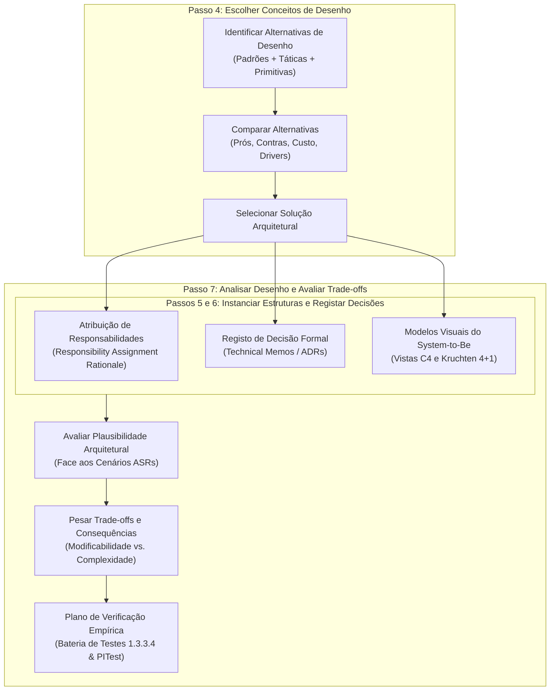
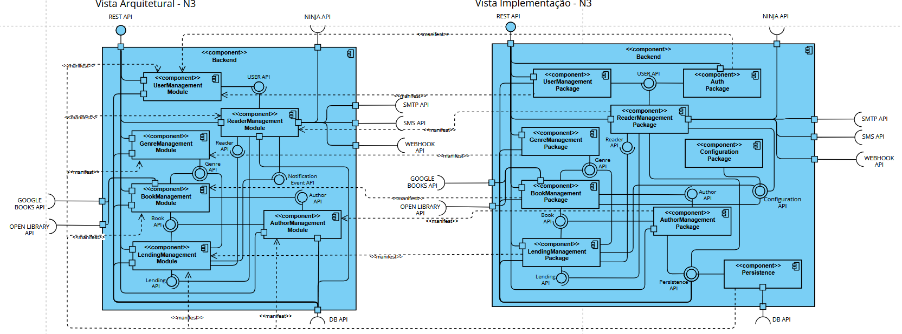
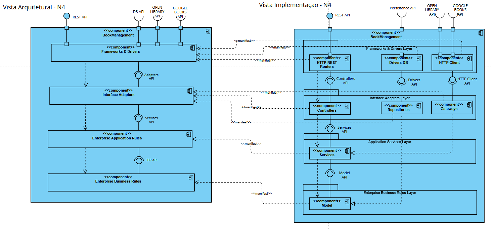

# ARQSOFT — Alternativas de Desenho Arquitetural e Racional (Modelos Visuais)

## 1. Metodologia de Tomada de Decisão e Racional no ADD 3.0 (Passos 4, 6 e 7)

No método **Attribute-Driven Design (ADD 3.0)**, a construção da arquitetura do software decorre da análise sistemática das forças motrizes (*Architectural Drivers*) e da ponderação fundamentada entre opções estruturais viáveis.

### 1.1. Critérios de Avaliação Multidimensional de Alternativas
Perante cada sub-problema e iteração do ADD, as alternativas de desenho são formuladas e comparadas segundo quatro critérios objetivos:
1. **Aderência aos Drivers Arquiteturais:** Capacidade de satisfazer integralmente os requisitos funcionais (`FR01` a `FR04`) e os cenários de atributos de qualidade (`ASR01` a `ASR07`);
2. **Conformidade com Restrições (*Technical Constraints*):** Respeito por `TC01` (Java 17 / Spring Boot), `TC02` (Monólito Modular DDD), `TC03` (JPA/H2) e `TC05` (Testes 100% herméticos e determinísticos em ambiente offline);
3. **Custo e Complexidade de Implementação:** Avaliação do esforço de desenvolvimento, quantidade de abstrações introduzidas e risco de introdução de dívida técnica ou *over-engineering*;
4. **Viabilidade Operacional (`OL01`–`OL04`):** Possibilidade de paralelização equilibrada das tarefas entre os 3 elementos do grupo para cumprimento rigoroso da data de entrega (2026-11-01).

### 1.2. Registo Formal do Racional Arquitetural
Para garantir a rastreabilidade e a transparência entre os requisitos de negócio e o código implementado, utilizam-se dois mecanismos formais:
* **Tabelas de Comparação de Alternativas (Passo 4):** Contrastam explicitamente os prós, contras, custo e decisão final face aos drivers;
* **Technical Memos (ADRs — *Architectural Decision Records* — Passo 6):** Consolidam a especificação da decisão, incluindo *Issue*, *Problem*, *Summary of Solution*, *Factors*, *Solution*, *Motivation*, *Alternatives Considered* e *Pending Issues / Carry-forward*.

---

## 2. Avaliação de Alternativas de Desenho e Racional por Sub-Problema

---

### 2.1. Sub-Problema 1: Recuperação e Agregação de Fontes Bibliográficas Heterogéneas (1.3.3.1 / Iteração 1)

* **Contexto do Problema:** O serviço de livros necessita de obter metadados bibliográficos a partir de APIs externas (Google Books e Open Library). Estas APIs expõem estruturas de dados heterogéneas; deve ser possível selecionar em *setup time* uma ou ambas as fontes ativas, realizar contingência (*fallback*) automática caso a primária falhe ou tenha dados incompletos, e permitir adicionar novas fontes futuras com impacto nulo na lógica existente (cumprimento estrito do OCP).

#### A. Tabela Comparativa de Alternativas de Desenho (Iteração 1)

| Alternativa de Desenho | Prós (Vantagens) | Contras (Limitações e Riscos) | Custo | Decisão Face aos Drivers |
| :--- | :--- | :--- | :---: | :--- |
| **A1.1 — Dependência Direta no Serviço Aplicacional** *(Instanciar e consumir `WebClient` diretamente dentro de `BookServiceImpl`, à semelhança do system-as-is)* | • Menor número inicial de ficheiros e interfaces. • Implementação imediata do pedido HTTP. | • **Viola `ASR01` (Extensibilidade/OCP):** Cada nova fonte exige alterar `BookServiceImpl`. • **Viola `ASR05` (Interoperabilidade):** O modelo JSON externo contamina o domínio interno. • **Viola `ASR04` e `TC05` (Testabilidade):** Torna impossível testar unitariamente o serviço sem mocks complexos de rede. | Baixo | **Rejeitada** *(Acoplamento inaceitável)* |
| **A1.2 — Gateway Monolítico Central Único** *(Uma única classe `ExternalBookGateway` contendo métodos e condicionais internos para Google Books, Open Library e fallback)* | • Remove o código HTTP direto de `BookServiceImpl`. • Centraliza as invocações externas numa só classe. | • **Viola a Coesão e o OCP (`ASR01`):** Adicionar uma 3.ª fonte obriga a modificar a classe existente, com risco de regressão nas fontes já testadas. • Não suporta vinculação condicional transparente no arranque (`ASR02`). | Médio | **Rejeitada** *(Violação de modularidade)* |
| **A1.3 — Porta Estável (`BookInfoProvider`) + Adaptadores Dedicados + Provedor Composto (`CompositeBookInfoProvider`) + Configuração em Setup Time (`BibliographicConfig`)** | • **Cumpre 100% dos drivers (`ASR01`, `ASR02`, `ASR05`, `ASR06`).** • Isola cada API no seu próprio *Adapter* coeso. • Normaliza dados num DTO canónico (`BookDetailsDTO`). • Permite 1, 2 ou $N$ fontes ativas com *fallback* automático transparente para o serviço aplicacional. • Permite testes de unidade, domínio e mutação PITest 100% isolados (`TC05`). | • Introduz mais classes e interfaces (1 porta, 2 adaptadores, 1 composite, 1 DTO canónico e 1 classe de configuração). | Médio | **SELECIONADA** *(Solução robusta e desacoplada)* |

#### B. Technical Memo 1 — Registo Formal da Decisão (TM-01)

| Campo | Especificação Técnica e Racional Arquitetural |
| :--- | :--- |
| **Issue / ID** | **TM-01:** Integração Extensível, Configurável e Resiliente de Fontes Bibliográficas Externas (1.3.3.1). |
| **Problem** | Como obter metadados de livros a partir de APIs externas heterogéneas (Google Books e Open Library), permitindo selecionar e combinar fontes em *setup time* e adicionar novas fontes no futuro sem modificar a lógica aplicacional do módulo `bookmanagement`? |
| **Summary of Solution** | Aplicar as táticas **Abstract Common Services**, **Encapsulate**, **Restrict Dependencies**, **Use an Intermediary**, **Degradation / Fallback** e **Defer Binding Time (Startup)**, materializadas na combinação dos padrões **Port & Adapter**, **Canonical Data Model (DTO)** e **Composite**. |
| **Factors (Drivers)** | `FR01` (Google Books + Open Library), `ASR01` (Extensibilidade OCP), `ASR02` (Configuração em *setup time*), `ASR05` (Modelos de dados heterogéneos), `ASR06` (Tolerância a falhas externas), `ASR04` e `TC05` (Testes 100% offline). |
| **Solution** | 1. Definir o contrato abstrato de saída `BookInfoProvider` e o modelo canónico `BookDetailsDTO` na camada `services`. 2. Implementar `GoogleBooksAdapter` e `OpenLibraryAdapter` na camada `infrastructure.gateways`, encapsulando `WebClient` e mapeando os esquemas JSON específicos para o DTO canónico. 3. Implementar `CompositeBookInfoProvider` que implementa `BookInfoProvider` e agrega a lista de provedores ativos pela ordem definida em `bibliographic.providers`. Realiza **contingência automática (*fallback*)** em caso de indisponibilidade/timeout e **enriquecimento/fusão (*data merging*)** caso a primeira fonte retorne dados parciais, preenchendo os atributos em falta a partir da fonte subsequente antes de entregar o DTO final ao serviço. 4. Criar `BibliographicConfig` para registar dinamicamente os beans com base nas propriedades ativas no arranque. |
| **Motivation** | O serviço aplicacional `BookServiceImpl` depende exclusivamente da abstração `BookInfoProvider`. Desconhece quantas ou quais fontes estão configuradas. A inclusão de uma 3.ª fonte futura exige apenas adicionar 1 nova classe adaptadora e atualizar o ficheiro de propriedades, garantindo OCP absoluto. |
| **Alternatives Considered** | Consumo direto com `WebClient` em `BookServiceImpl` (rejeitada por violar OCP e testabilidade) e Gateway único com condicionais internos (rejeitada por baixa coesão e acoplamento). |
| **Pending Issues / Carry-forward** | O encadeamento de fontes em caso de falha pode acumular tempos de espera (*timeout*). É necessário configurar tempos limites curtos no `WebClient` (ex.: 2 a 3 segundos) e validar o comportamento de *fallback* com testes de injeção de falhas com *stubs* HTTP locais (`1.3.3.4`). |

---

### 2.2. Sub-Problema 2: Sistema de Notificações a Leitores Desacoplado e Multicanal (1.3.3.2 / Iteração 2)

* **Contexto do Problema:** Quando ocorrem eventos no ciclo de vida de empréstimos (criação, devolução, prazo limite, atraso com multa), os leitores devem ser notificados através de canais distintos (**Email**, **SMS** e **Webhook**), funcionando individualmente ou em qualquer combinação configurada em *setup time*. A indisponibilidade de um canal externo não pode bloquear outros canais nem provocar o *rollback* da transação do empréstimo na base de dados (`ASR06`). Novos canais devem ser suportados sem modificar `lendingmanagement`.

#### A. Tabela Comparativa de Alternativas de Desenho (Iteração 2)

| Alternativa de Desenho | Prós (Vantagens) | Contras (Limitações e Riscos) | Custo | Decisão Face aos Drivers |
| :--- | :--- | :--- | :---: | :--- |
| **A2.1 — Invocação Síncrona Direta no Serviço de Empréstimos** *(Injetar classes concretas `EmailSender`, `SmsSender`, `WebhookSender` diretamente em `LendingServiceImpl`)* | • Fluxo de código sequencial simples de seguir em debug. | • **Grave Violação de Coesão e Acoplamento:** `lendingmanagement` passa a conhecer detalhes de telecomunicações. • **Violação de `ASR06` (Fiabilidade):** Uma falha no envio de SMS reverte o `@Transactional` do empréstimo. • **Violação de `ASR07` (Desempenho):** O utilizador fica bloqueado à espera da rede externa. | Baixo | **Rejeitada** *(Fragilidade transacional intolerável)* |
| **A2.2 — Message Broker Distribuído Externo (RabbitMQ / Apache Kafka)** *(Publicar eventos num broker distribuído fora do processo Java)* | • Desacoplamento físico e persistência em disco de filas de mensagens assíncronas. | • **Violação Frontal de `TC02` (Monólito Modular) e `TC05` (Testes herméticos):** Exige infraestrutura externa de containers e brokers em tempo de build/teste. • **Over-engineering:** Complexidade operacional desproporcionada para o âmbito do projeto. | Muito Alto | **Rejeitada** *(Complexidade desmedida)* |
| **A2.3 — Barramento de Eventos In-Process (`ApplicationEventPublisher`) com Sincronização Pós-Commit (`@TransactionalEventListener`) + Padrão `Strategy` (`NotificationSender`) + Despachador `Composite`** | • **Cumpre 100% dos drivers (`FR02`, `ASR01`, `ASR02`, `ASR06`, `ASR07`, `TC02`, `TC05`).** • Desacopla totalmente os módulos `lendingmanagement` e `readermanagement`. • Suporta 1, 2 ou 3 canais em simultâneo através de `notification.channels`. • A sincronização `@TransactionalEventListener(phase = AFTER_COMMIT)` impede o envio de notificações de empréstimos não consolidados. • Cada envio é isolado em `try/catch`, garantindo que uma falha externa não corrompe a BD H2. • Executa 100% em memória nos testes unitários e de integração. | • Requer definir classes formais de eventos de domínio imutáveis e garantir o tratamento de exceções no ouvinte. | Médio | **SELECIONADA** *(Arquitetura robusta e elegante)* |

#### B. Technical Memo 2 — Registo Formal da Decisão (TM-02)

| Campo | Especificação Técnica e Racional Arquitetural |
| :--- | :--- |
| **Issue / ID** | **TM-02:** Subsistema de Notificações Multicanal Desacoplado e Resiliente (1.3.3.2). |
| **Problem** | Como notificar leitores sobre eventos relevantes de empréstimo através de Email, SMS e Webhook (isolados ou combinados), selecionando os canais em *setup time* e permitindo novos canais futuros sem modificar o módulo de empréstimos nem comprometer as transações de dados? |
| **Summary of Solution** | Adotar as táticas **Publish-Subscribe**, **Abstract Common Services**, **Encapsulate**, **Use an Intermediary**, **Fault Isolation**, **Asynchronous Event Processing** e **Defer Binding Time (Startup)**, articulando os padrões **Domain Events / Observer**, **Strategy** e **Composite**. |
| **Factors (Drivers)** | `FR02` (Email, SMS, Webhook), `ASR01` (Extensibilidade OCP), `ASR02` (Configuração em *setup time*), `ASR06` (Isolamento de falhas), `ASR07` (Desempenho e não-bloqueio), `TC02` (Monólito Modular), `TC05` (Testes offline). |
| **Solution** | 1. `LendingServiceImpl` emite eventos de domínio imutáveis (`LendingCreatedEvent`, etc.) através do `ApplicationEventPublisher` do Spring após a persistência da entidade. 2. O componente `LendingNotificationListener` (em `readermanagement.infrastructure.notifications`) subscreve os eventos via anotação `@TransactionalEventListener(phase = TransactionPhase.AFTER_COMMIT)`. Isto assegura que nenhuma notificação é enviada caso a transação de base de dados sofra *rollback*. 3. O despachador `CompositeNotificationSender` agrega os canais ativados na propriedade `notification.channels=email,sms,webhook` e invoca cada `NotificationSender` protegido por bloco `try/catch` individual. 4. Adaptadores concretos (`EmailNotificationSender`, `SmsNotificationSender`, `WebhookNotificationSender`) realizam a formatação e entrega específica. |
| **Motivation** | O subdomínio `lendingmanagement` mantém-se 100% puro e focado em regras de negócio de empréstimos. A falha de um serviço externo de SMS ou Webhook nunca impede a emissão de um empréstimo válido na biblioteca. |
| **Alternatives Considered** | Chamadas diretas acopladas no serviço de empréstimo (rejeitada por quebra do OCP e risco transacional) e Message Broker RabbitMQ/Kafka (rejeitada por complexidade desnecessária e quebra de testes offline). |
| **Pending Issues / Carry-forward** | Validar nos testes de integração (`1.3.3.4.4`) que, mesmo simulando que o Webhook responde com HTTP 500 ou timeout, o empréstimo é criado na BD H2 com status 201 Created e os outros canais ativos são invocados normalmente. |

---

### 2.3. Sub-Problema 3: Motor de Políticas de Empréstimo Parametrizáveis e Dinâmicas (1.3.3.3 / Iteração 3)

* **Contexto do Problema:** No *system-as-is*, as regras de empréstimo encontram-se fixas no código (*hardcoded* em `LendingServiceImpl`): limite global de 3 livros, bloqueio ao 1.º atraso, duração e taxas de multa imutáveis. O *System-to-Be* exige:
  1. Parametrização em *setup time* de limites, prazos e multas sem alterar código (`ASR02`);
  2. Seleção dinâmica em tempo de execução (*runtime*) da política aplicável segundo regras baseadas no leitor e no livro (`ASR03`);
  3. Suporte a novas políticas no futuro com impacto mínimo (`ASR01`).

#### A. Tabela Comparativa de Alternativas de Desenho (Iteração 3)

| Alternativa de Desenho | Prós (Vantagens) | Contras (Limitações e Riscos) | Custo | Decisão Face aos Drivers |
| :--- | :--- | :--- | :---: | :--- |
| **A3.1 — Estruturas Condicionais Complexas (`if/else` / `switch`) em `LendingServiceImpl`** | • Fácil de programar para 1 ou 2 regras simples num primeiro momento. | • **Violação Crítica de `ASR01` (OCP) e `ASR04` (Testabilidade):** `LendingServiceImpl.create()` cresce descontroladamente a cada nova regra de negócio. • Alta complexidade ciclomática e risco severo de mutantes sobreviventes no PITest. • Não resolve a parametrização externa limpa em *setup time*. | Baixo | **Rejeitada** *(Antipadrão de manutenibilidade)* |
| **A3.2 — Motor de Regras de Negócio Externo Pesado (ex.: Drools / ficheiros `.drl`)** | • Permite editar expressões lógicas em ficheiros de texto externos. | • **Complexidade Excessiva (*Over-engineering*):** Curva de aprendizagem acentuada e impacto no tempo de arranque. • **Incompatibilidade com `ASR04` e PITest:** Regras escritas em DSL externa não são avaliadas pelo analisador de mutação PITest sobre código Java (`1.3.3.4.3`). | Alto | **Rejeitada** *(Complexidade e perda de verificação estrita)* |
| **A3.3 — Padrão `Strategy` (`LendingPolicy`) + Intermediário `LendingPolicyResolver` + Mapeamento Tipado `@ConfigurationProperties`** | • **Cumpre 100% dos drivers (`FR03`, `ASR01`, `ASR02`, `ASR03`, `ASR04`).** • Cada política de negócio é uma classe Java coesa, imutável e 100% testável com JUnit e PITest. • Limiares numéricos são injetados de `application.properties` no arranque. • O `LendingPolicyResolver` descobre automaticamente todas as políticas ativas e seleciona deterministicamente a correta em *runtime* com base em `isApplicable` e `getPriority()`. • Novas políticas são adicionadas criando apenas 1 nova classe `@Component`. | • Requer definir convenções estritas de prioridade para desempate caso múltiplas políticas sejam aplicáveis. | Médio | **SELECIONADA** *(Arquitetura modular, limpa e altamente testável)* |

#### B. Technical Memo 3 — Registo Formal da Decisão (TM-03)

| Campo | Especificação Técnica e Racional Arquitetural |
| :--- | :--- |
| **Issue / ID** | **TM-03:** Motor de Políticas de Empréstimo Dinâmicas e Parametrizáveis Externamente (1.3.3.3). |
| **Problem** | Como aplicar políticas de empréstimo distintas (`StandardLendingPolicy` e `AdaptiveLendingPolicy`, segundo a *Lending Policies Specification v1.0*), permitindo calibrar todos os parâmetros quantitativos (`MaxActiveLendings`, `LendingPeriod`, `FirstThreshold`, `SecondThreshold`, `HistoryPeriod`, `MinCompletedLendings`, `MinOnTimeRatio`, etc.) em *setup time* sem alterar código, selecionar a regra adequada em *runtime* por requisição/renovação, e adicionar novas políticas com esforço mínimo? |
| **Summary of Solution** | Adotar as táticas **Split Module**, **Abstract Common Services**, **Use an Intermediary**, **Polymorphism**, **Dynamic Resolution / Runtime Registration** e **Configuration Files**, materializadas nos padrões **Strategy**, **Policy Resolver** e **Externalized Configuration Binding**. |
| **Factors (Drivers)** | `FR03` (Políticas de empréstimo), `ASR01` (Extensibilidade OCP), `ASR02` (Parâmetros em *setup time*), `ASR03` (Seleção em *runtime*), `ASR04` (Testabilidade BVA e mutação PITest $\ge 60\%$). |
| **Solution** | 1. Isolar o contrato `LendingPolicy` num novo pacote `lendingmanagement.policies`, contendo os métodos `isApplicable(reader, book)`, `validateCanLend(reader, book, activeLendings)`, `getLendingDurationInDays(...)`, `getMaxSimultaneousLendings()`, `getFineValuePerDayInCents()`, `getPriority()` e `getPolicyName()`. 2. Implementar `StandardLendingPolicy` (prioridade 10, política por omissão com `MaxActiveLendings`, `LendingPeriod`, `MaxRenewals`, `RenewalPeriod`) e `AdaptiveLendingPolicy` (prioridade 20, selecionada quando nos últimos `HistoryPeriod` meses o leitor completou $\ge \text{MinCompletedLendings}$, devolveu $\ge \text{MinOnTimeRatio}$ a tempo e sem atrasos ativos, adaptando o prazo entre `LongPeriod`, `StandardPeriod` e `ShortPeriod` consoante `FirstThreshold` e `SecondThreshold`). 3. Implementar `LendingPolicyResolver` que interroga as políticas injetadas e retorna a de maior prioridade aplicável. 4. Mapear e validar as restrições das propriedades externas via `LendingPolicyProperties` (`@ConfigurationProperties`). |
| **Motivation** | Separa de forma irrevogável três preocupações distintas: (a) a calibração de valores numéricos (propriedades); (b) a lógica de cada regra de negócio (classes de política); e (c) o fluxo transacional de emissão de empréstimos (`LendingServiceImpl`). Permite testes unitários de domínio transparentes e execução determinística de testes de mutação. |
| **Alternatives Considered** | Ramificações condicionais internas em `LendingServiceImpl` (rejeitada por violação do OCP e complexidade) e motor Drools (rejeitada por quebra do ambiente de mutação Java). |
| **Pending Issues / Carry-forward** | Garantir que a bateria de testes de unidade de domínio (`1.3.3.4.1`) e mutação (`1.3.3.4.3`) testa exaustivamente os valores de fronteira (Análise de Valores Limite — BVA: $N-1$, $N$, $N+1$) para matar mutantes relacionais gerados pelo PITest (`ConditionalsBoundaryMutator`). |

---

### 2.4. Atribuição de Responsabilidades e Racional Estrutural (Passo 5 do ADD: *Responsibility Assignment Rationale — RAR*)

Conforme estipulado no Passo 5 do método ADD 3.0 (*Instantiate architectural elements, allocate responsibilities and define interfaces*), a tabela formal abaixo consolida cada elemento estrutural introduzido no *System-to-Be*, explicitando a responsabilidade atribuída, propriedades técnicas e o driver arquitetural que motivou a sua criação:

| Elemento Arquitetural Instanciado | Camada / Pacote (Clean Architecture) | Responsabilidade Principal & Racional | Propriedades Técnicas | Driver / ASR Satisfeito |
| :--- | :--- | :--- | :--- | :--- |
| **`BookInfoProvider`** *(Interface)* | Camada 2: *Application Services* (`bookmanagement.services`) | Contrato abstrato estável para consulta de metadados bibliográficos; desacopla as regras aplicacionais das APIs externas. | Porta de saída (*Driven Port*); Java puro sem dependências externas. | `ASR01` (Extensibilidade OCP), `TC05` (Testes herméticos). |
| **`BookDetailsDTO`** *(Record/DTO)* | Camada 2: *Application Services* (`bookmanagement.services`) | Modelo canónico de dados que normaliza atributos bibliográficos (título, autores, sinopse, ISBN). | Imutável (`record` Java); independente de esquemas JSON externos. | `ASR05` (Interoperabilidade de esquemas), `ASR01`. |
| **`GoogleBooksAdapter`** *(Classe)* | Camada 3: *Interface Adapters* (`bookmanagement.infrastructure.gateways`) | Converte pedidos do LMS para a API Google Books e transforma a resposta JSON no modelo `BookDetailsDTO`. | Adaptador de saída (*Driven Adapter*); consome `WebClient` com timeout estrito ($\le 2.5\text{ s}$). | `FR01`, `ASR01`, `ASR05`. |
| **`OpenLibraryAdapter`** *(Classe)* | Camada 3: *Interface Adapters* (`bookmanagement.infrastructure.gateways`) | Converte pedidos do LMS para a API Open Library e transforma o JSON indexado no modelo `BookDetailsDTO`. | Adaptador de saída (*Driven Adapter*); consome `WebClient` com timeout estrito ($\le 2.5\text{ s}$). | `FR01`, `ASR01`, `ASR05`. |
| **`CompositeBookInfoProvider`** *(Classe)* | Camada 3: *Interface Adapters* (`bookmanagement.infrastructure.gateways`) | Orquestra a coleção ordenada de provedores ativos em *setup time*; executa contingência (*fallback*) e fusão de dados parciais (*metadata merging*). | Implementa `BookInfoProvider`; encapsula `List<BookInfoProvider>`. | `FR01`, `ASR02` (Setup config), `ASR06` (Fiabilidade). |
| **`BibliographicConfig`** *(Classe)* | Camada 4: *Frameworks* (`configuration`) | Fábrica de vinculação em tempo de arranque que instancia os adaptadores e o composite com base nas propriedades externas. | `@Configuration`; utiliza `@ConditionalOnProperty` e le `bibliographic.providers`. | `ASR02` (Configuração sem recompilação). |
| **`LendingCreatedEvent`** *(Record)* | Camada 2: *Application Services* (`lendingmanagement.events`) | Evento de domínio imutável representativo do sucesso da criação e persistência de um empréstimo. | Evento in-process POJO; transporta apenas IDs de negócio (`lendingId`, `readerNumber`, etc.). | `FR02`, `ASR01`, `ASR07` (Desacoplamento). |
| **`LendingNotificationListener`** *(Classe)* | Camada 3: *Interface Adapters* (`readermanagement.infrastructure.notifications`) | Captura eventos de ciclo de vida de empréstimos após o commit da transação e delega no subsistema multicanal. | `@TransactionalEventListener(phase = AFTER_COMMIT)`; ouvinte isolado. | `ASR06` (Consistência transacional e isolamento). |
| **`NotificationSender`** *(Interface)* | Camada 2: *Application Services* (`readermanagement.services`) | Contrato abstrato de envio de mensagens a leitores; desacopla a notificação dos protocolos concretos. | Porta de saída (*Strategy Port*); define `send(NotificationRequest)`. | `ASR01` (Extensibilidade OCP), `TC05`. |
| **`CompositeNotificationSender`** *(Classe)* | Camada 3: *Interface Adapters* (`readermanagement.infrastructure.notifications`) | Despacha mensagens para os múltiplos canais ativos (Email, SMS, Webhook) sob proteção individual de exceções. | Implementa `NotificationSender`; isolamento individual em blocos `try/catch`. | `FR02`, `ASR02`, `ASR06` (Isolamento de falhas). |
| **`EmailNotificationSender`** / **`Sms...`** / **`Webhook...`** | Camada 3: *Interface Adapters* (`readermanagement.infrastructure.notifications`) | Estratégias concretas de entrega de mensagens via SMTP, gateway de telecomunicações e HTTP POST. | Implementam `NotificationSender`; utilizam MailSender e WebClient. | `FR02`, `ASR01`, `ASR02`. |
| **`NotificationConfig`** *(Classe)* | Camada 4: *Frameworks* (`configuration`) | Cria o bean primário `CompositeNotificationSender` injetando apenas os canais ativados em `notification.channels`. | `@Configuration` do Spring; suporte a seleção individual ou em combinação. | `ASR02` (Configuração em setup time). |
| **`LendingPolicy`** *(Interface)* | Camada 1: *Enterprise Business Rules* (`lendingmanagement.policies`) | Encapsula as regras de elegibilidade, cálculo de duração, limite máximo de requisições e taxa diária de multa. | Estratégia de domínio pura (Java puro sem frameworks); métodos sem efeitos colaterais. | `FR03`, `ASR01`, `ASR04` (Testabilidade BVA e PITest). |
| **`StandardLendingPolicy`** / **`AdaptiveLendingPolicy`** | Camada 1: *Enterprise Business Rules* (`lendingmanagement.policies`) | Implementações concretas das políticas de empréstimo padrão e adaptativa calibradas por propriedades externas. | `@Component`; alimentadas por `LendingPolicyProperties`. | `FR03`, `ASR01`, `ASR02`, `ASR04`. |
| **`LendingPolicyResolver`** *(Classe)* | Camada 2: *Application Services* (`lendingmanagement.policies`) | Avalia dinamicamente as políticas injetadas e seleciona a regra de maior prioridade em tempo de execução. | Intermediário de resolução dinâmica; avalia `isApplicable` e desempata por `getPriority()`. | `FR03`, `ASR03` (Seleção dinâmica em runtime). |
| **`LendingPolicyProperties`** *(Classe)* | Camada 4: *Frameworks* (`configuration`) | Mapeamento tipado e validado de limiares de empréstimo (dias, multas, limites de livros) definidos em ficheiro externo. | `@ConfigurationProperties(prefix = "lending.policies")`; imutável e validado no arranque. | `ASR02` (Configurabilidade externa sem alteração de código). |

---

## 3. Análise de Trade-Offs Arquiteturais e Consequências (Passo 7 do ADD)

A consolidação das decisões no Passo 7 do ADD exige avaliar as consequências globais das escolhas face aos múltiplos atributos de qualidade do sistema:

| Balanço / Trade-Off | Decisão Arquitetural Tomada | Benefício Obtido | Custo / Consequência Aceite | Mecanismo de Mitigação |
| :--- | :--- | :--- | :--- | :--- |
| **Extensibilidade (*ASR01*) vs. Complexidade de Classes** | Adoção generalizada de Portas, Adaptadores, Composites e Estratégias nas 3 iterações. | Cumprimento estrito do OCP. Zero impacto nos módulos core aquando de extensões. | Aumento do número total de classes e interfaces no projeto. | Pacotes semânticos organizados e injeção automática de dependências pelo Spring. |
| **Configurabilidade em Setup (*ASR02*) vs. Validação no Arranque** | Parametrização via `application.properties` e `@ConfigurationProperties`. | Alteração de fontes, canais e limiares sem necessidade de recompilar código Java. | Risco de erros de digitação (*typos*) nos ficheiros `.properties` impedirem o arranque. | Validação tipada com `@Validated` e testes de integração de contexto Spring (`@SpringBootTest`). |
| **Tolerância a Falhas / Fallback (*ASR06*) vs. Latência de Resposta** | Encadeamento sequencial de fontes bibliográficas no `CompositeBookInfoProvider`. | O sistema responde com sucesso mesmo quando o Google Books falha, recorrendo à Open Library. | Se o fornecedor primário sofrer *timeout*, o utilizador aguarda a soma dos tempos de espera. | Configuração de *timeouts* agressivos no `WebClient` (máx. 2 a 3 segundos). |
| **Isolamento de Falhas (*ASR06*) vs. Complexidade Transacional** | Notificações desacopladas via `ApplicationEventPublisher` e tratamento isolado por canal. | Falha num Webhook externo nunca reverte o empréstimo gravado na base de dados H2. | Exige capturar e registar exceções no listener sem mascarar problemas graves de sistema. | Registo detalhado em log com severidade `WARN`/`ERROR` de todas as falhas intercetadas. |

---

## 4. Distinção Formal: Plausibilidade Arquitetural vs. Verificação Empírica

No rigor do método ADD, distingue-se explicitamente duas fases da garantia de qualidade arquitetural:
1. **Plausibilidade Arquitetural (*Architectural Plausibility* — Fase de Desenho / ADD):**
   * Avaliada analiticamente nos Passos 4 a 7 de cada iteração.
   * Conclui que a combinação de táticas e padrões (Inversão de Dependências, Padrão Composite, Eventos de Domínio) **fornece os mecanismos estruturais adequados** para satisfazer as medidas de resposta dos cenários (`S1.1`, `S2.1`, `S3.1`).
2. **Verificação Empírica / Experimental (*Empirical Verification* — Fase 1.3.3.4 Testing):**
   * A plausibilidade concetual é uma hipótese que tem de ser comprovada na prática através de evidências empíricas e executáveis, correspondendo aos cinco níveis de testes:

| Nível de Teste Exigido (1.3.3.4) | SUT (*System Under Test*) | Decisão Arquitetural Subjacente | Estratégia de Verificação Empírica & Evidência |
| :--- | :--- | :--- | :--- |
| **1. Functional Opaque-Box** (1.3.3.4.1) | $SUT = \text{classes}$ (`GoogleBooksAdapter`, `OpenLibraryAdapter`, `CompositeNotificationSender`) | Padrão *Adapter* e contratos de porta | Testes de partição de equivalência com entradas nulas, campos em falta, respostas HTTP corrompidas e simulação de *timeouts* locais. |
| **2. Functional Transparent-Box** (1.3.3.4.2) | $SUT = \text{domain classes}$ (`StandardLendingPolicy`, `ShortTermLendingPolicy`, `BookDetailsDTO`) | Padrão *Strategy* e domínio puro sem frameworks | Testes baseados em caminhos e ramos lógicos. Aplicação rigorosa de **Análise de Valores Limite (BVA)** sobre os limiares de dias e quantidades de empréstimo ($N-1, N, N+1$). |
| **3. Mutation Tests** (1.3.3.4.3) | $SUT = \text{classes}$ (Políticas, Resolvers, Adapters) | Padrão *Strategy* e *Policy Resolver* desacoplados | Execução do **PITest**: as asserções fortes de BVA garantem a aniquilação de $\ge 60\%$ dos mutantes relacionais (`ConditionalsBoundaryMutator`, `MathMutator`, `InvertNegativesMutator`). |
| **4. Functional Opaque-Box Integrado** (1.3.3.4.4) | $SUT = \text{controller} + \text{service} + \{\text{domain, repo, gateways}\}$ | Inversão de Controlo (IoC) e Portas de Saída | Testes de integração em contexto Spring com *stubs* em memória (MockMvc + Gateways mockados). Comprovam o fluxo de *fallback* bibliográfico e envio multicanal 100% offline (`TC05`). |
| **5. Functional Opaque-Box Sistema** (1.3.3.4.5) | $SUT = \text{system}$ (Instância global em execução) | Monólito Modular em processo único | Testes end-to-end (E2E) através de requisições HTTP REST contra o binário executável em ambiente controlado. |

---

## 5. Catálogo de Modelos Visuais de Arquitetura (System-to-Be)

> [!NOTE]
> Esta secção apresenta a **relação completa e exata dos 27 modelos visuais do *System-to-Be***, correspondendo rigorosamente à mesma quantidade e estrutura de vistas documentadas no *System-as-is*, atualizadas com as novas decisões arquiteturais de extensibilidade, configurabilidade e testabilidade.
>
> Os diagramas encontram-se estruturados nas respetivas subpastas de `Docs/ARQSOFT/system-to-be/`:
> * `Vista Arquitetural/` (4 diagramas)
> * `Vista Lógica/` (3 diagramas)
> * `Vista Implementação/` (4 diagramas)
> * `Manifestação/` (2 diagramas)
> * `Vista_Fisica/` (2 diagramas)
> * `Vista Processos/` (12 diagramas de sequência: 4 cenários $\times$ 3 níveis)

---

### 5.1. Vista Arquitetural (VA — 4 Diagramas)

#### 5.1.1. Nível 1 — Sistema Global (C4 Context / System-to-Be)
* **Objetivo:** Representar o LMS como sistema único no seu contexto operacional, identificando os atores e as novas interfaces externas introduzidas.
* **Alterações no System-to-Be:** Expansão das fronteiras do sistema. Para além da `REST API` e da `NINJA API`, são incluídas as interfaces externas requeridas com a **Google Books API**, **Open Library API**, **Servidores SMTP**, **Gateways SMS** e **Endpoints HTTP Webhook**.

> **[ESPAÇO RESERVADO PARA DIAGRAMA: VA_N1.png — VISTA ARQUITETURAL NÍVEL 1 (CONTEXTO)]**  
> *Elementos a representar:* LMS Backend, Clientes REST (Leitor, Bibliotecário, Administrador), Google Books API, Open Library API, Servidor SMTP, Gateway SMS, Webhook Endpoints, Ninja API.

---

#### 5.1.2. Nível 2 — Decomposição em Subsistemas (C4 Container / System-to-Be)
* **Objetivo:** Representar os contentores de alto nível que compõem o LMS e as suas portas de ligação.
* **Alterações no System-to-Be:** O container `Backend` assume a responsabilidade de gerir as novas portas de integração bibliográfica externa e os canais de despacho de notificações, mantendo a ligação relacional à base de dados `DB` (H2 Database) através da interface `BD API`.

> **[ESPAÇO RESERVADO PARA DIAGRAMA: VA_N2.png — VISTA ARQUITETURAL NÍVEL 2 (CONTENTORES)]**  
> *Elementos a representar:* Container `Backend` (Spring Boot), Container `DB` (H2 Database Engine), portas de entrada `REST API`, portas de saída bibliográficas, de notificação e persistência.

---

#### 5.1.3. Nível 3 — Módulos de Domínio (Modular Monolith / System-to-Be)
* **Objetivo:** Representar a decomposição do Backend nos seus módulos de subdomínio e a malha de comunicação inter-módulos.
* **Alterações no System-to-Be:**
  * `BookManagement`: Adição das portas de saída para Google Books API e Open Library API via adaptador e composite;
  * `LendingManagement`: Disparo de eventos de domínio imutáveis no barramento interno e incorporação do motor de políticas dinâmicas (`policies`);
  * `ReaderManagement`: Incorporação do listener e adaptadores de notificações multicanal (Email, SMS, Webhook);
  * Manutenção dos módulos `UserManagement`, `AuthorManagement` e `GenreManagement`.

> **[ESPAÇO RESERVADO PARA DIAGRAMA: VA_N3.png — VISTA ARQUITETURAL NÍVEL 3 (MÓDULOS DE DOMÍNIO)]**  
> *Elementos a representar:* 6 Módulos DDD, contratos de serviço inter-módulos (*ball-and-socket*), barramento de eventos de domínio e conectores para as novas APIs externas.

---

#### 5.1.4. Nível 4 — Estrutura Interna dos Módulos Refinados (Clean Architecture / System-to-Be)
* **Objetivo:** Ilustrar a organização concêntrica interna dos módulos de subdomínio refinados segundo o padrão Clean Architecture / Portas e Adaptadores.
* **Alterações no System-to-Be:** Evidencia as 4 camadas concêntricas aplicadas aos módulos refinados (`bookmanagement`, `lendingmanagement`, `readermanagement`):
  * *Camada 1 (Enterprise Business Rules):* Entidades puras (`Book`, `Lending`, `ReaderDetails`) e estratégias de política (`StandardLendingPolicy`, `AdaptiveLendingPolicy`);
  * *Camada 2 (Application Business Rules):* Serviços (`BookServiceImpl`, `LendingServiceImpl`), DTOs canónicos (`BookDetailsDTO`) e contratos abstratos de saída (`BookInfoProvider`, `NotificationSender`, `LendingPolicyResolver`);
  * *Camada 3 (Interface Adapters):* REST Controllers, adaptadores HTTP (`GoogleBooksAdapter`, `OpenLibraryAdapter`), despachadores (`CompositeBookInfoProvider`, `CompositeNotificationSender`), senders (`Email`, `SMS`, `Webhook`) e repositórios JPA;
  * *Camada 4 (Frameworks & Drivers):* Spring Boot, Spring Web, Spring Data JPA, H2, Spring Events, WebClient.

> **[ESPAÇO RESERVADO PARA DIAGRAMA: VA_N4.png — VISTA ARQUITETURAL NÍVEL 4 (CLEAN ARCHITECTURE INTERNA)]**  
> *Elementos a representar:* Os 4 círculos concêntricos da Clean Architecture, a regra de dependência de fora para dentro e a inversão de controlo através das interfaces de porta.

---

### 5.2. Vista Lógica (VL — 3 Diagramas)

#### 5.2.1. Nível 1 — Visão Lógica Global (System-to-Be)
* **Objetivo:** Representar concetualmente os limites lógicos do LMS e as suas interações funcionais de alto nível com utilizadores e sistemas externos.
* **Alterações no System-to-Be:** Inclusão dos fluxos lógicos de metadados bibliográficos e de entrega de mensagens a leitores.

> **[ESPAÇO RESERVADO PARA DIAGRAMA: VL-N1.png — VISTA LÓGICA NÍVEL 1]**  
> *Elementos a representar:* Fronteira lógica do LMS, fluxos de informação de utilizadores e interações com serviços externos.

---

#### 5.2.2. Nível 2 — Subsistemas Lógicos (System-to-Be)
* **Objetivo:** Representar a divisão lógica entre a aplicação de serviços de negócio (Backend) e a persistência relacional (DB).
* **Alterações no System-to-Be:** Integração das portas lógicas de comunicação externa no Backend.

> **[ESPAÇO RESERVADO PARA DIAGRAMA: VL-N2.png — VISTA LÓGICA NÍVEL 2]**  
> *Elementos a representar:* Decomposição lógica em Backend e DB, especificando interfaces lógicas de entrada e saída.

---

#### 5.2.3. Nível 3 — Subdomínios Lógicos e Barramento de Eventos (System-to-Be)
* **Objetivo:** Ilustrar a topologia lógica dos subdomínios, evidenciando o desacoplamento promovido pelo barramento de eventos de domínio.
* **Alterações no System-to-Be:** O subdomínio de empréstimos emite eventos de ciclo de vida que são transmitidos logicamente ao subdomínio de leitores para acionamento das notificações, eliminando o acoplamento direto entre eles.

> **[ESPAÇO RESERVADO PARA DIAGRAMA: VL-N3.png — VISTA LÓGICA NÍVEL 3]**  
> *Elementos a representar:* Subdomínios lógicos, portas lógicas e barramento de eventos aplicacionais.

---

### 5.3. Vista de Implementação (VI — 4 Diagramas)

#### 5.3.1. Nível 1 — Artefato Executável Global (System-to-Be)
* **Objetivo:** Descrever o artefato físico executável resultante do processo de compilação e empacotamento Maven (`.jar`).
* **Alterações no System-to-Be:** O executável incorpora as novas dependências de infraestrutura: Spring WebFlux / `WebClient` para chamadas HTTP não-bloqueantes, barramento Spring Events, e classes de binding de propriedades.

> **[ESPAÇO RESERVADO PARA DIAGRAMA: VI_N1.png — VISTA DE IMPLEMENTAÇÃO NÍVEL 1 (ARTEFATO EXECUTÁVEL)]**  
> *Elementos a representar:* Artefato `psoft-g1-0.0.1-SNAPSHOT.jar`, Spring Boot Starter, Embedded Tomcat, conectores HTTP REST e WebClient.

---

#### 5.3.2. Nível 2 — Subsistemas de Implementação (System-to-Be)
* **Objetivo:** Evidenciar a divisão entre a base de código da aplicação e a base de dados relacional H2.
* **Alterações no System-to-Be:** O subsistema de código incorpora o novo módulo transversal de configuração (`configuration`) para leitura externa de propriedades (`application.properties`).

> **[ESPAÇO RESERVADO PARA DIAGRAMA: VI_N2.png — VISTA DE IMPLEMENTAÇÃO NÍVEL 2]**  
> *Elementos a representar:* Subsistema de código Backend (Java/Spring Boot), subsistema DB (H2 Engine via driver JDBC).

---

#### 5.3.3. Nível 3 — Módulos de Subdomínio e Persistência Técnica (System-to-Be)
* **Objetivo:** Representar os pacotes de código correspondentes aos subdomínios e a infraestrutura técnica partilhada de persistência.
* **Alterações no System-to-Be:**
  * Pacote `bookmanagement`: inclusão de `infrastructure.gateways`;
  * Pacote `lendingmanagement`: inclusão de `events` e `policies`;
  * Pacote `readermanagement`: inclusão de `infrastructure.notifications`;
  * Pacote `configuration`: classes `BibliographicConfig`, `NotificationConfig` e `LendingPolicyProperties`;
  * Pacote `Persistência`: infraestrutura técnica Spring Data JPA / Hibernate partilhada.

> **[ESPAÇO RESERVADO PARA DIAGRAMA: VI_N3.png — VISTA DE IMPLEMENTAÇÃO NÍVEL 3 (SUBDOMÍNIOS DE CÓDIGO)]**  
> *Elementos a representar:* Pacotes Java de subdomínio, componente técnico de Persistência e interfaces de biblioteca.

---

#### 5.3.4. Nível 4 — Decomposição Física em Pacotes Java dos Novos Módulos (System-to-Be)
* **Objetivo:** Detalhar a árvore física de pacotes e tipos Java nos subdomínios modificados.
* **Alterações no System-to-Be:** Mapeia a hierarquia física completa dos pacotes Java refinados (`policies`, `gateways`, `notifications`, `events`, `configuration`), exibindo as interfaces abstratas e as classes de implementação concreta.

> **[ESPAÇO RESERVADO PARA DIAGRAMA: VI_N4.png — VISTA DE IMPLEMENTAÇÃO NÍVEL 4 (PACOTES FÍSICOS)]**  
> *Elementos a representar:* Estrutura detalhada de diretórios e ficheiros `.java` nos novos pacotes criados pelas iterações do ADD.

---

### 5.4. Manifestação entre Vistas (VA $\to$ VI — 2 Diagramas)

#### 5.4.1. Mapeamento Nível 3 (VA N3 $\leftrightarrow$ VI N3 / System-to-Be)
* **Objetivo:** Estabelecer a rastreabilidade formal `<<manifest>>` entre os módulos funcionais da Vista Arquitetural e os pacotes de código da Vista de Implementação.
* **Alterações no System-to-Be:** Atualização dos mapeamentos `<<manifest>>` para refletir as novas responsabilidades de integração bibliográfica, notificações e políticas de negócio.

> **[ESPAÇO RESERVADO PARA DIAGRAMA: VA_to_VI_N3.png — MANIFESTAÇÃO NÍVEL 3]**  
> *Elementos a representar:* Módulos conceituais da VA N3 mapeados com estereótipo `<<manifest>>` para os pacotes de código da VI N3 e componente técnico de persistência.

---

#### 5.4.2. Mapeamento Nível 4 (VA N4 $\leftrightarrow$ VI N4 / System-to-Be)
* **Objetivo:** Mapear os círculos da Clean Architecture (VA N4) para os pacotes de código reais Java (VI N4).
* **Alterações no System-to-Be:** Rastreabilidade entre *Enterprise Business Rules* e os pacotes `model`/`policies`, *Application Business Rules* e `services`, *Interface Adapters* e `api`/`gateways`/`notifications`, e *Frameworks* e `configuration`.

> **[ESPAÇO RESERVADO PARA DIAGRAMA: VA_to_VI_N4.png — MANIFESTAÇÃO NÍVEL 4]**  
> *Elementos a representar:* Correspondência explícita entre as camadas da Clean Architecture e as classes/pacotes Java implementados.

---

### 5.5. Vista Física / Implantação (VF — 2 Diagramas)

#### 5.5.1. Nível 1 — Nó Computacional Global (System-to-Be)
* **Objetivo:** Representar o nó físico global do servidor onde executa o sistema.
* **Alterações no System-to-Be:** Mapeamento do nó servidor do LMS *System-to-Be*.

> **[ESPAÇO RESERVADO PARA DIAGRAMA: VF_N1.png — VISTA FÍSICA NÍVEL 1]**  
> *Elementos a representar:* Nó `Server (Host)` contendo o sistema LMS global.

---

#### 5.5.2. Nível 2 — Topologia de Nós Físicos/Lógicos e Ambiente Hermético (System-to-Be)
* **Objetivo:** Descrever os processos de software, portas de rede e nós computacionais físicos e na cloud.
* **Alterações no System-to-Be:** Detalhe dos nós em nuvem externos:
  * `Google Cloud / Google Books API Server` (HTTPS :443);
  * `Open Library API Server` (HTTPS :443);
  * `SMTP Server` (TCP :587 / :25);
  * `SMS Gateway Provider` (HTTPS :443);
  * `Webhook Target Servers` (HTTPS / HTTP);
  * Representação explícita do ambiente de teste hermético e offline (`TC05`), demonstrando que a execução de testes executa 100% isolada sem cabos de rede externos.

> **[ESPAÇO RESERVADO PARA DIAGRAMA: VF_N2.png — VISTA FÍSICA NÍVEL 2 (TOPOLOGIA DE IMPLANTAÇÃO)]**  
> *Elementos a representar:* Nó `Server (localhost)` com JVM 17, Tomcat, H2 DBMS, Local Storage; nós externos na Cloud (Google Books, Open Library, SMTP, SMS, Webhooks); nó `Test Runner Environment (Surefire/Failsafe/WireMock)`.

---

### 5.6. Vista de Processos (VP — 12 Diagramas de Sequência)

A Vista de Processos ilustra a realização dinâmica das operações do sistema através de diagramas de sequência para os quatro cenários de referência representativos do LMS, em três níveis de abstração cada (N1, N2 e N3), totalizando 12 modelos visuais.

---

#### 5.6.1. Cenário 1: Criar Empréstimo com Resolução Dinâmica de Política e Notificações Multicanal (*Create Lending*)
* **Descrição do Cenário no System-to-Be:**
  1. O pedido HTTP `POST /api/lendings` é recebido;
  2. O serviço invoca em *runtime* o `LendingPolicyResolver` para determinar deterministicamente a política aplicável (`StandardLendingPolicy` ou `AdaptiveLendingPolicy`) com base no histórico recente e empréstimos ativos do leitor;
  3. A política valida as regras de elegibilidade (`validateCanLend`), prazos e taxa de multa;
  4. O empréstimo é persistido com sucesso na base de dados relacional H2;
  5. O serviço emite `LendingCreatedEvent` no barramento Spring;
  6. O ouvinte `LendingNotificationListener` despacha a mensagem para os canais ativados (`Email`, `SMS`, `Webhook`) sob isolamento de falhas (*try/catch* individual por canal), garantindo que falhas de rede externa nunca revertem a transação de empréstimo (`ASR06`).

* **Nível 1 (Sistema Global / Caixa Preta):**  
    
  > **[ESPAÇO RESERVADO PARA DIAGRAMA: VP_N1_CreateLending.png — NÍVEL 1]**

* **Nível 2 (Interação entre Containers / Backend $\leftrightarrow$ DB $\leftrightarrow$ Gateways):**  
    
  > **[ESPAÇO RESERVADO PARA DIAGRAMA: VP_N2_CreateLending.png — NÍVEL 2]**

* **Nível 3 (Colaboração Detalhada entre Componentes Internos):**  
    
  > **[ESPAÇO RESERVADO PARA DIAGRAMA: VP_N3_CreateLending.png — NÍVEL 3]**  
  > *Lifelines:* `LendingController`, `LendingServiceImpl`, `LendingPolicyResolver`, `LendingPolicy`, `LendingRepository`, `ApplicationEventPublisher`, `LendingNotificationListener`, `CompositeNotificationSender`, `EmailNotificationSender`, `SmsNotificationSender`, `WebhookNotificationSender`.

---

#### 5.6.2. Cenário 2: Consulta e Registo de Livro com Fontes Bibliográficas Externas e Fallback (*Register / Search Book*)
* **Descrição do Cenário no System-to-Be:**
  1. Durante a consulta ou registo de um livro por ISBN, `BookServiceImpl` invoca o contrato abstrato `BookInfoProvider`;
  2. O `CompositeBookInfoProvider` consulta a fonte primária configurada (ex.: Google Books API via `GoogleBooksAdapter`);
  3. Caso a fonte primária retorne erro HTTP, indisponibilidade ou atributos parciais, o intermediário composto ativa automaticamente a contingência (*fallback*) para a Open Library API (`OpenLibraryAdapter`);
  4. Os atributos obtidos são consolidados no modelo canónico `BookDetailsDTO`;
  5. A entidade `Book` é instanciada e persistida na base de dados relacional H2 de forma transparente.

* **Nível 1 (Sistema Global):**  
    
  > **[ESPAÇO RESERVADO PARA DIAGRAMA: VP_N1_CreateBook.png — NÍVEL 1]**

* **Nível 2 (Interação entre Containers):**  
    
  > **[ESPAÇO RESERVADO PARA DIAGRAMA: VP_N2_CreateBook.png — NÍVEL 2]**

* **Nível 3 (Colaboração entre Componentes):**  
    
  > **[ESPAÇO RESERVADO PARA DIAGRAMA: VP_N3_CreateBook.png — NÍVEL 3]**  
  > *Lifelines:* `BookController`, `BookServiceImpl`, `CompositeBookInfoProvider`, `GoogleBooksAdapter`, `OpenLibraryAdapter`, `BookRepository`.

---

#### 5.6.3. Cenário 3: Devolver Empréstimo com Cálculo de Multa por Política Dinâmica (*Return Lending*)
* **Descrição do Cenário no System-to-Be:**
  1. O leitor submete a devolução do livro (`PATCH /api/lendings/{id}/return`);
  2. O serviço valida permissões e controlo de concorrência (`If-Match`);
  3. A apuração de eventuais multas por dias de atraso recorre à taxa diária configurada na política de empréstimo específica associada à transação;
  4. A devolução é persistida e o evento `LendingReturnedEvent` é publicado no barramento Spring;
  5. O leitor recebe confirmação multicanal através do subsistema de notificações.

* **Nível 1 (Sistema Global):**  
    
  > **[ESPAÇO RESERVADO PARA DIAGRAMA: VP_N1_ReturnLending.png — NÍVEL 1]**

* **Nível 2 (Interação entre Containers):**  
    
  > **[ESPAÇO RESERVADO PARA DIAGRAMA: VP_N2_ReturnLending.png — NÍVEL 2]**

* **Nível 3 (Colaboração entre Componentes):**  
    
  > **[ESPAÇO RESERVADO PARA DIAGRAMA: VP_N3_ReturnLending.png — NÍVEL 3]**  
  > *Lifelines:* `LendingController`, `LendingServiceImpl`, `Lending`, `LendingRepository`, `ApplicationEventPublisher`, `LendingNotificationListener`, `CompositeNotificationSender`.

---

#### 5.6.4. Cenário 4: Consulta Top 5 Livros Mais Emprestados (*Top 5 Books Lent*)
* **Descrição do Cenário no System-to-Be:**
  1. Pedido analítico paginado de consulta dos 5 livros com maior histórico de requisições no último ano;
  2. Execução de consulta otimizada no repositório de persistência sem impacto transacional de escrita;
  3. Retorno do DTO de projeção com tempos de resposta mínimos, confirmando a preservação do desempenho e ausência de regressões no catálogo.

* **Nível 1 (Sistema Global):**  
    
  > **[ESPAÇO RESERVADO PARA DIAGRAMA: VP_N1_Top5BooksLent.png — NÍVEL 1]**

* **Nível 2 (Interação entre Containers):**  
    
  > **[ESPAÇO RESERVADO PARA DIAGRAMA: VP_N2_Top5BooksLent.png — NÍVEL 2]**

* **Nível 3 (Colaboração entre Componentes):**  
    
  > **[ESPAÇO RESERVADO PARA DIAGRAMA: VP_N3_Top5BooksLent.png — NÍVEL 3]**  
  > *Lifelines:* `LendingController`, `LendingServiceImpl`, `LendingRepository`.
