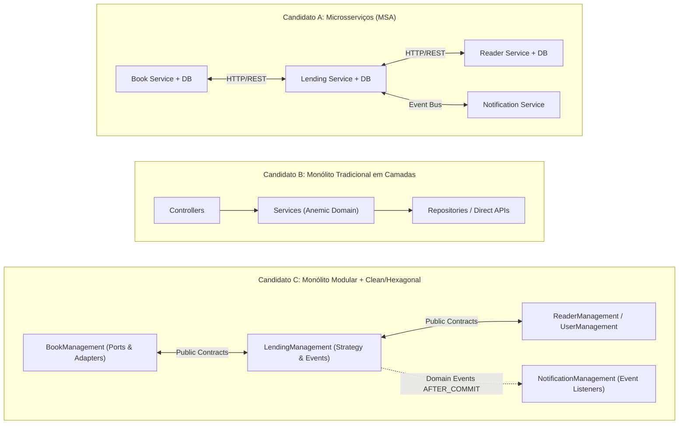

# ARQSOFT — Arquiteturas de Referência (System-to-Be)

## 1. Enquadramento e Seleção de Arquétipos (ADD 3.0 — Passo 4)

Sendo o LMS (`psoft-g1`) um sistema *Brownfield*, a seleção da **Arquitetura de Referência** no **Passo 4 do ADD 3.0** parte da estrutura modular existente (`TC01`, `TC02`) e refina as fronteiras internas para resolver as limitações de **Extensibilidade**, **Configurabilidade** e **Testabilidade** (Enunciado 1.2).

Foram avaliados três arquétipos arquiteturais candidatos:

### 1.1. Comparação dos Arquétipos Candidatos

| Critério / Dimensão | Candidato A: Microsserviços (*MSA*) | Candidato B: Monólito em Camadas Rígidas | Candidato C: Monólito Modular + *Clean / Hexagonal Architecture* (Selecionado) |
| :--- | :--- | :--- | :--- |
| **Descrição** | Serviços distribuídos independentes com bases de dados separadas. | Aplicação monolítica dividida apenas por camadas técnicas globais (`controller`, `service`, `repository`). | Processo JVM único decomposto em subdomínios coesos (DDD) com camadas concêntricas e portas/adaptadores. |
| **Restrições Técnicas (`TC01`–`TC05`)** | **Violação de `TC02` e `TC05`:** Introduz distribuição de rede e requer contentores/brokers externos. | Cumpre `TC02`, mas o acoplamento direto dificulta o isolamento de testes (`TC05`). | **Cumprimento Pleno:** Mantém o monólito modular com testes 100% determinísticos e offline em memória. |
| **Extensibilidade (`ASR01` / OCP)** | Elevada entre serviços, mas com sobrecarga de rede e serialização. | **Fraca:** Adicionar fornecedores ou canais obriga a editar serviços existentes. | **Elevada:** Portas de saída (`BookInfoProvider`, `NotificationSender`, `LendingPolicy`) isolam novas integrações. |
| **Configurabilidade (`ASR02`, `ASR03`)** | Exige servidores de configuração distribuídos (ex.: Spring Cloud Config). | Parâmetros dispersos e condicionais rígidas. | **Elevada:** Resolução declarativa via `@ConfigurationProperties`, `BibliographicConfig`, `NotificationConfig` e `LendingPolicyResolver`. |
| **Consistência Transacional (`TC03`)** | Exige *Sagas* ou transações distribuídas. | ACID local simples. | **ACID local in-process** combinado com eventos pós-commit (`AFTER_COMMIT`). |
| **Decisão** | **Rejeitado** | **Rejeitado** | **Selecionado** |

---

## 2. Caracterização da Arquitetura de Referência Adotada (*System-to-Be*)

A arquitetura de referência articula dois níveis complementares: **Macro-arquitetura** (nível de sistema/contentor) e **Micro-arquitetura** (nível interno de cada módulo).

### 2.1. Macro-Arquitetura: *Modular Monolith (DDD)*
* **Processo Único JVM (Java 17 / Spring Boot 3.2.5):** Elimina latência de rede inter-módulos e preserva transações ACID sobre a base de dados relacional.
* **Decomposição em Subdomínios:**
  1. [`bookmanagement`](../../../src/main/java/pt/psoft/g1/psoftg1/bookmanagement): Catálogo bibliográfico e enriquecimento externo multi-fonte (`GoogleBooksAdapter`, `OpenLibraryAdapter`, `CrossRefAdapter`, `CompositeBookInfoProvider`).
  2. [`lendingmanagement`](../../../src/main/java/pt/psoft/g1/psoftg1/lendingmanagement): Ciclo de vida de empréstimos, renovações, multas, eventos de domínio e motor de políticas (`StandardLendingPolicy`, `AdaptiveLendingPolicy`, `LendingPolicyResolver`).
  3. [`notificationmanagement`](../../../src/main/java/pt/psoft/g1/psoftg1/notificationmanagement): Escuta de eventos de empréstimo (`LendingNotificationListener`) e despacho multicanal (`EmailNotificationSender`, `SmsNotificationSender`, `WebhookNotificationSender`, `CompositeNotificationSender`).
  4. [`readermanagement`](../../../src/main/java/pt/psoft/g1/psoftg1/readermanagement), [`usermanagement`](../../../src/main/java/pt/psoft/g1/psoftg1/usermanagement), [`authormanagement`](../../../src/main/java/pt/psoft/g1/psoftg1/authormanagement) e [`genremanagement`](../../../src/main/java/pt/psoft/g1/psoftg1/genremanagement): Subdomínios nucleares do LMS.

### 2.2. Micro-Arquitetura: *Clean Architecture / Ports and Adapters (Hexagonal)*

Cada módulo estrutura-se em quatro camadas concêntricas respeitando a *Dependency Rule* (dependências apontam de fora para dentro):
1. **Domínio (*Enterprise Business Rules* — `model`, `policies`, `events`):** Entidades (`Book`, `Lending`, `ReaderDetails`, `Fine`), *Value Objects* (`Isbn`, `Title`, `LendingNumber`), políticas (`StandardLendingPolicy`, `AdaptiveLendingPolicy`) e eventos imutáveis (`LendingCreatedEvent`, `LendingReturnedEvent`, `LendingOverdueEvent`).
2. **Aplicação (*Application Business Rules* — `services`, `repositories`):** Casos de uso (`BookServiceImpl`, `LendingServiceImpl`), modelos canónicos (`BookDetailsDTO`) e **Portas de Saída (*Driven Ports*)** (`BookInfoProvider`, `NotificationSender`, `BookRepository`, `LendingRepository`).
3. **Adaptadores de Interface (*Interface Adapters* — `api`, `infrastructure`, `listeners`):**
   * *Driving Adapters:* Controladores REST (`BookController`, `LendingController`, `LendingPolicyAdminController`) e `LendingNotificationListener`.
   * *Driven Adapters:* `GoogleBooksAdapter`, `OpenLibraryAdapter`, `CrossRefAdapter`, `CompositeBookInfoProvider`, `EmailNotificationSender`, `SmsNotificationSender`, `WebhookNotificationSender`, `CompositeNotificationSender` e repositórios Spring Data JPA.
4. **Frameworks & Drivers (`configuration`):** Ficheiros de configuração IoC (`BibliographicConfig`, `NotificationConfig`, `LendingPolicyProperties`), clientes HTTP (`RestTemplate`) e motor H2.

### 2.3. Coordenação Inter-Módulos e Eventos Pós-Commit
* **Invocação Síncrona via Contratos:** Utilizada quando o caso de uso requer validação imediata (ex.: `LendingServiceImpl` consulta `BookRepository`, `ReaderRepository` e `LendingPolicyResolver`).
* **Eventos de Domínio Pós-Commit (*In-Process Event-Driven Style*):** Utilizada entre `lendingmanagement` e `notificationmanagement`. O [`LendingNotificationListener`](../../../src/main/java/pt/psoft/g1/psoftg1/notificationmanagement/listeners/LendingNotificationListener.java) utiliza `@TransactionalEventListener(phase = TransactionPhase.AFTER_COMMIT)`, garantindo que:
  1. Nenhuma notificação é enviada se a transação de empréstimo sofrer *rollback*;
  2. Qualquer exceção num canal de notificação é isolada pelo [`CompositeNotificationSender`](../../../src/main/java/pt/psoft/g1/psoftg1/notificationmanagement/infrastructure/CompositeNotificationSender.java) sem afetar a transação JPA já consolidada (`ASR06`, `ASR07`).

---

## 3. Síntese de Rastreabilidade com os Drivers Arquiteturais

| Driver Arquitetural | Exigência do Enunciado | Suporte na Arquitetura de Referência |
| :--- | :--- | :--- |
| **Extensibilidade (`ASR01`)** | Adicionar fontes bibliográficas, canais de notificação e políticas com impacto limitado. | As portas `BookInfoProvider`, `NotificationSender` e `LendingPolicy` permitem adicionar novos adaptadores/estratégias (ex.: `CrossRefAdapter`) sem alterar os serviços aplicacionais nem o domínio. |
| **Configurabilidade em Setup Time (`ASR02`)** | Selecionar fontes, canais e parâmetros no arranque sem recompilar. | `BibliographicConfig`, `NotificationConfig` e `LendingPolicyProperties` montam a cadeia de fornecedores/canais e injetam limiares a partir de `application.properties`. |
| **Configurabilidade em Runtime (`ASR03`)** | Selecionar a política de empréstimo aplicável em cada pedido. | `LendingPolicyResolver` avalia em memória o histórico do leitor (`HistoryPeriod`, `MinCompletedLendings`, `MinOnTimeRatio`, atrasos) a cada criação e renovação. |
| **Testabilidade (`ASR04`, `TC05`)** | Testes multi-nível determinísticos e 100% offline. | A inversão de dependência permite substituir `RestTemplate`, repositórios e portas externas por *Test Doubles* nos testes unitários e H2 em memória nos testes de integração. |
| **Interoperabilidade e Resiliência (`ASR05`, `ASR06`)** | Normalizar modelos heterogéneos e isolar falhas externas. | Os adaptadores convertem payloads JSON díspares para `BookDetailsDTO`, enquanto `CompositeBookInfoProvider` e `CompositeNotificationSender` asseguram *fallback* e isolamento de falhas. |
