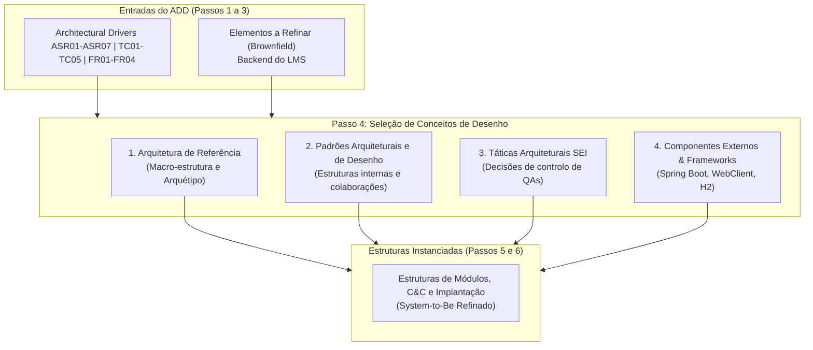
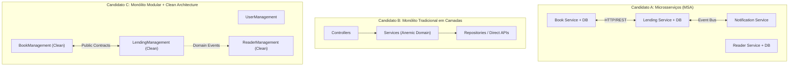
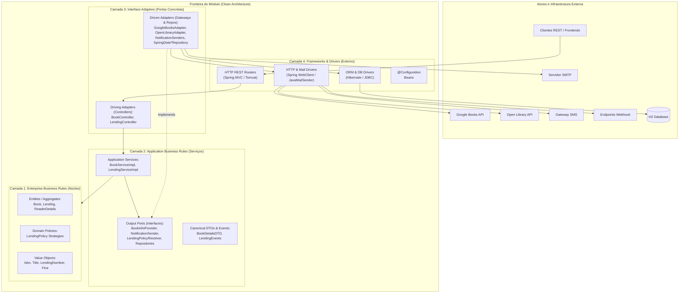

# ARQSOFT — Arquiteturas de Referência (System-to-Be)

## 1. Enquadramento Metodológico no ADD 3.0 (Passo 4: *Choose Design Concepts*)

No método **Attribute-Driven Design (ADD 3.0)** do *Software Engineering Institute* (SEI — Cervantes & Kazman, 2016; Bass, Clements & Kazman, 2021), a seleção de conceitos de desenho no **Passo 4** não se limita a padrões abstratos e táticas isoladas. O arquiteto recorre a primitivas de desenho concretas, entre as quais se destacam as **Arquiteturas de Referência (*Reference Architectures*)** ou **Arquétipos de Aplicação (*Application Archetypes*)**.

### 1.1. Definição e Papel das Arquiteturas de Referência
* **Definição Formal:** Uma Arquitetura de Referência é um modelo de arquitetura comprovado, padronizado e amplamente aceite na indústria para um determinado domínio ou família de aplicações (*Application Archetype* — Microsoft Application Architecture Guide, 2.ª Edição). Fornece um modelo concetual de referência (*blueprint*) que dita a divisão de alto nível em subsistemas, camadas e limites de responsabilidade.
* **Função no Processo de Desenho:**
  1. **Evitar "reinventar a roda" (*Avoid reinventing the wheel*):** Adotar uma solução validada pela comunidade para problemas com requisitos e restrições similares.
  2. **Estabelecer vocabulário e padrões estruturais comuns:** Facilitar a comunicação técnica entre arquitetos, desenvolvedores e *stakeholders*.
  3. **Fornecer o esqueleto para instanciação de táticas:** Serve de contexto base onde as táticas elementares de modificabilidade, configurabilidade e testabilidade são ancoradas.

### 1.2. Abordagem *Brownfield* vs. *Greenfield* no Projeto LMS
De acordo com os princípios do método ADD 3.0 para sistemas existentes (*Design for an Existing System / Brownfield Roadmap*):
* **Em sistemas *Greenfield*:** A primeira iteração do ADD foca-se obrigatoriamente na escolha da arquitetura de referência para criar a estrutura global do sistema a partir do zero.
* **Em sistemas *Brownfield* (caso do LMS `psoft-g1`):** A macro-estrutura global do sistema já se encontra parcialmente estabelecida no *system-as-is* (um serviço backend REST modular em Java/Spring Boot).
* **Consequência Arquitetural:** Não se desenha uma estrutura global de raiz. A arquitetura de referência base é **analisada, avaliada e confirmada face aos novos drivers**, preservando os seus princípios estruturais sólidos (`TC01`, `TC02`) e identificando as camadas internas que necessitam de refinamento para sanar as fragilidades de **Extensibilidade**, **Configurabilidade** e **Testabilidade** (Enunciado 1.2).

---

## 2. Análise e Comparação de Arquétipos Arquiteturais Candidatos

Para suportar o *System-to-Be* com as novas capacidades exigidas no Enunciado (1.3.3.1 a 1.3.3.3), foram analisados e comparados três arquétipos de referência distintos:

### 2.1. Avaliação Comparativa dos Arquétipos

| Critério / Dimensão | Candidato A: Arquitetura de Microsserviços (*Microservices — MSA*) | Candidato B: Monólito Tradicional em Camadas Rígidas (*Layered / Anemic*) | Candidato C: Monólito Modular com *Clean Architecture* (*Selected*) |
| :--- | :--- | :--- | :--- |
| **Descrição Concetual** | Decomposição física em serviços independentes distribuídos, cada um com o seu próprio processo, base de dados e pipeline de deploy. | Aplicação monolítica dividida apenas por camadas técnicas globais (`controller`, `service`, `repository`) com lógica de negócio dispersa. | Monólito único em processo JVM, decomposto em subdomínios isolados (DDD) com camadas internas concêntricas (*Hexagonal / Clean*). |
| **Aderência a `TC02` (Monólito Modular)** | **Violação Crítica:** Introduz distribuição de rede e múltiplos serviços autónomos não solicitados. | Cumpre (é um monólito), mas não assegura modularidade forte entre domínios. | **Cumprimento Pleno:** Preserva o monólito modular exigido formalmente pelo enunciado. |
| **Aderência a `TC05` (Testes 100% Herméticos / Offline)** | **Muito Fraca:** Exige orquestração de containers (Docker/Testcontainers), service discovery e brokers externos, tornando os testes lentos e frágeis. | Média: Permite mocks em memória, mas o acoplamento forte entre serviços dificulta o isolamento de classes. | **Excelente:** Permite testes unitários ultrarrápidos em memória e testes de integração determinísticos sem rede. |
| **Suporte a `ASR01` (Extensibilidade / OCP)** | Elevada para novos serviços, mas com alto overhead de infraestrutura de transporte e serialização. | **Muito Fraca:** Modificar um serviço contamina as camadas técnicas e obriga a alterar classes existentes. | **Excelente:** As portas e adaptadores isolam as variações na fronteira externa do módulo. |
| **Suporte a `ASR02` e `ASR03` (Configurabilidade)** | Alta complexidade: requer *Config Servers* distribuídos (ex.: Spring Cloud Config, Consul). | Fraca: Parâmetros dispersos e lógica acoplada via condicionais rígidos. | **Excelente:** Resolução simples via `@ConditionalOnProperty`, `@ConfigurationProperties` e DI do Spring. |
| **Consistência Transacional (`TC03`)** | **Problemática:** Requer padrões complexos como *Saga* ou *2-Phase Commit (2PC)* para operações de empréstimo e leitor. | Cumpre: ACID relacional simples. | **Cumprimento Pleno:** Transações ACID in-process locais com consistência garantida pelo Spring/JPA. |
| **Complexidade Operacional e Custo (`OL01`–`OL04`)** | **Muito Alto (*Over-engineering*):** Desproporcionado para uma equipa de 3 estudantes com prazo fixo até 2026-11-01. | Baixo, mas gera dívida técnica severa de manutenibilidade. | **Ótimo:** Equilíbrio ideal entre rigor arquitetural, isolamento modular e simplicidade de entrega. |
| **Decisão Final** | **Rejeitado** | **Rejeitado** | **Selecionado como Arquitetura de Referência Alvo** |

---

## 3. Caracterização da Arquitetura de Referência Adotada (*System-to-Be*)

A arquitetura de referência adotada para o *System-to-Be* estrutura-se numa estratégia de dois níveis: **Macro-arquitetura (Nível de Sistema/Contentor)** e **Micro-arquitetura (Nível Interno de cada Módulo de Domínio)**.

### 3.1. Macro-Arquitetura: *Enterprise REST Web Service — Modular Monolith*
* **Arquétipo de Aplicação:** *Web Service Application* RESTful baseado na plataforma Spring Boot 3.2.5 sobre Java 17.
* **Modelo Estrutural:** **Monólito Modular orientado a Domínios (*Domain-Driven Design — DDD Modular Monolith*)**:
  * O sistema executa num **único processo JVM**, eliminando a latência de rede inter-módulos e as falhas parciais típicas de sistemas distribuídos.
  * O código-fonte organiza-se em **módulos de subdomínio funcionais bem delimitados**:
    1. `bookmanagement`: Catálogo de livros, ISBN, exemplares e integração com fontes bibliográficas externas.
    2. `lendingmanagement`: Gestão de empréstimos, devoluções, cálculo de prazos, multas e aplicação de políticas dinâmicas.
    3. `readermanagement`: Fichas de leitores, perfis de utilizador e subsistema de notificações multicanal.
    4. `usermanagement`: Autenticação, autorização de segurança (Spring Security / JWT) e gestão de utilizadores.
    5. `authormanagement`: Catálogo e dados biográficos de autores.
    6. `genremanagement`: Categorização literária e métricas associadas.
  * **Regra de Acoplamento Inter-Módulos:** É estritamente proibida a dependência direta entre entidades internas de subdomínios distintos. A comunicação entre módulos realiza-se exclusivamente através de:
    1. *Contratos de Serviços Aplicacionais (Public Service APIs)*;
    2. *Barramento de Eventos de Domínio In-Process* (`ApplicationEventPublisher` do Spring).

### 3.2. Micro-Arquitetura: *Clean Architecture / Ports and Adapters (Hexagonal Architecture)*
No interior de cada módulo de subdomínio (com foco prioritário nos módulos refinados `bookmanagement`, `lendingmanagement` e `readermanagement`), a arquitetura de referência instancia os princípios da **Clean Architecture** (Robert C. Martin) e da **Arquitetura Hexagonal / Portas e Adaptadores** (Alistair Cockburn):

#### As Quatro Camadas Concêntricas da Arquitetura de Referência:
1. **Camada 1 — Núcleo de Domínio (*Enterprise Business Rules*):**
   * Contém as entidades centrais do negócio (`Book`, `Lending`, `ReaderDetails`), *Value Objects* imutáveis (`Isbn`, `LendingNumber`, `Fine`) e as regras essenciais de validação e consistência.
   * **Regra de Dependência:** Não depende de nenhuma outra camada, de frameworks ou de bibliotecas externas (Java puro).
2. **Camada 2 — Serviços de Aplicação (*Application Business Rules / Use Cases*):**
   * Orquestra os fluxos de casos de uso (ex.: registar livro, emitir empréstimo, devolver exemplar).
   * Define os contratos abstratos de saída (**Output Ports**), tais como `BookInfoProvider`, `NotificationSender`, e interfaces de repositório (`BookRepository`).
   * Define os modelos de dados canónicos e eventos de domínio (`BookDetailsDTO`, `LendingCreatedEvent`).
3. **Camada 3 — Adaptadores de Interface (*Interface Adapters*):**
   * Converte dados entre o formato mais conveniente para os casos de uso e o formato exigido pelas entidades externas.
   * *Adaptadores de Entrada (Driving):* Controladores REST que traduzem pedidos HTTP/JSON em chamadas aos serviços aplicacionais.
   * *Adaptadores de Saída (Driven):* Implementações de portas como `GoogleBooksAdapter`, `EmailNotificationSender`, e repositórios JPA.
4. **Camada 4 — Frameworks e Drivers (*Frameworks & Infrastructure*):**
   * Onde assentam as ferramentas técnicas: Spring Boot, Spring Web, Spring Data JPA, Hibernate, Jackson, e conectores de rede.

### 3.3. Estilo de Coordenação e Comunicação Inter-Módulos
Para garantir que os subdomínios permanecem fracamente acoplados, a arquitetura de referência adota dois estilos complementares de comunicação:
1. **Comunicação Síncrona Direta via Contratos de Serviço (*Point-to-Point Service Invocation*):**
   * Utilizada quando uma operação necessita de resposta imediata e determinística (ex.: `LendingServiceImpl` consulta `BookRepository` ou `ReaderRepository` para validar a existência dos agregados).
2. **Comunicação Assíncrona / Desacoplada via Eventos de Domínio (*In-Process Event-Driven Style*):**
   * Utilizada quando uma ação num módulo gera efeitos secundários noutro módulo sem exigir bloqueio transacional (ex.: a criação de um empréstimo em `lendingmanagement` dispara um `LendingCreatedEvent` no `ApplicationEventPublisher`, sendo capturado pelo `LendingNotificationListener` em `readermanagement`).
   * **Política Transacional e Sincronização Pós-Commit (`@TransactionalEventListener`):**
     * Para prevenir inconsistências críticas de negócio e o envio de notificações "fantasma", o ouvinte de eventos utiliza a anotação `@TransactionalEventListener(phase = TransactionPhase.AFTER_COMMIT)`.
     * Desta forma, os canais de notificação externa (Email, SMS, Webhook) só são acionados **estritamente após a conclusão e commit bem-sucedido** da transação de empréstimo na base de dados relacional H2 (`TC03`).
     * Caso ocorra um *rollback* da transação de negócio, nenhum evento é despachado externamente.
     * Inversamente, caso ocorra uma falha de rede temporária durante o envio para um dos canais de notificação externos, a transação da base de dados já se encontra consolidada, garantindo isolamento total de falhas (`ASR06`).
   * **Benefício:** O módulo de empréstimos mantém **zero linhas de código de notificação**, não conhece os canais externos e não sofre impacto no seu fluxo transacional (`ASR06`, `ASR07`).

### 3.4. Arquitetura de Implantação e Configuração Externa (*Deployment & Config Archetype*)
Do ponto de vista físico e de infraestrutura (`TC01`, `TC03`, `TC05`), a arquitetura de referência adota o padrão **2-Tier / 3-Tier Físico Simples**:
* **Nó de Cliente (*Client Node*):** Aplicações cliente (Postman, Single Page Applications, ou suites de teste JUnit/MockMvc) que comunicam via HTTP/REST sobre TCP/IP.
* **Nó de Aplicação (*Application Server Node*):** Processo único JVM onde executa a aplicação empacotada em `.jar` executável (`psoft-g1-0.0.1-SNAPSHOT.jar`), contendo o servidor web embutido (Apache Tomcat) e a stack Spring Boot 3.
  * **Injeção de Configuração Externa em Setup Time (1.3.3.1–1.3.3.3):** Em conformidade com as boas práticas de configuração externalizada (*12-Factor App*), os parâmetros operacionais (fontes bibliográficas ativas, canais de notificação ativados, e limiares das políticas de empréstimo) são injetados no arranque da JVM via ficheiro externo `application.properties`, variáveis de ambiente de sistema ou argumentos de linha de comando (`--spring.config.additional-location`), **sem necessidade de recompilar ou gerar um novo `.jar`** (`ASR02`).
  * **Gestão de Timeouts de Rede:** A camada de adaptadores de infraestrutura configura tempos limites estritos nos clientes HTTP (`WebClient` com *response timeout* $\le 2.5\text{ s}$), prevenindo a exaustão de threads do servidor aplicacional em caso de latência das APIs externas.
* **Nó de Persistência (*Data Storage Node*):** Base de dados relacional H2, operando em modo ficheiro local persistente em desenvolvimento ou em modo *In-Memory* para suportar a execução de testes automatizados rápidos e herméticos (`TC05`).
* **Nó de Testes Herméticos (*Offline Test Environment* — 1.3.3.4):** Como as fronteiras de infraestrutura externa e de persistência estão estritamente isoladas por interfaces de porta (*Ports & Adapters*), todo o ciclo de testes (unitários, domínio transparente, mutação PITest e integração) executa de forma determinística em memória e 100% offline, sem qualquer dependência de conectividade externa.

---

## 4. Rastreabilidade: Como a Arquitetura de Referência Resolve os Drivers

A tabela abaixo sintetiza como a adoção da arquitetura de referência monólito modular com *Clean Architecture* e portas/adaptadores satisfaz os condutores fundamentais do projeto:

| Problema Base / Driver | Exigência do Enunciado | Como a Arquitetura de Referência Resolve |
| :--- | :--- | :--- |
| **1.2.1 Extensibilidade (`ASR01`)** | Adicionar novas fontes bibliográficas, canais de notificação e políticas sem alterar o código existente (OCP). | A fronteira de portas e adaptadores (*Driven Ports*) permite acrescentar novos fornecedores e canais criando apenas novas classes de adaptação na camada externa, sem tocar nas regras de domínio ou serviços aplicacionais. |
| **1.2.2 Configurabilidade em Setup Time (`ASR02`)** | Selecionar fontes, canais e calibrar limiares numéricos via ficheiros externos sem recompilar código. | A arquitetura assenta no contentor IoC do Spring Boot, permitindo vincular condicionalmente implementações concretas aos contratos de porta através de `@ConditionalOnProperty` e `@ConfigurationProperties`. |
| **1.2.2 Configurabilidade em Runtime (`ASR03`)** | Selecionar a política de empréstimo aplicável em tempo de execução com base no leitor e livro. | O padrão de micro-arquitetura permite injetar um resolvedor de políticas no serviço aplicacional, avaliando em memória a estratégia aplicável para cada requisição. |
| **1.2.3 Testabilidade Automatizada (`ASR04`, `TC05`)** | Testes de unidade, domínio transparente, mutação PITest e integração sem dependência de internet. | Como o domínio e os casos de uso dependem apenas de interfaces abstratas (*DIP*), é trivial injetar *mocks* e *stubs* em memória, garantindo execução hermética, rápida e 100% determinística. |
| **Interoperabilidade e Resiliência (`ASR05`, `ASR06`)** | Lidar com APIs externas heterogéneas e isolar falhas de rede. | A separação da camada de infraestrutura permite encapsular a conversão JSON para modelos canónicos e intercalar componentes compostos (*Composite/Fallback*) sem contaminar o núcleo. |