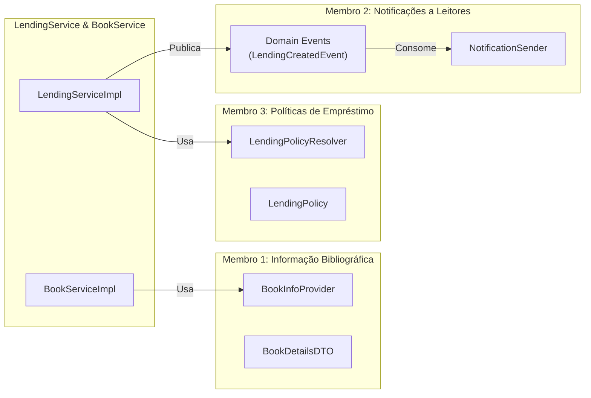

# ARQSOFT — System-to-Be: Planeamento e Divisão de Trabalho (3 Membros)

> **Unidade Curricular:** Arquitetura de Software (ARQSOFT) — 2026/2027  
> **Projeto:** Sistema de Gestão de Biblioteca (LMS — *Library Management System*) — `psoft-g1`  
> **Fase:** 1.3.3 Development (Desenvolvimento e Implementação da Arquitetura Alvo)  
> **Composição do Grupo:** 3 Estudantes

---

## 1. Visão Geral da Arquitetura Alvo (*System-to-Be*)

A fase de desenvolvimento do projeto de Arquitetura de Software visa resolver os problemas fundamentais identificados na versão inicial (*system-as-is*):
1. **Extensibilidade (*Modifiability / Extensibility*):** Capacidade de acrescentar novas fontes de informação, novos canais de notificação e novas políticas de negócio sem modificar o código existente (cumprimento estrito do princípio *Open-Closed Principle* — OCP).
2. **Configurabilidade (*Configurability*):** Capacidade de selecionar e parametrizar módulos, fornecedores e canais em tempo de configuração/arranque (*setup time*), através de propriedades externas (`application.properties` / `library.properties`) sem necessidade de recompilar código.
3. **Testabilidade (*Testability*):** Estruturação do código segundo os princípios de *Clean Architecture* e *Inversion of Control* (IoC), garantindo que todos os componentes são testáveis em múltiplos níveis de abstração (caixa-opaca, caixa-transparente, testes de mutação com PITest, testes de integração vertical e testes de sistema de ponta a ponta).

---

## 2. Matriz Geral de Divisão de Trabalho

A carga de trabalho do tópico **1.3.3 Development** é dividida de forma equilibrada entre os **3 membros** do grupo, associando cada estudante a um dos três pilares funcionais/arquiteturais e distribuindo as responsabilidades de testes automatizados e integração transversal.

| Membro | Foco Primário (Sub-tópico) | Atributos de Qualidade Chave | Padrões Arquiteturais & Táticas ADD | Artefactos Nucleares |
| :---: | :--- | :--- | :--- | :--- |
| **Membro 1** | **1.3.3.1 Informação Bibliográfica**<br>*(Bibliographic Information)* | Extensibilidade, Interoperabilidade, Configurabilidade em *Setup Time* | **Adapter**, **Gateway**, **Composite / Chain**, `@ConditionalOnProperty` | Adaptadores Google Books e Open Library, Composite Provider, Configuração de setup time. |
| **Membro 2** | **1.3.3.2 Notificações a Leitores**<br>*(Reader Notifications)* | Desacoplamento, Extensibilidade, Concorrência / Assincronismo | **Observer / Domain Events**, **Strategy**, **Composite**, Spring `@EventListener` | Eventos de domínio de empréstimo, Adaptadores de Email, SMS e Webhook, Despachador multicanal. |
| **Membro 3** | **1.3.3.3 Políticas de Empréstimo**<br>*(Lending Policies)* | Flexibilidade de Negócio, Configurabilidade Dinâmica em *Runtime* | **Strategy**, **Factory / Policy Resolver**, `@ConfigurationProperties` | Interface de Política, Estratégias concretas (Standard, Premium, Strict), Engine de resolução em runtime. |
| **Todos** | **1.3.3.4 Testes Funcionais & E2E**<br>*(Automated Functional Testing)* | Testabilidade, Fiabilidade, Resiliência a Regressões | BVA, Equivalence Partitioning, PITest Mutation, `@SpringBootTest`, E2E | Bateria de testes de unidade, domínio, mutação, integração e teste de sistema global E2E unificado. |

---

## 3. Especificação Detalhada por Membro

---

### 3.1. Membro 1: Informação Bibliográfica (Tópico 1.3.3.1)

#### 3.1.1. Objetivos e Requisitos do Enunciado
1. Recuperar informação bibliográfica sobre livros a partir de diferentes sistemas externos heterogéneos, suportando obrigatoriamente a **Google Books API** e a **Open Library API**.
2. Harmonizar as diferenças estruturais: os sistemas externos expõem modelos de dados distintos e fornecem diferentes subconjuntos de informação (ex.: o Google Books possui resumos mais ricos e categorização por géneros; o Open Library possui identificadores alternativos e dados de publicação detalhados).
3. Permitir a seleção, em **setup time**, do(s) sistema(s) a utilizar, suportando o funcionamento com **mais do que uma fonte** em simultâneo (estratégia de fallback ou agregação).
4. Assegurar que a adição de novas fontes (ex.: WorldCat, Biblioteca Nacional) tenha impacto nulo no código de domínio existente (OCP).

#### 3.1.2. Padrões de Desenho e Táticas Arquiteturais (ADD)
* **Adapter / Gateway Pattern:** Isola as particularidades das APIs HTTP externas, transformando as respostas JSON específicas num modelo canónico interno.
* **Composite Pattern / Fallback Chain:** Permite configurar uma cadeia ou agregador de provedores bibliográficos que tenta sucessivamente as fontes ativas caso uma falhe ou traga dados incompletos.
* **Dependency Injection & Conditional Configuration:** Instanciação seletiva baseada nas propriedades ativas no arranque da aplicação.

#### 3.1.3. Artefactos de Código a Desenvolver
* **Contrato e DTO Canónico:**
  * `pt.psoft.g1.psoftg1.bookmanagement.services.BookInfoProvider` *(Interface)*:
    * `Optional<BookDetailsDTO> findBookByIsbn(String isbn);`
    * `String getProviderName();`
  * `pt.psoft.g1.psoftg1.bookmanagement.services.BookDetailsDTO` *(Value Object/DTO)*: campos normalizados (título, autores, descrição, editora, data de publicação, ISBN-10/13, URL da imagem de capa).
* **Adaptadores Externos:**
  * `pt.psoft.g1.psoftg1.bookmanagement.infrastructure.gateways.GoogleBooksAdapter`:
    * Consome o endpoint `https://www.googleapis.com/books/v1/volumes?q=isbn:{isbn}` via Spring `WebClient`.
    * Desserializa e mapeia o payload específico de `volumeInfo`.
  * `pt.psoft.g1.psoftg1.bookmanagement.infrastructure.gateways.OpenLibraryAdapter`:
    * Consome o endpoint `https://openlibrary.org/api/books?bibkeys=ISBN:{isbn}&format=json&jscmd=data` via `WebClient`.
    * Desserializa e mapeia o payload do Open Library.
* **Provedor Composto / Agregador:**
  * `pt.psoft.g1.psoftg1.bookmanagement.infrastructure.gateways.CompositeBookInfoProvider`:
    * Implementa `BookInfoProvider`. Itera sobre as fontes ativas na ordem configurada, assegurando fallback resiliente e consolidação dos atributos preenchidos.
* **Configuração em *Setup Time*:**
  * `pt.psoft.g1.psoftg1.configuration.BibliographicConfig`:
    * Lê propriedades como `bibliographic.providers=googlebooks,openlibrary`.
    * Regista como beans apenas os adaptadores ativados e monta o bean primário `BookInfoProvider`.
* **Integração no Subdomínio de Livros:**
  * Injetar `BookInfoProvider` em `BookServiceImpl.java`.
  * Adicionar endpoint de consulta no `BookController.java` (ex.: `GET /api/books/external/{isbn}`) ou preenchimento automático no registo de livros.

#### 3.1.4. Testes a Cargo do Membro 1 (1.3.3.4)
* **Opaque-Box (SUT = classes):**
  * Testes unitários a `GoogleBooksAdapter`, `OpenLibraryAdapter` e `CompositeBookInfoProvider`, validando partições de equivalência (ISBN válido encontrado, ISBN inexistente, resposta com campos nulos, resposta corrompida).
* **Transparent-Box (SUT = DTOs e Mappers):**
  * Teste estrutural das transformações JSON $\leftrightarrow$ `BookDetailsDTO`, assegurando 100% de cobertura de ramos nas conversões defensivas de listas de autores e datas de publicação.
* **Testes de Mutação (PITest):**
  * Execução do PITest sobre o pacote `infrastructure.gateways`, garantindo que mutações nas lógicas de fallback ou parsing de ISBN são devidamente mortas pelos testes.
* **Integração (SUT = Controller + Service + Gateway):**
  * Teste com `@SpringBootTest` e `MockMvc` para `BookController`, utilizando `@MockBean` ou `WireMock` para simular as APIs externas HTTP sem dependência de internet.

---

### 3.2. Membro 2: Notificações a Leitores (Tópico 1.3.3.2)

#### 3.2.1. Objetivos e Requisitos do Enunciado
1. Notificar os leitores sobre eventos relevantes de empréstimo (criação de novo empréstimo, aviso de data limite de devolução, notificação de atraso/mora com cálculo de multa, confirmação de devolução).
2. Suportar três mecanismos distintos de notificação: **Email**, **SMS** e **Webhook**, funcionando **individualmente ou em qualquer combinação configurada**.
3. Selecionar em **setup time** os canais de notificação ativos via ficheiro de configuração.
4. Suportar novos canais (ex.: notificação push, mensagem de WhatsApp, bot de Discord/Slack) com impacto mínimo no código existente (extensibilidade e isolamento de dependências).

#### 3.2.2. Padrões de Desenho e Táticas Arquiteturais (ADD)
* **Publish-Subscribe / Domain Events (Observer Pattern):** Emissão de eventos através do `ApplicationEventPublisher` do Spring. O subdomínio de empréstimos (`lendingmanagement`) emite os eventos e não tem qualquer acoplamento com serviços de email, SMS ou webhooks.
* **Strategy Pattern:** Cada canal de envio é encapsulado como uma estratégia concreta sob uma interface comum.
* **Composite Pattern:** Um despachador multicanal agrupa todos os canais ativados e distribui as mensagens sequencialmente ou em paralelo.

#### 3.2.3. Artefactos de Código a Desenvolver
* **Eventos de Domínio:**
  * `pt.psoft.g1.psoftg1.lendingmanagement.events.LendingCreatedEvent`: transporta dados do empréstimo (leitor, título do livro, data de devolução prevista).
  * `pt.psoft.g1.psoftg1.lendingmanagement.events.LendingReturnedEvent`: transporta dados da devolução e existência de multa associada.
  * `pt.psoft.g1.psoftg1.lendingmanagement.events.LendingOverdueEvent`: transporta dados de empréstimo em atraso e dias em mora.
* **Publicação dos Eventos:**
  * Injetar `ApplicationEventPublisher` em `LendingServiceImpl.java` e emitir os eventos em `create()` e `setReturned()`.
* **Contrato de Notificação:**
  * `pt.psoft.g1.psoftg1.readermanagement.infrastructure.notifications.NotificationSender` *(Interface)*:
    * `void send(NotificationRequest request);`
    * `String getChannelName();`
  * `NotificationRequest` *(DTO)*: destinatário (email, telefone ou webhook URL), assunto, corpo da mensagem, tipo de evento.
* **Adaptadores de Canal:**
  * `EmailNotificationSender`: formata mensagem de email e envia via `JavaMailSender` (ou mock com template de saída formatado em log de auditoria).
  * `SmsNotificationSender`: formata texto curto (até 160 caracteres) e simula/executa envio para o número de telefone do leitor.
  * `WebhookNotificationSender`: envia payload JSON via `WebClient` para URL HTTP externa configurada.
* **Despachador Multicanal:**
  * `CompositeNotificationSender implements NotificationSender`: despacha a notificação para todos os canais registados no arranque.
* **Ouvinte de Eventos (Event Listener):**
  * `pt.psoft.g1.psoftg1.readermanagement.infrastructure.notifications.LendingNotificationListener`:
    * Métodos anotados com `@EventListener` (ou `@TransactionalEventListener(phase = TransactionPhase.AFTER_COMMIT)`):
      * `onLendingCreated(LendingCreatedEvent event)`
      * `onLendingReturned(LendingReturnedEvent event)`
      * `onLendingOverdue(LendingOverdueEvent event)`
* **Configuração em *Setup Time*:**
  * `pt.psoft.g1.psoftg1.configuration.NotificationConfig`:
    * Lê chaves em `application.properties`:
      ```properties
      notification.channels=email,sms,webhook
      notification.email.enabled=true
      notification.sms.enabled=false
      notification.webhook.enabled=true
      ```

#### 3.2.4. Testes a Cargo do Membro 2 (1.3.3.4)
* **Opaque-Box (SUT = classes):**
  * Testes unitários a `CompositeNotificationSender`, `EmailNotificationSender`, `SmsNotificationSender` e `WebhookNotificationSender`, validando classes de equivalência (destinatários válidos/inválidos, mensagens vazias, payload webhook íntegro).
* **Transparent-Box (SUT = Eventos e Listener):**
  * Testes estruturais verificando a correta instanciação e extração de propriedades dos eventos de domínio e os caminhos de formatação textual do listener.
* **Testes de Mutação (PITest):**
  * Execução de PITest sobre o pacote de notificações e listeners, garantindo eliminação de mutantes de desvio condicional (ex.: validação de canal ativo vs desativado).
* **Integração (SUT = Controller + Service + Event Bus + Notification Senders):**
  * Teste `@SpringBootTest` que executa a criação de um empréstimo via endpoint REST ou service e valida que o listener é invocado e que o mock de `NotificationSender` recebe os argumentos esperados.

---

### 3.3. Membro 3: Políticas de Empréstimo (Tópico 1.3.3.3)

#### 3.3.1. Objetivos e Requisitos do Enunciado
1. Aplicar diferentes políticas de empréstimo de acordo com a especificação de negócio (eliminar regras *hardcoded*).
2. Suportar parametrização externa das políticas em **setup time** sem alterar o código-fonte (limites de dias de empréstimo, tolerâncias de atraso, número máximo de livros simultâneos, valor da multa por dia).
3. Selecionar a política aplicável dinamicamente em **runtime** de acordo com regras de seleção (ex.: perfil do leitor, idade, tipo de livro, histórico de devoluções).
4. Suportar novas políticas de negócio com impacto mínimo no código existente (extensibilidade e manutenção do OCP).

#### 3.3.2. Padrões de Desenho e Táticas Arquiteturais (ADD)
* **Strategy Pattern:** Cada política de empréstimo implementa a interface comum `LendingPolicy`, encapsulando a sua lógica de validação e parametrização.
* **Factory / Policy Resolver Pattern:** Um componente resolvedor avalia o contexto do pedido de empréstimo (`Reader`, `Book`) e seleciona em *runtime* a estratégia correta.
* **External Configuration Binding (`@ConfigurationProperties`):** Vincula diretamente blocos de propriedades do ficheiro `application.properties` ou `library.properties` a classes Java tipadas.

#### 3.3.3. Artefactos de Código a Desenvolver
* **Interface da Estratégia de Política:**
  * `pt.psoft.g1.psoftg1.lendingmanagement.policies.LendingPolicy` *(Interface)*:
    * `boolean isApplicable(Reader reader, Book book);`
    * `int getLendingDurationInDays();`
    * `int getMaxSimultaneousLendings();`
    * `int getFineValuePerDayInCents();`
    * `void validateCanLend(Reader reader, Book book, List<Lending> currentLendings);`
    * `int getPriority();` *(para resolução em caso de sobreposição de critérios)*
* **Estratégias de Política Concretas:**
  * `StandardLendingPolicy`: aplicada por omissão a leitores regulares (15 dias, máx. 3 livros, 200 cents/dia, bloqueia com 1 livro em atraso).
  * `PremiumReaderLendingPolicy`: aplicada a leitores seniores/frequentes ou professores (30 dias, máx. 5 livros, 100 cents/dia, tolerância a devolução).
  * `ShortTermLendingPolicy`: aplicada a livros de referência, novidades ou alta procura (7 dias, máx. 1 exemplar, multa agravada).
* **Motor de Resolução de Políticas em *Runtime*:**
  * `pt.psoft.g1.psoftg1.lendingmanagement.policies.LendingPolicyResolver`:
    * Injeta automaticamente todas as classes que implementam `LendingPolicy`.
    * No método `resolvePolicy(Reader reader, Book book)`, filtra as aplicáveis e devolve a de maior prioridade. Lança exceção de domínio se nenhuma for elegível.
* **Mapeamento de Propriedades em *Setup Time*:**
  * `pt.psoft.g1.psoftg1.configuration.LendingPolicyProperties`:
    * Mapeia parâmetros a partir de `library.properties` / `application.properties`:
      ```properties
      lending.policies.standard.duration-days=15
      lending.policies.standard.max-books=3
      lending.policies.standard.fine-cents=200
      
      lending.policies.premium.duration-days=30
      lending.policies.premium.max-books=5
      lending.policies.premium.fine-cents=100
      
      lending.policies.short-term.duration-days=7
      lending.policies.short-term.max-books=1
      lending.policies.short-term.fine-cents=400
      ```
* **Refatoração no Núcleo de Empréstimos:**
  * Refatorar `LendingServiceImpl.java`: substituir a validação manual e estática por chamada ao `policyResolver.resolvePolicy(reader, book)` e `policy.validateCanLend(...)`.
  * Atualizar o construtor da entidade `Lending.java` para receber os parâmetros resultantes da política selecionada.

#### 3.3.4. Testes a Cargo do Membro 3 (1.3.3.4)
* **Opaque-Box (SUT = classes de política):**
  * Análise de Valores Limite (BVA) e Classes de Equivalência para cada política:
    * Se máx = 3 livros: testar com 2 livros (válido), 3 livros (fronteira válida), 4 livros (fronteira inválida $\rightarrow$ `LendingForbiddenException`).
    * Testar com atraso = 0 dias vs atraso = 1 dia.
* **Transparent-Box (SUT = domain classes: `Lending`, `Fine`):**
  * Teste estrutural exaustivo dos métodos de negócio em `Lending.java` e `Fine.java`, garantindo cobertura de 100% de branches em `getDaysDelayed()`, cálculo de dias em atraso e valor total da multa.
* **Testes de Mutação (PITest):**
  * Execução do PITest sobre `policies` e `lendingmanagement.model`, assegurando que operadores relacionais (`>`, `>=`, `==`) e operadores aritméticos alterados pelo PITest são detetados e eliminados pelos testes.
* **Integração (SUT = Controller + Service + Repository + Policies):**
  * Testes de integração via `MockMvc` validando que um leitor Premium obtém 30 dias de prazo enquanto um leitor Standard obtém 15 dias para o mesmo livro.

---

## 4. Trabalho Conjunto e Transversal (Membros 1, 2 e 3)

### 4.1. Contrato e Matriz de Interdependência entre Membros

Para evitar bloqueios entre os estudantes durante o desenvolvimento, foram estabelecidos contratos formais entre os módulos:



* **Ponto de Sincronização 1 (M1 $\rightarrow$ Core):** O Membro 1 entrega a interface `BookInfoProvider` e o DTO `BookDetailsDTO` como primeiro passo (esqueleto/stub), permitindo que o catálogo funcione mesmo antes dos adaptadores HTTP reais estarem terminados.
* **Ponto de Sincronização 2 (M3 $\rightarrow$ Core):** O Membro 3 entrega a interface `LendingPolicy` e o método de validação `validateCanLend()`, permitindo que o `LendingServiceImpl` seja refatorado imediatamente sem depender de quais políticas serão criadas a seguir.
* **Ponto de Sincronização 3 (Core $\rightarrow$ M2):** A emissão de eventos em `LendingServiceImpl` é ativada. O Membro 2 pode desenvolver e testar os listeners e os adaptadores de email/SMS/webhook de forma 100% isolada e assíncrona.

---

### 4.2. Testes de Sistema Integrados de Ponta a Ponta (SUT = System)

O item 5 do requisito 1.3.3.4 (*Functional opaque-box with SUT = system*) exige testes que validem a aplicação completa como uma caixa opaca.

Os **3 membros desenvolverão em conjunto** a suite de testes de sistema `SystemEndToEndTest`:
* **Ambiente de Teste:** Execução com `@SpringBootTest(webEnvironment = SpringBootTest.WebEnvironment.RANDOM_PORT)`.
* **Mecanismo:** Execução de requisições HTTP reais usando `TestRestTemplate` ou `WebTestClient`.
* **Cenário de Integração Total (Jornada Completa):**
  1. **Autenticação:** O teste efetua login como `LIBRARIAN` e obtém o token JWT.
  2. **Catálogo com API Externa (M1):** O bibliotecário introduz um ISBN; o sistema consulta o `BookInfoProvider` (mockado localmente para o teste de sistema) e regista a obra no catálogo.
  3. **Registo de Leitor:** É cadastrado um novo leitor no sistema com preferências de notificação (email e webhook).
  4. **Empréstimo com Resolução de Política (M3):** O leitor requisita o livro. O `LendingPolicyResolver` seleciona a política aplicável em runtime, valida os limites e cria o empréstimo com o prazo e taxas configurados.
  5. **Verificação de Notificação (M2):** O teste valida que a emissão do empréstimo despachou a notificação correspondente para os canais ativos sem corromper a transação da base de dados.
  6. **Devolução e Fecho do Ciclo:** O leitor devolve a obra após o prazo; o sistema gera a multa correta de acordo com os parâmetros de setup time da política e despacha a notificação de encerramento.

---

## 5. Critérios de Aceitação e Definição de Concluído (*Definition of Done*)

Para cada sub-tópico ser considerado concluído, cada membro deve garantir os seguintes critérios de qualidade:

1. **Compilação e Formatação:** Zero erros de compilação em JDK 17 e sem violações de estilo.
2. **Configurabilidade em Setup Time:** As propriedades novas devem estar documentadas e funcionais em `application.properties` ou `library.properties`, sem valores *hardcoded*.
3. **Mínimo de Cobertura de Código:** Cobertura de linhas $\ge 70\%$ nas classes novas de serviço e domínio desenvolvidas pelo membro.
4. **Mínimo de Score de Mutação (PITest):** Pelo menos $60\%$ de mutantes eliminados nas classes sob responsabilidade direta de cada membro.
5. **Isolamento em Testes:** Nenhum teste unitário ou de integração pode depender de ligações ativas à internet (todos os gateways e APIs externas devem usar stubs/mocks controlados nos testes).
6. **Rastreabilidade Documental:** Atualização correspondente no documento de arquitetura (`arqsoft-documentation_new.md`), refletindo os diagramas e as decisões tomadas.

---

## 6. Roteiro e Ordem Cronológica de Execução Recomendada

```
+-------------------------------------------------------------------------------------------------------+
| FASE 1: Definição de Contratos e Interfaces (Dia 1 - Conjunto)                                         |
| - M1: Cria interface BookInfoProvider e BookDetailsDTO                                                |
| - M2: Cria classes de evento LendingCreatedEvent, LendingReturnedEvent e interface NotificationSender   |
| - M3: Cria interface LendingPolicy e assinatura do LendingPolicyResolver                              |
+-------------------------------------------------------------------------------------------------------+
                                                   |
                                                   v
+-------------------------------------------------------------------------------------------------------+
| FASE 2: Implementação em Paralelo (Dias 2 a 5 - Individual)                                           |
| - M1: Implementa GoogleBooksAdapter, OpenLibraryAdapter, CompositeBookInfoProvider e testes unitários  |
| - M2: Implementa Email, SMS, Webhook senders, LendingNotificationListener e testes unitários          |
| - M3: Implementa Standard/Premium/ShortTerm policies, binding de propriedades e testes unitários      |
+-------------------------------------------------------------------------------------------------------+
                                                   |
                                                   v
+-------------------------------------------------------------------------------------------------------+
| FASE 3: Integração no Core do LMS (Dias 6 e 7 - Par / Conjunto)                                       |
| - M1 + M3: Integram BookInfoProvider no BookServiceImpl e LendingPolicyResolver no LendingServiceImpl |
| - M2 + M3: Integram publicação de eventos no LendingServiceImpl e garantem transacionalidade          |
+-------------------------------------------------------------------------------------------------------+
                                                   |
                                                   v
+-------------------------------------------------------------------------------------------------------+
| FASE 4: Testes de Integração, Mutação e Sistema E2E (Dias 8 a 10 - Conjunto)                          |
| - Execução do PITest e enriquecimento de testes para matar mutantes resistentes                       |
| - Implementação da suite de testes de sistema (SUT = system)                                          |
| - Execução do pipeline de testes e geração de relatórios de evidência                                 |
+-------------------------------------------------------------------------------------------------------+
```

