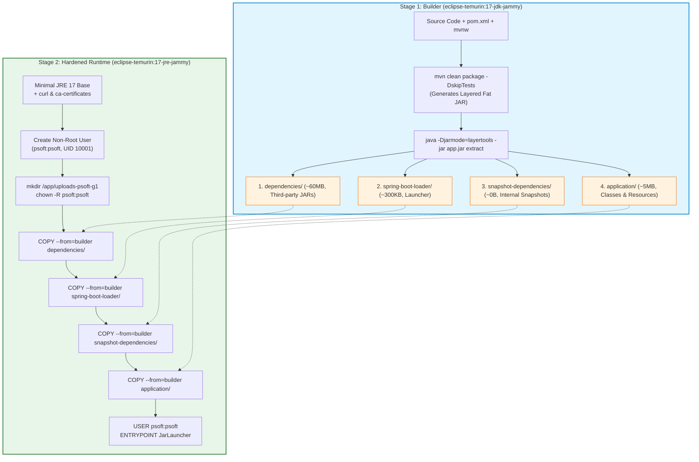

# Multi-Environment Configuration and Production-Grade Containerization

## 1. Overview and Scope (Issue #20 / Goal 1.3.5)

In accordance with Project 1 Goal 1.3.5 (*Support configurable and repeatable deployment of the application across development, staging, and production environments*) and **Issue #20** (*Containerize Application and Support Multi-Environment Configuration*), this document details the engineering decisions, implementation architecture, and operational procedures for:

1. **Production-Grade Multi-Stage Containerization (`Dockerfile`):** Implementing an optimized, layered OCI/Docker container packaging model leveraging Spring Boot `layertools` and running under an unprivileged non-root service account.
2. **Environment Parity & Dynamic Configuration Profiles:** Segregating operational concerns across **Development (`dev`)**, **Staging/UAT (`staging` / `uat`)**, and **Production (`prod`)** environments via dedicated Spring properties files and a standardized template (`.env.example`).
3. **Externalization of Critical Infrastructure Parameters:** Eliminating hardcoded parameters for relational database connections, server ports, upload directories, cryptographic keys, and third-party service credentials in accordance with the **Twelve-Factor App methodology (Factor III: Config & Factor X: Dev/Prod Parity)**.
4. **Repeatable Local Orchestration (`docker-compose.yml`):** Enabling one-command initialization, automated healthcheck polling, and persistent volume management for uploaded media assets.

---

## 2. Multi-Stage Dockerfile Architecture

### 2.1. Limitations of the Baseline Process (*As-Is*)
As established in [`Docs/ODSOFT/system-as-is/system-as-is.md`](../system-as-is/system-as-is.md):
* The application relied on bare-metal execution of fat JARs on host machines, leading to "works on my machine" inconsistencies due to divergent host JDK installations, operating system differences, and local path dependencies.
* Uploaded files were written directly to unmanaged relative paths (`uploads-psoft-g1`), preventing horizontal scaling, state isolation, and container portability.
* Running Java applications as the host `root` user or developer account exposed the underlying system to privilege escalation risks upon potential remote code execution (RCE) or directory traversal vulnerabilities.

### 2.2. Multi-Stage Build & LayerTools Decomposition (*To-Be*)

To maximize Docker build cache reusability and minimize container attack surface, the containerization architecture implements a two-stage multi-stage build:



#### 2.2.1. Spring Boot `layertools` Layering Rationale
Traditional Docker builds copy the monolithic fat JAR in a single `COPY target/*.jar app.jar` layer. Whenever a developer modifies a single line of Java code, the entire ~72 MB JAR layer is invalidated, forcing Docker to upload and store an entirely new 72 MB layer across every CI build and environment push.

By extracting layers via `java -Djarmode=layertools -jar app.jar extract`:
1. **`dependencies/` (~60 MB):** Contains external Maven dependencies (Spring Boot, Hibernate, Jackson, etc.). Invalidated only when `pom.xml` dependencies change. In 95% of commits, this layer is served instantaneously from the Docker cache.
2. **`spring-boot-loader/` (~300 KB):** Contains Spring Boot's internal classloaders (`JarLauncher`).
3. **`snapshot-dependencies/`:** Houses project snapshot dependencies.
4. **`application/` (~5 MB):** Contains the project's compiled `.class` files, Spring properties, and static assets. Only this tiny layer (~5 MB) is invalidated and rebuilt upon standard code commits.

#### 2.2.2. Least Privilege Security Hardening (Non-Root User)
Running container workloads as `root` (UID 0) violates fundamental security compliance standards (CIS Docker Benchmark, NIST SP 800-190). If an adversary exploits an application vulnerability (such as a deserialization flaw or file upload escape), root privileges inside the container drastically increase the likelihood of container escape to the host kernel.

The runtime stage strictly enforces least privilege:
```dockerfile
# Create system group and unprivileged user with UID 10001 and disabled interactive shell
RUN groupadd -g 10001 psoft && \
    useradd -u 10001 -g psoft -s /usr/sbin/nologin -m psoft

# Prepare uploads directory with ownership scoped to psoft user
RUN mkdir -p /app/uploads-psoft-g1 && \
    chown -R psoft:psoft /app/uploads-psoft-g1

# Switch container execution context
USER psoft:psoft
```

#### 2.2.3. Dual Dockerfile Strategy: Autonomous vs. Fast CI Pipeline
To support both developer local ergonomics and CI/CD pipeline efficiency:
* **[`Dockerfile`](../../../Dockerfile):** Completely autonomous multi-stage build. Includes the Maven wrapper (`./mvnw clean package -DskipTests`) in Stage 1, allowing any developer or environment to build the container without requiring pre-installed Java or Maven toolchains on the host machine.
* **[`Dockerfile.artifact`](../../../Dockerfile.artifact):** Optimized for CI/CD pipelines following the **Single-Build Immutable Artifact Pattern** (Jez Humble & David Farley). It accepts the pre-tested, immutable `target/psoft-g1-0.0.1-SNAPSHOT.jar` produced in the Maven build stage, extracting layers in under 3 seconds without re-compiling bytecode.

---

## 3. Multi-Environment Configuration Architecture

### 3.1. Externalization and Fallback Strategy
In adherence to **Twelve-Factor App (Factor III: Store config in the environment)**, all environment-dependent settings in [`src/main/resources/application.properties`](../../../src/main/resources/application.properties) use Spring Boot's property placeholder syntax with sensible fallback defaults:

```properties
server.port=${PORT:8080}
demo.environment=${DEMO_ENVIRONMENT:local}
spring.profiles.active=${SPRING_PROFILES_ACTIVE:dev,bootstrap}

spring.datasource.url=${SPRING_DATASOURCE_URL:jdbc:h2:mem:testdb;DB_CLOSE_DELAY=-1;IGNORECASE=TRUE}
spring.datasource.driverClassName=${SPRING_DATASOURCE_DRIVER:org.h2.Driver}
spring.datasource.username=${SPRING_DATASOURCE_USERNAME:mysqluser}
spring.datasource.password=${SPRING_DATASOURCE_PASSWORD:mysqlpass}

file.upload-dir=${FILE_UPLOAD_DIR:uploads-psoft-g1}
file.photo_max_size=${FILE_PHOTO_MAX_SIZE:20000}
```

### 3.2. Dedicated Environment Profiles

The project defines dedicated configuration profiles under `src/main/resources/`:

| Dimension / Setting | Development (`dev`) | Staging / UAT (`staging` / `uat`) | Production (`prod`) |
| :--- | :--- | :--- | :--- |
| **Profile File** | [`application-dev.properties`](../../../src/main/resources/application-dev.properties) | [`application-staging.properties`](../../../src/main/resources/application-staging.properties) / [`application-uat.properties`](../../../src/main/resources/application-uat.properties) | [`application-prod.properties`](../../../src/main/resources/application-prod.properties) |
| **Operational Target** | Local Workstations / CI test runners | Pre-production QA on DEI VM `vs806` | Live end-user system on DEI VM `vs336` |
| **Default Port** | `8080` (or `8081` on VM) | `8082` | `8080` |
| **Database Engine** | In-Memory H2 (`jdbc:h2:mem:devdb`) | Ephemeral H2 (`jdbc:h2:mem:uatdb`) | Persistent File H2 (`jdbc:h2:file:/opt/psoft-g1/prod/data/proddb`) or external RDBMS |
| **Data Seeding** | Enabled (`bootstrap` profile) | Anonymized / Minimal | Disabled (No synthetic test data in live DB) |
| **H2 Web Console** | **Enabled** (`/h2-console`) for rapid debugging | **Disabled** (Security hardening) | **Strictly Disabled** (Zero console access) |
| **JPA DDL Auto** | `update` | `update` (Schema validation) | `update` / `validate` (Strict schema control) |
| **SQL Logging** | `true` (`org.hibernate.SQL=DEBUG`) | `false` | `false` (Zero SQL leaking to logs) |
| **Log Verbosity** | `DEBUG` (`pt.psoft.g1`) | `INFO` | `WARN` / `ERROR` (Minimal overhead) |
| **Uploads Directory** | `uploads-psoft-g1/dev` | `/opt/psoft-g1/uat/uploads` | `/opt/psoft-g1/prod/uploads` |
| **Health Details** | `always` | `always` | `when-authorized` |

### 3.3. Standardized Environment Template (`.env.example`)
The template file [`.env.example`](../../../.env.example) placed at the repository root documents all supported variables, sample database connection strings (H2, PostgreSQL), security secrets, external API keys, and JVM memory parameters (`-XX:+UseG1GC -XX:MaxRAMPercentage=75.0`).

---

## 4. Docker Compose Orchestration (`docker-compose.yml`)

To satisfy the acceptance criteria of **one-command repeatable local execution**, the [`docker-compose.yml`](../../../docker-compose.yml) file orchestrates the container lifecycle:

```yaml
version: '3.8'

services:
  app:
    container_name: psoft-lms-app
    build:
      context: .
      dockerfile: Dockerfile
    image: psoft-g1:latest
    ports:
      - "${PORT:-8080}:8080"
    environment:
      - PORT=8080
      - DEMO_ENVIRONMENT=${DEMO_ENVIRONMENT:-docker}
      - SPRING_PROFILES_ACTIVE=${SPRING_PROFILES_ACTIVE:-dev,bootstrap}
      - SPRING_DATASOURCE_URL=${SPRING_DATASOURCE_URL:-jdbc:h2:mem:testdb;DB_CLOSE_DELAY=-1;IGNORECASE=TRUE}
      - FILE_UPLOAD_DIR=/app/uploads-psoft-g1
      - SPRING_H2_CONSOLE_ENABLED=${SPRING_H2_CONSOLE_ENABLED:-true}
    env_file:
      - path: .env
        required: false
    volumes:
      - uploads_data:/app/uploads-psoft-g1
    restart: unless-stopped
    healthcheck:
      test: ["CMD", "curl", "-f", "http://localhost:8080/actuator/health/readiness"]
      interval: 10s
      timeout: 3s
      retries: 5
      start_period: 25s

volumes:
  uploads_data:
    name: psoft_g1_uploads_data
```

### 4.1. Core Orchestration Capabilities
1. **Single-Command Startup:** `docker compose up --build -d` completely builds, configures, and launches the application container in background mode.
2. **Persistent Named Volume (`uploads_data`):** Uploaded book photos and reader avatars are mounted to `/app/uploads-psoft-g1`. Consequently, stopping or upgrading containers (`docker compose down && docker compose up -d`) never destroys uploaded assets.
3. **Optional `.env` Ingestion:** Docker Compose attempts to load `.env` if present, falling back gracefully to defaults if the developer has not yet created a local `.env`.
4. **Built-in Healthcheck Polling:** Polls `/actuator/health/readiness` every 10 seconds, marking the container state as `healthy` once Spring Boot finishes bootstrapping.

---

## 5. Verification and Operational Runbook

### 5.1. Building and Running with Docker Compose
```bash
# 1. Start application with one command
docker compose up --build -d

# 2. Inspect container status and health
docker compose ps

# 3. View real-time logs
docker compose logs -f app

# 4. Verify Actuator Readiness Probe
curl -i http://localhost:8080/actuator/health/readiness

# 5. Verify Build & Commit Info Endpoint
curl -i http://localhost:8080/info

# 6. Stop and remove containers (preserving persistent uploads volume)
docker compose down
```

### 5.2. Running Specific Environment Profiles via Docker CLI
```bash
# Run in Staging mode with port 8082
docker run -d --name psoft-staging \
  -p 8082:8082 \
  -e PORT=8082 \
  -e SPRING_PROFILES_ACTIVE=staging \
  -e DEMO_ENVIRONMENT=staging \
  psoft-g1:latest

# Run in Production mode with externalized database connection
docker run -d --name psoft-prod \
  -p 8080:8080 \
  -e PORT=8080 \
  -e SPRING_PROFILES_ACTIVE=prod \
  -e DEMO_ENVIRONMENT=prod \
  -e SPRING_DATASOURCE_URL="jdbc:h2:file:/app/data/proddb;DB_CLOSE_DELAY=-1" \
  psoft-g1:latest
```

