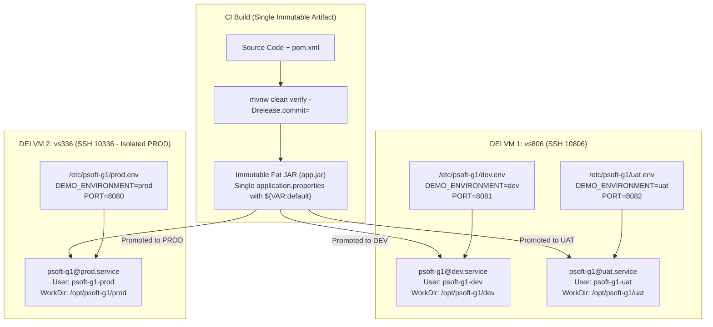

# Multi-Environment Configuration and Systemd Service Isolation

## 1. Overview and Scope (Goal 1.3.5)

In accordance with Project 1 Goal 1.3.5 (*Support configurable and repeatable deployment of the application across development, staging, and production environments*), this document details the engineering decisions, implementation architecture, and operational procedures for:

1. **Single-Build Immutable Artifact (`app.jar`):** Compiling and packaging a single executable Spring Boot fat JAR once in CI (`lms-dev`) and promoting the exact same binary across **Development (`dev`)**, **User Acceptance Testing (`uat` / `staging`)**, and **Production (`prod`)** without recompilation.
2. **Externalized Environment Configuration (Twelve-Factor App Factor III):** Eliminating hardcoded parameters in [`src/main/resources/application.properties`](../../../src/main/resources/application.properties) by using `${VARIABLE:default}` placeholders, documented in [`.env.example`](../../../.env.example) and injected per environment via `/etc/psoft-g1/<env>.env` on the target Linux servers (or optional local `.env` files during development).
3. **Repeatable Multi-Environment Provisioning (`deploy/setup-environments.sh`):** One-command idempotent provisioning of isolated directories (`/opt/psoft-g1/<env>`), environment files (`/etc/psoft-g1/<env>.env`), least-privilege Linux service users (`psoft-g1-<env>`), and restricted `sudoers` policies.
4. **Hardened Process Supervision (`deploy/psoft-g1@.service`):** Managing the lifecycle of each environment instance via parameterized `systemd` template units with strict OS-level sandboxing (`ProtectSystem=strict`, `ProtectHome=true`, `PrivateTmp=true`, `NoNewPrivileges=true`).

---

## 2. Systemd Multi-Environment Isolation Architecture

### 2.1. Limitations of the Baseline Process (*As-Is*)
As established in [`Docs/ODSOFT/system-as-is/system-as-is.md`](../system-as-is/system-as-is.md):
* The application relied on ad-hoc manual execution on developer machines, with hardcoded properties and no environment separation between `dev`, `uat`, and `prod`.
* Uploaded files were written to unmanaged relative directories without OS-level user isolation.
* Running Java processes manually or as `root` without a service supervisor lacked automatic crash recovery (`Restart=on-failure`) and exposed the host operating system to privilege escalation risks.

### 2.2. Parameterized Systemd Template & Multi-VM Topology (*To-Be*)

Following the reference architecture established for the course, environment isolation is achieved without heavy container daemon overhead on the resource-constrained DEI Virtual Servers by combining **Multi-VM physical separation** with **parameterized `systemd` service templates**:



#### 2.2.1. Least-Privilege Security Hardening (`deploy/psoft-g1@.service`)
Each environment runs under a dedicated, unprivileged Linux system user (`psoft-g1-dev`, `psoft-g1-uat`, `psoft-g1-prod`) created with `/usr/sbin/nologin`. The unit file [`deploy/psoft-g1@.service`](../../../deploy/psoft-g1@.service) enforces strict kernel and filesystem sandboxing:

```ini
[Unit]
Description=LMS Application (%i)
After=network.target

[Service]
User=psoft-g1-%i
Group=psoft-g1-%i
WorkingDirectory=/opt/psoft-g1/%i
EnvironmentFile=/etc/psoft-g1/%i.env
ExecStart=/usr/bin/java -jar /opt/psoft-g1/%i/app.jar
Restart=on-failure
RestartSec=5
NoNewPrivileges=true
PrivateTmp=true
ProtectSystem=strict
ProtectHome=true
ReadWritePaths=/opt/psoft-g1/%i
TimeoutStopSec=30

[Install]
WantedBy=multi-user.target
```

---

## 3. Multi-Environment Configuration Architecture

### 3.1. Externalization and Fallback Strategy (`application.properties`)
In adherence to **Twelve-Factor App (Factor III: Store config in the environment)**, all environment-dependent settings in [`src/main/resources/application.properties`](../../../src/main/resources/application.properties) use Spring Boot's property placeholder syntax `${VARIABLE:default}` with safe fallback defaults for out-of-the-box local execution:

```properties
spring.application.name=psoft-g1
spring.config.import=optional:file:.env[.properties]
spring.profiles.active=${SPRING_PROFILES_ACTIVE:bootstrap}

server.port=${PORT:8080}
demo.environment=${DEMO_ENVIRONMENT:local}

spring.datasource.url=${SPRING_DATASOURCE_URL:jdbc:h2:mem:testdb;DB_CLOSE_DELAY=-1;IGNORECASE=TRUE}
spring.datasource.driverClassName=${SPRING_DATASOURCE_DRIVER:org.h2.Driver}
spring.datasource.username=${SPRING_DATASOURCE_USERNAME:mysqluser}
spring.datasource.password=${SPRING_DATASOURCE_PASSWORD:mysqlpass}

spring.h2.console.enabled=${SPRING_H2_CONSOLE_ENABLED:true}
file.upload-dir=${FILE_UPLOAD_DIR:uploads-psoft-g1}
file.photo_max_size=${FILE_PHOTO_MAX_SIZE:20000}
```

### 3.2. Environment Topology Matrix

| Dimension / Setting | Local Workstation (`local`) | Development (`dev`) | UAT / Staging (`uat`) | Production (`prod`) |
| :--- | :--- | :--- | :--- | :--- |
| **Target Host** | `localhost` | DEI VM `vs806` (`10806`) | DEI VM `vs806` (`10806`) | Dedicated DEI VM `vs336` (`10336`) |
| **Configuration Source** | Optional `.env` or defaults | `/etc/psoft-g1/dev.env` | `/etc/psoft-g1/uat.env` | `/etc/psoft-g1/prod.env` |
| **`DEMO_ENVIRONMENT`** | `local` | `dev` | `uat` | `prod` |
| **Listening Port (`PORT`)** | `8080` (or `8085` via `.env`) | `8081` | `8082` | `8080` |
| **Systemd Service** | N/A (`mvnw spring-boot:run`) | `psoft-g1@dev.service` | `psoft-g1@uat.service` | `psoft-g1@prod.service` |
| **OS Service User** | Developer account | `psoft-g1-dev` | `psoft-g1-uat` | `psoft-g1-prod` |
| **Working Directory** | Project root | `/opt/psoft-g1/dev` | `/opt/psoft-g1/uat` | `/opt/psoft-g1/prod` |

### 3.3. Standardized Environment Template (`.env.example`)
The template file [`.env.example`](../../../.env.example) at the repository root documents all externalized variables supported by `application.properties`, including `PORT`, `DEMO_ENVIRONMENT`, `SPRING_PROFILES_ACTIVE`, database connection strings, JWT key paths, external bibliographic providers (`BIBLIOGRAPHIC_PROVIDERS`), notification channels (`NOTIFICATION_CHANNELS`), and lending policy parameters.

Because `application.properties` includes `spring.config.import=optional:file:.env[.properties]`:
* **Without a local `.env`:** The application and all 374 automated tests run out-of-the-box using the fallback defaults.
* **With a local `.env`:** Developers can override `PORT=8085` (for example, when port `8080` is occupied by a local Jenkins controller) without modifying tracked files.
* **On the DEI Linux VMs:** `systemd` injects `/etc/psoft-g1/<env>.env` directly into the process environment via `EnvironmentFile=`.

---

## 4. Repeatable Provisioning and Verification Runbook

### 4.1. Server Provisioning (`deploy/setup-environments.sh`)
```bash
# Provision DEV (8081), UAT (8082), and PROD (8080) on an Ubuntu host
sudo sh deploy/setup-environments.sh 8081 8082 8080
```

### 4.2. Local Execution and Verification
```powershell
# 1. Run application locally (automatically loads .env if present)
.\mvnw.cmd spring-boot:run

# 2. Verify identity & environment contract
curl http://localhost:8080/info

# 3. Verify readiness probe
curl http://localhost:8080/actuator/health/readiness
```
