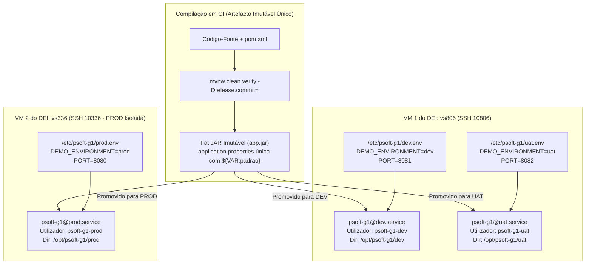

# Configuração Multi-Ambiente e Isolamento de Serviços com Systemd

## 1. Visão Geral e Âmbito (Goal 1.3.5)

Em conformidade com o Goal 1.3.5 do Projeto 1 (*Support configurable and repeatable deployment of the application across development, staging, and production environments*), este documento detalha as decisões de engenharia, a arquitetura de implementação e os procedimentos operacionais para:

1. **Single-Build Immutable Artifact (`app.jar`):** Compilação e empacotamento de um fat JAR executável Spring Boot uma única vez em CI (`lms-dev`), promovendo o mesmo binário por **Desenvolvimento (`dev`)**, **Testes de Aceitação (`uat` / `staging`)** e **Produção (`prod`)** sem qualquer recompilação.
2. **Externalização de Configurações de Ambiente (Twelve-Factor App - Fator III):** Eliminação de parâmetros hardcoded em [`src/main/resources/application.properties`](../../../src/main/resources/application.properties) através de marcadores `${VARIAVEL:padrao}`, documentados em [`.env.example`](../../../.env.example) e injetados por ambiente através de `/etc/psoft-g1/<env>.env` nos servidores Linux de destino (ou ficheiros `.env` locais em desenvolvimento).
3. **Aprovisionamento Repetível Multi-Ambiente (`deploy/setup-environments.sh`):** Provisionamento idempotente de diretórios isolados (`/opt/psoft-g1/<env>`), ficheiros de ambiente (`/etc/psoft-g1/<env>.env`), utilizadores de sistema de privilégio mínimo (`psoft-g1-<env>`) e políticas restritas de `sudoers`.
4. **Supervisão Endurecida de Processos (`deploy/psoft-g1@.service`):** Gestão do ciclo de vida de cada instância através de modelos parametrizados do `systemd` com isolamento estrito ao nível do sistema operativo (`ProtectSystem=strict`, `ProtectHome=true`, `PrivateTmp=true`, `NoNewPrivileges=true`).

---

## 2. Arquitetura de Isolamento Multi-Ambiente com Systemd

### 2.1. Limitações do Processo Inicial (*As-Is*)
Conforme estabelecido em [`Docs/ODSOFT/system-as-is/system-as-is.md`](../system-as-is/system-as-is.md):
* A aplicação dependia de execução manual ad-hoc nas estações de trabalho, com propriedades hardcoded e sem qualquer separação entre `dev`, `uat` e `prod`.
* Os ficheiros de upload eram gravados em diretórios relativos sem isolamento de utilizadores no sistema operativo.
* Executar processos Java manualmente ou como `root` sem supervisor de processos não garantia recuperação automática em falhas (`Restart=on-failure`) e expunha o sistema a riscos de escalamento de privilégios.

### 2.2. Modelo Parametrizado do Systemd e Topologia Multi-VM (*To-Be*)

Seguindo a arquitetura de referência do curso, o isolamento de ambientes é alcançado sem a sobrecarga computacional de um daemon de contentores nos Servidores Virtuais do DEI, combinando **separação física Multi-VM** com **modelos parametrizados do `systemd`**:



#### 2.2.1. Hardening e Princípio de Privilégio Mínimo (`deploy/psoft-g1@.service`)
Cada ambiente corre sob um utilizador de sistema dedicado e sem privilégios (`psoft-g1-dev`, `psoft-g1-uat`, `psoft-g1-prod`) criado com `/usr/sbin/nologin`. O ficheiro [`deploy/psoft-g1@.service`](../../../deploy/psoft-g1@.service) impõe restrições estritas de kernel e sistema de ficheiros:

```ini
[Unit]
Description=LMS Application (%i)
After=network.target

[Service]
User=psoft-g1-%i
Group=psoft-g1-%i
WorkingDirectory=/opt/psoft-g1/%i
EnvironmentFile=/etc/psoft-g1/%i.env
ExecStart=/usr/bin/java -jar /opt/psoft-g1/%i/app.jar
Restart=on-failure
RestartSec=5
NoNewPrivileges=true
PrivateTmp=true
ProtectSystem=strict
ProtectHome=true
ReadWritePaths=/opt/psoft-g1/%i
TimeoutStopSec=30

[Install]
WantedBy=multi-user.target
```

---

#### 2.2.2. Distinção Conceptual e Operacional: Ambientes Lógicos vs. Destinos de Deployment (C1.4 & C1.5)

Na engenharia de entrega contínua, é essencial distinguir entre um **Ambiente Lógico** (etapa de ciclo de vida com configurações, regras de governação, dados e portões de qualidade específicos) e um **Destino de Deployment** (o nó anfitrião físico ou virtual onde o binário é executado):

| Dimensão | Ambiente Lógico (*Logical Environment*) | Destino de Deployment (*Deployment Target*) |
| :--- | :--- | :--- |
| **Definição** | Fase funcional no ciclo de promoção de software (`local`, `dev`, `uat`/`staging`, `prod`). | Nó/anfitrião de infraestrutura que recebe o binário via SSH/SCP ou execução local (`localhost`, VM `vs806` do DEI, VM `vs336` do DEI). |
| **Identificação em Contrato** | Injetado via `DEMO_ENVIRONMENT` (`dev`, `uat`, `prod`) e verificado no `GET /info` (campo `"environment"`). | Endereçado pelo ponto de acesso de rede e porta SSH (`vsgate-ssh.dei.isep.ipp.pt:10806` para `vs806`; `:10336` para `vs336`). |
| **Cardinalidade e Mapeamento ($N:M$)** | **3 ambientes lógicos remotos** (`dev`, `uat`, `prod`) + **1 ambiente local** (`local`). | **2 Servidores Virtuais remotos do DEI** (`vs806` e `vs336`) + **1 máquina de desenvolvimento local** (`localhost`). |
| **Justificação de Colocação e Isolamento** | `dev` e `uat` são ambientes lógicos distintos com bases de dados independentes, portas próprias (`8081` vs `8082`), utilizadores de SO distintos (`psoft-g1-dev` vs `psoft-g1-uat`), diretórios separados (`/opt/psoft-g1/dev` vs `/opt/psoft-g1/uat`) e instâncias independentes de serviço systemd (`psoft-g1@dev` vs `psoft-g1@uat`), embora partilhem o mesmo destino físico (`vs806`). | `prod` é implantado num **destino de deployment dedicado (`vs336`)**, garantindo que picos de CPU, memória ou I/O em `dev`/`uat` em `vs806` nunca afetam a disponibilidade de produção. |
| **Alternativas e Compromissos** | *Alternativa 1:* 3 VMs separadas (mapeamento 1:1) — maior consumo de quotas de infraestrutura. *Alternativa 2:* 1 única VM para os três — risco de degradação de produção. *Solução Híbrida Adotada (3 ambientes lógicos em 2 VMs):* Equilíbrio ótimo entre eficiência de recursos e isolamento físico de produção. | *Alternativa:* Contentores Docker sobre as VMs LXD — rejeitado devido à sobrecarga de virtualização aninhada nas quotas restritas do DEI; o `systemd` parametrizado fornece isolamento nativo de namespaces do kernel (`ProtectSystem=strict`, `PrivateTmp=true`) com zero sobrecarga de memória. |

---

## 3. Arquitetura de Configuração Multi-Ambiente

### 3.1. Externalização e Estratégia de Fallback (`application.properties`)
Respeitando o princípio **Twelve-Factor App (Fator III: Armazenar configurações no ambiente)**, todos os parâmetros dependentes de ambiente em [`src/main/resources/application.properties`](../../../src/main/resources/application.properties) recorrem a marcadores `${VARIAVEL:padrao}` com valores seguros de fallback para execução out-of-the-box:

```properties
spring.application.name=psoft-g1
spring.config.import=optional:file:.env[.properties]
spring.profiles.active=${SPRING_PROFILES_ACTIVE:bootstrap}

server.port=${PORT:8080}
demo.environment=${DEMO_ENVIRONMENT:local}

spring.datasource.url=${SPRING_DATASOURCE_URL:jdbc:h2:mem:testdb;DB_CLOSE_DELAY=-1;IGNORECASE=TRUE}
spring.datasource.driverClassName=${SPRING_DATASOURCE_DRIVER:org.h2.Driver}
spring.datasource.username=${SPRING_DATASOURCE_USERNAME:mysqluser}
spring.datasource.password=${SPRING_DATASOURCE_PASSWORD:mysqlpass}

spring.h2.console.enabled=${SPRING_H2_CONSOLE_ENABLED:true}
file.upload-dir=${FILE_UPLOAD_DIR:uploads-psoft-g1}
file.photo_max_size=${FILE_PHOTO_MAX_SIZE:20000}
```

### 3.2. Matriz de Topologia dos Ambientes

| Dimensão / Parâmetro | Estação de Trabalho (`local`) | Desenvolvimento (`dev`) | Testes de Aceitação (`uat`) | Produção (`prod`) |
| :--- | :--- | :--- | :--- | :--- |
| **Anfitrião de Destino** | `localhost` | VM `vs806` do DEI (`10806`) | VM `vs806` do DEI (`10806`) | VM Dedicada `vs336` do DEI (`10336`) |
| **Origem da Configuração** | `.env` opcional ou valores padrão | `/etc/psoft-g1/dev.env` | `/etc/psoft-g1/uat.env` | `/etc/psoft-g1/prod.env` |
| **`DEMO_ENVIRONMENT`** | `local` | `dev` | `uat` | `prod` |
| **Porta de Escuta (`PORT`)** | `8080` (ou `8085` via `.env`) | `8081` | `8082` | `8080` |
| **Serviço Systemd** | N/A (`mvnw spring-boot:run`) | `psoft-g1@dev.service` | `psoft-g1@uat.service` | `psoft-g1@prod.service` |
| **Utilizador de SO** | Conta do programador | `psoft-g1-dev` | `psoft-g1-uat` | `psoft-g1-prod` |
| **Diretório de Trabalho** | Raiz do projeto | `/opt/psoft-g1/dev` | `/opt/psoft-g1/uat` | `/opt/psoft-g1/prod` |

### 3.3. Modelo Padronizado de Ambiente (`.env.example`)
O ficheiro modelo [`.env.example`](../../../.env.example) na raiz do repositório documenta todas as variáveis suportadas por `application.properties`, incluindo `PORT`, `DEMO_ENVIRONMENT`, `SPRING_PROFILES_ACTIVE`, cadeias de ligação à base de dados, caminhos de chaves JWT, fornecedores bibliográficos externos (`BIBLIOGRAPHIC_PROVIDERS`), canais de notificação (`NOTIFICATION_CHANNELS`) e parâmetros de políticas de empréstimo.

Como `application.properties` inclui `spring.config.import=optional:file:.env[.properties]`:
* **Sem `.env` local:** A aplicação e todos os 433 testes automatizados executam out-of-the-box com os valores de fallback.
* **Com `.env` local:** Os programadores podem substituir `PORT=8085` (por exemplo, quando a porta `8080` está ocupada pelo Jenkins local) sem modificar ficheiros versionados.
* **Nas VMs Linux do DEI:** O `systemd` injeta `/etc/psoft-g1/<env>.env` diretamente no ambiente do processo através de `EnvironmentFile=`.

---

## 4. Guia de Aprovisionamento Repetível e Verificação

### 4.1. Aprovisionamento do Servidor (`deploy/setup-environments.sh`)
```bash
# Aprovisionar DEV (8081), UAT (8082) e PROD (8080) num anfitrião Ubuntu
sudo sh deploy/setup-environments.sh 8081 8082 8080
```

### 4.2. Execução Local e Verificação
```powershell
# 1. Executar a aplicação localmente (carrega .env se existir)
.\mvnw.cmd spring-boot:run

# 2. Verificar o contrato de identidade e ambiente
curl http://localhost:8080/info

# 3. Verificar o probe de prontidão
curl http://localhost:8080/actuator/health/readiness
```
