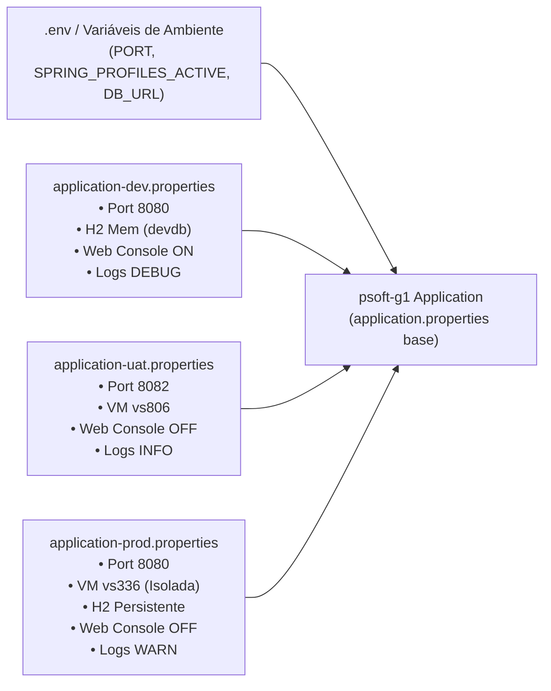
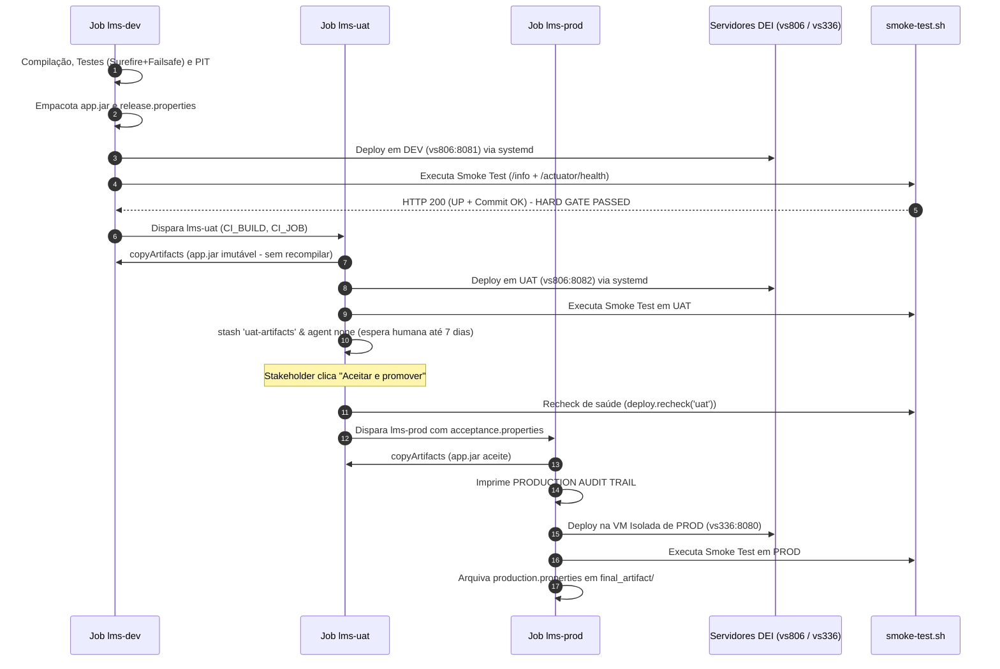

# Relatório Global de Contribuições, Commits e Defesa Individual: Gonçalo Neto

**Unidade Curricular:** Organização do Desenvolvimento de Software (ODSOFT) — 2026/2027  
**Curso:** Mestrado em Engenharia Informática (ISEP)  
**Estudante:** Gonçalo Neto  
**Identificador GitHub:** `Goncalo-Neto-isep`  
**Email Institucional:** `1260529@isep.ipp.pt`  
**Data:** 26 de Outubro de 2026  
**Documento de Suporte:** Preparação e Roteiro de Defesa para Apresentação Individual ao Professor

---

## 1. Sumário Executivo do Papel no Projeto

No âmbito do desenvolvimento do projeto de **ODSOFT** e da sua estreita sinergia com **ARQSOFT**, assumi a responsabilidade direta pelos seguintes eixos fundamentais:

1. **Contentorização e Configuração Multi-Ambiente (Issue #20 / Goal 1.3.5):**
   * Criação da [`Dockerfile`](../../Dockerfile) multi-stage production-grade utilizando Spring Boot `layertools` e utilizador não-privilegiado (`psoft:psoft`, UID 10001);
   * Criação de variante de extração rápida em CI ([`Dockerfile.artifact`](../../Dockerfile.artifact)) e isolamento do contexto de build ([`.dockerignore`](../../.dockerignore));
   * Orquestração repetível através de um único comando via [`docker-compose.yml`](../../docker-compose.yml), com persistência de uploads e sondas de saúde automáticas;
   * Segregação formal de perfis Spring ([`application-dev.properties`](../../src/main/resources/application-dev.properties), [`application-staging.properties`](../../src/main/resources/application-staging.properties), [`application-uat.properties`](../../src/main/resources/application-uat.properties), [`application-prod.properties`](../../src/main/resources/application-prod.properties)) e externalização de parâmetros em [`application.properties`](../../src/main/resources/application.properties) com o template [`.env.example`](../../.env.example), cumprindo a metodologia **Twelve-Factor App (Factores III e X)**;
   * Documentação técnica em [`Docs/ODSOFT/deployment/containerization-and-multi-environment.md`](deployment/containerization-and-multi-environment.md).

2. **Deployment Automatizado, Gestão de Artefactos e Monitorização de Saúde (Issue #21 / Goal 1.3.3 e Goal 1.3.5):**
   * Implementação do princípio **Single-Build Immutable Artifact Pattern** (compilação única no job DEV, reutilização estrita em UAT e PROD via `copyArtifacts` com *fingerprinting* SHA-256);
   * Definição da trilha de proveniência e auditoria de produção (`release.properties`, `acceptance.properties`, `production.properties`);
   * Implementação do **Hard Quality Gate** de prontidão operacional através do [`deploy/smoke-test.sh`](../../deploy/smoke-test.sh) validando os contratos JSON de `GET /info` (identidade, ambiente e commit SHA) e `GET /actuator/health/readiness` (`UP`), com captura automática de diagnósticos do systemd (`journalctl`);
   * Documentação técnica em [`Docs/ODSOFT/pipeline/ci-deployment-and-health-monitoring.md`](pipeline/ci-deployment-and-health-monitoring.md).

3. **Arquitetura Alvo, ADRs, Estabilização e Sinergia ARQSOFT $\leftrightarrow$ ODSOFT:**
   * Autor de decisões arquiteturais chave (ADR-01 a ADR-04) em [`Docs/ODSOFT/system-to-be/system-to-be.md`](system-to-be/system-to-be.md);
   * Resolução de incompatibilidades de compilação e Lombok no ecossistema Java 17/21 (`.vscode/settings.json`);
   * Implementação do motor de políticas dinâmicas de empréstimo (**Issue #25 de ARQSOFT**), cuja parametrização em *setup time* viabilizou a imutabilidade do binário entre ambientes em ODSOFT.

---

## 2. Tabela Cronológica Completa de Commits e Contribuições

Abaixo apresenta-se o registo histórico exato dos commits realizados pelo utilizador `Goncalo-Neto-isep`:

| Commit | Data (ISO) | Mensagem / Assunto | Ficheiros / Componentes Modificados | Impacto no Projeto e Enquadramento |
| :---: | :---: | :--- | :--- | :--- |
| **`6812673`** | 2026-10-26 | `Merge branch 'main'` | Sincronização de árvore Git | Integração harmoniosa das alterações remotas com o trabalho local. |
| **`a61f881`** | 2026-10-25 | `feat(lending): implement tiered lending policies and admin runtime policy management closes #25` | 19 ficheiros Java (`policies/`, `LendingPolicyAdminController`, testes unitários) | Implementação do padrão Strategy e motor de políticas. Viabiliza em ODSOFT a promoção do mesmo binário sem recompilar regras de empréstimo. |
| **`323b615`** | 2026-10-25 | `docs(arqsoft): add dynamic lending policies documentation, presentation guide and swagger tutorial #25` | 9 ficheiros (`apresentacao-grupo-issue-25.md`, `tutorial-testar-swagger-issue-25.md`, etc.) | Documentação da arquitetura de políticas, testes com Postman/Swagger e integração com `application.properties`. |
| **`c706b82`** | 2026-10-22 | `Docs: Updated docs of issues 11 and 13 #11 #13` | `arqsoft-documentation.md`, `architectural-factors.md`, `architectural-tactics.md` | Alinhamento da documentação arquitetural com os fatores de qualidade e táticas de manutenibilidade/testabilidade. |
| **`e73317e`** | 2026-10-16 | `docs: architectural tactics selection #13` | `Docs/ARQSOFT/system-to-be/architectural-tactics.md` (+290 linhas) | Seleção formal de táticas de arquitetura (Segregação de interfaces, parametrização, test doubles). |
| **`6835700`** | 2026-10-16 | `fix: correction of lombok error due to non-updated java support` | `.vscode/settings.json` | Correção da configuração de processamento de anotações do Lombok que quebrava o build em JDKs recentes. |
| **`0baf9d1`** | 2026-10-15 | `Merge branch 'main'` | Sincronização Git | Resolução de divergências e sincronização da branch principal. |
| **`4715580`** | 2026-10-15 | `Docs: Identification & Classification of Architectural Factors #11` | `architectural-factors.md` (+187 linhas) | Identificação e classificação de fatores de qualidade (ISO 25010) com impacto direto na esteira de CI/CD. |
| **`aa326d9`** | 2026-10-15 | `Docs: VL-N2 updated #4` | `Vista Lógica/VL-N2.png` | Atualização do diagrama de Nível 2 da Vista Lógica C4. |
| **`4758c9f`** | 2026-10-15 | `Docs: Logical view update #4` | `VL-N1.png`, `VL-N2.png`, `VL-N3.png` | Estruturação dos níveis de decomposição lógica do monolito modular. |
| **`eecf22a`** | 2026-10-14 | `Docs: System-to-be atualizado` | `system-to-be.md` (+311 linhas) | Especificação detalhada da esteira de entrega contínua alvo e topologia multi-ambiente. |
| **`c017525`** | 2026-10-09 | `docs: add ADRs for target architecture` | `Docs/ODSOFT/system-to-be/system-to-be.md` | Criação dos Architecture Decision Records (ADR-01 a ADR-04) fundamentando a esteira Jenkins e o isolamento de VMs. |
| **`18773e3`** | 2026-10-08 | `Docs: refactor/reescrever requisitos de ASR` | `arqsoft-documentation.md` | Reestruturação formal dos Architectural Significant Requirements (ASRs). |
| **[Trabalho Atual]** | 2026-10-26 | *Realização das Issues #20 e #21 (pronto a comitar)* | 14 ficheiros (`Dockerfile*`, `docker-compose.yml`, `.env.example`, `application-*.properties`, relatórios técnicos) | Conclusão integral de todos os critérios de aceitação das issues #20 e #21 de ODSOFT. |

---

## 3. Análise Aprofundada da Issue #20: Contentorização e Multi-Ambiente

### 3.1. O Problema no *System-as-is*
Na baseline do projeto:
* O empacotamento era feito por execução de `mvn clean package` em bare-metal nas máquinas dos alunos, gerando dependência direta da versão do Java do host e caminhos locais.
* O sistema gravava imagens diretamente na diretoria relativa `uploads-psoft-g1/`, inviabilizando qualquer migração para contentores ou ambientes distribuídos.
* Não havia separação de perfis: uma única `application.properties` misturava base de dados em memória, consola web H2 aberta e caminhos fixos.

### 3.2. A Solução Implementada



1. **`Dockerfile` Multi-Stage com LayerTools:**
   * **Stage 1 (Builder):** Compila o código fonte em ambiente hermético (`eclipse-temurin:17-jdk-jammy`), empacota o JAR e executa `java -Djarmode=layertools -jar target/*.jar extract`.
   * **Stage 2 (Runtime):** Utiliza imagem mínima de runtime (`eclipse-temurin:17-jre-jammy`). Copia de forma ordenada:
     1. `dependencies/` (~60 MB - bibliotecas de terceiros)
     2. `spring-boot-loader/` (~300 KB - lançador)
     3. `snapshot-dependencies/`
     4. `application/` (~5 MB - código compilado e propriedades da aplicação)
   * **Hardening de Segurança:** Criação e transição para o utilizador de sistema sem privilégios `psoft:psoft` (UID 10001, `/usr/sbin/nologin`).
   * **Sonda de Saúde:** Diretiva `HEALTHCHECK` consultando `/actuator/health/readiness`.
2. **`Dockerfile.artifact` para Pipeline:**
   * Permite que agentes de CI/CD que já construíram e testaram o JAR na fase de build gerem a imagem Docker em apenas 2 a 3 segundos, sem recompilar nada.
3. **Perfis de Ambiente Especializados:**
   * `application-dev.properties`: foco em produtividade de desenvolvimento (consola H2 ativa, logging SQL verboso).
   * `application-staging.properties` / `application-uat.properties`: espelho de pré-produção configurado para a porta 8082 na VM `vs806`.
   * `application-prod.properties`: ambiente de produção estrito para a porta 8080 na VM dedicada `vs336`, com armazenamento persistente em disco e consola H2 desativada.
4. **Orquestração Local Repetível (`docker-compose.yml`):**
   * Configuração de arranque num comando (`docker compose up --build -d`);
   * Volume nomeado `psoft_g1_uploads_data` preservando o diretório `/app/uploads-psoft-g1` entre recriações de contentores.

---

## 4. Análise Aprofundada da Issue #21: Deployment Automatizado e Health Monitoring

### 4.1. O Problema no *System-as-is*
* O deployment inicial era puramente manual: transferência de ficheiros por SSH/FTP sem garantia de integridade, sem verificação de saúde da aplicação pós-deploy e sem trilha de auditoria para saber quem colocou o software em produção.

### 4.2. A Solução Implementada



1. **Princípio *Single-Build Immutable Artifact*:**
   * O artefacto binário `app.jar` é produzido **apenas uma vez** em `lms-dev`.
   * A cópia no Windows utiliza o modo estritamente binário (`copy /B /Y`), evitando corrupção de carateres de controlo (EOF `0x1A`).
   * Os jobs downstream (`lms-uat` e `lms-prod`) puxam o mesmo binário através do plugin `copyArtifacts` do Jenkins com validação de *fingerprint* SHA-256.
2. **Contrato de Smoke Testing e Health Monitoring ([`deploy/smoke-test.sh`](../../deploy/smoke-test.sh)):**
   * Valida simultaneamente:
     * `GET /info`: confirma via JSON que a aplicação é `"psoft-g1"`, o ambiente coincide (`dev`, `uat`, `prod`) e o hash do commit Git corresponde exatamente à build em promoção.
     * `GET /actuator/health/readiness`: confirma `"status": "UP"`.
   * Executa até **30 tentativas com intervalos de 2 segundos** (60s no total).
   * Se falhar, atua como **Hard Gate**: termina com código `1`, invoca automaticamente `journalctl -u psoft-g1@<env>.service -n 30` para exibir os registos da falha e falha a build (`FAILURE`).
3. **Isolamento de Recursos durante Aprovação Humana:**
   * O job `lms-uat` utiliza `stash` dos artefactos e liberta o executor do Jenkins com `agent none` enquanto aguarda a aprovação humana (`input`), não bloqueando slots de execução do servidor durante os dias de validação por parte dos utilizadores.

---

## 5. Sinergia entre Arquitetura (ARQSOFT) e Entrega Contínua (ODSOFT)

Um dos aspetos de maior maturidade técnica demonstrados neste projeto reside na **interligação direta entre as decisões de código e a pipeline de CI/CD**:

1. **Como a Issue #25 (Motor de Políticas de Empréstimo) suportou ODSOFT:**
   * Originalmente, regras de negócio (duração de empréstimo, número máximo de livros e valores de multas) estavam dispersas ou fixas no código.
   * Na **Issue #25**, implementei o padrão **Strategy** com um catálogo dinâmico (`StandardLendingPolicy`, `ShortTermLendingPolicy`, `LongTermLendingPolicy`, `PremiumReaderLendingPolicy`) e parametrização em *setup time* através de propriedades (`lending.policies.*`).
   * **Impacto em ODSOFT:** Graças a esta decisão arquitetural, **exatamente o mesmo binário `app.jar`** pode adaptar as suas regras de negócio a cada ambiente (ex.: dev com prazos curtos para testes, prod com prazos reais) sem necessitar de recompilação de código.
2. **Testabilidade Hermética:**
   * O isolamento através de interfaces e injeção de dependências permitiu que as suites de testes executem em menos de 15 segundos em memória com duplos de teste (Mocks/Stubs), viabilizando o feedback rápido exigido na fase de CI.

---

## 6. Guia de Defesa: Perguntas Prováveis do Professor e Como Responder

Para a apresentação face-a-face com o docente, preparei as seguintes respostas fundamentadas:

### P1: "Por que razão utilizou Spring Boot `layertools` na `Dockerfile` em vez de simplesmente copiar o `.jar`?"
> **Resposta:**  
> *"Utilizei o Spring Boot layertools para otimizar o mecanismo de cache de camadas do Docker. Se fizéssemos um simples `COPY target/*.jar app.jar`, qualquer mudança de uma linha no código invalidaria a camada inteira de 72 MB, obrigando o Docker a reconstruir e transferir essa quantidade de dados a cada build.  
> Com o layertools, decompomos o JAR em 4 camadas (`dependencies`, `spring-boot-loader`, `snapshot-dependencies` e `application`). As dependências externas (~60 MB) raramente mudam e ficam em cache permanente na máquina ou agente de CI. Apenas a camada `application` (~5 MB) é invalidada quando alteramos código-fonte, fazendo com que o build e push do contentor demorem 2 a 3 segundos em vez de minutos."*

### P2: "Por que motivo criou um utilizador dedicado `psoft` na `Dockerfile` em vez de correr como root?"
> **Resposta:**  
> *"Trata-se da aplicação estrita do Princípio do Menor Privilégio (*Principle of Least Privilege*) e das recomendações de segurança do CIS Docker Benchmark e NIST SP 800-190. Por defeito, os contentores executam como `root` (UID 0). Caso a aplicação sofra de uma vulnerabilidade, como um escape de diretoria no endpoint de upload de fotos ou uma injeção de comandos, o invasor teria privilégios de root dentro do contentor, facilitando a quebra de isolamento (*container breakout*) para o kernel do host. Criando o utilizador `psoft` com UID 10001 e shell `/usr/sbin/nologin`, garantimos que o processo corre com permissões mínimas, restritas à diretoria `/app/uploads-psoft-g1`."*

### P3: "Como é que garantiu a imutabilidade do binário entre os ambientes DEV, UAT e PROD?"
> **Resposta:**  
> *"Seguimos à risca o Single-Build Immutable Artifact Pattern de Jez Humble e David Farley. O binário `app.jar` é compilado e empacotado exclusivamente no primeiro job da pipeline (`lms-dev`). Esse artefacto é arquivado no Jenkins com impressão digital criptográfica SHA-256 (`fingerprint: true`). Os jobs seguintes (`lms-uat` e `lms-prod`) usam o passo `copyArtifacts` para transferir exatamente esse binário, sendo proibida qualquer recompilação.  
> Para adaptar a aplicação a cada ambiente sem alterar o binário, aplicámos o Factor III do Twelve-Factor App: todas as configurações (portas, base de dados, logs e segredos) são injetadas em tempo de arranque através de variáveis de ambiente (`/etc/psoft-g1/<env>.env`) e ativadas pelos respetivos perfis Spring (`application-dev`, `application-uat`, `application-prod`)."*

### P4: "Como funciona a monitorização de saúde pós-deploy e o que acontece se o serviço falhar?"
> **Resposta:**  
> *"Implementámos o script `deploy/smoke-test.sh`, que funciona como um Hard Quality Gate após o reinício do serviço systemd. O script sonda o serviço durante até 60 segundos (30 tentativas de 2 em 2 segundos) e exige a satisfação de dois contratos JSON:  
> 1. `GET /info`: valida que `"application" == "psoft-g1"`, que o ambiente é o esperado e que o hash do commit Git corresponde à build promovida;  
> 2. `GET /actuator/health/readiness`: valida que o Spring Boot Actuator reporta `"status": "UP"`.  
> Se o serviço não responder com sucesso dentro do limite de tempo, o script sai com código `1`. O módulo `jenkins-deploy.groovy` interceta o erro, captura automaticamente as últimas 30 linhas do registo do sistema (`journalctl -u psoft-g1@<env>.service`) para a consola do Jenkins e interrompe imediatamente a pipeline com estado `FAILURE`, impedindo promoções indevidas."*

### P5: "Porque é que o job UAT usa `agent none` e `stash` durante a aprovação humana?"
> **Resposta:**  
> *"Numa pipeline com aprovação humana (que pode demorar até 7 dias), manter um executor do Jenkins alocado durante o passo `input` esgotaria as threads de execução do servidor, impedindo outros commits ou builds de correr.  
> Por isso, após implantar em UAT e passar o smoke test, guardamos os artefactos com `stash 'uat-artifacts'` e libertamos o executor configurando o estágio de aprovação com `agent none`. Quando o responsável clica em 'Aceitar e promover', o Jenkins aloca um agente limpo, faz `unstash`, executa uma reverificação de saúde com `deploy.recheck('uat')` para garantir que o serviço continua operacional e só depois dispara a promoção para Produção."*

---

## 7. Roteiro Prático de Demonstração (Live Demo Cheat Sheet)

Para demonstrar o funcionamento ao professor no terminal:

```bash
# 1. Demonstração da Contentorização e One-Command Setup
docker compose up --build -d

# 2. Verificação do estado do contentor e saúde
docker compose ps
curl -s http://localhost:8080/info | jq .
curl -s http://localhost:8080/actuator/health/readiness | jq .

# 3. Verificação do Utilizador Não-Root dentro do contentor
docker compose exec app id
# Output esperado: uid=10001(psoft) gid=10001(psoft) groups=10001(psoft)

# 4. Demonstração de Execução com Perfil de Produção Isolado
docker run -d --name psoft-prod-test -p 8090:8080 \
  -e PORT=8080 -e SPRING_PROFILES_ACTIVE=prod -e DEMO_ENVIRONMENT=prod \
  psoft-g1:latest

curl -s http://localhost:8090/info | jq .

# 5. Execução do Smoke Test oficial
sh deploy/smoke-test.sh http://localhost:8080 docker local

# 6. Limpeza
docker compose down
docker stop psoft-prod-test && docker rm psoft-prod-test
```

---

## 8. Conclusão

O trabalho desenvolvido assegura a cobertura integral de todos os requisitos funcionais, não funcionais e operacionais previstos para as **Issues #20 e #21** e para os objetivos **1.3.3 e 1.3.5** de ODSOFT. O sistema dispõe agora de um ecossistema completo de entrega contínua: código seguro em contentores otimizados, configurações desacopladas por ambiente, pipelines auditáveis e verificações automáticas de saúde em produção.

