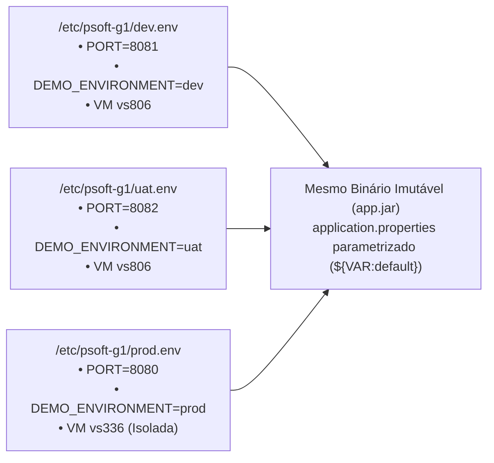

# Relatório Global de Contribuições, Commits e Defesa Individual: Gonçalo Neto

**Unidade Curricular:** Organização do Desenvolvimento de Software (ODSOFT) — 2026/2027  
**Curso:** Mestrado em Engenharia Informática (ISEP)  
**Estudante:** Gonçalo Neto  
**Identificador GitHub:** `Goncalo-Neto-isep`  
**Email Institucional:** `1260529@isep.ipp.pt`  
**Data:** 26 de Outubro de 2026  
**Documento de Suporte:** Preparação e Roteiro de Defesa para Apresentação Individual ao Professor

---

## 1. Sumário Executivo do Papel no Projeto

No âmbito do desenvolvimento do projeto de **ODSOFT** e da sua estreita sinergia com **ARQSOFT**, assumi a responsabilidade direta pelos seguintes eixos fundamentais:

1. **Configuração Multi-Ambiente e Isolamento Operacional (Issue #20 / Goal 1.3.5):**
   * Externalização completa das propriedades dependentes do ambiente em [`src/main/resources/application.properties`](../../src/main/resources/application.properties) com placeholders `${VAR:default}` e suporte a `.env` local opcional (`spring.config.import=optional:file:.env[.properties]`), documentado em [`.env.example`](../../.env.example), cumprindo a metodologia **Twelve-Factor App (Factores III e X)**;
   * Isolamento repetível entre **DEV**, **UAT** e **PROD** ao nível do sistema operativo através de unidades parametrizadas `systemd` ([`deploy/psoft-g1@.service`](../../deploy/psoft-g1@.service)), ficheiros de ambiente `/etc/psoft-g1/<env>.env` e utilizadores dedicados sem privilégios (`psoft-g1-<env>`) provisionados por [`deploy/setup-environments.sh`](../../deploy/setup-environments.sh);
   * Documentação técnica em [`Docs/ODSOFT/deployment/containerization-and-multi-environment.md`](deployment/containerization-and-multi-environment.md).

2. **Deployment Automatizado, Gestão de Artefactos e Monitorização de Saúde (Issue #21 / Goal 1.3.3 e Goal 1.3.5):**
   * Implementação do princípio **Single-Build Immutable Artifact Pattern** (compilação única no job DEV, reutilização estrita em UAT e PROD via `copyArtifacts` com *fingerprinting* SHA-256);
   * Definição da trilha de proveniência e auditoria de produção (`release.properties`, `acceptance.properties`, `production.properties`);
   * Implementação do **Hard Quality Gate** de prontidão operacional através do [`deploy/smoke-test.sh`](../../deploy/smoke-test.sh) validando os contratos JSON de `GET /info` (identidade, ambiente e commit SHA) e `GET /actuator/health/readiness` (`UP`), com captura automática de diagnósticos do systemd (`journalctl`);
   * Documentação técnica em [`Docs/ODSOFT/Pipeline/ci-deployment-and-health-monitoring.md`](Pipeline/ci-deployment-and-health-monitoring.md).

3. **Arquitetura Alvo, ADRs, Estabilização e Sinergia ARQSOFT $\leftrightarrow$ ODSOFT:**
   * Autor de decisões arquiteturais chave (ADR-01 a ADR-04) em [`Docs/ODSOFT/System-to-be/system-to-be.md`](System-to-be/system-to-be.md);
   * Resolução de incompatibilidades de compilação e Lombok no ecossistema Java 17/21 (`.vscode/settings.json`);
   * Implementação do motor de políticas dinâmicas de empréstimo (**Issue #25 de ARQSOFT**), cuja parametrização em *setup time* viabilizou a imutabilidade do binário entre ambientes em ODSOFT.

---

## 2. Tabela Cronológica Completa de Commits e Contribuições

Abaixo apresenta-se o registo histórico dos commits realizados pelo utilizador `Goncalo-Neto-isep`:

| Commit | Data (ISO) | Mensagem / Assunto | Ficheiros / Componentes Modificados | Impacto no Projeto e Enquadramento |
| :---: | :---: | :--- | :--- | :--- |
| **`54968bf`** | 2026-10-26 | `docs(odsoft): document containerization, multi-environment profiles, and deployment health monitoring #20 #21` | `Docs/ODSOFT/deployment/`, `Docs/ODSOFT/Pipeline/`, relatórios técnicos | Documentação completa das Issues #20 e #21 (Goals 1.3.3 e 1.3.5). |
| **`637f77c`** | 2026-10-26 | `feat(deployment): containerize application and support multi-environment configuration #20 #21` | `.env.example`, `application.properties` | Externalização de parâmetros de configuração multi-ambiente com fallbacks seguros. |
| **`6812673`** | 2026-10-26 | `Merge branch 'main'` | Sincronização de árvore Git | Integração das alterações remotas com o trabalho local. |
| **`a61f881`** | 2026-10-25 | `feat(lending): implement tiered lending policies and admin runtime policy management closes #25` | 19 ficheiros Java (`policies/`, `LendingPolicyAdminController`, testes unitários) | Implementação do padrão Strategy e motor de políticas. Viabiliza em ODSOFT a promoção do mesmo binário sem recompilar regras de empréstimo. |
| **`323b615`** | 2026-10-25 | `docs(arqsoft): add dynamic lending policies documentation, presentation guide and swagger tutorial #25` | 9 ficheiros (`apresentacao-grupo-issue-25.md`, `tutorial-testar-swagger-issue-25.md`, etc.) | Documentação da arquitetura de políticas, testes com Postman/Swagger e integração com `application.properties`. |
| **`c706b82`** | 2026-10-22 | `Docs: Updated docs of issues 11 and 13 #11 #13` | `arqsoft-documentation.md`, `architectural-factors.md`, `architectural-tactics.md` | Alinhamento da documentação arquitetural com os fatores de qualidade e táticas de manutenibilidade/testabilidade. |
| **`e73317e`** | 2026-10-16 | `docs: architectural tactics selection #13` | `Docs/ARQSOFT/system-to-be/architectural-tactics.md` (+290 linhas) | Seleção formal de táticas de arquitetura (Segregação de interfaces, parametrização, test doubles). |
| **`6835700`** | 2026-10-16 | `fix: correction of lombok error due to non-updated java support` | `.vscode/settings.json` | Correção da configuração de processamento de anotações do Lombok que quebrava o build em JDKs recentes. |
| **`0baf9d1`** | 2026-10-15 | `Merge branch 'main'` | Sincronização Git | Resolução de divergências e sincronização da branch principal. |
| **`4715580`** | 2026-10-15 | `Docs: Identification & Classification of Architectural Factors #11` | `architectural-factors.md` (+187 linhas) | Identificação e classificação de fatores de qualidade (ISO 25010) com impacto direto na esteira de CI/CD. |
| **`aa326d9`** | 2026-10-15 | `Docs: VL-N2 updated #4` | `Vista Lógica/VL-N2.png` | Atualização do diagrama de Nível 2 da Vista Lógica C4. |
| **`4758c9f`** | 2026-10-15 | `Docs: Logical view update #4` | `VL-N1.png`, `VL-N2.png`, `VL-N3.png` | Estruturação dos níveis de decomposição lógica do monolito modular. |
| **`eecf22a`** | 2026-10-14 | `Docs: System-to-be atualizado` | `system-to-be.md` (+311 linhas) | Especificação detalhada da esteira de entrega contínua alvo e topologia multi-ambiente. |
| **`c017525`** | 2026-10-09 | `docs: add ADRs for target architecture` | `Docs/ODSOFT/System-to-be/system-to-be.md` | Criação dos Architecture Decision Records (ADR-01 a ADR-04) fundamentando a esteira Jenkins e o isolamento de VMs. |
| **`18773e3`** | 2026-10-08 | `Docs: refactor/reescrever requisitos de ASR` | `arqsoft-documentation.md` | Reestruturação formal dos Architectural Significant Requirements (ASRs). |

---

## 3. Análise Aprofundada da Issue #20: Configuração Multi-Ambiente e Isolamento

### 3.1. O Problema no *System-as-is*
Na baseline do projeto:
* A aplicação tinha propriedades codificadas (*hardcoded*) em `application.properties`, impedindo que o mesmo artefacto corresse em portas e ambientes distintos (`dev`, `uat`, `prod`).
* Não existia isolamento de utilizadores de sistema nem gestão de ciclo de vida dos processos por ambiente.

### 3.2. A Solução Implementada

1. **Externalização Unificada em [`application.properties`](../../src/main/resources/application.properties):**
   * Todas as propriedades variáveis usam `${VARIAVEL:default}`, permitindo promover exatamente o mesmo `app.jar` entre `dev`, `uat` e `prod`.
   * A diretiva `spring.config.import=optional:file:.env[.properties]` permite sobrepor variáveis localmente (ex.: `PORT=8085`) através de um ficheiro `.env` opcional sem afetar o repositório.
2. **Isolamento via `systemd` ([`deploy/psoft-g1@.service`](../../deploy/psoft-g1@.service)) e [`deploy/setup-environments.sh`](../../deploy/setup-environments.sh):**
   * Criação automática de contas de sistema sem privilégios (`psoft-g1-dev`, `psoft-g1-uat`, `psoft-g1-prod`) com `/usr/sbin/nologin`.
   * Injeção de `/etc/psoft-g1/%i.env` via `EnvironmentFile=`.
   * Restrição de escrita no sistema de ficheiros com `ProtectSystem=strict`, `ProtectHome=true`, `PrivateTmp=true` e `ReadWritePaths=/opt/psoft-g1/%i`.

---

## 4. Análise Aprofundada da Issue #21: Deployment Automatizado e Health Monitoring

---

## 5. Sinergia entre Arquitetura (ARQSOFT) e Entrega Contínua (ODSOFT)

1. **Como a Issue #25 (Motor de Políticas de Empréstimo) suportou ODSOFT:**
   * Na **Issue #25**, implementei o padrão **Strategy** com um catálogo dinâmico (`StandardLendingPolicy`, `ShortTermLendingPolicy`, `LongTermLendingPolicy`, `PremiumReaderLendingPolicy`) e parametrização em *setup time* através de propriedades (`lending.policies.*`).
   * **Impacto em ODSOFT:** Graças a esta decisão arquitetural, **exatamente o mesmo binário `app.jar`** pode adaptar as suas regras de negócio a cada ambiente através de variáveis de ambiente sem necessitar de recompilação de código.
2. **Testabilidade Hermética:**
   * O isolamento através de interfaces e injeção de dependências permite que toda a suite de testes execute rapidamente em memória com duplos de teste (Mocks/Stubs), viabilizando o feedback rápido na fase de CI.

---

## 6. Guia de Defesa: Perguntas Prováveis do Professor e Como Responder

### P1: "Como é que garantiu a imutabilidade do binário entre os ambientes DEV, UAT e PROD?"
> **Resposta:**  
> *"Seguimos o Single-Build Immutable Artifact Pattern e a arquitetura de referência da cadeira. O binário `app.jar` é compilado e empacotado exclusivamente no primeiro job da pipeline (`lms-dev`) com o hash do commit injetado via `-Drelease.commit`. Esse artefacto é arquivado no Jenkins com impressão digital SHA-256 (`fingerprint: true`). Os jobs seguintes (`lms-uat` e `lms-prod`) usam `copyArtifacts` para promover exatamente esse mesmo binário sem recompilar.  
> Para adaptar a aplicação a cada ambiente, todas as configurações variáveis em `application.properties` usam placeholders `${VAR:default}` e são injetadas em runtime pelo `systemd` através de `/etc/psoft-g1/<env>.env`."*

### P2: "Por que motivo usaram unidades parametrizadas `systemd` com utilizadores dedicados em vez de correr o JAR manualmente como root?"
> **Resposta:**  
> *"Por dois motivos: supervisão de processo e Princípio do Menor Privilégio. O template `psoft-g1@.service` instancia cada ambiente (`dev`, `uat`, `prod`) sob um utilizador de sistema exclusivo sem shell (`psoft-g1-dev`, `psoft-g1-uat`, `psoft-g1-prod`), com `ProtectSystem=strict`, `ProtectHome=true`, `PrivateTmp=true` e `NoNewPrivileges=true`, restringindo qualquer escrita apenas a `/opt/psoft-g1/%i`. Além disso, o `systemd` garante reinício automático em caso de falha (`Restart=on-failure`) e recolha centralizada de logs via `journalctl`."*

### P3: "Como funciona a monitorização de saúde pós-deploy e o que acontece se o serviço falhar?"
> **Resposta:**  
> *"Implementámos o script `deploy/smoke-test.sh`, que funciona como um Hard Quality Gate após o reinício do serviço systemd. O script sonda o serviço durante até 60 segundos (30 tentativas de 2 em 2 segundos) e exige dois contratos JSON:  
> 1. `GET /info`: valida que `"application" == "psoft-g1"`, que `"environment"` coincide com o ambiente alvo (`dev`, `uat`, `prod`) e que `"commit"` corresponde ao hash Git da build promovida;  
> 2. `GET /actuator/health/readiness`: valida que o Spring Boot Actuator reporta `"status": "UP"`.  
> Se falhar, o módulo `jenkins-deploy.groovy` captura as últimas 30 linhas do `journalctl -u psoft-g1@<env>.service` para a consola do Jenkins e aborta a pipeline com `FAILURE`."*

### P4: "Porque é que o job UAT usa `agent none` e `stash` durante a aprovação humana?"
> **Resposta:**  
> *"Como a aprovação humana em UAT pode aguardar até 7 dias, manter um executor alocado durante o `input` bloquearia o agente do Jenkins. Por isso, fazemos `stash` dos artefactos e usamos `agent none` durante a espera. Quando o aprovador aceita, o Jenkins aloca novamente o agente, faz `unstash`, revalida a saúde do serviço com `deploy.recheck('uat')` e dispara a promoção para Produção."*
