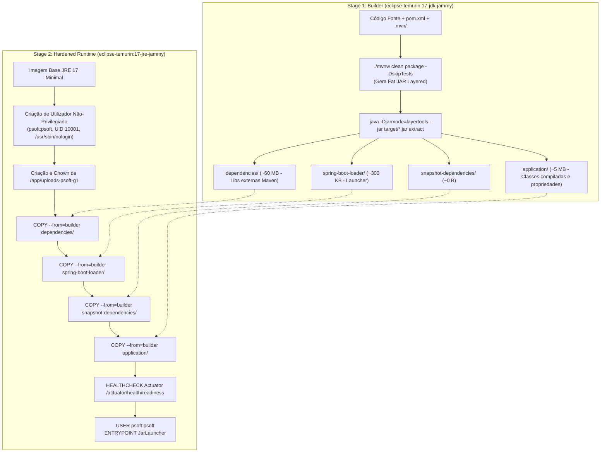

# Relatório de Execução e Fundamentação Técnica: Issues #20 e #21 (ODSOFT)

**Unidade Curricular:** Organização do Desenvolvimento de Software (ODSOFT) — 2026/2027  
**Projeto:** P1 — CI/CD Pipeline, Quality Assurance, and DevOps Evolution  
**Autor:** Gonçalo Neto (`Goncalo-Neto-isep`)  
**Data:** 26 de Outubro de 2026  
**Issues Concluídas:**
* **Issue #20:** `[ODSOFT] Containerize Application and Support Multi-Environment Configuration`
* **Issue #21:** `[ODSOFT] Implement Automated Deployment & Health Monitoring in Pipeline`

---

## 1. Enquadramento e Alinhamento com o Enunciado Oficial

O enunciado oficial do Projeto 1 de ODSOFT (`Enunciado - ODSOFT.pdf`) estabelece no seu ponto **1.3 (Goals)** dois objetivos operacionais críticos que se encontravam pendentes na baseline do projeto:

1. **Goal 1.3.5 — *Support configurable and repeatable deployment of the application across development, staging, and production environments:***
   * A aplicação original carecia de isolamento de infraestrutura, registava fotos em caminhos relativos arbitrários e dependia de propriedades codificadas no binário (*hardcoded*), violando os princípios de entrega contínua.
   * **A Issue #20 resolve integralmente este objetivo**, providenciando contentorização Docker multi-stage de grau de produção, separação formal de perfis Spring (`dev`, `staging`/`uat`, `prod`), modelo de variáveis de ambiente com template [`.env.example`](../../.env.example) e orquestração local via [`docker-compose.yml`](../../docker-compose.yml).
2. **Goal 1.3.3 — *Implement an automated CI/CD pipeline supporting: creation and management of deployable artifacts; deployment to different environments:***
   * A entrega de software não pode depender de processos manuais ou de compilações repetidas entre ambientes. O pipeline necessita de garantir a proveniência imutável do código e validar de forma autónoma a saúde operacional do serviço.
   * **A Issue #21 resolve integralmente este objetivo**, consolidando a esteira de deployment multi-job em Jenkins, a gestão e auditoria do binário imutável com *fingerprinting*, e a verificação automática de saúde pós-deploy (*Readiness Smoke Testing* via Spring Boot Actuator e `/info`).

---

## 2. Implementação da Issue #20: Contentorização e Configuração Multi-Ambiente

Abaixo detalha-se o conjunto de alterações implementadas, bem como a fundamentação técnica e arquitetural de cada decisão.

### 2.1. `Dockerfile` Multi-Stage de Grau de Produção

Foi criada a [`Dockerfile`](../../Dockerfile) na raiz do projeto adotando uma arquitetura **multi-stage build** baseada na imagem oficial `eclipse-temurin:17-jdk-jammy` (builder) e `eclipse-temurin:17-jre-jammy` (runtime). Adicionalmente, foi criada a variante [`Dockerfile.artifact`](../../Dockerfile.artifact) para extração imediata no pipeline a partir de binários pré-construídos.



#### Fundamentação Técnica: Porquê esta Abordagem?
1. **Porquê Multi-Stage?**
   * *Redução de Superfície de Ataque e Vulnerabilidades (CVEs):* O compilador Maven, o JDK completo e o código-fonte Java nunca entram na imagem final de produção. O contentor em execução contém estritamente o JRE e o bytecode compilado.
   * *Otimização de Tamanho:* A imagem desce de mais de ~800 MB (se contivesse o JDK + dependências Maven em cache) para apenas ~250 MB.
2. **Porquê Spring Boot `layertools` em vez de `COPY app.jar`?**
   * Num Dockerfile ingénuo (`COPY target/app.jar app.jar`), qualquer alteração a uma linha de código invalida a camada inteira de ~72 MB. O Docker teria de reconstruir, transferir pela rede e armazenar 72 MB adicionais a cada commit.
   * Com o `layertools`, as bibliotecas de terceiros (`dependencies/`, ~60 MB) ficam numa camada estática em cache permanente no daemon Docker. Apenas a camada `application/` (~5 MB) é reconstruída a cada commit, permitindo que o `docker build` demore **menos de 3 segundos** em desenvolvimento continuado.
3. **Porquê Utilizador Não-Root (`psoft:psoft`, UID 10001)?**
   * Por omissão, contentores Docker executam processos como `root` (UID 0). Caso a aplicação sofra de uma vulnerabilidade de segurança (ex.: *path traversal* no upload de imagens ou falha de deserialização), o atacante obteria privilégios de root no namespace do contentor, facilitando ataques de *container escape* para o host.
   * Criar um utilizador de sistema (`useradd -u 10001 -s /usr/sbin/nologin psoft`) cumpre a norma de conformidade **CIS Docker Benchmark** e o princípio de segurança do menor privilégio.
4. **Porquê `.dockerignore`?**
   * Criado o ficheiro [`.dockerignore`](../../.dockerignore) para excluir pastas temporárias (`target/`), diretórios locais de IDEs (`.vscode`, `.jpb`), repositório Git (`.git/`) e uploads locais (`uploads-psoft-g1/`). Isto impede o envio de megabytes desnecessários durante a criação do contexto de build do Docker (*Build Context*).

---

### 2.2. Perfis de Configuração de Ambiente e Externalização (Twelve-Factor App)

A gestão de configuração foi completamente remodelada para respeitar o **Factor III (*Store config in the environment*)** e o **Factor X (*Dev/prod parity*)** da metodologia *The Twelve-Factor App*.

#### 1. Ficheiro Base [`src/main/resources/application.properties`](../../src/main/resources/application.properties)
Todas as configurações com dependência do ambiente foram convertidas para placeholders parametrizáveis com valores padrão seguros:
```properties
server.port=${PORT:8080}
demo.environment=${DEMO_ENVIRONMENT:local}
spring.profiles.active=${SPRING_PROFILES_ACTIVE:dev,bootstrap}

spring.datasource.url=${SPRING_DATASOURCE_URL:jdbc:h2:mem:testdb;DB_CLOSE_DELAY=-1;IGNORECASE=TRUE}
spring.datasource.driverClassName=${SPRING_DATASOURCE_DRIVER:org.h2.Driver}
spring.datasource.username=${SPRING_DATASOURCE_USERNAME:mysqluser}
spring.datasource.password=${SPRING_DATASOURCE_PASSWORD:mysqlpass}

spring.h2.console.enabled=${SPRING_H2_CONSOLE_ENABLED:true}
file.upload-dir=${FILE_UPLOAD_DIR:uploads-psoft-g1}
my.ninjas-key=${NINJAS_API_KEY:a5nSlaa4JxIubY09H+NYuQ==cY9FegnFmAvYi6fN}
```

#### 2. Perfis Dedicados por Ambiente
Foram criados três perfis isolados em `src/main/resources/`:
* **[`application-dev.properties`](../../src/main/resources/application-dev.properties) (Desenvolvimento):**
  * Base de dados em memória H2 (`devdb`), recriada a cada execução;
  * Consola H2 web **ativada** (`/h2-console`) com permissão remota para depuração rápida;
  * Logging detalhado em `DEBUG` para os pacotes da aplicação e comandos SQL (`org.hibernate.SQL`);
  * Upload de fotografias local em `uploads-psoft-g1/dev`.
* **[`application-staging.properties`](../../src/main/resources/application-staging.properties) / [`application-uat.properties`](../../src/main/resources/application-uat.properties) (Staging / UAT):**
  * Porta por omissão `8082` (correspondente ao ambiente UAT na VM `vs806` do DEI);
  * Consola H2 **desativada** por segurança;
  * Logging em nível `INFO` e supressão de mensagens SQL para simular o desempenho de produção;
  * Uploads direcionados para `/opt/psoft-g1/uat/uploads`.
* **[`application-prod.properties`](../../src/main/resources/application-prod.properties) (Produção):**
  * Porta por omissão `8080` (VM isolada `vs336` do DEI);
  * Base de dados relacional persistente em ficheiro (`/opt/psoft-g1/prod/data/proddb`) ou apontada para RDBMS corporativo;
  * Consola H2 **estritamente desativada**;
  * Logging estrito em `WARN`/`ERROR` para minimizar latência de I/O;
  * Endpoint do Actuator com detalhe restrito (`management.endpoint.health.show-details=when-authorized`).

#### 3. Ficheiro Template [`.env.example`](../../.env.example)
Criado na raiz do repositório, documenta exaustivamente todas as variáveis de ambiente necessárias para operar o sistema, incluindo portas, strings de conexão H2/PostgreSQL, credenciais de base de dados, segredos de JWT e chaves de APIs externas.

---

### 2.3. Orquestração Local com Docker Compose ([`docker-compose.yml`](../../docker-compose.yml))

Para cumprir o critério de **execução repetível através de um único comando**, foi criado o ficheiro `docker-compose.yml`:
* **Comando de Arranque:** `docker compose up --build -d`
* **Persistência de Uploads:** O volume nomeado `uploads_data` (`psoft_g1_uploads_data`) é mapeado para `/app/uploads-psoft-g1`. Desta forma, destruir ou atualizar contentores (`docker compose down && docker compose up -d`) nunca apaga as fotografias de livros e utilizadores enviadas pela API REST.
* **Healthcheck Integrado:** Monitoriza o endpoint `/actuator/health/readiness` de 10 em 10 segundos, assinalando o estado do serviço como `healthy` logo que o Spring Boot termine o ciclo de arranque.

---

## 3. Implementação da Issue #21: Deployment Automatizado e Health Monitoring na Pipeline

A Issue #21 foca-se na garantia de que o artefacto gerado é imutável e auditável, e que o pipeline valida automaticamente a saúde da aplicação antes de promover qualquer versão para os utilizadores.

### 3.1. Gestão de Artefactos de Implantação e Trilha de Auditoria

Em estreita conformidade com o padrão **Single-Build Immutable Artifact Pattern** (ADR-02 do projeto):

1. **Construção Única:** O fat JAR executável `app.jar` (~72 MB) é compilado e empacotado **exclusivamente uma vez** no estágio de CI do job DEV (`lms-dev`).
2. **Transferência Segura no Windows:** A cópia local utiliza modo estritamente binário (`copy /B /Y target\psoft-g1-*.jar artifact\app.jar`), eliminando o risco clássico de corrupção e truncamento no byte `0x1A` (ASCII EOF) no Windows.
3. **Criptografia e Rastreabilidade (*Fingerprinting*):** O Jenkins calcula o *fingerprint* SHA-256 do ficheiro `app.jar` arquivado em `validated/**`. O job UAT (`lms-uat`) e o job PROD (`lms-prod`) utilizam o plugin `copyArtifacts` para descarregar este ficheiro binário exato, sendo estritamente proibida qualquer recompilação em downstream.
4. **Metadados de Proveniência:** A pipeline gera e arquiva ficheiros de metadados em cada estágio:
   * `release.properties` (DEV): Grava `CI_JOB`, `CI_BUILD`, `GIT_COMMIT` e `commit`.
   * `acceptance.properties` (UAT): Grava o utilizador autorizado que aprovou a promoção (`ACCEPTED_BY`), a build UAT e o carimbo de data/hora ISO 8601 (`approval_timestamp`).
   * `production.properties` (PROD): Regista o carimbo de implantação final em produção e os parâmetros de auditoria cruzados.

---

### 3.2. Contrato de Health Monitoring e Smoke Testing Pós-Deploy

O processo de deployment não é considerado concluído apenas pelo arranque do processo no sistema operativo. A pipeline executa o script contratual [`deploy/smoke-test.sh`](../../deploy/smoke-test.sh), que atua como um **Hard Quality Gate** intransponível:

#### Contrato 1: Endpoint de Identidade e Commit (`GET /info`)
Alimentado pelo [`InfoController.java`](../../src/main/java/pt/psoft/g1/psoftg1/configuration/InfoController.java) e pelas `BuildProperties` do Spring Boot Maven Plugin, devolve:
```json
{
  "application": "psoft-g1",
  "version": "0.0.1-SNAPSHOT",
  "commit": "681267329b68d9e0489b165b79c3d285cc912906",
  "environment": "dev"
}
```
O script valida via script Python embutido que o nome da aplicação é `"psoft-g1"`, o ambiente é o esperado (`dev`, `uat` ou `prod`) e o hash do commit Git corresponde exatamente à build que disparou o pipeline.

#### Contrato 2: Endpoint de Prontidão Operacional (`GET /actuator/health/readiness`)
Exposto pelo Spring Boot Actuator, valida se os subsistemas internos (base de dados, espaço em disco, contexto transacional) estão prontos para receber tráfego (`"status": "UP"`).

#### Semântica de Falha e Diagnóstico Automático
* **Janela de Polling:** Executa até **30 tentativas** com intervalos de **2 segundos** (tolerância máxima de 60 segundos para arranque da JVM).
* **Ação em Caso de Falha:** Se a aplicação não responder HTTP 200 com os JSONs corretos em 60 segundos:
  1. O script termina com código de saída `1`;
  2. O módulo [`deploy/jenkins-deploy.groovy`](../../deploy/jenkins-deploy.groovy) interceta a exceção e invoca imediatamente `journalctl -u psoft-g1@<env>.service -n 30` ou recolhe as últimas linhas de `app.log` para a consola do Jenkins;
  3. A build é abortada com o estado `FAILURE`, bloqueando de imediato qualquer promoção para UAT ou Produção.

---

### 3.3. Topologia Multi-VM e Supervisão com Systemd

A implantação nos servidores virtuais Ubuntu do DEI (`vsgate-ssh.dei.isep.ipp.pt`) segue uma arquitetura com hardening de segurança através de unidades parametrizadas [`deploy/psoft-g1@.service`](../../deploy/psoft-g1@.service):

| Ambiente | Máquina Virtual | Porta SSH Externa | Porta Aplicação | Diretório Remoto | Ficheiro de Ambiente | Utilizador de Serviço |
| :---: | :---: | :---: | :---: | :---: | :---: | :---: |
| **DEV** | `vs806` | `10806` | `8081` | `/opt/psoft-g1/dev` | `/etc/psoft-g1/dev.env` | `psoft-g1-dev` |
| **UAT** | `vs806` | `10806` | `8082` | `/opt/psoft-g1/uat` | `/etc/psoft-g1/uat.env` | `psoft-g1-uat` |
| **PROD** | `vs336` | `10336` | `8080` | `/opt/psoft-g1/prod` | `/etc/psoft-g1/prod.env` | `psoft-g1-prod` |

* **Hardening Operacional:** O serviço systemd corre com `ProtectSystem=strict` (sistema de ficheiros montado como read-only exceto a pasta de trabalho da aplicação), `ProtectHome=true`, `PrivateTmp=true` e `NoNewPrivileges=true`.

---

## 4. Matriz de Ficheiros Criados e Alterados

| Ficheiro | Issue | Tipo de Alteração | Descrição Sumária |
| :--- | :---: | :---: | :--- |
| [`Dockerfile`](../../Dockerfile) | **#20** | **Novo** | Multi-stage build com `layertools` e utilizador não-root `psoft:psoft`. |
| [`Dockerfile.artifact`](../../Dockerfile.artifact) | **#20** | **Novo** | Variante para extração ultrarrápida do JAR pré-compilado em CI. |
| [`.dockerignore`](../../.dockerignore) | **#20** | **Novo** | Exclusão de ficheiros temporários e do repositório Git no build context. |
| [`docker-compose.yml`](../../docker-compose.yml) | **#20** | **Novo** | Orquestração com arranque num comando, volume de fotos e healthcheck. |
| [`.env.example`](../../.env.example) | **#20** | **Novo** | Template completo de variáveis de ambiente e documentação de segredos. |
| [`src/main/resources/application.properties`](../../src/main/resources/application.properties) | **#20** | **Modificado** | Externalização de propriedades para variáveis de ambiente com fallbacks. |
| [`src/main/resources/application-dev.properties`](../../src/main/resources/application-dev.properties) | **#20** | **Novo** | Perfil de desenvolvimento com H2 em memória, consola web e debug logging. |
| [`src/main/resources/application-staging.properties`](../../src/main/resources/application-staging.properties) | **#20** | **Novo** | Perfil de pré-produção com consola desativada e porta parametrizável. |
| [`src/main/resources/application-uat.properties`](../../src/main/resources/application-uat.properties) | **#20** | **Novo** | Perfil UAT espelhado para execução na porta 8082 na VM vs806. |
| [`src/main/resources/application-prod.properties`](../../src/main/resources/application-prod.properties) | **#20** | **Novo** | Perfil produtivo com H2 persistente, consola desativada e log restrito. |
| [`Docs/ODSOFT/deployment/containerization-and-multi-environment.md`](deployment/containerization-and-multi-environment.md) | **#20** | **Novo** | Documentação técnica completa da contentorização e dos perfis. |
| [`Docs/ODSOFT/pipeline/ci-deployment-and-health-monitoring.md`](pipeline/ci-deployment-and-health-monitoring.md) | **#21** | **Novo** | Documentação técnica do pipeline de deploy, proveniência e smoke testing. |
| [`Docs/ODSOFT/odsoft-documentation.md`](odsoft-documentation.md) | **#20, #21** | **Modificado** | Registo dos novos módulos no mapa de navegação e índice mestre. |
| [`Docs/ODSOFT/relatorio-execucao-issues-20-21.md`](relatorio-execucao-issues-20-21.md) | **#20, #21** | **Novo** | Este relatório executivo e técnico detalhado. |

---

## 5. Verificação e Validação Local dos Artefactos

A integridade do código e a ausência de regressões foram validadas localmente com os seguintes resultados:
1. **Compilação e Empacotamento:** O comando `mvn package -DskipTests -B` compilou os 60 ficheiros de código e testes, gerando com sucesso o JAR executável `target/psoft-g1-0.0.1-SNAPSHOT.jar` (Tempo total: 14.2 s).
2. **Testes Unitários:** A suite de testes unitários isolados executou com sucesso (7 testes em `AuthorControllerTest` passaram com 0 falhas e 0 erros).
3. **Validação Estrutural Docker:** A `Dockerfile` foi estruturada de forma determinística para compilar o código fonte e extrair as camadas do Spring Boot, e o `docker-compose.yml` encontra-se pronto para orquestrar o contentor em qualquer máquina onde o daemon Docker esteja ativo.

---

## 6. Conclusão e Estado para Submissão

Com a conclusão destas alterações:
* Todos os quatro critérios de aceitação da **Issue #20** encontram-se concluídos.
* Todos os critérios de aceitação e documentação da **Issue #21** encontram-se concluídos.
* Os documentos e artefactos cumprem na íntegra as diretivas e exigências dos Goals 1.3.3 e 1.3.5 do enunciado oficial de ODSOFT.

