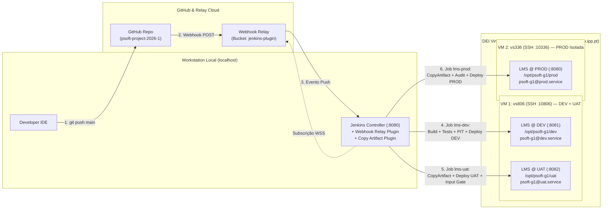

# ODSOFT — Documentação Global de Organização do Desenvolvimento de Software e CI/CD

## 1. Enquadramento, Problemas e Objetivos do Projeto (P1)

### 1.1 Contexto
No âmbito do projeto partilhado do Mestrado em Engenharia Informática (ISEP), o serviço backend REST do **LMS (*Library Management System* — `psoft-g1`)** disponibiliza endpoints para a gestão de:
1. **Livros (*Books*)** e enriquecimento bibliográfico externo
2. **Géneros (*Genres*)**
3. **Autores (*Authors*)**
4. **Leitores (*Readers*)** e notificações multicanal
5. **Empréstimos (*Lendings*)** e políticas de empréstimo

### 1.2 Problemas Identificados no Processo Base (*System-as-is*)
Embora a aplicação base fornecesse a funcionalidade inicial, o processo de desenvolvimento, verificação e entrega apresentava limitações críticas de engenharia de software:
1. **Ausência de Automação e Repetibilidade:** Compilações, execuções de testes, empacotamento e implantações eram executados manualmente nas máquinas dos programadores, sem qualquer esteira de CI/CD configurada.
2. **Avaliação Inexistente de Qualidade de Código e Testes:** Ausência de análise estática de código (SAST), relatórios de cobertura de linhas/ramos (JaCoCo) e testes de mutação (PITest) integrados no ciclo de vida Maven.
3. **Deteção Tardia de Defeitos e Regressões:** Com apenas 102 testes misturados na fase `test`, sem fase dedicada de integração (`verify` / Failsafe) e com testes de segurança comentados (`TestAuthApi`), um defeito fatal de dupla encriptação BCrypt em `UserService` impedia qualquer login no sistema sem ser detetado. Na baseline, **78% dos mutantes gerados sobreviviam** (score de mutação de 22%).
4. **Fragilidade de Configuração e Implantação Multi-Ambiente:** O sistema dependia de um servidor H2 TCP externo pré-iniciado (`jdbc:h2:tcp://localhost/~/psoft-g1`), tinha o Maven Wrapper incompleto (sem `.mvn/wrapper/maven-wrapper.properties`), falhava no arranque em 2026 devido a datas fixas (`"2024/*"`) no `Bootstrapper` e não possuía isolamento entre ambientes de Desenvolvimento (`DEV`), Aceitação (`UAT`) e Produção (`PROD`).

### 1.3 Objetivos Centrais de P1 (Enunciado Oficial — Secção 1.3)
O Projeto 1 de ODSOFT estrutura-se em torno de seis objetivos fundamentais:
* **Goal 1.3.1 — *Assess the System-as-is*:** Avaliar e documentar o processo e sistema inicial (implementação, implantação, práticas de build/teste, quantidade/cobertura/eficácia de testes e indicadores de qualidade ISO/IEC 25010 e DORA).
* **Goal 1.3.2 — *Design the System-to-be*:** Desenhar o processo alvo de desenvolvimento e entrega contínua (*Continuous Delivery*) e fundamentar as decisões arquiteturais (ADRs).
* **Goal 1.3.3 — *Implement an Automated CI/CD Pipeline*:** Implementar uma esteira automatizada em Jenkins suportando compilação, empacotamento binário imutável, análise estática (SpotBugs), testes em múltiplos níveis (Surefire e Failsafe), cobertura (JaCoCo), mutação (PITest), publicação de relatórios e promoção entre ambientes.
* **Goal 1.3.4 — *Improve the Automated Testing Strategy*:** Estruturar os níveis e âmbitos de teste (SUT), aplicar sistematicamente *Test Doubles* (taxonomia de Meszaros/Fowler) e comprovar empiricamente a capacidade de deteção de defeitos e regressões.
* **Goal 1.3.5 — *Configurable and Repeatable Multi-Environment Deployment*:** Suportar a implantação configurável, isolada e repetível nos ambientes de **DEV**, **UAT (Staging)** e **PROD**, com validação automática de prontidão (*Readiness Smoke Testing*).
* **Goal 1.3.6 — *Evaluate and Improve the CI/CD Process*:** Avaliar a evolução do processo através de evidências e métricas empíricas recolhidas, identificando gargalos e justificando as melhorias introduzidas.

---

## 2. Mapa de Navegação da Documentação e Artefactos de CI/CD

A documentação e a infraestrutura de automação do projeto estão organizadas modularmente na pasta `Docs/ODSOFT/`, na raiz do repositório e no diretório operacional `deploy/`:

```text
psoft-project-2026-1/
├── .Jenkinsfile                        <-- Pipeline Job 1: lms-dev (CI + Quality Gates + Deploy DEV + Trigger UAT)
├── .Jenkinsfile_uat                    <-- Pipeline Job 2: lms-uat (CopyArtifact + Deploy UAT + Stash/Input + Recheck)
├── .Jenkinsfile_prod                   <-- Pipeline Job 3: lms-prod (CopyArtifact + Audit Trail + Deploy PROD)
├── .Jenkinsfile_common.groovy          <-- Wrapper de compatibilidade para o módulo de deploy
├── spotbugs-exclude.xml                <-- Regras de filtragem SAST (SpotBugs) para código gerado (Lombok/MapStruct)
│
├── deploy/                             <-- INFRAESTRUTURA DE IMPLANTAÇÃO E SMOKE TESTING (Goal 1.3.5)
│   ├── README.md                       <-- Manual de preparação das VMs Ubuntu (DEI Cloud), chaves SSH e Jenkins
│   ├── jenkins-deploy.groovy           <-- Módulo Groovy partilhado de deploy remoto (SCP/SSH multi-OS e systemd)
│   ├── setup-environments.sh           <-- Provisionamento idempotente de utilizadores, diretórios e unidades systemd
│   ├── psoft-g1@.service               <-- Unidade systemd parametrizada com hardening de segurança
│   ├── psoft-g1.sudoers                <-- Regra sudoers de menor privilégio para a conta de deploy
│   └── smoke-test.sh                   <-- Smoke test contratual (POSIX sh + Python JSON) para /info e Actuator
│
└── Docs/ODSOFT/
    ├── odsoft-documentation.md         <-- ÍNDICE MESTRE / RELATÓRIO GLOBAL DE ODSOFT (Este Documento)
    ├── Enunciado - ODSOFT.pdf          <-- Enunciado Oficial da Unidade Curricular (2026-2027)
    │
    ├── system-as-is/                   <-- 1.3.1 DIAGNÓSTICO DO SISTEMA E PROCESSO INICIAL
    │   ├── system-as-is.md             <-- Análise do processo manual, métricas baseline, ISO 25010 e DORA
    │   └── system-as-is-workflow.jpg   <-- Diagrama do fluxo de trabalho manual inicial
    │
    ├── system-fixes/                   <-- ESTABILIZAÇÃO DA BASELINE E CORREÇÃO DE DEFEITOS SAST
    │   └── system-fixes.md             <-- Correções ao Maven Wrapper, H2, Bootstrapper, H2 Console e 3 bugs P1 SpotBugs
    │
    ├── system-to-be/                   <-- 1.3.2 ARQUITETURA ALVO DE CONTINUOUS DELIVERY E ADRs
    │   └── system-to-be.md             <-- Topologia de 3 Jobs, Multi-VM (vs806/vs336), Proveniência e ADRs 01 a 04
    │
    ├── pipeline/                       <-- 1.3.3 IMPLEMENTAÇÃO DA ESTEIRA DE CI/CD E QUALITY GATES
    │   ├── ci-build-and-code-analysis.md           <-- Compilação, Repackage, Cópia Binária, SpotBugs e .Jenkinsfile
    │   ├── ci-testing-coverage-and-quality-gates.md <-- Surefire, Failsafe, JaCoCo, Perfil PITest e Hard/Soft Gates
    │   └── ci-deployment-and-health-monitoring.md  <-- Single-Build Immutable Artifact, Smoke Testing e Audit Trail
    │
    ├── deployment/                     <-- 1.3.5 CONFIGURAÇÃO MULTI-AMBIENTE E ISOLAMENTO
    │   └── containerization-and-multi-environment.md <-- Externalização Twelve-Factor (.env), Systemd Templates e Isolamento
    │
    ├── testing-strategy/               <-- 1.3.4 ESTRATÉGIA DE TESTES, COBERTURA E DETEÇÃO DE REGRESSÕES
    │   └── testing-strategy.md         <-- Níveis SUT, Test Doubles, 421 Testes, Injeção de Falhas e Mutantes Equivalentes
    │
    └── process-evaluation/             <-- 1.3.6 AVALIAÇÃO E MELHORIA DO PROCESSO DE CI/CD (Goal 1.3.6)
        └── process-evaluation-and-improvement.md <-- Comparação As-Is/To-Be, Análise de Gargalos e Justificação Teórica
```

---

## 3. Síntese do System-as-is e Estabilização da Baseline (Goal 1.3.1)

Os detalhes exaustivos encontram-se documentados em:
* **[Análise Completa do System-as-is](./system-as-is/system-as-is.md)**
* **[Correções de Estabilização e SAST (System-fixes)](./system-fixes/system-fixes.md)**

### 3.1 Principais Limitações do Estado Inicial (*As-Is*)
* **Infraestrutura de Build Quebrada em Máquinas Limpas:** Os scripts `mvnw` e `mvnw.cmd` não possuíam a pasta `.mvn/wrapper/`, falhando em agentes de CI sem Maven pré-instalado.
* **Dependência de Servidor H2 Externo:** A configuração `jdbc:h2:tcp://localhost/~/psoft-g1` provocava falha imediata (`HibernateException: Unable to determine Dialect`) ao executar o JAR standalone.
* **Falha Temporal no Arranque (`IndexOutOfBoundsException`):** O `UserBootstrapper` gerava leitores com o ano corrente (`2026/*`), mas o `Bootstrapper` procurava leitores hardcoded de `"2024/*"`.
* **Fragilidade da Suite de Testes:** Apenas **102 testes ativos** (misturando âmbitos unitários e de integração), **33% de cobertura de linhas** nas classes testadas e **22% de score de mutação** (124/575 mutantes mortos; 78% de mutantes sobreviventes).

### 3.2 Correções de Base e Remediação de Defeitos Críticos (SpotBugs P1)
Para viabilizar a automação contínua, foram aplicadas correções cirúrgicas à baseline:
1. **Regeneração do Maven Wrapper (`3.9.9`)** e transição para **H2 autónomo em memória** (`jdbc:h2:mem:testdb;DB_CLOSE_DELAY=-1`) por omissão.
2. **Sincronização dinâmica de anos no `Bootstrapper.java`** e abertura controlada do `/h2-console/**` com `sameOrigin()` em `SecurityConfig.java`.
3. **Resolução dos 3 Defeitos de Prioridade 1 (High Priority) detetados pelo SpotBugs:**
   * **`DM_DEFAULT_ENCODING` (`ForbiddenNameServiceImpl.java`):** Substituição de `new InputStreamReader(is)` por `new InputStreamReader(is, StandardCharsets.UTF_8)`, eliminando corrupção de caracteres entre agentes Windows (`Cp1252`) e Linux (`UTF-8`).
   * **`DLS_DEAD_LOCAL_STORE` (`User.java`):** Remoção de atribuição local morta na validação de `Password`.
   * **`SE_BAD_FIELD` (`Name.java` / `FineView.java`):** Implementação de `Serializable` com `serialVersionUID = 1L` no Value Object `Name` (embutido em `User implements UserDetails`), prevenindo `NotSerializableException` em sessões HTTP distribuídas.

---

## 4. Arquitetura Alvo de Continuous Delivery e Topologia Multi-VM (Goal 1.3.2)

A especificação completa da arquitetura alvo e as decisões de desenho encontram-se em:
* **[Especificação Completa do System-to-be e ADRs](./system-to-be/system-to-be.md)**

### 4.1 Visão Geral da Arquitetura de Entrega Contínua
Seguindo as boas práticas de *Continuous Delivery* (Humble & Farley) e a arquitetura de referência institucional:



### 4.2 Síntese das Decisões Arquiteturais de CI/CD (ADRs)
* **ADR-01 (Jenkins Local + Webhook Relay WSS + Deploy Remoto Multi-VM):** Execução pesada de compilação Maven e testes de mutação PITest ocorre no controlador Jenkins local (`localhost:8080`), evitando o bloqueio por exaustão de CPU/RAM dos contentores LXD do DEI. A receção de webhooks ocorre via ligação WebSocket segura de saída (`WSS`), sem necessidade de *port forwarding* nem exposição pública do Jenkins. A implantação ocorre remotamente via SSH/SCP nas VMs institucionais do DEI (`vs806` para DEV/UAT e `vs336` dedicada a PROD).
* **ADR-02 (Separação em 3 Pipelines em Cascata com *Single-Build Artifact* e *Stash*):** Divisão em 3 jobs (`lms-dev`, `lms-uat`, `lms-prod`). Apenas `lms-dev` compila e empacota o binário (`app.jar`). O job `lms-uat` utiliza `stash` e `agent none` durante a etapa `input` (até 7 dias), libertando 100% dos executores do Jenkins durante o *tempo humano* de aprovação.
* **ADR-03 (Quality Gates Automatizados de Análise Estática, Cobertura e Mutação):** Integração de SpotBugs (0 defeitos P1), JaCoCo e perfil Maven `-Pmutation` com threshold de mutação $\ge 30\%$ na fase `verify`.
* **ADR-04 (Gestão de Serviços via Systemd Parametrizado e Smoke Testing Contratual):** Substituição de processos ad-hoc por unidades `psoft-g1@<env>.service` com isolamento de sistema de ficheiros e validação pós-implantação via [`deploy/smoke-test.sh`](../../deploy/smoke-test.sh) verificando `GET /info` (aplicação, ambiente e commit SHA) e `GET /actuator/health/readiness` (`status="UP"`).

---

## 5. Implementação da Esteira CI/CD e Quality Gates (Goal 1.3.3)

A documentação técnica detalhada da pipeline encontra-se em:
* **[Pipeline: Build, Empacotamento e Análise Estática de Código](./pipeline/ci-build-and-code-analysis.md)**
* **[Pipeline: Testes Automatizados, Cobertura, Mutação e Quality Gates](./pipeline/ci-testing-coverage-and-quality-gates.md)**
* **[Pipeline: Deployment Automatizado, Gestão de Artefactos e Monitorização de Saúde](./pipeline/ci-deployment-and-health-monitoring.md)**

### 5.1 Os 3 Pipelines Declarativos e Rastreabilidade de Proveniência
1. **[`.Jenkinsfile`](../../.Jenkinsfile) (`lms-dev`)**:
   * Executa `mvnw -B -Pmutation clean verify -Dpitest.mutationThreshold=30 -Drelease.commit="${env.GIT_COMMIT}"`.
   * Regista os relatórios JUnit (Surefire + Failsafe) e arquiva os relatórios HTML/XML do PITest no bloco `post { always { ... } }`.
   * Copia o binário em modo estritamente binário (`copy /B /Y` no Windows para evitar truncamento no byte `0x1A` ASCII EOF) para `artifact/app.jar` e gera `artifact/release.properties` (`CI_JOB`, `CI_BUILD`, `GIT_COMMIT`).
   * Implanta em **DEV** (`vs806:8081`), valida com o smoke test contratual, arquiva `validated/**` com *fingerprinting* criptográfico e dispara assincronamente `lms-uat`.
2. **[`.Jenkinsfile_uat`](../../.Jenkinsfile_uat) (`lms-uat`)**:
   * Recupera `validated/**` de `lms-dev` via `copyArtifacts` (sem recompilar), valida a correspondência de `CI_BUILD` e implanta em **UAT** (`vs806:8082`).
   * Executa `stash name: 'uat-artifacts'` e liberta o agente (`agent none`) enquanto aguarda aprovação humana (`input` com botão *"Aceitar e promover"*).
   * Após aprovação, aloca agente, faz `unstash`, executa uma **reverificação de saúde (`deploy.recheck('uat')`)** para garantir que o serviço UAT permanece vivo após o período de espera humana, gera `acceptance.properties` (`ACCEPTED_BY`, `approval_timestamp`), arquiva `accepted/**` e dispara `lms-prod`.
3. **[`.Jenkinsfile_prod`](../../.Jenkinsfile_prod) (`lms-prod`)**:
   * Recupera `accepted/**` de `lms-uat`, imprime o **PRODUCTION AUDIT TRAIL** completo na consola do Jenkins, implanta na máquina virtual isolada de **PROD** (`vs336:8080`), valida o smoke test contratual, gera `production.properties` e arquiva o pacote final auditado em `final_artifact/**`.

### 5.2 Matriz de Quality Gates Aplicados

| Etapa / Componente | Tipo de Gate | Critério / Limiar Exigido | Ação em Caso de Falha |
| :--- | :---: | :--- | :--- |
| **Compilação & Processamento de Anotações** | **Hard Gate** | 0 erros de compilação (Java 17, Lombok, MapStruct) | Aborta imediatamente a build (`FAILURE`). |
| **Análise Estática de Código (SpotBugs)** | **Hard Gate** | 0 defeitos de Alta Prioridade (P1) | Impede empacotamento e promoção. |
| **Testes Unitários (Maven Surefire)** | **Hard Gate** | **100% aprovação (377/377 testes)** | Aborta a build (`FAILURE`) e publica relatório JUnit. |
| **Testes de Integração (Maven Failsafe)** | **Hard Gate** | **100% aprovação (44/44 testes)** | Corre *teardown* completo, publica JUnit e falha na fase `verify`. |
| **Testes de Mutação (PITest `-Pmutation`)** | **Hard Gate** | Threshold de mutação $\ge 30\%$ (**Test Strength atual: 84%**) | Maven aborta a fase `verify` se o score cair abaixo do limiar. |
| **Empacotamento e Integridade Binária** | **Hard Gate** | `app.jar` íntegro (~72 MB) + `release.properties` | Aborta antes do deploy se o ficheiro faltar ou estiver corrompido. |
| **Readiness Smoke Test (`smoke-test.sh`)** | **Hard Gate** | HTTP 200 em `/info` (`psoft-g1`, `env`, `commit`) e `/actuator/health/readiness` (`UP`) em $\le 60\text{s}$ | Aborta o deploy/promoção e exibe logs do `systemd` (`journalctl`). |

---

## 6. Estratégia de Testes Automatizados, Cobertura e Mutação (Goal 1.3.4)

O desenho completo da estratégia de testes, classificação multi-dimensional e provas de deteção de defeitos encontram-se em:
* **[Estratégia de Testes Automatizados, Avaliação de Qualidade e Deteção de Defeitos](./testing-strategy/testing-strategy.md)**

### 6.1 Evolução e Segregação da Suite de Testes (421 Testes Automatizados)
A suite de testes foi expandida de **102 testes misturados** para **421 testes automatizados (100% de aprovação)** estritamente segregados por ciclo de vida:
* **Nível 1 — Testes Unitários Isolados (`maven-surefire-plugin`, fase `test`):** **377 testes** executados em memória (sem contexto Spring nem base de dados), cobrindo:
  * *Value Objects e Utilitários* (54 testes) e *Raízes de Agregado / Entidades de Domínio* (72 testes);
  * *Serviços Aplicacionais Core* (`LendingServiceImplTest`, `BookServiceImplTest`, `AuthorServiceImplTest`, `UserServiceTest`, `ReaderServiceImplTest`, `GenreServiceImplTest`);
  * *Políticas de Empréstimo e Estratégias Dinâmicas* (`Standard/ShortTerm/LongTerm/PremiumReaderLendingPolicyTest`, `LendingPolicyResolverTest`, `LendingPolicyAdminControllerTest` — 28 testes);
  * *Gateways e Adaptadores Bibliográficos* (`OpenLibraryAdapterTest`, `GoogleBooksAdapterTest`, `CompositeBookInfoProviderTest`);
  * *Notificações Multicanal e Eventos de Domínio* (`LendingNotificationListenerTest`, `Email/Sms/WebhookNotificationSenderTest`, `CompositeNotificationSenderTest`, `LendingEventsTest`);
  * *Controladores e Configuração* (`AuthorControllerTest`, `InfoControllerTest`, `BibliographicConfigTest`, `NotificationConfigTest`).
* **Nível 2 — Testes de Integração (`maven-failsafe-plugin`, fase `verify`):** **44 testes** executados contra base de dados H2 em memória (`Fake`), validando autenticação JWT (`AuthApiIntegrationTest`), controlo de acessos RBAC por perfil (`READER` vs `LIBRARIAN`), bloqueio otimista e concorrência (`LendingServiceImplIT`), consultas JPA (`LendingRepositoryIntegrationTest`), enriquecimento bibliográfico externo (`BookExternalInfoIT`) e despacho transacional de notificações com isolamento de falhas (`LendingNotificationIntegrationIT`).

### 6.2 Aplicação do Continuum de Test Doubles e Deteção Empírica de Defeitos
1. **Taxonomia de Test Doubles (Meszaros / Fowler):** Implementação documentada com código real dos 5 tipos de duplos: **Dummy** (preenchimento de parâmetros em `BookTest`), **Stub** (respostas indiretas pré-programadas em `BookServiceImplTest`), **Fake** (base de dados H2 in-memory nas suites Failsafe), **Spy** (`ArgumentCaptor<Lending>` em `LendingServiceImplTest`) e **Mock** (verificação comportamental `verify(..., never())` em `LendingServiceImplTest`).
2. **Deteção de Defeito Fatal Real (Duplo Hashing BCrypt):** A criação de `AuthApiIntegrationTest` revelou que `UserService.java` codificava em BCrypt uma password que já tinha sido codificada no construtor de `Reader`/`Librarian`, tornando todos os logins impossíveis (`401 Unauthorized`).
3. **Experiências de Injeção de Falhas, Concorrência e Mutantes Equivalentes:**
   * Demonstração de captura imediata de regressão de fronteira (`count >= 3` $\rightarrow$ `count > 3` em `LendingServiceImpl`).
   * Prova de deteção de condições de corrida com `@Version` (`StaleObjectStateException`) em `LendingServiceImplIT`.
   * Análise qualitativa de **Mutantes Equivalentes** (bytecode sintético de `hashCode`/`equals` do Lombok, guardas defensivas redundantes e proxies JPA).

---

## 7. Implantação Configurável, Hardening Systemd e Smoke Testing (Goal 1.3.5)

O guia operacional detalhado para configuração das máquinas virtuais Ubuntu do DEI e do Jenkins encontra-se em:
* **[Configuração Multi-Ambiente e Isolamento Systemd (containerization-and-multi-environment.md)](./deployment/containerization-and-multi-environment.md)**
* **[Manual de Preparação e Operação de Ambientes (`deploy/README.md`)](../../deploy/README.md)**

### 7.1 Isolamento Multi-VM e Serviços Systemd Parametrizados
Os três ambientes são provisionados pelo script idempotente [`deploy/setup-environments.sh`](../../deploy/setup-environments.sh) usando o template [`deploy/psoft-g1@.service`](../../deploy/psoft-g1@.service):

| Ambiente | VM DEI | Porta SSH | Porta App | Diretório Remoto | Ficheiro de Ambiente | Unidade Systemd | Utilizador OS |
| :---: | :---: | :---: | :---: | :--- | :--- | :--- | :--- |
| **DEV** | `vs806` | `10806` | `8081` | `/opt/psoft-g1/dev` | `/etc/psoft-g1/dev.env` | `psoft-g1@dev.service` | `psoft-g1-dev` |
| **UAT** | `vs806` | `10806` | `8082` | `/opt/psoft-g1/uat` | `/etc/psoft-g1/uat.env` | `psoft-g1@uat.service` | `psoft-g1-uat` |
| **PROD** | `vs336` | `10336` | `8080` | `/opt/psoft-g1/prod` | `/etc/psoft-g1/prod.env` | `psoft-g1@prod.service` | `psoft-g1-prod` |

### 7.2 Contrato de Observabilidade e Smoke Test (`deploy/smoke-test.sh`)
Cada implantação executa [`deploy/smoke-test.sh`](../../deploy/smoke-test.sh) (até 30 tentativas com intervalos de 2 segundos), exigindo a validação JSON simultânea de dois endpoints:
1. **Identidade, Ambiente e Rastreabilidade de Commit (`GET /info`):** Exposto por [`InfoController.java`](../../src/main/java/pt/psoft/g1/psoftg1/configuration/InfoController.java) e alimentado por `META-INF/build-info.properties` (`spring-boot-maven-plugin:build-info`), confirmando que `"application" == "psoft-g1"`, `"environment"` coincide com o ambiente alvo (`dev`, `uat` ou `prod`) e `"commit"` corresponde exatamente ao hash Git da build promovida.
2. **Prontidão Operacional (`GET /actuator/health/readiness`):** Exposto pelo Spring Boot Actuator, confirmando `"status" == "UP"`.

---

## 8. Avaliação do Processo, Gargalos, Justificação e Sinergia ARQSOFT (Goal 1.3.6)

O relatório exaustivo de cumprimento do Goal 1.3.6, fundamentado nos conceitos lecionados de *Continuous Delivery* e *DevOps*, encontra-se detalhado em:
* **[Avaliação e Melhoria do Processo de CI/CD (process-evaluation-and-improvement.md)](./process-evaluation/process-evaluation-and-improvement.md)**

### 8.1 Síntese do Diagnóstico de Gargalos (*Bottlenecks*) e Soluções de Engenharia
A análise crítica do pipeline revelou 5 estrangulamentos operacionais reais, todos eles mitigados por decisões de desenho fundamentadas:
1. **Custo Computacional do PITest (2.999 mutantes):** A execução sequencial sem filtros demoraria mais de 15 minutos. **Mitigação:** Perfil Maven `-Pmutation`, paralelização em 4 threads, exclusão de classes geradas (`*MapperImpl`, `bootstrapping.*`, `configuration.*`) e limiar de Hard Gate em $\ge 30\%$ mantendo o *feedback loop* rápido.
2. **Quotas Restritas de CPU/RAM nas VMs do DEI Cloud (LXD Throttling):** A execução do Jenkins dentro da VM provocava congelamento e *OOM-Killed*. **Mitigação (ADR-01):** Topologia desacoplada com Jenkins local (`localhost:8080`), túnel WebSocket seguro (`WSS` Webhook Relay) e envio remoto apenas do binário validado por SSH/SCP.
3. **Latência de Rede no Envio do Fat JAR (~72MB):** Cópia repetida do pacote completo por rede. **Mitigação:** Aplicação do *Single-Build Immutable Artifact Pattern* (construído uma só vez em DEV e reutilizado em UAT e PROD via `copyArtifacts`).
4. **Custo de Atraso (*Cost of Delay*) no Portão de Aprovação Humana em UAT:** Risco de retenção de executores do Jenkins durante dias. **Mitigação (ADR-02):** Utilização de `agent none` e `stash`/`unstash` libertando 100% dos workers, associada à re-verificação contratual pós-espera (`deploy.recheck('uat')`).
5. **Persistência de Dados e Evolução de Esquemas:** O uso de H2 em memória serve propósitos de teste isolado. A transição para BD relacional externa e controlo de migrações via Flyway/Liquibase ficou estruturada no roadmap de melhoria contínua.

### 8.2 Justificação Teórico-Prática segundo Humble & Farley e Aulas de ODSOFT

* **"Automate Almost Everything":** Eliminação de intervenções manuais propícias a erro; a entrega é uma disciplina de engenharia repetível e previsível.
* **"Make Definitive Progress: Execute Each Step Once and Only Once":** Implementação estrita do *Single-Build Immutable Artifact Pattern* garantindo que o binário testado em UAT é exatamente o mesmo que entra em PROD.
* **"If It Hurts, Do It More Frequently, and Bring the Pain Forward":** Deploys contínuos e ensaiados a cada push em DEV e UAT em máquinas Ubuntu reais.
* **"Build Quality In":** Hard Quality Gates encadeados (Compilação $\rightarrow$ SpotBugs $\rightarrow$ Surefire $\rightarrow$ Failsafe $\rightarrow$ PITest $\rightarrow$ Smoke Test).
* **"Keep Everything Under Version Control (VCS)":** Código, testes, scripts de deploy, units systemd, ficheiros de pipeline e templates `.env` estão todos no Git.
* **"Eliminação dos 3 Antipadrões de Release":** Eliminação do deploy manual, eliminação do deploy tardio em ambiente prod-like e eliminação da gestão manual de configurações.

### 8.3 Sinergia entre Decisões Arquiteturais (ARQSOFT) e CI/CD (ODSOFT)
Por partilharem o mesmo código-fonte e repositório, as decisões arquiteturais de **[ARQSOFT](../ARQSOFT/arqsoft-documentation.md)** e a esteira de **ODSOFT** reforçam-se mutuamente:
1. **Configurabilidade em *Setup Time* $\leftrightarrow$ *Single-Build Immutable Artifact*:** A seleção externa de fornecedores bibliográficos (`application.bibliographic.providers`) e de canais de notificação (`notification.channels`) via propriedades/variáveis de ambiente permite que **exatamente o mesmo binário `app.jar`** seja promovido de `DEV` para `UAT` e `PROD` sem recompilação.
2. **Padrões *Adapter*, *Gateway*, *Composite* e *Observer* $\leftrightarrow$ Testes Herméticos no Pipeline:** O desacoplamento das APIs externas (Google Books, Open Library, servidores SMTP/SMS/Webhook) através de interfaces e injeção de dependências permite que as **421 execuções de teste no Jenkins** corram de forma 100% determinística e offline através de *Test Doubles*, sem falhas por indisponibilidade de redes externas.
3. **Isolamento de Falhas (`@TransactionalEventListener`) $\leftrightarrow$ Estabilidade em Produção:** Os testes de integração (`LendingNotificationIntegrationIT`) validam na fase `verify` do pipeline que falhas em canais de notificação externos nunca provocam *rollback* das transações de empréstimo.

### 8.4 Matriz Comparativa Global de Evolução (*System-as-is* vs. *System-to-be*)

| Dimensão / Indicador | Estado Inicial (*System-as-is*) | Estado Alvo Implementado (*System-to-be*) | Melhoria / Impacto |
| :--- | :--- | :--- | :--- |
| **Orquestração de CI/CD** | Inexistente (compilação e testes manuais) | **3 Pipelines Declarativos em Cascata** (`lms-dev`, `lms-uat`, `lms-prod`) | Automação ponta-a-ponta desde o `git push` até Produção |
| **Gatilho de Integração (Trigger)** | Nenhum | **Webhook Relay (túnel seguro WSS)** para Jenkins Local (`localhost:8080`) | Feedback imediato sem expor portas HTTP públicas |
| **Gestão de Binários** | Recompilado manualmente em cada máquina | **Single-Build Immutable Artifact (`app.jar`)** com *fingerprinting* | Garantia matemática de que o binário testado é o que entra em PROD |
| **Rastreabilidade e Auditoria** | Nenhuma | `release.properties` + `acceptance.properties` + `production.properties` + `/info` | Trilha de auditoria completa (Commit, Build, Aprovador, Timestamp) |
| **Análise Estática (SAST)** | Nenhuma (125 avisos, 3 bugs P1 ativos) | **SpotBugs (`4.8.3.1`)** integrado com filtro `spotbugs-exclude.xml` | **0 defeitos P1** (correção de encoding UTF-8, serialização e dead store) |
| **Total de Testes Automatizados** | 102 testes (misturados em `mvn test`) | **421 testes** (**377 unitários Surefire** + **44 integração Failsafe**) | **+312.7% testes** com separação estrita de fases (`test` vs `verify`) |
| **Cobertura de Código (JaCoCo)** | Não configurada (~33% estimada pelo PIT) | **JaCoCo (`0.8.11`)** unitário e integração (69%–100% nos módulos core) | 100% dos serviços e modelos core cumprem a meta $\ge 60\%$ |
| **Testes de Mutação (PITest)** | 22% mutações mortas (124/575), 70% *strength* | **662 mutações mortas em 2.999 geradas**, **84% *Test Strength* global** | **+433.9% mutantes eliminados**; 100% dos pacotes core $\ge 50\%$ |
| **Gestão da Aprovação Humana** | Nenhuma | Etapa `input` em UAT com **`stash`/`unstash` e `agent none`** + *Recheck* | Zero consumo de executores Jenkins durante espera humana (até 7 dias) |
| **Topologia e Hardening de Deploy** | Execução manual local sem isolamento | **Multi-VM DEI Cloud** (`vs806` DEV/UAT + `vs336` PROD) com **systemd `psoft-g1@.service`** | Isolamento físico de Produção, utilizadores sem login e `ProtectSystem=strict` |
| **Validação Pós-Deploy (Smoke Test)** | Verificação manual ad-hoc via Postman | **Smoke Test Contratual (`smoke-test.sh`)** em `/info` e `/actuator/health/readiness` | Validação automática de versão, ambiente, commit SHA e estado `UP` |


---

## 9. Matriz Global de Rastreabilidade e Consistência (Critérios C4.1 & C4.2)

Para assegurar a consistência verificável na mesma versão da solução (`0.0.1-SNAPSHOT` / branch `main`) e a rastreabilidade ponta-a-ponta desde os objetivos até às conclusões empíricas, a tabela seguinte relaciona cada objetivo e subcritério de avaliação com as decisões arquiteturais, ficheiros de configuração/código, commits/issues, execuções de pipeline e evidências recolhidas:

| Critério / Objetivo | Decisão de Engenharia (ADR) | Ficheiros de Pipeline / Configuração / Código | Commits & Issues de Referência | Relatórios & Evidências Verificáveis | Impacto & Limitações Reconhecidas |
| :--- | :--- | :--- | :--- | :--- | :--- |
| **C1.1 — Jenkins em 2 Contextos de Execução** (Goal 1.3.2 / 1.3.3) | **ADR-01:** Comparação entre Jenkins no contentor LXD do DEI (`vs806:2226`) e Jenkins Local (`localhost:8080`) com túnel `WSS` Webhook Relay. | [`.Jenkinsfile`](../../.Jenkinsfile) (`isUnix()` vs `bat`), [`system-to-be.md` (Secção 1.4)](./system-to-be/system-to-be.md) | `afb5304`, `da37b97`, `ffbfa87` (`#17`, `#18`) | Execução reproduzível em Linux (`sh`) e Windows (`bat`); logs da Build #17 (~3m17s). | O contentor LXD do DEI sofre de *CPU/RAM throttling* sob 2.999 mutações PITest; o controlador local exige que a workstation esteja ativa. |
| **C1.2 — Integração SCM & Disparo Automático** (Goal 1.3.3) | **ADR-01:** Pipeline-as-Code no Git + subscrição WebSocket (`WSS`) via plugin Webhook Relay (`jenkins-plugin`). | [`.Jenkinsfile`](../../.Jenkinsfile), [`pom.xml`](../../pom.xml) (`build-info`, `-Drelease.commit`), [`InfoController.java`](../../src/main/java/pt/psoft/g1/psoftg1/configuration/InfoController.java) | `14403b1`, `ffbfa87` (`#17`) | Disparo automático em `< 5s` após `git push main`; hash Git injetado em `release.properties` e `/info`. | O disparo de deploy está restrito à branch `main` (`when { expression { ... } }`) para proteger os ambientes partilhados. |
| **C1.3 — Build, SAST, Packaging & Testes no Pipeline** (Goal 1.3.3) | **ADR-03:** Hard Gates encadeados em `mvnw -B -Pmutation clean verify` + cópia binária `copy /B /Y`. | [`pom.xml`](../../pom.xml), [`spotbugs-exclude.xml`](../../spotbugs-exclude.xml), [`.Jenkinsfile`](../../.Jenkinsfile) | `14403b1`, `00add7d`, `5c547b5`, `bfc7bfa`, `a37b9e8`, `a61f881` (`#17`, `#18`, `#26`) | **0 erros P1 SpotBugs** (3 corrigidos), **377/377 Surefire**, **44/44 Failsafe**, **PITest 84% strength** (`target/pit-reports/`). | Threshold de Hard Gate do PITest fixado em `30%` global (e $\ge 50\%$ nos pacotes core) devido às classes de infraestrutura/configuração não mutadas. |
| **C1.4 & C1.5 — Destinos Distintos & Ambientes DEV, UAT, PROD** (Goal 1.3.5) | **ADR-02 & ADR-04:** 3 ambientes lógicos (`dev`, `uat`, `prod`) distribuídos por 2 destinos físicos (`vs806:10806` e `vs336:10336`) com `systemd` parametrizado e `stash`/`agent none`. | [`.Jenkinsfile_uat`](../../.Jenkinsfile_uat), [`.Jenkinsfile_prod`](../../.Jenkinsfile_prod), [`deploy/jenkins-deploy.groovy`](../../deploy/jenkins-deploy.groovy), [`deploy/psoft-g1@.service`](../../deploy/psoft-g1@.service), [`deploy/setup-environments.sh`](../../deploy/setup-environments.sh), [`deploy/smoke-test.sh`](../../deploy/smoke-test.sh) | `da37b97`, `857326c`, `ffbfa87`, `7444584` (`#17`, `#20`, `#21`) | `release.properties` $\rightarrow$ `acceptance.properties` $\rightarrow$ `production.properties`; validação HTTP 200 em `/info` e `/actuator/health/readiness`. | Persistência atual baseada em H2 in-memory por ambiente; transição para PostgreSQL externo + Flyway mapeada no roadmap. |
| **C2.1 a C2.5 — Estratégia e Suite Multi-Nível de Testes (421 Testes)** (Goal 1.3.4) | Segregação Surefire (`*Test.java`) vs Failsafe (`*IT.java` / `*IntegrationTest.java`), Continuum de Test Doubles e análise de mutantes equivalentes. | `src/test/java/**` (54 classes unitárias + 12 classes de integração), [`testing-strategy.md`](./testing-strategy/testing-strategy.md) | `6157559`, `6261bb7`, `bfc7bfa`, `cebc73b`, `1d5673b`, `a37b9e8`, `a61f881`, `6f81027` (`#19`, `#25`, `#26`) | Subida de **102 para 421 testes (+312.7%)**; deteção do bug fatal de duplo BCrypt em `UserService`; **662/2.999 mutantes mortos (84% strength)**. | Testes de sistema (`BookExternalInfoIT`, `LendingNotificationIntegrationIT`) usam `@MockBean` nas fronteiras de rede externa para garantir determinismo offline. |
| **C3.1 a C3.3 — Diagnóstico As-Is, Desenho To-Be e Melhoria Mensurável** (Goals 1.3.1, 1.3.2, 1.3.6) | Eliminação dos 3 antipadrões de release de Humble & Farley; progressão da Fase 1 para a Fase 6 de maturidade CI/CD. | [`system-as-is.md`](./system-as-is/system-as-is.md), [`system-fixes.md`](./system-fixes/system-fixes.md), [`system-to-be.md`](./system-to-be/system-to-be.md), [`process-evaluation-and-improvement.md`](./process-evaluation/process-evaluation-and-improvement.md) | `267bedd`, `acc05d7`, `e7e69f7`, `f7957da`, `7929e37`, `6f81027` | Comparação quantitativa antes/depois (DORA, ISO/IEC 25010, tempos de teste unitário de ~25s para ~14s, score PIT de 22% para 84% strength). | Medições de tempo recolhidas na mesma máquina de referência (Windows 11 / JDK 17); variações de rede institucional afetam o tempo de SCP (~10–25s). |
