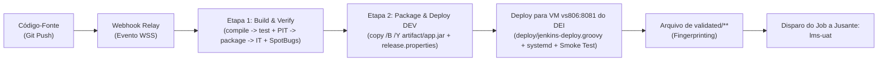

# Pipeline de CI/CD: Compilação, Empacotamento e Análise Estática de Código

## 1. Visão Geral e Âmbito (Goal 1.3.3)

Em conformidade com o Goal 1.3.3 do Projeto 1 (*Implement an automated CI/CD pipeline*), este documento especifica o desenho arquitetural e a implementação operacional de:
1. **Compilação e Empacotamento do Software:** Compilação determinística, geração de bytecode e empacotamento de JAR executável Spring Boot respeitando o **Single-Build Immutable Artifact Pattern** (*One Build, Many Deploys*).
2. **Análise Estática de Código (SAST):** Inspeção automatizada de código-fonte e bytecode com o **SpotBugs** (vinculado à fase de ciclo de vida `verify`) para identificar vulnerabilidades de segurança, anomalias de concorrência e falhas de qualidade.
3. **Orquestração de Pipeline Declarativo Jenkins:** Pipeline-as-Code declarativo ([`.Jenkinsfile`](../../../.Jenkinsfile)) que comanda a esteira **`lms-dev`** num Controlador Jenkins local (`localhost:8080`), integrado com o GitHub via **Webhook Relay** (túnel WebSocket de saída `WSS`) e direcionado para a **Cloud Privada de Servidores Virtuais do DEI (`vsgate-ssh.dei.isep.ipp.pt`)** para deployment remoto automatizado.

---

## 2. Estratégia Automatizada de Compilação e Empacotamento

### 2.1. Limitações do Processo Inicial (*As-Is*)
Conforme analisado em [`Docs/ODSOFT/system-as-is/system-as-is.md`](../system-as-is/system-as-is.md):
* A compilação de software era executada manualmente nas estações de trabalho dos programadores (`mvn clean compile`), sujeita a discrepâncias ambientais e incompatibilidades de JDK (ex.: falhas no processamento de anotações em versões não-LTS).
* O empacotamento dependia de execuções ad-hoc de `mvn clean package`, transferindo JARs não verificados para servidores de destino via SSH/FTP sem cálculo de hash criptográfico, registos de auditoria ou rastreabilidade.
* Os binários eram repetidamente recompilados para cada ambiente, violando diretamente o **princípio fundamental de Continuous Delivery: Compilar binários apenas uma vez** (Jez Humble & David Farley).

### 2.2. Ciclo de Vida Alvo de Compilação e Empacotamento (*To-Be*)

O processo automatizado recorre ao Maven Wrapper (`./mvnw` / `mvnw.cmd`) com OpenJDK 17/21 num ciclo de vida padronizado:



#### 2.2.1. Compilação e Processamento de Anotações (`compile`)
* **Execução:** Executado de forma determinística como parte de `mvnw -B -Pmutation clean verify -Djacoco.dataFile=target/jacoco.exec -Djacoco-it.dataFile=target/jacoco-it.exec -Dpitest.mutationThreshold=30 -Drelease.commit="${env.GIT_COMMIT}"`.
* **Processadores de Anotações:** Padronizados no [`pom.xml`](../../../pom.xml) sob o plugin `maven-compiler-plugin`:
  * Lombok (`1.18.30`) para redução de código boilerplate.
  * Processador MapStruct (`1.5.5.Final`) para mapeamento DTO/Domínio seguro em tempo de compilação.
  * Conetor Lombok-MapStruct (`0.2.0`) para prevenir problemas na ordem de execução de anotações.
* **Saída:** Bytecode compilado gerado sob `target/classes`.
* **Quality Gate (Hard Gate):** Zero erros de compilação. Qualquer falha sintática ou de processador de anotações aborta imediatamente o pipeline, fornecendo feedback em menos de 15 segundos.

#### 2.2.2. Etapa de Empacotamento (`package` & `spring-boot-maven-plugin:repackage`)
* **Execução:** Executado automaticamente durante a fase `package` do Maven, após a fase `test` (testes unitários Surefire + mutação PITest) e antes da fase `verify` (testes de integração Failsafe + análise estática SpotBugs).
* **Repackaging Spring Boot e Build Info:** O `spring-boot-maven-plugin` re-empacota as classes compiladas e dependências resolvidas num arquivo executável autónomo, gerando `META-INF/build-info.properties` carimbado com o hash de commit do Git:
  * Artefacto Executável Principal: `target/psoft-g1-0.0.1-SNAPSHOT.jar` (~72 MB, com dependências em `BOOT-INF/lib` e Spring Boot Loader).
  * Artefacto Original: `target/psoft-g1-0.0.1-SNAPSHOT.jar.original` (JAR simples sem dependências embutidas).
* **Cópia em Modo Binário (`copy /B /Y`):**
  Em agentes Windows, o comando padrão `copy` opera em modo de texto ASCII, truncando ficheiros binários ZIP/JAR ao encontrar o primeiro byte `0x1A` (caractere EOF ASCII 26 / Ctrl+Z). O pipeline impõe explicitamente o modo binário (`copy /B /Y target\psoft-g1-*.jar artifact\app.jar`), preservando a integridade integral do binário.
* **Metadados de Release (`release.properties`):**
  Juntamente com o `app.jar`, o pipeline gera um ficheiro de propriedades padronizado registando a proveniência:
  ```properties
  job=lms-dev
  CI_JOB=lms-dev
  build=38
  CI_BUILD=38
  commit=4e10baf1db04f1a904f87833a1b7a98c19e0f5a1
  GIT_COMMIT=4e10baf1db04f1a904f87833a1b7a98c19e0f5a1
  ```
* **Garantia de Imutabilidade (*Single-Build Artifact Pattern*):** O JAR gerado é arquivado no Jenkins (`archiveArtifacts`) com fingerprinting criptográfico e reutilizado nas etapas subsequentes de UAT e PROD sem qualquer recompilação.

---

## 3. Arquitetura de Análise Estática de Código (SAST)

### 3.1. Seleção da Ferramenta e Integração no Ciclo de Vida
Para detetar falhas de software, vulnerabilidades de segurança e code smells sem executar a aplicação, o **SpotBugs** está configurado no [`pom.xml`](../../../pom.xml) via `spotbugs-maven-plugin` versão `4.8.3.1` e vinculado à fase `verify`:

```xml
<!-- Plugin SpotBugs para Análise Estática de Código (SAST) e Quality Gate -->
<plugin>
    <groupId>com.github.spotbugs</groupId>
    <artifactId>spotbugs-maven-plugin</artifactId>
    <version>4.8.3.1</version>
    <configuration>
        <effort>Max</effort>
        <threshold>Medium</threshold>
        <xmlOutput>true</xmlOutput>
        <htmlOutput>true</htmlOutput>
        <excludeFilterFile>spotbugs-exclude.xml</excludeFilterFile>
        <failOnError>false</failOnError>
    </configuration>
    <executions>
        <execution>
            <phase>verify</phase>
            <goals>
                <goal>check</goal>
            </goals>
        </execution>
    </executions>
</plugin>
```

### 3.2. Configuração de Filtros (`spotbugs-exclude.xml`)
Em aplicações Spring Boot com Lombok e MapStruct, analisadores de bytecode podem produzir falsos positivos em classes sintéticas e convenções de frameworks. Para focar a análise na lógica aplicacional, o ficheiro [`spotbugs-exclude.xml`](../../../spotbugs-exclude.xml) filtra:
1. **Mappers Gerados pelo MapStruct (`~.*MapperImpl.*`):** Bytecode gerado automaticamente para conversão DTO.
2. **Builders Gerados pelo Lombok (`~.*Builder.*`):** Padrões de builder gerados automaticamente.
3. **Exposição de Representação Interna (`EI_EXPOSE_REP`, `EI_EXPOSE_REP2`):** Prática comum em construtores de injeção de dependências e DTOs onde coleções mutáveis são manipuladas intencionalmente.
4. **Exceções em Construtores (`CT_CONSTRUCTOR_THROW`):** Prática padrão em Value Objects de Domain-Driven Design (DDD) onde os construtores garantem invariantes de domínio lançando `IllegalArgumentException`.

### 3.3. Diagnóstico Inicial e Correção de Defeitos

A execução inicial do SpotBugs na base de código original detetou **125 ocorrências de bugs**, incluindo **3 defeitos de Alta Prioridade (Prioridade 1)**. Todos os três foram diagnosticados, corrigidos e validados:

| # | Tipo de Bug | Prioridade | Classe / Localização | Causa Raiz | Resolução Implementada |
| :---: | :--- | :---: | :--- | :--- | :--- |
| **1** | `DM_DEFAULT_ENCODING` | **P1 (Alta)** | `ForbiddenNameServiceImpl.java:21` | Dependência da codificação padrão do sistema operativo anfitrião ao instanciar `InputStreamReader(resource.getInputStream())`. Em Windows (`Cp1252`), nomes proibidos com acentos eram corrompidos, divergindo de ambientes Linux (`UTF-8`). | Especificou-se explicitamente `StandardCharsets.UTF_8`: `new InputStreamReader(resource.getInputStream(), StandardCharsets.UTF_8)`. |
| **2** | `DLS_DEAD_LOCAL_STORE` | **P1 (Alta)** | `User.java:166` | Atribuição morta em `setPassword(String)`: instanciava `Password passwordCheck = new Password(password);` apenas para validação, armazenando numa variável local não utilizada. | Substituído por validação direta `new Password(password);` sem alocação desnecessária de variável local. |
| **3** | `SE_BAD_FIELD` | **P1 (Alta)** | `User.java` / `Name.java` | `User` implementa `UserDetails` do Spring Security (que estende `Serializable`). O campo embutido `Name name` não implementava `Serializable`, provocando `NotSerializableException` caso o contexto de segurança fosse serializado. | `Name` passou a implementar `java.io.Serializable` com `private static final long serialVersionUID = 1L;`. Removeu-se o marcador redundante em `FineView`. |

#### Verificação Pós-Correção (Build #38):
* **Bugs de Alta Prioridade (P1) Remanescentes:** **0** (11 avisos de Prioridade Média P2 reportados em `target/spotbugsXml.xml`).
* **Estado do SpotBugs no Maven:** `BUILD SUCCESS`.
* **Suíte Atual de Testes:** 386/386 Testes Unitários e 47/47 Testes de Integração com aprovação total (433 testes no total) e 0 regressões.

---

## 4. Implementação do Pipeline Declarativo Jenkins ([`.Jenkinsfile`](../../../.Jenkinsfile))

O pipeline de DEV é orquestrado através do ficheiro [`.Jenkinsfile`](../../../.Jenkinsfile) na raiz do repositório. O estágio principal `Build` invoca o Maven wrapper com caminhos explícitos de ficheiros de cobertura JaCoCo (evitando problemas de encoding de caminhos em Windows) e recolhe evidências no bloco `post`:

```groovy
stage('Build') {
    steps {
        echo '>>> Stage 1: Build, Unit Tests, PIT Mutation Testing, Package & Integration Tests'
        timeout(time: 15, unit: 'MINUTES') {
            script {
                def commitArg = env.GIT_COMMIT ? "-Drelease.commit=${env.GIT_COMMIT}" : ""
                def jacocoArgs = "-Djacoco.dataFile=target/jacoco.exec -Djacoco-it.dataFile=target/jacoco-it.exec"
                if (isUnix()) {
                    sh "./mvnw -B -Pmutation clean verify ${jacocoArgs} -Dpitest.mutationThreshold=30 ${commitArg}"
                } else {
                    bat "mvnw.cmd -B -Pmutation clean verify ${jacocoArgs} -Dpitest.mutationThreshold=30 ${commitArg}"
                }
            }
        }
    }
    post {
        always {
            echo '>>> Archiving Test, Coverage, Mutation & Quality Reports as Evidence...'
            archiveArtifacts artifacts: 'target/pit-reports/**, target/site/jacoco/**, target/site/jacoco-it/**',
                             allowEmptyArchive: true
            junit testResults: 'target/surefire-reports/TEST-*.xml, target/failsafe-reports/TEST-*.xml',
                  allowEmptyResults: true
            recordCoverage tools: [[parser: 'JACOCO', pattern: 'target/site/jacoco/jacoco.xml']],
                           id: 'unit-coverage',
                           name: 'Cobertura: testes unitários',
                           sourceCodeRetention: 'EVERY_BUILD'
            recordCoverage tools: [[parser: 'JACOCO', pattern: 'target/site/jacoco-it/jacoco.xml']],
                           id: 'integration-coverage',
                           name: 'Cobertura: testes de integração',
                           sourceCodeRetention: 'EVERY_BUILD'
        }
    }
}
```

Para a especificação completa do Estágio 2 (`Deploy DEV`)—incluindo a cópia binária segura (`copy /B /Y`), geração de `release.properties`, deployment remoto via [`deploy/jenkins-deploy.groovy`](../../../deploy/jenkins-deploy.groovy), fingerprinting SHA-256 de `validated/**` e disparo a jusante de `lms-uat`—consulte diretamente o ficheiro versionado [`.Jenkinsfile`](../../../.Jenkinsfile).

---

## 5. Quality Gates e Regras de Bloqueio

O pipeline estabelece **Hard Gates** (bloqueantes) ao longo de todo o ciclo de verificação:

| Etapa / Componente | Tipo de Gate | Limiar / Condição Exigida | Ação em Caso de Falha |
| :--- | :---: | :--- | :--- |
| **Compilação** | **Hard Gate** | 0 erros de compilação, 0 erros em processadores de anotações | Aborta a build imediatamente (`FAILURE`). Interrompe a esteira. |
| **Testes Unitários (Surefire)** | **Hard Gate** | 100% de aprovação (386/386 testes passam na fase `test`) | Aborta a build (`FAILURE`). Publica relatório JUnit. |
| **Testes de Mutação (PITest)** | **Hard Gate** | Limiar de mutação $\ge 30\%$ (82% Test Strength na fase `test`) | Aborta a build se o score descer abaixo do limiar. |
| **Empacotamento de Artefacto** | **Hard Gate** | Preservação integral do JAR binário (~72 MB) via `copy /B /Y` | Aborta a esteira se o artefacto faltar ou estiver corrompido. |
| **Testes de Integração (Failsafe)** | **Hard Gate** | 100% de aprovação (47/47 testes passam na fase `verify`) | Aborta a build (`FAILURE`). Publica relatório JUnit. |
| **Análise Estática (SpotBugs)** | **Hard Gate** | 0 defeitos de Alta Prioridade (P1) na fase `verify` | Interrompe o pipeline antes do deployment. |
| **Smoke Test de Prontidão** | **Hard Gate** | HTTP 200 e validação de contratos em `/info` (app, env, commit) e `/actuator/health/readiness` (status UP) em $\le 60\text{s}$ (30 tentativas $\times$ 2s) | Aborta o pipeline de deployment (`FAILURE`). |
