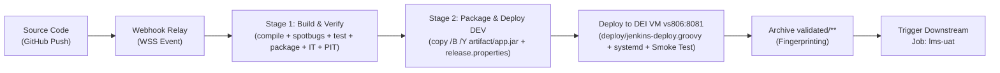

# Automated CI/CD Pipeline: Build, Packaging, and Static Code Analysis

## 1. Overview and Scope (Goal 1.3.3)

In accordance with Project 1 Goal 1.3.3 (*Implement an automated CI/CD pipeline*), this document specifies the architectural design and operational implementation of:
1. **Building and Packaging the Software:** Deterministic compilation, bytecode generation, and Spring Boot executable JAR packaging adhering to the **Single-Build Immutable Artifact Pattern** (*One Build, Many Deploys*).
2. **Static Code Analysis (SAST):** Automated inspection of bytecode and source code using **SpotBugs** to identify security vulnerabilities, concurrency anomalies, and code quality defects.
3. **Jenkins Declarative Pipeline Orchestration:** Declarative Pipeline-as-Code ([`.Jenkinsfile`](../../../.Jenkinsfile)) driving the **`lms-dev`** pipeline on a local Jenkins Controller (`localhost:8080`), integrated with GitHub via **Webhook Relay** (outbound WebSocket `WSS` tunnel) and targeting the **DEI Virtual Servers Private Cloud (`vsgate-ssh.dei.isep.ipp.pt`)** for automated remote deployment.

---

## 2. Automated Build and Packaging Strategy

### 2.1. Limitations of the Baseline Process (*As-Is*)
As analyzed in [`Docs/ODSOFT/system-as-is/system-as-is.md`](../system-as-is/system-as-is.md):
* Software compilation was performed manually on developers' workstations (`mvn clean compile`), suffering from environmental discrepancies and JDK incompatibility (e.g. annotation processing failures on non-LTS releases).
* Packaging relied on ad-hoc executions of `mvn clean package`, transferring unverified JARs manually to target servers via SSH/FTP without cryptographic hashing, audit logs, or pipeline traceability.
* Binaries were repeatedly recompiled for each environment, directly violating the **Continuous Delivery core principle: Build binaries only once** (Jez Humble & David Farley).

### 2.2. Target Build & Packaging Lifecycle (*To-Be*)

The automated build process uses the Maven Wrapper (`./mvnw` / `mvnw.cmd`) with OpenJDK 17 in a standardized, headless lifecycle:



#### 2.2.1. Compilation & Annotation Processing (`compile`)
* **Execution:** Executed deterministically as part of `mvnw -B -Pmutation clean verify -Drelease.commit="${env.GIT_COMMIT}"`.
* **Annotation Processors:** Standardized in [`pom.xml`](../../../pom.xml) under `maven-compiler-plugin`:
  * Lombok (`1.18.30`) for boilerplate code reduction.
  * MapStruct Processor (`1.5.5.Final`) for compile-time type-safe DTO/Domain mappers.
  * Lombok-MapStruct binding (`0.2.0`) to avoid annotation ordering issues.
* **Output:** Compiled bytecode placed under `target/classes`.
* **Quality Gate (Hard Gate):** Zero compilation errors. Any syntax or annotation processor failure immediately aborts the pipeline, providing fast feedback to the committer in under 15 seconds.

#### 2.2.2. Packaging Stage (`package` & `spring-boot-maven-plugin:repackage`)
* **Execution:** Executed automatically during the Maven `package` lifecycle phase before `verify`.
* **Spring Boot Repackaging & Build Info:** The `spring-boot-maven-plugin` repackages the compiled classes and resolved runtime dependencies into a self-contained executable archive, adding a `META-INF/build-info.properties` stamped with the Git commit hash:
  * Primary Executable Artifact: `target/psoft-g1-0.0.1-SNAPSHOT.jar` (~72 MB, includes nested `BOOT-INF/lib` dependencies and Spring Boot Loader).
  * Original Artifact: `target/psoft-g1-0.0.1-SNAPSHOT.jar.original` (thin JAR without embedded runtime dependencies).
* **Binary Mode Copy (`copy /B /Y`):**
  On Windows runners, the standard command line `copy` utility defaults to ASCII text mode, truncating binary ZIP/JAR streams at the first `0x1A` (ASCII 26 / Ctrl+Z EOF character). The pipeline explicitly enforces binary mode copy (`copy /B /Y target\psoft-g1-*.jar artifact\app.jar`), preserving all bytes intact.
* **Release Metadata (`release.properties`):**
  Alongside `app.jar`, the pipeline generates a standardized properties file recording provenance:
  ```properties
  job=lms-dev
  CI_JOB=lms-dev
  build=17
  CI_BUILD=17
  commit=08acb15e0febd30f7e5e451686997e1a1d90e979
  GIT_COMMIT=08acb15e0febd30f7e5e451686997e1a1d90e979
  ```
* **Immutability Guarantee (*Single-Build Artifact Pattern*):** The generated JAR is archived in Jenkins (`archiveArtifacts`) with cryptographic fingerprinting and reused across downstream UAT and PROD stages without any recompilation.

---

## 3. Static Code Analysis (SAST) Architecture

### 3.1. Tool Selection and Integration
To detect software flaws, security vulnerabilities, and code smells without executing the program, **SpotBugs** (the official successor to FindBugs) is configured in [`pom.xml`](../../../pom.xml) via `spotbugs-maven-plugin` version `4.8.3.1`:

```xml
<!-- SpotBugs Plugin for Static Code Analysis (SAST) and Quality Gate Enforcement -->
<plugin>
    <groupId>com.github.spotbugs</groupId>
    <artifactId>spotbugs-maven-plugin</artifactId>
    <version>4.8.3.1</version>
    <configuration>
        <effort>Max</effort>
        <threshold>Medium</threshold>
        <xmlOutput>true</xmlOutput>
        <htmlOutput>true</htmlOutput>
        <excludeFilterFile>spotbugs-exclude.xml</excludeFilterFile>
        <failOnError>false</failOnError>
    </configuration>
</plugin>
```

### 3.2. Filter Configuration (`spotbugs-exclude.xml`)
In modern Spring Boot and Lombok/MapStruct applications, bytecode analyzers generate noise on synthetic classes and framework conventions. To prevent false positives while rigorously checking application logic, [`spotbugs-exclude.xml`](../../../spotbugs-exclude.xml) filters:
1. **MapStruct Generated Mappers (`~.*MapperImpl.*`):** Auto-generated bytecode implementing DTO mapping.
2. **Lombok Generated Builders (`~.*Builder.*`):** Auto-generated builder patterns.
3. **Representation Exposure (`EI_EXPOSE_REP`, `EI_EXPOSE_REP2`):** Standard in Spring Dependency Injection constructors and DTOs where mutable collection references are intentionally manipulated.
4. **Constructor Throw (`CT_CONSTRUCTOR_THROW`):** Standard in Domain-Driven Design (DDD) Value Objects where constructors enforce domain invariants by throwing `IllegalArgumentException`.

### 3.3. Empirical Baseline Findings and Defect Remediation

Running SpotBugs on the baseline codebase identified **125 bug instances**, including **3 High-Priority (Priority 1) defects**. All three were analyzed, root-caused, and resolved:

| # | Bug Type | Priority | Class / Location | Root Cause | Implemented Resolution |
| :---: | :--- | :---: | :--- | :--- | :--- |
| **1** | `DM_DEFAULT_ENCODING` | **P1 (High)** | `ForbiddenNameServiceImpl.java:21` | Reliance on host OS default character encoding when instantiating `InputStreamReader(resource.getInputStream())`. On Windows runners (`Cp1252`), non-ASCII forbidden names were corrupted, diverging from Linux (`UTF-8`). | Specified `StandardCharsets.UTF_8` explicitly: `new InputStreamReader(resource.getInputStream(), StandardCharsets.UTF_8)`. |
| **2** | `DLS_DEAD_LOCAL_STORE` | **P1 (High)** | `User.java:166` | Dead local store in `setPassword(String)`: `Password passwordCheck = new Password(password);` allocated an object solely for validation, storing it in an unread local variable. | Replaced with direct validation invocation `new Password(password);` without allocating an unused local reference. |
| **3** | `SE_BAD_FIELD` | **P1 (High)** | `User.java` / `Name.java` | `User` implements Spring Security `UserDetails` (which extends `Serializable`). The embedded field `Name name` did not implement `Serializable`, causing runtime `NotSerializableException` if the security principal is serialized in HTTP sessions or distributed caches. | Made `Name` implement `java.io.Serializable` with explicit `private static final long serialVersionUID = 1L;`. Removed extraneous `Serializable` tag from `FineView`. |

#### Verification Post-Remediation:
* **Remaining High-Priority (P1) Bugs:** **0**
* **SpotBugs Build Status:** `BUILD SUCCESS`.
* **Current Test Suite:** 330/330 Unit Tests and 44/44 Integration Tests pass with 0 regressions.

---

## 4. Jenkins Declarative Pipeline Implementation ([`.Jenkinsfile`](../../../.Jenkinsfile))

The DEV pipeline is orchestrated via [`.Jenkinsfile`](../../../.Jenkinsfile) at the repository root:

```groovy
pipeline {
    agent any

    options {
        copyArtifactPermission('lms-uat,lms-private-uat,LMS-private-uat,LMS-uat,*')
        disableConcurrentBuilds()
    }

    environment {
        JAVA_TOOL_OPTIONS = '-Dfile.encoding=UTF-8 -Djava.awt.headless=true'
        UAT_JOB_NAME = 'lms-uat'
    }

    stages {
        stage('Build') {
            steps {
                echo '>>> Stage 1: Build, Unit Tests, PIT Mutation Testing, Package & Integration Tests'
                timeout(time: 15, unit: 'MINUTES') {
                    script {
                        def commitArg = env.GIT_COMMIT ? "-Drelease.commit=${env.GIT_COMMIT}" : ""
                        if (isUnix()) {
                            sh "./mvnw -B -Pmutation clean verify -Dpitest.mutationThreshold=30 ${commitArg}"
                        } else {
                            bat "mvnw.cmd -B -Pmutation clean verify -Dpitest.mutationThreshold=30 ${commitArg}"
                        }
                    }
                }
            }
            post {
                always {
                    echo '>>> Archiving Test, Mutation & Quality Reports as Evidence...'
                    archiveArtifacts artifacts: 'target/pit-reports/**', allowEmptyArchive: true
                    junit testResults: 'target/surefire-reports/TEST-*.xml, target/failsafe-reports/TEST-*.xml', allowEmptyResults: true
                }
            }
        }

        stage('Deploy DEV') {
            when {
                expression { env.GIT_BRANCH in ['origin/main', 'main'] || env.BRANCH_NAME == 'main' }
            }
            steps {
                echo '>>> Stage 2: Packaging and Deploying to DEV Environment'
                script {
                    dir('artifact') {
                        deleteDir()
                    }

                    if (isUnix()) {
                        sh '''
                            mkdir -p artifact
                            cp target/psoft-g1-*.jar artifact/app.jar
                        '''
                    } else {
                        bat '''
                            if not exist artifact mkdir artifact
                            copy /B /Y target\\psoft-g1-*.jar artifact\\app.jar
                        '''
                    }

                    def commitSha = env.GIT_COMMIT ?: 'UNKNOWN_COMMIT'
                    def propertiesContent = "job=${env.JOB_NAME}\nCI_JOB=${env.JOB_NAME}\nbuild=${env.BUILD_NUMBER}\nCI_BUILD=${env.BUILD_NUMBER}\ncommit=${commitSha}\nGIT_COMMIT=${commitSha}\n"
                    writeFile file: 'artifact/release.properties', text: propertiesContent, encoding: 'UTF-8'

                    // Load deploy module and deploy to DEV on DEI VM vs806
                    def deploy = load 'deploy/jenkins-deploy.groovy'
                    deploy.call('dev')

                    dir('validated') {
                        deleteDir()
                    }
                    if (isUnix()) {
                        sh '''
                            mkdir -p validated
                            cp artifact/app.jar validated/app.jar
                            cp artifact/release.properties validated/release.properties
                        '''
                    } else {
                        bat '''
                            if not exist validated mkdir validated
                            copy /B /Y artifact\\app.jar validated\\app.jar
                            copy /Y artifact\\release.properties validated\\release.properties
                        '''
                    }

                    archiveArtifacts artifacts: 'validated/**', fingerprint: true, allowEmptyArchive: false

                    try {
                        build job: "${UAT_JOB_NAME}",
                              parameters: [
                                  string(name: 'CI_BUILD', value: "${env.BUILD_NUMBER}"),
                                  string(name: 'CI_JOB', value: "${env.JOB_NAME}")
                              ],
                              wait: false
                    } catch (Exception e) {
                        echo "WARNING: Could not trigger downstream job '${UAT_JOB_NAME}': ${e.message}."
                    }
                }
            }
        }
    }

    post {
        always {
            echo "CI Pipeline finished with status: ${currentBuild.currentResult}"
        }
        success {
            echo "Pipeline SUCCESS: Build passed quality gates and deployed to DEV."
        }
        failure {
            echo "Pipeline FAILURE: Build or deployment failed."
        }
    }
}
```

---

## 5. Quality Gates and Enforcement Rules

The pipeline establishes **Hard Gates** and **Soft Gates** as taught in the theoretical curriculum (*Something about Apache Jenkins*):

| Stage / Component | Gate Type | Threshold / Condition | Action on Failure |
| :--- | :---: | :--- | :--- |
| **Compilation** | **Hard Gate** | 0 compilation errors, 0 annotation processor errors | Aborts build immediately (`FAILURE`). Stops line. |
| **Static Code Analysis (SpotBugs)** | **Hard Gate** | 0 High-Priority (P1) defects | Halts pipeline before packaging or deployment. |
| **Unit Tests (Surefire)** | **Hard Gate** | 100% pass rate (330/330 tests pass) | Aborts build (`FAILURE`). Test report published via `junit`. |
| **Integration Tests (Failsafe)** | **Hard Gate** | 100% pass rate (44/44 tests pass) | Aborts build (`FAILURE`). Test report published via `junit`. |
| **Mutation Testing (PITest)** | **Hard Gate** | Mutation threshold $\ge 30\%$ | Aborts build if mutation score degrades below threshold. |
| **Artifact Packaging** | **Hard Gate** | Binary JAR preserved (~72 MB) via `copy /B /Y` | Aborts build if artifact missing or truncated. |
| **Readiness Smoke Test** | **Hard Gate** | HTTP 200 and contract validation on `/info` (app, env, commit) and `/actuator/health/readiness` (status UP) within 60s (30 attempts $\times$ 2s) | Aborts deployment pipeline (`FAILURE`). |
