# Automated CI/CD Pipeline: Build, Packaging, and Static Code Analysis

## 1. Overview and Scope (Issue #17 / Goal 1.3.3)

In accordance with Project 1 Goal 1.3.3 (*Implement an automated CI/CD pipeline*) and **Issue #17** (*Implement an automated CI/CD (Build & Code Analysis) Pipeline*), this document specifies the implementation of:
1. **Building and Packaging the Software:** Deterministic compilation, bytecode generation, and Spring Boot executable JAR packaging adhering to the **Single-Build Immutable Artifact Pattern**.
2. **Static Code Analysis (SAST):** Automated inspection of bytecode and source code using **SpotBugs** to identify security vulnerabilities, concurrency anomalies, and code quality defects.
3. **Jenkins Declarative Pipeline Orchestration:** Declarative Pipeline-as-Code (`Jenkinsfile`) designed for the team's dedicated Jenkins controller on the **DEI Virtual Servers Private Cloud (`vs-ctl.dei.isep.ipp.pt:2226`)**.

---

## 2. Automated Build and Packaging Strategy

### 2.1. Limitations of the Baseline Process (*As-Is*)
As analyzed in [`Docs/ODSOFT/system-as-is/system-as-is.md`](../system-as-is/system-as-is.md):
* Software compilation was performed manually on developers' workstations (`mvn clean compile`), suffering from environmental discrepancies and JDK incompatibility (e.g. annotation processing failures on non-LTS releases).
* Packaging relied on ad-hoc executions of `mvn clean package`, transferring unverified JARs manually to target servers via SSH/FTP without cryptographic hashing, audit logs, or pipeline traceability.
* Binaries were repeatedly recompiled for each environment, directly violating the **Continuous Delivery core principle: Build binaries only once** (Jez Humble & David Farley).

### 2.2. Target Build & Packaging Lifecycle (*To-Be*)

The automated build process uses Apache Maven 3.9+ with OpenJDK 17/21, standardizing the build lifecycle into distinct, verifiable phases:

```mermaid
flowchart LR
    SRC["Source Code<br/>(Git SCM)"] --> COMPILE["mvn clean compile<br/>(Bytecode & Annotations)"]
    COMPILE --> SAST["mvn spotbugs:spotbugs<br/>(Static Analysis)"]
    SAST --> TEST["mvn test & verify<br/>(Surefire & Failsafe)"]
    TEST --> PACKAGE["mvn package -DskipTests<br/>(Executable Fat JAR)"]
    PACKAGE --> ARCHIVE["archiveArtifacts<br/>(Jenkins Artifact Repository)"]
    
    classDef srcStyle fill:#e1f5fe,stroke:#0288d1,stroke-width:2px;
    classDef buildStyle fill:#e8f5e9,stroke:#2e7d32,stroke-width:2px;
    classDef pkgStyle fill:#fff3e0,stroke:#ef6c00,stroke-width:2px;
    
    class SRC srcStyle;
    class COMPILE,SAST,TEST buildStyle;
    class PACKAGE,ARCHIVE pkgStyle;
```



#### 2.2.1. Compilation Stage (`compile`)
* **Execution:** `mvn clean compile -B`
* **Annotation Processors:** Standardized in [`pom.xml`](../../../pom.xml) under `maven-compiler-plugin`:
  * Lombok (`1.18.30`) for boilerplate code reduction.
  * MapStruct Processor (`1.5.5.Final`) for compile-time type-safe DTO/Domain mappers.
  * Lombok-MapStruct binding (`0.2.0`) to avoid annotation ordering issues.
* **Output:** Compiled bytecode placed under `target/classes`.
* **Quality Gate (Hard Gate):** Zero compilation errors. Any syntax or annotation processor failure immediately aborts the pipeline, providing fast feedback to the committer in under 15 seconds.

#### 2.2.2. Packaging Stage (`package`)
* **Execution:** `mvn package -DskipTests -B` (tests are already executed and validated in earlier, dedicated pipeline stages).
* **Spring Boot Repackaging:** The `spring-boot-maven-plugin` repackages the compiled classes and resolved runtime dependencies into a self-contained executable archive:
  * Primary Artifact: `target/psoft-g1-0.0.1-SNAPSHOT.jar` (includes nested `BOOT-INF/lib` dependencies and Spring Boot Loader).
  * Original Artifact: `target/psoft-g1-0.0.1-SNAPSHOT.jar.original` (thin JAR without embedded runtime dependencies).
* **Immutability Guarantee:** The generated `.jar` is archived in Jenkins (`archiveArtifacts`) and subsequently copied into Docker containers without recompilation.

---

## 3. Static Code Analysis (SAST) Architecture

### 3.1. Tool Selection and Integration
To detect software flaws, security vulnerabilities, and code smells without executing the program, **SpotBugs** (the official successor to FindBugs) is configured in [`pom.xml`](../../../pom.xml) via `spotbugs-maven-plugin` version `4.8.3.1`:

```xml
<!-- SpotBugs Plugin for Static Code Analysis (SAST) and Quality Gate Enforcement -->
<plugin>
    <groupId>com.github.spotbugs</groupId>
    <artifactId>spotbugs-maven-plugin</artifactId>
    <version>4.8.3.1</version>
    <configuration>
        <effort>Max</effort>
        <threshold>Medium</threshold>
        <xmlOutput>true</xmlOutput>
        <htmlOutput>true</htmlOutput>
        <excludeFilterFile>spotbugs-exclude.xml</excludeFilterFile>
        <failOnError>false</failOnError>
    </configuration>
</plugin>
```

### 3.2. Filter Configuration (`spotbugs-exclude.xml`)
In modern Spring Boot and Lombok/MapStruct applications, bytecode analyzers generate noise on synthetic classes and framework conventions. To prevent false positives while rigorously checking application logic, [`spotbugs-exclude.xml`](../../../spotbugs-exclude.xml) filters:
1. **MapStruct Generated Mappers (`~.*MapperImpl.*`):** Auto-generated bytecode implementing DTO mapping.
2. **Lombok Generated Builders (`~.*Builder.*`):** Auto-generated builder patterns.
3. **Representation Exposure (`EI_EXPOSE_REP`, `EI_EXPOSE_REP2`):** Standard in Spring Dependency Injection constructors and DTOs where mutable collection references are intentionally manipulated.
4. **Constructor Throw (`CT_CONSTRUCTOR_THROW`):** Standard in Domain-Driven Design (DDD) Value Objects where constructors enforce domain invariants by throwing `IllegalArgumentException`.

### 3.3. Empirical Baseline Findings and Defect Remediation

Running SpotBugs on the baseline codebase identified **125 bug instances**, including **3 High-Priority (Priority 1) defects**. All three were analyzed, root-caused, and resolved:

| # | Bug Type | Priority | Class / Location | Root Cause | Implemented Resolution |
| :---: | :--- | :---: | :--- | :--- | :--- |
| **1** | `DM_DEFAULT_ENCODING` | **P1 (High)** | `ForbiddenNameServiceImpl.java:21` | Reliance on host OS default character encoding when instantiating `InputStreamReader(resource.getInputStream())`. On Windows runners (`Cp1252`), non-ASCII forbidden names were corrupted, diverging from Linux (`UTF-8`). | Specified `StandardCharsets.UTF_8` explicitly: `new InputStreamReader(resource.getInputStream(), StandardCharsets.UTF_8)`. |
| **2** | `DLS_DEAD_LOCAL_STORE` | **P1 (High)** | `User.java:166` | Dead local store in `setPassword(String)`: `Password passwordCheck = new Password(password);` allocated an object solely for validation, storing it in an unread local variable. | Replaced with direct validation invocation `new Password(password);` without allocating an unused local reference. |
| **3** | `SE_BAD_FIELD` | **P1 (High)** | `User.java` / `Name.java` | `User` implements Spring Security `UserDetails` (which extends `Serializable`). The embedded field `Name name` did not implement `Serializable`, causing runtime `NotSerializableException` if the security principal is serialized in HTTP sessions or distributed caches. | Made `Name` implement `java.io.Serializable` with explicit `private static final long serialVersionUID = 1L;`. Removed extraneous `Serializable` tag from `FineView`. |

#### Verification Post-Remediation:
* **Remaining High-Priority (P1) Bugs:** **0**
* **SpotBugs Build Status:** `BUILD SUCCESS` (execution time: ~14.4s).
* **Unit Test Suite:** 239/239 tests pass with 0 regressions.

---

## 4. Jenkins Declarative Pipeline Implementation (`Jenkinsfile`)

The pipeline is defined in [`Jenkinsfile`](../../../Jenkinsfile) at the repository root, complying with standard Declarative Pipeline syntax:

```groovy
pipeline {
    agent any

    environment {
        // Enforce UTF-8 encoding and headless mode across build environments
        JAVA_TOOL_OPTIONS = '-Dfile.encoding=UTF-8 -Djava.awt.headless=true'
    }

    stages {
        stage('Compile') {
            steps {
                echo 'Compiling source code with Apache Maven...'
                script {
                    if (isUnix()) {
                        sh 'mvn clean compile -B'
                    } else {
                        bat 'mvn clean compile -B'
                    }
                }
            }
        }

        stage('Static Code Analysis (SAST)') {
            steps {
                echo 'Executing SpotBugs static code analysis for defect and vulnerability detection...'
                script {
                    if (isUnix()) {
                        sh 'mvn spotbugs:spotbugs -B'
                    } else {
                        bat 'mvn spotbugs:spotbugs -B'
                    }
                }
            }
            post {
                always {
                    archiveArtifacts artifacts: 'target/spotbugsXml.xml', allowEmptyArchive: true, fingerprint: false
                }
            }
        }

        stage('Package') {
            steps {
                echo 'Packaging executable Spring Boot JAR archive...'
                script {
                    if (isUnix()) {
                        sh 'mvn package -DskipTests -B'
                    } else {
                        bat 'mvn package -DskipTests -B'
                    }
                }
            }
        }

        stage('Archive Artifacts') {
            steps {
                echo 'Publishing deployable binary artifacts to Jenkins repository...'
                archiveArtifacts artifacts: 'target/*.jar', fingerprint: true, allowEmptyArchive: false
            }
        }
    }

    post {
        always {
            echo "CI/CD Pipeline finished with status: ${currentBuild.currentResult}"
        }
        success {
            echo "Pipeline SUCCESS: Executable artifact target/*.jar ready for deployment."
        }
        unstable {
            echo "Pipeline UNSTABLE: Quality gate warnings or test degradation detected."
        }
        failure {
            echo "Pipeline FAILURE: Build failed. Check console output and test reports."
        }
    }
}
```

---

## 5. Quality Gates and Enforcement Rules

The pipeline establishes **Hard Gates** and **Soft Gates** as taught in the theoretical curriculum (*Something about Apache Jenkins*):

| Stage | Gate Type | Threshold / Condition | Action on Failure |
| :--- | :---: | :--- | :--- |
| **Compile** | **Hard Gate** | 0 compilation errors, 0 annotation processor errors | Aborts build immediately (`FAILURE`). Stops line. |
| **Static Code Analysis** | **Hard Gate** | 0 High-Priority (P1) SpotBugs defects | Halts pipeline before packaging or deployment. |
| **Unit Tests** | **Hard Gate** | 100% pass rate (0 failures, 0 errors in Surefire) | Aborts build (`FAILURE`). Test report published via `junit`. |
| **Integration Tests** | **Hard Gate** | 100% pass rate in Failsafe integration tests | Aborts build (`FAILURE`). Test report published via `junit`. |
| **Coverage & Mutation** | **Soft/Hard Gate** | JaCoCo line coverage $\ge 60\%$, PIT mutation $\ge 50\%$ | Flags build as `UNSTABLE` or `FAILURE` upon degradation. |
| **Package & Archive** | **Hard Gate** | Executable JAR present in `target/*.jar` | Aborts build if artifact generation fails. |

---

## 6. Verification and Evidence Checklist

- [x] Maven compile goal executes deterministically in under 15 seconds.
- [x] `spotbugs-maven-plugin` configured with `spotbugs-exclude.xml` in `pom.xml`.
- [x] All 3 P1 High-Priority SpotBugs defects identified and resolved in source code.
- [x] Spring Boot JAR successfully packaged (`psoft-g1-0.0.1-SNAPSHOT.jar`).
- [x] Declarative `Jenkinsfile` created with `Compile`, `Static Code Analysis`, `Unit Tests`, `Integration Tests`, `Coverage`, `Package`, and `Archive Artifacts` stages.
- [x] Test results captured via standard Jenkins `junit` step (`surefire-reports` and `failsafe-reports`).
- [x] Artifacts versioned and preserved via Jenkins `archiveArtifacts`.

