# Automated Deployment, Immutable Artifact Management, and Health Monitoring Pipeline

## 1. Overview and Objectives (Issue #21 / Goal 1.3.3 & Goal 1.3.5)

In accordance with Project 1 Goal 1.3.3 (*Implement an automated CI/CD pipeline supporting creation and management of deployable artifacts and deployment to different environments*) and **Issue #21** (*Implement Automated Deployment & Health Monitoring in Pipeline*), this document specifies the architecture, engineering principles, and operational mechanisms governing:

1. **Creation and Management of Deployable Artifacts:** Enforcing the **Single-Build Immutable Artifact Pattern** (Jez Humble & David Farley), ensuring that application packages are compiled and tested once in the continuous integration stage and promoted downstream across environments with cryptographic fingerprinting.
2. **Automated Continuous Deployment Across Environments:** Driving automated, repeatable deployments to **Development (DEV)**, **User Acceptance Testing (UAT / Staging)**, and **Production (PROD)** across segregated virtual machines in the DEI Private Cloud.
3. **Continuous Health Monitoring and Readiness Gates:** Integrating automated post-deployment contract verification using **Spring Boot Actuator** and the [`deploy/smoke-test.sh`](../../../deploy/smoke-test.sh) probe as a non-negotiable **Hard Quality Gate** before promoting releases.
4. **End-to-End Auditability and Provenance Tracking:** Generating immutable metadata (`release.properties`, `acceptance.properties`, and `production.properties`) capturing Git commit SHAs, Jenkins build numbers, authorized stakeholder approval signatures, and ISO 8601 timestamps.

---

## 2. Immutable Artifact Lifecycle & Provenance Architecture

### 2.1. Limitations of the Baseline Process (*As-Is*)
As analyzed in [`Docs/ODSOFT/system-as-is/system-as-is.md`](../system-as-is/system-as-is.md):
* Executable binaries were repeatedly recompiled on target machines or manually built on workstations (`mvn clean package`) and transferred via ad-hoc SSH sessions without SHA-256 verification or build linkage.
* Environments ran uncontrolled bytecode variations, making it impossible to guarantee that the binary running in production matched the exact code verified during unit and integration testing.
* Post-deployment verification was purely manual and subjective (e.g., ad-hoc manual testing using Postman without verifying Git commit stamps or readiness status).

### 2.2. The Target Immutable Delivery Flow (*To-Be*)

The deployment pipeline treats built binaries as **immutable assets**:

```mermaid
flowchart TD
    subgraph DEV_JOB["1. Pipeline DEV (lms-dev)"]
        BUILD["mvnw clean verify<br/>(Unit + IT + PIT + SAST)"] --> JAR["Package Fat JAR<br/>(app.jar ~72MB)"]
        JAR --> REL_PROPS["Generate release.properties<br/>(CI_JOB, CI_BUILD, GIT_COMMIT)"]
        REL_PROPS --> FINGERPRINT["Jenkins archiveArtifacts<br/>(fingerprint: true on validated/**)"]
        FINGERPRINT --> DEPLOY_DEV["Deploy to DEV (vs806:8081)<br/>via systemd + SCP"]
        DEPLOY_DEV --> SMOKE_DEV{"Readiness Smoke Test<br/>(/info + /actuator/health)"}
        SMOKE_DEV -->|Pass| TRIGGER_UAT["Trigger lms-uat (CI_BUILD, CI_JOB)"]
        SMOKE_DEV -->|Fail| ABORT_DEV["Abort Build & Dump journalctl"]
    end

    subgraph UAT_JOB["2. Pipeline UAT (lms-uat)"]
        TRIGGER_UAT --> COPY_VAL["copyArtifacts from lms-dev<br/>(No recompilation!)"]
        COPY_VAL --> DEPLOY_UAT["Deploy to UAT (vs806:8082)<br/>via systemd + SCP"]
        DEPLOY_UAT --> SMOKE_UAT{"Readiness Smoke Test<br/>(/info + /actuator/health)"}
        SMOKE_UAT --> STASH["stash 'uat-artifacts'<br/>agent none (Release Executor)"]
        STASH --> HUMAN_GATE{"Human Approval Gate<br/>'Aceitar e promover' (timeout 7d)"}
        HUMAN_GATE --> UNSTASH["unstash & Recheck Smoke Test<br/>(deploy.recheck('uat'))"]
        UNSTASH --> ACC_PROPS["Generate acceptance.properties<br/>(ACCEPTED_BY, timestamp)"]
        ACC_PROPS --> TRIGGER_PROD["Trigger lms-prod"]
    end

    subgraph PROD_JOB["3. Pipeline PROD (lms-prod)"]
        TRIGGER_PROD --> COPY_ACC["copyArtifacts from lms-uat<br/>(Reuses accepted/app.jar)"]
        COPY_ACC --> AUDIT["Verify & Print Audit Trail<br/>(DEV -> UAT -> PROD)"]
        AUDIT --> DEPLOY_PROD["Deploy to Dedicated PROD VM<br/>(vs336:8080) via systemd"]
        DEPLOY_PROD --> SMOKE_PROD{"Readiness Smoke Test<br/>(port 8080 on vs336)"}
        SMOKE_PROD --> PROD_PROPS["Generate production.properties<br/>Archive final_artifact/**"]
    end

    classDef devStyle fill:#e8f5e9,stroke:#2e7d32,stroke-width:2px;
    classDef uatStyle fill:#f3e5f5,stroke:#7b1fa2,stroke-width:2px;
    classDef prodStyle fill:#fce4ec,stroke:#c2185b,stroke-width:2px;
    classDef gateStyle fill:#fff3e0,stroke:#ef6c00,stroke-width:2px;
    classDef failStyle fill:#ffebee,stroke:#c62828,stroke-width:2px;

    class DEV_JOB,BUILD,JAR,REL_PROPS,FINGERPRINT,DEPLOY_DEV devStyle;
    class UAT_JOB,COPY_VAL,DEPLOY_UAT,STASH,UNSTASH,ACC_PROPS uatStyle;
    class PROD_JOB,COPY_ACC,AUDIT,DEPLOY_PROD,PROD_PROPS prodStyle;
    class SMOKE_DEV,SMOKE_UAT,SMOKE_PROD,HUMAN_GATE gateStyle;
    class ABORT_DEV failStyle;
```



---

## 3. Cascading Declarative Pipeline Jobs Specification

Rather than coupling all stages into an unwieldy single job, delivery is orchestrated through **three decoupled, parameterized declarative pipelines** (ADR-02):

### 3.1. Job 1: `lms-dev` ([`.Jenkinsfile`](../../../.Jenkinsfile))
* **Trigger:** Automated Git push trigger via Webhook Relay tunnel (`WSS`).
* **Build & Verification Stage:**
  * Clean build with OpenJDK 17/21.
  * Static code analysis via SpotBugs (0 P1 defects permitted).
  * 330 unit tests via Surefire (100% pass rate).
  * 44 integration tests via Failsafe (100% pass rate).
  * PITest mutation analysis with minimum threshold $\ge 30\%$ (Test strength: 84%).
  * Spring Boot packaging into `target/psoft-g1-0.0.1-SNAPSHOT.jar` and Git commit stamping via `-Drelease.commit="${env.GIT_COMMIT}"`.
* **Deployment to DEV Stage:**
  * Standardized binary transfer (`copy /B /Y target\psoft-g1-*.jar artifact\app.jar` on Windows agents to prevent EOF truncation).
  * Generates `artifact/release.properties`.
  * Invokes [`deploy/jenkins-deploy.groovy`](../../../deploy/jenkins-deploy.groovy) to copy binary to DEI VM `vs806:10806` (`/opt/psoft-g1/dev`).
  * Restarts systemd unit `psoft-g1@dev.service` on port `8081`.
  * Runs contract smoke test on `http://localhost:8081`.
  * Prepares `validated/**` and archives with cryptographic fingerprinting (`fingerprint: true`).
  * Asynchronously triggers `lms-uat` with `CI_BUILD` and `CI_JOB` parameters.

### 3.2. Job 2: `lms-uat` ([`.Jenkinsfile_uat`](../../../.Jenkinsfile_uat))
* **Trigger:** Triggered automatically by successful completion of `lms-dev`.
* **Deployment to UAT Stage:**
  * Pulls validated immutable binary from `lms-dev` via Jenkins `copyArtifacts` plugin (no recompilation).
  * Deploys to DEI VM `vs806:10806` (`/opt/psoft-g1/uat`) on port `8082`.
  * Restarts systemd unit `psoft-g1@uat.service`.
  * Runs contract smoke test on `http://localhost:8082`.
* **Human Acceptance & Resource Optimization (`agent none` + `stash`):**
  * Stashes deployment artifacts (`stash name: 'uat-artifacts'`) and releases the Jenkins executor (`agent none`).
  * Awaits authorized human stakeholder sign-off via Jenkins UI (`input message: 'Aceitar e promover para Produção?'`, timeout 7 days).
  * Upon approval, re-allocates an executor, performs `unstash`, and executes `deploy.recheck('uat')` to mathematically verify that the UAT instance remained healthy throughout the approval period.
  * Generates `acceptance.properties` containing `ACCEPTED_BY` and `approval_timestamp`.
  * Archives `accepted/**` and triggers `lms-prod`.

### 3.3. Job 3: `lms-prod` ([`.Jenkinsfile_prod`](../../../.Jenkinsfile_prod))
* **Trigger:** Triggered by approved UAT promotion.
* **Audit Trail Verification Stage:**
  * Pulls accepted artifact from `lms-uat`.
  * Parses and prints complete traceability metadata to Jenkins console (original CI job, CI build, Git commit hash, UAT approval user, UAT timestamp).
* **Production Deployment Stage:**
  * Deploys binary to dedicated isolated DEI VM `vs336:10336` (`/opt/psoft-g1/prod`) on port `8080`.
  * Restarts systemd unit `psoft-g1@prod.service`.
  * Runs contract smoke test on `http://localhost:8080`.
  * Generates `production.properties` (`deployed_to=prod`, timestamp) and archives final release bundle in `final_artifact/**`.

---

## 4. Automated Health Monitoring and Readiness Smoke Testing

### 4.1. Contract Verification Specification (`smoke-test.sh`)
The health monitoring gate is implemented in [`deploy/smoke-test.sh`](../../../deploy/smoke-test.sh) and executed automatically following every deployment. The script enforces two simultaneous contract validations:

```bash
# Invocation signature
smoke-test.sh <BASE_URL> <EXPECTED_ENVIRONMENT> <EXPECTED_GIT_COMMIT>
```

#### Contract 1: Identity, Target Environment, and Commit Alignment (`GET /info`)
Exposed by [`InfoController.java`](../../../src/main/java/pt/psoft/g1/psoftg1/configuration/InfoController.java), the endpoint returns:
```json
{
  "application": "psoft-g1",
  "version": "0.0.1-SNAPSHOT",
  "commit": "08acb15e0febd30f7e5e451686997e1a1d90e979",
  "environment": "dev"
}
```
The smoke test parses the JSON response using Python, verifying that:
1. `"application"` exactly equals `"psoft-g1"`.
2. `"environment"` exactly matches the target deployment stage (`dev`, `uat`, or `prod`).
3. `"commit"` matches the exact Git commit SHA built in the upstream CI stage.

#### Contract 2: Operational Health and Readiness (`GET /actuator/health/readiness`)
Exposed by the Spring Boot Actuator, the endpoint verifies database connectivity, disk space, and application component status:
```json
{
  "status": "UP"
}
```

### 4.2. Polling Strategy and Hard Gate Failure Semantics
* **Polling Window:** The script executes up to **30 polling attempts** with **2-second sleep intervals** (60 seconds maximum startup grace window).
* **Hard Gate Enforcement:** If the application fails to return HTTP 200 with matching JSON contracts within 60 seconds:
  1. The smoke test immediately exits with code `1`.
  2. The shared deployment module [`deploy/jenkins-deploy.groovy`](../../../deploy/jenkins-deploy.groovy) intercepts the failure in a `try/catch` block.
  3. Diagnostic service logs are automatically captured and printed to the Jenkins console via `journalctl -u psoft-g1@<env>.service -n 30 --no-pager` or `tail -n 30 /opt/psoft-g1/<env>/app.log`.
  4. The deployment pipeline terminates as `FAILURE`, blocking any further environment promotion.

---

## 5. Systemd Service Management and Operating System Hardening

To ensure process supervision and operating system level security on the DEI virtual machines:

### 5.1. Parameterized Systemd Unit (`deploy/psoft-g1@.service`)
The systemd unit [`deploy/psoft-g1@.service`](../../../deploy/psoft-g1@.service) dynamically parameterizes the environment:
```ini
[Unit]
Description=LMS psoft-g1 Backend (%i)
After=network.target

[Service]
Type=simple
User=psoft-g1-%i
WorkingDirectory=/opt/psoft-g1/%i
EnvironmentFile=/etc/psoft-g1/%i.env
ExecStart=/usr/bin/java -jar /opt/psoft-g1/%i/app.jar
Restart=always
RestartSec=5

# Security Hardening
NoNewPrivileges=true
ProtectSystem=strict
ProtectHome=true
PrivateTmp=true
ReadWritePaths=/opt/psoft-g1/%i

[Install]
WantedBy=multi-user.target
```

### 5.2. Security Hardening Guarantees
1. **Unprivileged Service Accounts:** Separate Linux users (`psoft-g1-dev`, `psoft-g1-uat`, `psoft-g1-prod`) with disabled shell logins (`/usr/sbin/nologin`).
2. **Filesystem Isolation:** `ProtectSystem=strict` mounts `/usr`, `/boot`, and `/etc` as read-only. `ReadWritePaths` restricts mutable writes exclusively to the environment's dedicated directory `/opt/psoft-g1/%i`.
3. **Restricted Sudoers:** [`deploy/psoft-g1.sudoers`](../../../deploy/psoft-g1.sudoers) grants the `deploy` user passwordless execution strictly for `systemctl` commands managing `psoft-g1@*.service`.

