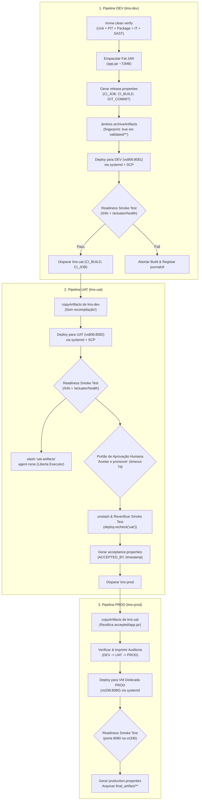

# Pipeline de CI/CD: Deployment Automatizado, Gestão de Artefactos Imutáveis e Monitorização de Saúde

## 1. Visão Geral e Objetivos (Goal 1.3.3 & Goal 1.3.5)

Em conformidade com o Goal 1.3.3 (*Implement an automated CI/CD pipeline supporting creation and management of deployable artifacts and deployment to different environments*) e o Goal 1.3.5, este documento especifica a arquitetura, os princípios de engenharia e os mecanismos operacionais que regem:

1. **Criação e Gestão de Artefactos de Deployment:** Aplicação do **Single-Build Immutable Artifact Pattern** (Jez Humble & David Farley), garantindo que os pacotes aplicacionais são compilados e testados uma única vez na fase de integração contínua e promovidos para os ambientes subsequentes com verificação criptográfica.
2. **Deployment Contínuo e Automatizado entre Ambientes:** Execução de deployments automatizados e repetíveis para **Desenvolvimento (DEV)**, **Testes de Aceitação (UAT / Staging)** e **Produção (PROD)** em máquinas virtuais segregadas na Cloud Privada do DEI.
3. **Monitorização Contínua de Saúde e Portões de Prontidão:** Integração de verificação pós-deployment baseada em contratos com o **Spring Boot Actuator** e o script de teste [`deploy/smoke-test.sh`](../../../deploy/smoke-test.sh) como **Hard Quality Gate** bloqueante antes da promoção de releases.
4. **Auditabilidade Integral e Rastreabilidade de Proveniência:** Geração de metadados imutáveis (`release.properties`, `acceptance.properties` e `production.properties`) registando os hashes de commit do Git, números de build do Jenkins, assinaturas de aprovação de intervenientes autorizados e timestamps ISO 8601.

---

## 2. Ciclo de Vida do Artefacto Imutável e Arquitetura de Proveniência

### 2.1. Limitações do Processo Inicial (*As-Is*)
Conforme analisado em [`Docs/ODSOFT/system-as-is/system-as-is.md`](../system-as-is/system-as-is.md):
* Os binários executáveis eram repetidamente recompilados nas máquinas de destino ou construídos manualmente em estações de trabalho (`mvn clean package`) e transferidos através de sessões ad-hoc de SSH sem validação SHA-256 ou ligação a uma build de CI.
* Os ambientes executavam variações descontroladas de bytecode, tornando impossível garantir que o binário em execução em produção correspondia rigorosamente ao código validado nos testes unitários e de integração.
* A verificação pós-deployment era exclusivamente manual e subjetiva (ex.: testes exploratórios manuais no Postman sem verificação do commit ou do estado de prontidão).

### 2.2. Fluxo Alvo de Entrega Imutável (*To-Be*)

O pipeline trata os binários gerados como **ativos imutáveis**:



---

## 3. Especificação dos Jobs Declarativos em Cascata

Em vez de acoplar todos os estágios num pipeline único monolítico, o fluxo de entrega é coordenado por **três pipelines declarativos parametrizados e desacoplados** (ADR-02):

### 3.1. Job 1: `lms-dev` ([`.Jenkinsfile`](../../../.Jenkinsfile))
* **Gatilho:** Disparo automático por Git push via túnel Webhook Relay (`WSS`).
* **Estágio de Build & Verificação:**
  * Compilação determinística com OpenJDK 17/21.
  * 386 testes unitários via Surefire (fase `test`, 100% de taxa de aprovação).
  * Análise de mutação PITest na fase `test` com limiar mínimo $\ge 30\%$ (Test Strength: 82%).
  * Empacotamento Spring Boot em `target/psoft-g1-0.0.1-SNAPSHOT.jar` e injeção do commit Git via `-Drelease.commit="${env.GIT_COMMIT}"`.
  * 47 testes de integração via Failsafe (fase `verify`, 100% de taxa de aprovação).
  * Análise estática de código via SpotBugs na fase `verify` (0 defeitos P1 permitidos).
  * Registo de cobertura unitária (`unit-coverage`) e de integração (`integration-coverage`) pelo JaCoCo.
* **Estágio de Deployment para DEV:**
  * Cópia binária padronizada (`copy /B /Y target\psoft-g1-*.jar artifact\app.jar` em Windows para prevenir truncamento de EOF).
  * Geração de `artifact/release.properties`.
  * Invocação de [`deploy/jenkins-deploy.groovy`](../../../deploy/jenkins-deploy.groovy) para transferir o binário para a VM `vs806:10806` do DEI (`/opt/psoft-g1/dev`).
  * Reinício da unidade systemd `psoft-g1@dev.service` na porta `8081`.
  * Execução do smoke test contratual em `http://localhost:8081`.
  * Preparação de `validated/**` e arquivo com fingerprinting criptográfico (`fingerprint: true`).
  * Disparo assíncrono de `lms-uat` com passagem dos parâmetros `CI_BUILD` e `CI_JOB`.

### 3.2. Job 2: `lms-uat` ([`.Jenkinsfile_uat`](../../../.Jenkinsfile_uat))
* **Gatilho:** Disparado automaticamente após a conclusão bem-sucedida de `lms-dev`.
* **Estágio de Deployment para UAT:**
  * Obtém o binário validado imutável de `lms-dev` através do plugin `copyArtifacts` do Jenkins (sem recompilação).
  * Efetua o deployment para a VM `vs806:10806` do DEI (`/opt/psoft-g1/uat`) na porta `8082`.
  * Reinicia a unidade systemd `psoft-g1@uat.service`.
  * Executa o smoke test contratual em `http://localhost:8082`.
* **Aceitação Humana e Otimização de Recursos (`agent none` + `stash`):**
  * Guarda os artefactos de deployment em stash (`stash name: 'uat-artifacts'`) e liberta o executor do Jenkins (`agent none`).
  * Aguarda a validação de um interveniente autorizado através da interface do Jenkins (`input message: 'Aceitar e promover para Produção?'`, timeout de 7 dias).
  * Após aprovação, aloca novamente um executor, executa `unstash` e procede a `deploy.recheck('uat')` para verificar se a instância de UAT permaneceu saudável durante o período de espera.
  * Gera o ficheiro `acceptance.properties` contendo `ACCEPTED_BY` e o `approval_timestamp`.
  * Arquiva `accepted/**` e dispara `lms-prod`.

### 3.3. Job 3: `lms-prod` ([`.Jenkinsfile_prod`](../../../.Jenkinsfile_prod))
* **Gatilho:** Disparado pela aprovação formal em UAT.
* **Estágio de Verificação da Trilha de Auditoria:**
  * Obtém o artefacto aceite de `lms-uat`.
  * Processa e imprime os metadados de rastreabilidade na consola do Jenkins (job de CI original, build de CI, hash do commit Git, utilizador de aprovação em UAT e timestamp de UAT).
* **Estágio de Deployment para Produção:**
  * Efetua o deployment do binário para a VM dedicada e isolada `vs336:10336` do DEI (`/opt/psoft-g1/prod`) na porta `8080`.
  * Reinicia a unidade systemd `psoft-g1@prod.service`.
  * Executa o smoke test contratual em `http://localhost:8080`.
  * Gera `production.properties` (`deployed_to=prod`, timestamp) e arquiva o pacote final de release em `final_artifact/**`.

---

## 4. Monitorização Automatizada de Saúde e Smoke Testing de Prontidão

### 4.1. Especificação da Verificação Contratual (`smoke-test.sh`)
O portão de monitorização de saúde está implementado em [`deploy/smoke-test.sh`](../../../deploy/smoke-test.sh) e é executado automaticamente após cada deployment. O script impõe a validação simultânea de dois contratos:

```bash
# Assinatura de invocação
smoke-test.sh <BASE_URL> <EXPECTED_ENVIRONMENT> <EXPECTED_GIT_COMMIT>
```

#### Contrato 1: Alinhamento de Identidade, Ambiente Alvo e Commit (`GET /info`)
Disponibilizado por [`InfoController.java`](../../../src/main/java/pt/psoft/g1/psoftg1/configuration/InfoController.java), o endpoint devolve:
```json
{
  "application": "psoft-g1",
  "version": "0.0.1-SNAPSHOT",
  "commit": "4e10baf1db04f1a904f87833a1b7a98c19e0f5a1",
  "environment": "dev"
}
```
O smoke test analisa a resposta JSON através de Python, verificando que:
1. `"application"` é rigorosamente igual a `"psoft-g1"`.
2. `"environment"` coincide com o ambiente de destino (`dev`, `uat` ou `prod`).
3. `"commit"` coincide exatamente com o hash de commit do Git gerado na etapa de CI.

#### Contrato 2: Saúde Operacional e Prontidão (`GET /actuator/health/readiness`)
Disponibilizado pelo Spring Boot Actuator, o endpoint verifica conetividade à base de dados, espaço em disco e o estado dos componentes:
```json
{
  "status": "UP"
}
```

### 4.2. Estratégia de Polling e Comportamento do Portão Bloqueante
* **Janela de Polling:** O script executa até **30 tentativas de polling** com **intervalos de espera de 2 segundos** (janela de tolerância de arranque até 60 segundos).
* **Execução do Hard Gate:** Caso a aplicação não responda com HTTP 200 e contratos JSON coincidentes no prazo de 60 segundos:
  1. O smoke test termina imediatamente com código de saída `1`.
  2. O módulo de deployment [`deploy/jenkins-deploy.groovy`](../../../deploy/jenkins-deploy.groovy) interceta a falha num bloco `try/catch`.
  3. Os registos de diagnóstico do serviço são recolhidos e impressos na consola do Jenkins através de `journalctl -u psoft-g1@<env>.service -n 30 --no-pager` ou `tail -n 30 /opt/psoft-g1/<env>/app.log`.
  4. O pipeline de deployment termina com o estado `FAILURE`, bloqueando qualquer promoção subsequente.

---

## 5. Gestão de Serviços no Systemd e Hardening ao Nível do Sistema Operativo

Para assegurar a supervisão de processos e segurança ao nível do sistema operativo nas máquinas virtuais do DEI:

### 5.1. Unidade Parametrizada do Systemd (`deploy/psoft-g1@.service`)
A unidade systemd [`deploy/psoft-g1@.service`](../../../deploy/psoft-g1@.service) parametriza dinamicamente o ambiente através de `%i`:
```ini
[Unit]
Description=LMS psoft-g1 Backend (%i)
After=network.target

[Service]
Type=simple
User=psoft-g1-%i
WorkingDirectory=/opt/psoft-g1/%i
EnvironmentFile=/etc/psoft-g1/%i.env
ExecStart=/usr/bin/java -jar /opt/psoft-g1/%i/app.jar
Restart=always
RestartSec=5

# Hardening de Segurança
NoNewPrivileges=true
ProtectSystem=strict
ProtectHome=true
PrivateTmp=true
ReadWritePaths=/opt/psoft-g1/%i

[Install]
WantedBy=multi-user.target
```

### 5.2. Garantias de Hardening e Segurança
1. **Contas de Serviço Sem Privilégios:** Utilizadores Linux dedicados (`psoft-g1-dev`, `psoft-g1-uat`, `psoft-g1-prod`) com shell desativada (`/usr/sbin/nologin`).
2. **Isolamento do Sistema de Ficheiros:** A diretiva `ProtectSystem=strict` monta `/usr`, `/boot` e `/etc` como só de leitura. A diretiva `ReadWritePaths` restringe operações de escrita exclusivamente ao diretório dedicado do ambiente `/opt/psoft-g1/%i`.
3. **Privilégios Restritos de Sudoers:** O ficheiro [`deploy/psoft-g1.sudoers`](../../../deploy/psoft-g1.sudoers) concede ao utilizador `deploy` execução sem palavra-passe estritamente para comandos `systemctl` que giram `psoft-g1@*.service`.
