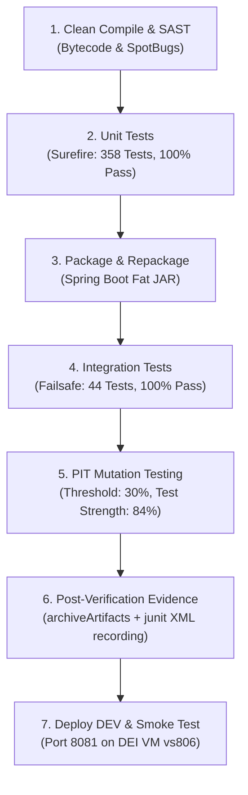

# Automated CI/CD Pipeline: Testing, Coverage, Mutation, and Quality Gates

## 1. Overview and Objectives (Goal 1.3.3)

In accordance with Project 1 Goal 1.3.3 (*Implement an automated CI/CD pipeline*), this document specifies the implementation of:
1. **Automated Testing at Appropriate Levels:** Segregated execution of unit tests (`maven-surefire-plugin`) and integration tests (`maven-failsafe-plugin`).
2. **Test Reporting and Evidence Collection:** Automated publishing and historical trend tracking of build and test results in Jenkins using the Declarative `junit` step and `archiveArtifacts`.
3. **Code Coverage and Mutation Testing:** Automated execution and report archiving for **JaCoCo** (code coverage) and **PITest** (mutation testing with the `<profile><id>mutation</id>` Maven profile).
4. **Quality Gates Enforcement:** Enforcing formal Hard and Soft quality gates based on 100% test pass rates, compilation integrity, mutation threshold enforcement ($\ge 30\%$), and HTTP readiness smoke testing.

---

## 2. Automated Testing Levels in the Pipeline

Following the architectural segregation designed in [`Docs/ODSOFT/testing-strategy/testing-strategy.md`](../testing-strategy/testing-strategy.md), the CI pipeline isolates testing scopes into distinct sequential verification phases executed within Maven's standardized `verify` lifecycle:



### 2.1. Level 1: Unit Tests (`maven-surefire-plugin`)
* **Scope:** 358 isolated unit tests covering Domain Value Objects, Aggregate Roots, Application Services, Lending Policies, Notification Listeners, and Configuration using Mockito test doubles.
* **Execution:** Executed during the Maven `test` phase.
* **Characteristics:** Runs entirely in memory without Spring context or database overhead, finishing in ~14 seconds to provide immediate developer feedback.
* **Surefire Configuration:** Includes `**/*Test.java`, strictly excluding `**/*IT.java` and `**/*IntegrationTest.java`.
* **Observed Result:** 358 tests executed, 0 failures, 0 errors, 0 skipped.

### 2.2. Level 2: Integration Tests (`maven-failsafe-plugin`)
* **Scope:** 44 integration tests verifying Spring Data JPA repository queries, Spring Security filter chains, role-based authorization (RBAC), database concurrency locking (`@Version` on `LendingServiceImplIT`), and multichannel notification dispatch (`LendingNotificationIntegrationIT`).
* **Execution:** Executed during `integration-test` and verified during `verify`.
* **Characteristics:** Bootstraps an ephemeral in-memory H2 database (`jdbc:h2:mem:testdb`), executing in ~15 seconds.
* **Failsafe Advantage:** Unlike Surefire, Failsafe does not prematurely abort the build during the `integration-test` phase; it guarantees that post-integration cleanup and verify phases execute, allowing complete test report collection.
* **Observed Result:** 44 tests executed, 0 failures, 0 errors, 0 skipped.

---

## 3. Test Reporting Infrastructure (Jenkins `junit` Step)

Continuous integration requires automated collection and historical tracking of test outcomes. The pipeline integrates the Jenkins Declarative `junit` step in the `post { always { ... } }` block of Stage 1 in [`.Jenkinsfile`](../../../.Jenkinsfile):

```groovy
post {
    always {
        echo '>>> Archiving Test, Mutation & Quality Reports as Evidence...'
        archiveArtifacts artifacts: 'target/pit-reports/**',
                         allowEmptyArchive: true

        junit testResults: 'target/surefire-reports/TEST-*.xml, target/failsafe-reports/TEST-*.xml',
              allowEmptyResults: true
    }
}
```

### Key Capabilities of the Test Reporting Engine:
1. **Historical Trend Charts:** Jenkins plots historical test duration, pass rates, and regressions across consecutive builds.
2. **Failure Drill-Down:** Clicking on a failed build immediately displays the failing test method, stack trace, and error message.
3. **Historical Evidence Archiving:** Test XMLs and PIT mutation reports are archived as immutable artifacts on the Jenkins controller for auditing, post-mortem analysis, and quality traceability.

---

## 4. Code Coverage and Mutation Testing Pipeline Integration

### 4.1. JaCoCo Code Coverage Reporting
* **Execution:** Bound to `prepare-agent`, `report`, `prepare-agent-integration`, and `report-integration` in [`pom.xml`](../../../pom.xml).
* **Multi-Format Output:** Configured to produce XML and HTML execution reports under `target/site/jacoco/`.
* **Observed Line Coverage:**
  * Core Domain Models: **84.1% - 93.5%** line coverage.
  * Core Application Services: **69.1% - 85.2%** line coverage.

### 4.2. PITest Mutation Testing Analysis (Maven Profile `mutation`)

To avoid slowing down ordinary local development compilations while strictly enforcing mutation testing during CI builds, PITest is bound to the `verify` phase inside a dedicated profile `<id>mutation</id>` in [`pom.xml`](../../../pom.xml):

```xml
<profile>
    <id>mutation</id>
    <build>
        <plugins>
            <plugin>
                <groupId>org.pitest</groupId>
                <artifactId>pitest-maven</artifactId>
                <version>1.15.8</version>
                <dependencies>
                    <dependency>
                        <groupId>org.pitest</groupId>
                        <artifactId>pitest-junit5-plugin</artifactId>
                        <version>1.2.1</version>
                    </dependency>
                </dependencies>
                <executions>
                    <execution>
                        <id>pitest-mutation-coverage</id>
                        <phase>verify</phase>
                        <goals>
                            <goal>mutationCoverage</goal>
                        </goals>
                    </execution>
                </executions>
                <configuration>
                    <targetClasses>
                        <param>pt.psoft.g1.psoftg1.*</param>
                    </targetClasses>
                    <targetTests>
                        <param>pt.psoft.g1.psoftg1.*Test</param>
                        <param>pt.psoft.g1.psoftg1.*IT</param>
                    </targetTests>
                    <outputFormats>
                        <outputFormat>HTML</outputFormat>
                        <outputFormat>XML</outputFormat>
                        <outputFormat>CSV</outputFormat>
                    </outputFormats>
                    <timestampedReports>false</timestampedReports>
                </configuration>
            </plugin>
        </plugins>
    </build>
</profile>
```

#### Pipeline Command:
```bash
./mvnw -B -Pmutation clean verify -Dpitest.mutationThreshold=30 -Drelease.commit="${GIT_COMMIT}"
```

#### Empirical Execution Metrics (Jenkins Build #17 Log):
* **Mutators Active:** `IncrementsMutator`, `VoidMethodCallMutator`, `EmptyObjectReturnValsMutator`, `NullReturnValsMutator`, `NegateConditionalsMutator`.
* **Line Coverage (Mutated Classes):** 1404 / 2510 (56%).
* **Total Mutations Generated:** 2,999.
* **Mutations Killed:** 662 (22%).
* **Mutations with No Coverage:** 2,213.
* **Test Strength:** **84%** (percentage of mutations killed among those covered by tests).
* **Total Tests Executed by PITest:** 1,421 tests (0.47 tests per mutation).
* **Execution Time (Mutation Analysis):** 1 min 58 s (Total stage: 3 min 17 s).
* **Build Status:** `BUILD SUCCESS`.

---

## 5. Quality Gate Evaluation Architecture

In alignment with the quality gate patterns defined in *Something about Apache Jenkins* (Section *Hard vs. Soft Quality Gates*):

| Gate Category | Gate Scope | Threshold / Condition | Enforcement Mechanism | Failure Action |
| :--- | :--- | :--- | :---: | :--- |
| **Compilation Gate** | Source code & annotations | 0 compilation errors, 0 annotation processor errors | **Hard Gate** | Halts build immediately (`FAILURE`). Stops line. |
| **Unit Test Pass Gate** | Surefire unit test suite | 100% pass rate (358/358 tests pass) | **Hard Gate** | Halts build immediately (`FAILURE`). |
| **Integration Test Gate**| Failsafe integration suite | 100% pass rate (44/44 tests pass against H2) | **Hard Gate** | Halts build immediately (`FAILURE`). |
| **Mutation Testing Gate**| PITest mutation threshold | Mutation threshold $\ge 30\%$ | **Hard Gate** | Maven fails build in `verify` phase if threshold is unmet. |
| **Packaging Gate** | Executable Spring Boot JAR | `psoft-g1-0.0.1-SNAPSHOT.jar` present and complete (~72 MB) | **Hard Gate** | Aborts pipeline before deployment if artifact corrupted or missing. |
| **Readiness Smoke Test Gate** | HTTP service & contract check | HTTP 200 and contract validation on `/info` (app, env, commit) and `/actuator/health/readiness` (status UP) within 60s (30 attempts $\times$ 2s) | **Hard Gate** | Halts deployment pipeline and marks build `FAILURE`. |

---

## 6. Complete Pipeline Stage 1 Definition ([`.Jenkinsfile`](../../../.Jenkinsfile))

```groovy
stage('Build') {
    steps {
        echo '>>> Stage 1: Build, Unit Tests, PIT Mutation Testing, Package & Integration Tests'
        timeout(time: 15, unit: 'MINUTES') {
            script {
                def commitArg = env.GIT_COMMIT ? "-Drelease.commit=${env.GIT_COMMIT}" : ""
                if (isUnix()) {
                    sh "./mvnw -B -Pmutation clean verify -Dpitest.mutationThreshold=30 ${commitArg}"
                } else {
                    bat "mvnw.cmd -B -Pmutation clean verify -Dpitest.mutationThreshold=30 ${commitArg}"
                }
            }
        }
    }
    post {
        always {
            echo '>>> Archiving Test, Mutation & Quality Reports as Evidence...'
            archiveArtifacts artifacts: 'target/pit-reports/**',
                             allowEmptyArchive: true

            junit testResults: 'target/surefire-reports/TEST-*.xml, target/failsafe-reports/TEST-*.xml',
                  allowEmptyResults: true
        }
    }
}
```
