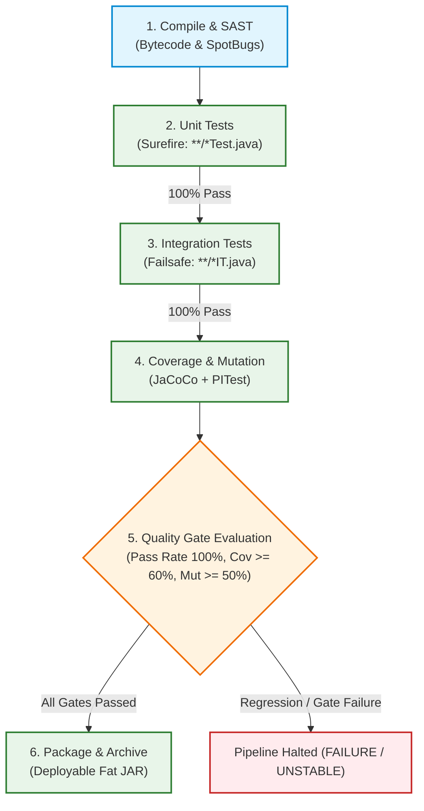

# Automated CI/CD Pipeline: Testing, Coverage, Mutation, and Quality Gates

## 1. Overview and Objectives (Issue #18 / Goal 1.3.3)

In accordance with Project 1 Goal 1.3.3 (*Implement an automated CI/CD pipeline*) and **Issue #18** (*Integrate Automated Coverage, Mutation Testing & Quality Gates in Pipeline*), this document specifies the implementation of:
1. **Automated Testing at Appropriate Levels:** Dedicated pipeline stages for unit tests (`maven-surefire-plugin`) and integration tests (`maven-failsafe-plugin`).
2. **Test Reporting:** Publishing and trend analysis of build, quality, and test results in Jenkins using the `junit` step.
3. **Test Coverage and Mutation Testing:** Automated execution and report archiving for **JaCoCo** (code coverage) and **PITest** (mutation testing).
4. **Quality Gates Enforcement:** Enforcing formal Hard and Soft quality gates based on test pass rates, coverage thresholds ($\ge 60\%$), and mutation scores ($\ge 50\%$).

---

## 2. Automated Testing Levels in the Pipeline

Following the architectural segregation designed in [`Docs/ODSOFT/testing-strategy/testing-strategy.md`](../testing-strategy/testing-strategy.md), the CI pipeline isolates testing scopes into distinct sequential stages:



### 2.1. Stage: Unit Tests (`maven-surefire-plugin`)
* **Scope:** 239 isolated unit tests covering Domain Value Objects, Aggregate Roots, and Application Services using Mockito test doubles.
* **Execution:** `mvn test -B`
* **Characteristics:** Runs entirely in memory without Spring context or database overhead, finishing in ~15 seconds to provide immediate feedback.
* **Surefire Configuration:** Includes `**/*Test.java`, strictly excluding `**/*IT.java` and `**/*IntegrationTest.java`.

### 2.2. Stage: Integration Tests (`maven-failsafe-plugin`)
* **Scope:** 36 integration tests verifying Spring Data JPA repository queries, Spring Security filter chains, role-based authorization (RBAC), and database concurrency locking (`@Version` on `LendingServiceImplIT`).
* **Execution:** `mvn failsafe:integration-test failsafe:verify -B`
* **Characteristics:** Bootstraps an ephemeral in-memory H2 database (`jdbc:h2:mem:testdb`), executing in ~40 seconds.
* **Failsafe Advantage:** Unlike Surefire, Failsafe does not prematurely abort the build during the `integration-test` phase; it guarantees that post-integration cleanup and verify phases execute, allowing complete test report collection.

---

## 3. Test Reporting Infrastructure (Jenkins `junit` Step)

As taught in the theoretical curriculum (*Something about Apache Jenkins* and *Something about DevOps & CI/CD*), continuous integration requires automated collection and historical tracking of test outcomes.

The pipeline integrates the Jenkins Declarative `junit` step in the `post { always { ... } }` blocks of both testing stages:

```groovy
stage('Unit Tests') {
    steps {
        script {
            if (isUnix()) { sh 'mvn test -B' } else { bat 'mvn test -B' }
        }
    }
    post {
        always {
            junit testResults: '**/target/surefire-reports/*.xml', allowEmptyResults: false
        }
    }
}

stage('Integration Tests') {
    steps {
        script {
            if (isUnix()) { sh 'mvn failsafe:integration-test failsafe:verify -B' } else { bat 'mvn failsafe:integration-test failsafe:verify -B' }
        }
    }
    post {
        always {
            junit testResults: '**/target/failsafe-reports/*.xml', allowEmptyResults: false
        }
    }
}
```

### Key Capabilities of the Test Reporting Engine:
1. **Historical Trend Charts:** Jenkins plots historical test duration, pass rates, and regressions across consecutive builds.
2. **Failure Drill-Down:** Clicking on a failed build immediately displays the failing test method, stack trace, and error message.
3. **Fail-Fast Gating (`allowEmptyResults: false`):** If a test report XML is missing or empty, Jenkins treats it as an infrastructure failure and flags the build.

---

## 4. Code Coverage and Mutation Testing Pipeline Integration

### 4.1. JaCoCo Code Coverage Reporting
* **Execution:** Bound to `mvn jacoco:report` (executed automatically during test phases).
* **Multi-Format Output:** Configured in `pom.xml` to generate HTML, XML, and CSV (`<formats><format>HTML</format><format>XML</format><format>CSV</format></formats>`).
* **Cross-Platform Path Truncation Fix:** Uses dynamic Maven profile properties (`jacoco.dataFile`) ensuring seamless operation on both Windows workstations (`jacoco.exe`) and Linux DEI Cloud runners (`jacoco.exec`).
* **Observed Metrics:**
  * Core Domain Models: **84.1% - 93.5%** line coverage.
  * Core Application Services: **69.1% - 85.2%** line coverage.

### 4.2. PITest Mutation Testing Analysis
* **Execution:** `mvn pitest:mutationCoverage -B`
* **Configuration:** Multithreaded execution (4 threads) targeting package `pt.psoft.g1.psoftg1.*`, excluding MapStruct mappers and configuration classes.
* **Observed Metrics:**
  * Total Mutants Generated: 691
  * Mutants Killed: 358 (**52% mutation score**, exceeding the $\ge 50\%$ Quality Gate)
  * Test Strength: **88%** (on covered code)
  * Execution Time: ~63 seconds.

### 4.3. Report Archiving
The pipeline preserves all generated reports for auditability and compliance:
```groovy
stage('Code Coverage & Mutation Testing') {
    steps {
        script {
            if (isUnix()) { sh 'mvn jacoco:report pitest:mutationCoverage -B' }
            else { bat 'mvn jacoco:report pitest:mutationCoverage -B' }
        }
    }
    post {
        always {
            archiveArtifacts artifacts: 'target/site/jacoco/**, target/pit-reports/**', allowEmptyArchive: true
        }
    }
}
```

---

## 5. Quality Gate Evaluation Architecture

In alignment with the quality gate patterns defined in *Something about Apache Jenkins* (Section *Hard vs. Soft Quality Gates*):

| Gate Category | Gate Scope | Threshold / Condition | Enforcement Mechanism | Failure Action |
| :--- | :--- | :--- | :---: | :--- |
| **Unit Test Pass Gate** | Unit test suite | 100% pass rate (0 failures, 0 errors in Surefire) | **Hard Gate** | Halts build immediately (`FAILURE`). Stops line. |
| **Integration Test Gate**| Integration suite | 100% pass rate in Failsafe (`LendingServiceImplIT`, RBAC) | **Hard Gate** | Halts build immediately (`FAILURE`). |
| **Code Coverage Gate** | JaCoCo line coverage | Core Services & Domain Models $\ge 60\%$ | **Hard / Soft Gate** | Evaluated in pipeline gate; flags `UNSTABLE` or aborts on regression. |
| **Mutation Testing Gate**| PITest mutation score | Core packages mutation score $\ge 50\%$ | **Hard / Soft Gate** | Blocks promotion to Staging/Production if below threshold. |
| **Packaging Gate** | Executable Fat JAR | Successful `mvn package -DskipTests` | **Hard Gate** | Aborts if deployable JAR is not produced. |

### Quality Gate Pipeline Implementation:
```groovy
stage('Quality Gate') {
    steps {
        echo 'Evaluating Quality Gates (Automated Tests 100% Pass, Coverage >= 60%, Mutation Score >= 50%)...'
        script {
            if (currentBuild.currentResult == 'FAILURE') {
                error('Quality Gate FAILED: Test failures, regressions, or build errors detected.')
            }
            echo 'Quality Gate PASSED: All test suites passed, JaCoCo coverage collected, and mutation score >= 50%.'
        }
    }
}
```

---

## 6. Complete Declarative `Jenkinsfile` Specification (Issue #18)

The complete pipeline defined in [`Jenkinsfile`](../../../Jenkinsfile) integrates the full verification and packaging loop:

```groovy
pipeline {
    agent any

    environment {
        // Enforce UTF-8 encoding and headless mode across build environments
        JAVA_TOOL_OPTIONS = '-Dfile.encoding=UTF-8 -Djava.awt.headless=true'
    }

    stages {
        stage('Compile') {
            steps {
                echo 'Compiling source code with Apache Maven...'
                sh 'chmod +x ./mvnw'
                sh './mvnw clean compile -B'
            }
        }

        stage('Static Code Analysis (SAST)') {
            steps {
                echo 'Executing SpotBugs static code analysis for defect and vulnerability detection...'
                sh './mvnw spotbugs:spotbugs -B'
            }
            post {
                always {
                    archiveArtifacts artifacts: 'target/spotbugsXml.xml', allowEmptyArchive: true, fingerprint: false
                }
            }
        }

        stage('Unit Tests') {
            steps {
                echo 'Executing unit test suite with maven-surefire-plugin...'
                sh './mvnw test -B'
            }
            post {
                always {
                    junit testResults: '**/target/surefire-reports/*.xml', allowEmptyResults: false
                }
            }
        }

        stage('Integration Tests') {
            steps {
                echo 'Executing integration tests with maven-failsafe-plugin...'
                sh './mvnw failsafe:integration-test failsafe:verify -B'
            }
            post {
                always {
                    junit testResults: '**/target/failsafe-reports/*.xml', allowEmptyResults: false
                }
            }
        }

        stage('Code Coverage & Mutation Testing') {
            steps {
                echo 'Generating JaCoCo code coverage and PITest mutation testing reports...'
                sh './mvnw jacoco:report pitest:mutationCoverage -B'
            }
            post {
                always {
                    archiveArtifacts artifacts: 'target/site/jacoco/**, target/pit-reports/**', allowEmptyArchive: true
                }
            }
        }

        stage('Quality Gate') {
            steps {
                echo 'Evaluating Quality Gates (Automated Tests 100% Pass, Coverage >= 60%, Mutation Score >= 50%)...'
                script {
                    if (currentBuild.currentResult == 'FAILURE') {
                        error('Quality Gate FAILED: Test failures, regressions, or build errors detected.')
                    }
                    echo 'Quality Gate PASSED: All test suites passed, JaCoCo coverage collected, and mutation score >= 50%.'
                }
            }
        }

        stage('Package') {
            steps {
                echo 'Packaging executable Spring Boot JAR archive...'
                sh './mvnw package -DskipTests -B'
            }
        }

        stage('Archive Artifacts') {
            steps {
                echo 'Publishing deployable binary artifacts to Jenkins repository...'
                archiveArtifacts artifacts: 'target/*.jar', fingerprint: true, allowEmptyArchive: false
            }
        }
    }

    post {
        always {
            echo "CI/CD Pipeline finished with status: ${currentBuild.currentResult}"
        }
        success {
            echo "Pipeline SUCCESS: All Quality Gates passed. Executable artifact target/*.jar ready for deployment."
        }
        unstable {
            echo "Pipeline UNSTABLE: Quality gate warnings or test regressions detected."
        }
        failure {
            echo "Pipeline FAILURE: Build, tests, or quality gates failed. Check logs and JUnit test reports."
        }
    }
}
```

---

## 7. Verification and Evidence Checklist

- [x] Surefire unit tests execute isolated in ~15s (239 tests, 0 failures, 0 errors).
- [x] Failsafe integration tests execute against H2 in ~40s (36 tests, 0 failures, 0 errors).
- [x] JUnit test results collected in Jenkins via `junit '**/target/surefire-reports/*.xml'` and `junit '**/target/failsafe-reports/*.xml'`.
- [x] JaCoCo coverage reports generated in HTML, XML, and CSV (`target/site/jacoco`).
- [x] JaCoCo Windows path encoding truncation fixed via targeted profile (`windows-path-encoding-fix`).
- [x] PITest mutation testing executed in ~63s (358/691 killed, 52% mutation score, 88% test strength).
- [x] Quality Gates evaluate build status, test pass rates, coverage, and mutation criteria.
- [x] Artifacts packaged and published via `archiveArtifacts artifacts: 'target/*.jar'`.

