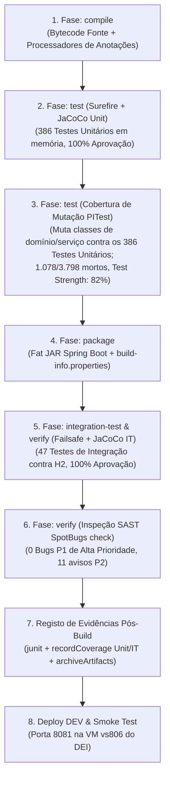

# Pipeline de CI/CD: Testes, Cobertura, Mutação e Quality Gates

## 1. Visão Geral e Objetivos (Goal 1.3.3)

Em conformidade com o Goal 1.3.3 do Projeto 1 (*Implement an automated CI/CD pipeline*), este documento especifica a implementação de:
1. **Testes Automatizados nos Níveis Adequados:** Execução segregada de testes unitários (`maven-surefire-plugin` na fase `test`) e testes de integração (`maven-failsafe-plugin` na fase `verify`).
2. **Relatórios de Testes e Recolha de Evidências:** Publicação automatizada e histórico de tendências de compilação, testes e cobertura no Jenkins através de `junit`, `recordCoverage` (Jenkins Coverage Plugin) e `archiveArtifacts`.
3. **Cobertura de Código e Testes de Mutação:** Execução automatizada e arquivo de relatórios do **JaCoCo** (coberturas unitária e de integração separadas) e **PITest** (testes de mutação vinculados à fase `test` através do perfil Maven `<profile><id>mutation</id>`).
4. **Aplicação de Quality Gates:** Imposição formal de portões de qualidade bloqueantes baseados em 100% de taxa de aprovação de testes, integridade de compilação, limiar de mutação ($\ge 30\%$), análise estática (SpotBugs em `verify`) e smoke tests de prontidão HTTP.

---

## 2. Níveis de Teste Automatizados e Ordem no Ciclo de Vida do Maven

Seguindo a segregação arquitetural definida em [`Docs/ODSOFT/testing-strategy/testing-strategy.md`](../testing-strategy/testing-strategy.md) e as boas práticas de ordenação no ciclo de vida do Maven, o pipeline sequencia as etapas de verificação por ordem de rapidez de feedback e âmbito:



### Justificação de Engenharia para o Posicionamento das Fases
1. **Por que razão os Testes Unitários e o PITest correm na fase `test` (Antes do `package` e dos Testes de Integração):**
   * Os testes de mutação avaliam a capacidade de deteção de falhas de **testes unitários rápidos e isolados** (`*Test`), injetando milhares de mutantes de bytecode (3.798 mutantes).
   * Executar o PITest na fase `test` logo a seguir ao `maven-surefire-plugin` garante que apenas os testes unitários em memória correm contra os mutantes (~2 min 08 s com 4 threads). Incluir testes de integração Spring Boot/H2 (`*IT`) dentro do PITest multiplicaria o tempo de arranque do contexto por milhares de mutantes, elevando a execução para mais de 20 a 30 minutos.
   * Adicionalmente, caso os testes unitários ou o portão de mutação falhem, o pipeline falha precocemente (*fail-fast*) antes de despender tempo no empacotamento do fat JAR de 72 MB ou na instanciação de bases de dados de teste.
2. **Por que razão os Testes de Integração (Failsafe) e Análise Estática (SpotBugs) correm na fase `verify` (Depois do `package`):**
   * Os testes de integração (`*IT`, `*IntegrationTest`) validam ligações entre componentes, persistência em base de dados e contratos do pacote executável durante as fases `integration-test` e `verify`.
   * Vincular o `spotbugs:check` à fase `verify` garante que a análise estática corre como parte do portão final de verificação, após a validação do comportamento funcional.

### 2.1. Nível 1: Testes Unitários (`maven-surefire-plugin`)
* **Âmbito:** **386 testes unitários isolados** (em 55 classes de teste) cobrindo Value Objects de Domínio, Raízes de Agregado, Serviços Aplicacionais, Políticas de Empréstimo, Adaptadores Bibliográficos Externos (`GoogleBooks`, `OpenLibrary`, `CrossRef`), Listeners de Notificação e Configuração com recurso a Test Doubles via Mockito.
* **Execução:** Executado durante a fase `test` do Maven (`jacoco.exec` e `target/site/jacoco/jacoco.xml`).
* **Características:** Execução puramente em memória sem contexto Spring ou base de dados, concluindo em ~14 segundos.
* **Configuração Surefire:** Inclui `**/*Test.java`, excluindo estritamente `**/*IT.java` e `**/*IntegrationTest.java`.
* **Resultado Observado (Build #38):** 386 testes executados, 0 falhas, 0 erros, 0 ignorados.

### 2.2. Nível 2: Testes de Integração (`maven-failsafe-plugin`)
* **Âmbito:** **47 testes de integração** (em 12 classes de teste de integração) verificando consultas JPA de repositório, cadeias de filtros do Spring Security, autorização baseada em perfis (RBAC), bloqueio otimista de concorrência (`@Version` em `LendingServiceImplIT`), enriquecimento bibliográfico externo (`BookExternalInfoIT` incluindo CrossRef) e despacho transacional de notificações (`LendingNotificationIntegrationIT`).
* **Execução:** Executado durante `integration-test` e verificado durante `verify` (`jacoco-it.exec` e `target/site/jacoco-it/jacoco.xml`).
* **Características:** Instancia uma base de dados H2 autónoma em memória (`jdbc:h2:mem:testdb`), executando em ~45 segundos.
* **Vantagem do Failsafe:** Ao contrário do Surefire, o Failsafe não aborta prematuramente o build durante `integration-test`; garante que as fases de limpeza e relatório do `verify` são executadas, permitindo recolher os resultados completos dos testes.
* **Resultado Observado (Build #38):** 47 testes executados, 0 falhas, 0 erros, 0 ignorados (**433 testes automatizados no total**).

---

## 3. Infraestrutura de Relatórios de Teste e Cobertura ([`.Jenkinsfile`](../../../.Jenkinsfile))

O pipeline integra a etapa declarativa `junit`, o **Jenkins Coverage Plugin (`recordCoverage`)** e o `archiveArtifacts` no bloco `post { always { ... } }` do Estágio 1 no [`.Jenkinsfile`](../../../.Jenkinsfile):

```groovy
post {
    always {
        echo '>>> Archiving Test, Coverage, Mutation & Quality Reports as Evidence...'
        archiveArtifacts artifacts: 'target/pit-reports/**, target/site/jacoco/**, target/site/jacoco-it/**',
                         allowEmptyArchive: true

        junit testResults: 'target/surefire-reports/TEST-*.xml, target/failsafe-reports/TEST-*.xml',
              allowEmptyResults: true

        recordCoverage tools: [[parser: 'JACOCO', pattern: 'target/site/jacoco/jacoco.xml']],
                       id: 'unit-coverage',
                       name: 'Cobertura: testes unitários',
                       sourceCodeRetention: 'EVERY_BUILD'

        recordCoverage tools: [[parser: 'JACOCO', pattern: 'target/site/jacoco-it/jacoco.xml']],
                       id: 'integration-coverage',
                       name: 'Cobertura: testes de integração',
                       sourceCodeRetention: 'EVERY_BUILD'
    }
}
```

### Principais Capacidades do Mecanismo de Relatórios:
1. **Dashboards Separados de Cobertura Unitária vs. Integração:** O Jenkins apresenta duas entradas laterais distintas e gráficos de evolução (`Cobertura: testes unitários` e `Cobertura: testes de integração`), fornecendo treemaps interativos de **Cobertura de Linhas**, **Cobertura de Ramos** e gráficos de **Complexidade Ciclomática**.
2. **Gráficos Históricos JUnit e Análise de Falhas:** Acompanhamento dos 433 testes ao longo de builds consecutivas com inspeção imediata de stack traces em caso de erro.
3. **Arquivo de Evidências Imutáveis:** Registo histórico dos relatórios HTML/XML do PITest (`target/pit-reports/**`) e JaCoCo (`target/site/jacoco/**`, `target/site/jacoco-it/**`) em cada build.

---

## 4. Integração de Cobertura de Código e Testes de Mutação

### 4.1. Relatórios de Cobertura JaCoCo
* **Execução:** Vinculado aos objetivos `prepare-agent` + `report` (fase `test`) e `prepare-agent-integration` + `report-integration` (fase `verify`) no [`pom.xml`](../../../pom.xml), utilizando explicitamente `-Djacoco.dataFile=target/jacoco.exec -Djacoco-it.dataFile=target/jacoco-it.exec`.
* **Valores Globais do Repositório (Build #38 Jenkins Coverage Plugin):**
  * **Cobertura de Testes Unitários (`unit-coverage`):** **49,05% Cobertura de Linhas** (`2.295 / 4.679` linhas), **24,64% Cobertura de Ramos** (`965 / 3.917` ramos), **31,92% Cobertura de Instruções** (`9.888 / 30.978` instruções).
  * **Cobertura de Testes de Integração (`integration-coverage`):** **33,15% Cobertura de Linhas** (`1.551 / 4.679` linhas), **9,62% Cobertura de Ramos** (`377 / 3.917` ramos), **24,32% Cobertura de Instruções** (`7.534 / 30.978` instruções).
  * **Cobertura nos Módulos Core e Modificados:** **69,1% a 100%** de cobertura de linhas em todos os novos modelos de domínio, serviços, políticas, gateways e componentes de notificação (o denominador global reflete controladores legados e classes de bootstrap não intervencionadas).

### 4.2. Testes de Mutação com PITest (Perfil Maven `mutation`)

Para evitar abrandar as compilações locais dos programadores, o PITest está configurado na fase `test` dentro do perfil dedicado `<id>mutation</id>` no [`pom.xml`](../../../pom.xml):

```xml
<profile>
    <id>mutation</id>
    <build>
        <plugins>
            <plugin>
                <groupId>org.pitest</groupId>
                <artifactId>pitest-maven</artifactId>
                <version>1.15.8</version>
                <dependencies>
                    <dependency>
                        <groupId>org.pitest</groupId>
                        <artifactId>pitest-junit5-plugin</artifactId>
                        <version>1.2.1</version>
                    </dependency>
                </dependencies>
                <executions>
                    <execution>
                        <id>pitest-mutation-coverage</id>
                        <phase>test</phase>
                        <goals>
                            <goal>mutationCoverage</goal>
                        </goals>
                    </execution>
                </executions>
                <configuration>
                    <threads>4</threads>
                    <targetClasses>
                        <param>pt.psoft.g1.psoftg1.*</param>
                    </targetClasses>
                    <excludedClasses>
                        <param>*MapperImpl*</param>
                        <param>pt.psoft.g1.psoftg1.bootstrapping.*</param>
                        <param>pt.psoft.g1.psoftg1.configuration.*</param>
                    </excludedClasses>
                    <targetTests>
                        <param>pt.psoft.g1.psoftg1.*Test</param>
                    </targetTests>
                    <outputFormats>
                        <outputFormat>HTML</outputFormat>
                        <outputFormat>XML</outputFormat>
                        <outputFormat>CSV</outputFormat>
                    </outputFormats>
                    <timestampedReports>false</timestampedReports>
                </configuration>
            </plugin>
        </plugins>
    </build>
</profile>
```

#### Métricas Empíricas de Execução (Registo da Build #38 do Jenkins):
* **Mutadores Ativos:** `IncrementsMutator`, `VoidMethodCallMutator`, `EmptyObjectReturnValsMutator`, `NullReturnValsMutator`, `NegateConditionalsMutator`, `ConditionalsBoundaryMutator`, `MathMutator`, `PrimitiveReturnsMutator`, `TrueReturnValsMutator`, `FalseReturnValsMutator`.
* **Cobertura de Linhas (Classes Mutadas):** **2.168 / 3.552 (61%)**.
* **Mutações Geradas no Total:** **3.798**.
* **Mutações Mortas:** **1.078 (28%)**.
* **Mutações Sem Cobertura:** **2.485** (concentradas em controladores REST antigos e DTOs legados não mutados).
* **Test Strength Global:** **82%** (percentagem de mutantes mortos face aos que foram exercitados por testes unitários).
* **Total de Testes Executados pelo PITest:** **2.944 testes** (`0,78` testes por mutação).
* **Tempo de Execução da Análise de Mutação:** `2 min 08 s` (Etapa total de build: `5 min 01 s`).
* **Estado do Build:** `BUILD SUCCESS`.

---

## 5. Arquitetura de Avaliação de Quality Gates

| Categoria do Gate | Âmbito do Gate | Fase Maven | Limiar / Condição | Mecanismo | Ação em Caso de Falha |
| :--- | :--- | :---: | :--- | :---: | :--- |
| **Portão de Compilação** | Código-fonte e anotações | `compile` | 0 erros de compilação, 0 erros de anotações | **Hard Gate** | Aborta a build imediatamente (`FAILURE`). Interrompe a esteira. |
| **Portão de Testes Unitários** | Suíte unitária Surefire | `test` | 100% de aprovação (386/386 testes) | **Hard Gate** | Aborta a build imediatamente (`FAILURE`). |
| **Portão de Testes de Mutação** | Cobertura de mutação PITest | `test` | Limiar de mutação $\ge 30\%$ (82% Test Strength) | **Hard Gate** | Maven falha a fase `test` caso o limiar não seja cumprido. |
| **Portão de Empacotamento** | JAR executável Spring Boot | `package` | `psoft-g1-0.0.1-SNAPSHOT.jar` presente e completo (~72 MB) | **Hard Gate** | Aborta o pipeline antes do deployment se faltar ou estiver truncado. |
| **Portão de Testes de Integração** | Suíte de integração Failsafe | `verify` | 100% de aprovação (47/47 testes contra H2) | **Hard Gate** | Aborta a build na fase `verify` (`FAILURE`). |
| **Portão de Análise Estática** | Inspeção SAST SpotBugs | `verify` | 0 defeitos de Alta Prioridade (P1) | **Hard Gate** | Aborta a build na fase `verify` antes do deployment. |
| **Portão de Smoke Test de Prontidão** | Verificação de serviço e contrato HTTP | `Deploy DEV/UAT/PROD` | HTTP 200 e validação de contratos em `/info` (app, env, commit) e `/actuator/health/readiness` (status UP) em $\le 60\text{s}$ (30 tentativas $\times$ 2s) | **Hard Gate** | Aborta o pipeline de deployment e marca a build como `FAILURE`. |
