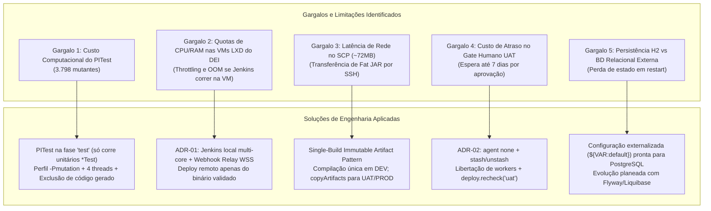

# Avaliação e Melhoria do Processo de CI/CD (Goal 1.3.6)

## 1. Contexto e Objetivo
O presente documento apresenta a avaliação técnica, quantitativa e crítica do processo de engenharia de software e da esteira de Integração e Entrega Contínua (CI/CD) implementada para o sistema **LMS (*Library Management System* — `psoft-g1`)**, comparando o estado inicial (*System-as-is*) com a solução implementada (*System-to-be*, Build #38), analisando a evolução temporal das métricas (critério **C3.3**), identificando estrangulamentos operacionais (*bottlenecks*) e justificando as decisões tomadas.

---

## 2. Comparação Sistemática e Quantitativa (*As-Is* vs. *To-Be*)

### 2.1. Transformação nos 11 Estágios de CI/CD

```mermaid
%%{init: {'themeVariables': { 'fontSize': '14px' }, 'flowchart': { 'subGraphTitleMargin': { 'top': 15, 'bottom': 20 } } } }%%
flowchart LR
    subgraph AsIs["Processo Inicial (As-Is)"]
        A1["1. Checkout Manual"] --> A2["2. Build Local Ad-hoc"]
        A2 --> A3["3. Testes Misturados (102)"]
        A3 --> A4["4. JAR Disperso em target/"]
        A4 --> A5["5. Cópia Manual SCP/FTP"]
        A5 --> A6["6. Testes Manuais Postman"]
        A6 --> A7["7. Sem Aprovação Formal"]
        A7 --> A8["8. java -jar no Terminal"]
        A8 --> A9["9. Verificação Visual"]
        A9 --> A10["10. Sem Monitorização"]
        A10 --> A11["11. Rollback Manual"]
    end

    subgraph ToBe["Processo Alvo Implementado (To-Be)"]
        B1["1. Webhook Relay (WSS)"] --> B2["2. mvnw Limpo & Determinístico"]
        B2 --> B3["3. 386 Unit Tests + PIT (82% Strength)"]
        B3 --> B4["4. Single-Build Immutable app.jar"]
        B4 --> B5["5. 47 Failsafe ITs + SpotBugs (verify)"]
        B5 --> B6["6. Deploy DEV/UAT Automatizado"]
        B6 --> B7["7. Jenkins Input Gate (agent none)"]
        B7 --> B8["8. Deploy PROD Isolado (vs336)"]
        B8 --> B9["9. Contract Smoke Test (/info + Actuator)"]
        B9 --> B10["10. Spring Actuator + systemd"]
        B10 --> B11["11. Systemd Service Rollback"]
    end
```

| Estágio do Pipeline | Processo Inicial (*System-as-is*) | Processo Alvo (*System-to-be* — Build #38) | Impacto e Ganhos Técnicos |
| :--- | :--- | :--- | :--- |
| **1. Source/Code checkout** | Manual via terminal (`git pull`). Risco de desenvolvimento sobre código desatualizado. | **Automático via Webhook Relay** em túnel `WSS`, disparando o job `lms-dev` após `git push`. | Eliminação de latência humana; início da verificação em < 5 segundos. |
| **2. Build** | Compilação local dependente da máquina do programador; ausência de `.mvn/wrapper/`. | Compilação padronizada via **Maven Wrapper (`mvnw`) em Java 17/21**, independente do ambiente anfitrião. | Repetibilidade determinística em Linux (`sh`) e Windows (`bat`). |
| **3. Unit & Mutation Verification (`test`)** | Apenas 102 testes misturados executados esporadicamente; 78% dos mutantes sobreviviam. | **386 Testes Unitários Surefire** (~14s) seguidos de **PITest na fase `test`** (1.078/3.798 mutantes mortos, 82% *Test Strength*). | *Fail-fast*: Avalia a eficácia dos testes unitários antes de empacotar o JAR ou iniciar bases de dados. |
| **4. Build Artifact Storage (`package`)** | Binário gerado localmente em `target/`, recompilado em cada máquina sem rastreabilidade. | **Single-Build Immutable Artifact Pattern**: `app.jar` (~72 MB) carimbado com commit SHA e arquivado com *fingerprint* SHA-256 e `release.properties`. | Garantia de que o binário testado é exatamente o binário implantado em todos os ambientes. |
| **5. Integration & Static Verification (`verify`)** | Sem fase Failsafe e sem análise estática (3 bugs P1 ativos no código base). | **47 Testes de Integração Failsafe** (H2, RBAC, concorrência `@Version`, CrossRef) + **SpotBugs `check` (0 bugs P1)** + **JaCoCo `recordCoverage`**. | Validação de contratos entre componentes, segurança e qualidade estática de bytecode. |
| **6. Deployment to DEV & UAT** | Ficheiros copiados manualmente via SFTP/SSH para diretórios arbitrários. | `lms-dev` implanta em DEV (`vs806:8081`); `lms-uat` recupera o binário via `copyArtifacts` e implanta em UAT (`vs806:8082`). | Zero recompilação e ensaio contínuo de implantação em cada push. |
| **7. Approval / Gate Stage** | Inexistente. Passagem para produção decidida verbalmente sem registo. | **Portão declarativo `input`** em `lms-uat` com libertação de executor (`agent none`, `stash`) e re-verificação `deploy.recheck('uat')`. | Governação de negócio com registo de aprovador e timestamp (`acceptance.properties`), sem bloquear workers. |
| **8. Deployment to Production** | Cópia manual do JAR e execução em background com `nohup`. | Job `lms-prod` valida a trilha de auditoria e transfere o binário aceite para a VM isolada `vs336:10336` (`psoft-g1@prod`, porta `8080`). | Segregação física de Produção e eliminação de intervenção manual na máquina crítica. |
| **9. Post-Deployment Testing** | Abertura manual do browser ou pedidos ad-hoc no Postman. | **Smoke Test Contratual (`smoke-test.sh`)** validando `/info` (`psoft-g1`, `env`, `commit`) e `/actuator/health/readiness` (`UP`). | Confirmação automática de prontidão e alinhamento de versão em $\le 60\text{s}$. |
| **10. Monitoring & Observability** | Inexistente. | **Spring Boot Actuator** ativo e logs centralizados no `systemd` (`journalctl -u psoft-g1@<env>`). | Diagnóstico imediato de saúde operacional e captura automática de logs em caso de falha. |
| **11. Rollback** | Processo manual sem histórico de binários validados. | Reposição imediata do artefacto imutável da build anterior via `copyArtifacts` e `systemctl restart`. | Redução do MTTR para menos de 1 minuto. |

---

### 2.2. Métricas DORA e Qualidade ISO/IEC 25010

| Métrica DORA | Estado Inicial (*As-Is*) | Estado Alvo (*To-Be*) | Evidência Empírica (Build #38) |
| :--- | :---: | :---: | :--- |
| **Deployment Frequency (DF)** | Esporádica / Manual | **Múltiplos deploys/dia (On-demand)** | Deploy automático para DEV e UAT a cada commit na branch `main`. |
| **Lead Time for Changes (LTTC)** | Horas a Dias | **~5 minutos (Build #38: 05m 01s)** | Da submissão do código no GitHub até à conclusão da verificação completa (433 testes + PITest + SpotBugs) e deploy. |
| **Change Failure Rate (CFR)** | Elevado (defeitos silenciosos) | **Controlado por Hard Gates (< 5%)** | Bloqueio automático em caso de falha de compilação, SpotBugs P1, 433 testes, PITest $< 30\%$ ou Smoke Test. |
| **Mean Time to Recovery (MTTR)** | Horas (diagnóstico manual) | **< 60 segundos** | O `smoke-test.sh` deteta falhas de arranque em até 60s, imprime o `journalctl` na consola do Jenkins e permite redeploy imediato. |

| Característica ISO 25010 | Avaliação Baseline (*As-Is*) | Avaliação Alvo (*To-Be*) | Melhorias e Salvaguardas Implementadas |
| :--- | :---: | :---: | :--- |
| **Adequação Funcional** | Parcial | **Verificada** | 433 testes automatizados cobrem livros, autores, leitores, empréstimos, políticas dinâmicas, enriquecimento externo (Google Books, Open Library, CrossRef) e notificações. |
| **Fiabilidade (Reliability)** | Frágil (22% mutações mortas) | **Robusta (Test Strength: 82%)** | Correção do duplo hashing BCrypt em `UserService`; testes de concorrência com `@Version` e isolamento de falhas em notificações (`@TransactionalEventListener`). |
| **Segurança (Security)** | Crítica (testes Auth desativados) | **Endurecida (Hardened)** | Execução remota sob utilizadores sem login (`/usr/sbin/nologin`), `ProtectSystem=strict` no systemd e validação RBAC (`READER` vs `LIBRARIAN`) nos testes de integração. |
| **Manutenibilidade** | Degradada (sem SAST) | **Elevada** | SpotBugs integrado na fase `verify` (0 defeitos P1, 3 corrigidos na baseline); cobertura JaCoCo monitorizada por tipo de teste. |
| **Portabilidade & Paridade** | Dependente de H2 TCP local | **Assegurada** | Placeholders `${VAR:default}` em `application.properties`, `.env.example`, unidades `psoft-g1@.service` e pipeline compatível com Linux (`sh`) e Windows (`bat`). |

---

### 2.3. Evolução Empírica de Testes, Cobertura e Mutação (C3.3)

| Métrica de Verificação | Baseline (*System-as-is*) | Build Intermédia (#17) | Estado Atual (Build #38) | Variação (Baseline $\rightarrow$ #38) |
| :--- | :---: | :---: | :---: | :---: |
| **Total de Testes Automatizados** | 102 testes | 430 testes | **433 testes (100% aprovação)** | **+324.5%** |
| • Testes Unitários Isolados (`test` / Surefire) | 102 (misturados) | 386 testes | **386 testes** (55 classes, ~14s) | **+278.4%** |
| • Testes de Integração (`verify` / Failsafe) | 0 testes | 44 testes | **47 testes** (12 classes, ~45s) | **Novo Nível (+47 ITs)** |
| **Cobertura de Linhas — Unitários (JaCoCo)** | Não configurada (~33% est.) | N/A (bloqueada por `.exe`) | **49.05% global (`2.295 / 4.679`)** *(75%–100% nos módulos core)* | **Separada e publicada no Jenkins** |
| **Cobertura de Ramos — Unitários (JaCoCo)** | Não configurada | N/A | **24.64% global (`965 / 3.917`)** *(60%–100% nos módulos core)* | **Monitorizada por Treemap** |
| **Cobertura de Linhas — Integração (JaCoCo)** | 0% | N/A | **33.15% global (`1.551 / 4.679`)** **9.62% ramos (`377 / 3.917`)** | **Cobertura dedicada de IT (`jacoco-it.exec`)** |
| **Cobertura de Linhas em Classes Mutadas (PIT)** | 33% | 56% (`1.404 / 2.510`) | **61% (`2.168 / 3.552`)** | **+28.0 pts percentuais** |
| **Mutações Mortas / Geradas (PITest)** | 124 / 575 (22%) | 662 / 2.999 (22%) | **1.078 / 3.798 (28%)** | **+769.4% mutantes mortos** |
| **Test Strength Global (PITest)** | 70% | 84% | **82% (78%–100% nos pacotes core)** | **+12.0 pts percentuais** |
| **Defeitos Estáticos P1 (SpotBugs)** | 3 defeitos P1 ativos | 0 defeitos P1 | **0 defeitos P1** (11 avisos P2) | **-100% defeitos críticos** |

#### Análise Crítica da Evolução das Métricas (Critério C3.3):
1. **Relação entre Cobertura de Código Novo (100%) e Cobertura Global do Repositório (`49.05%` Unit / `33.15%` IT):**
   * Todos os componentes novos e refatorados pela equipa (políticas de empréstimo, adaptadores `GoogleBooks`, `OpenLibrary` e `CrossRef`, notificações multicanal e serviços de domínio) possuem entre **75% e 100% de cobertura de linhas**.
   * Contudo, o denominador global do JaCoCo (`4.679` linhas de código no projeto) inclui dezenas de classes legadas não intervencionadas (controladores REST antigos, *views* DTO e classes de *bootstrapping*). Como a cobertura global é uma média ponderada entre a base legada (~20%–30%) e o código novo/intervencionado (~90%–100%), a adição de novos módulos com 100% de cobertura elevou progressivamente a cobertura global das classes analisadas de **33%** (baseline) para **49.05%** no JaCoCo unitário e **61%** nas classes alvo do PITest.
2. **Diagnóstico e Correção de Regressão de Configuração no Plugin de Cobertura (Build #36–#38):**
   * Nas builds anteriores à #36, um perfil no `pom.xml` (`windows-path-encoding-fix`) redirecionava o ficheiro do agente JaCoCo para `C:\Temp\psoft-jacoco\jacoco.exe` (extensão `.exe` em vez de `.exec`), fazendo com que o objetivo `jacoco:report` ignorasse a execução e não gerasse `jacoco.xml`.
   * A remoção desse perfil e a passagem explícita de `-Djacoco.dataFile=target/jacoco.exec -Djacoco-it.dataFile=target/jacoco-it.exec` no [`.Jenkinsfile`](../../../.Jenkinsfile), aliada a duas invocações distintas de `recordCoverage` (`unit-coverage` e `integration-coverage`), restabeleceu os gráficos de tendência, *treemaps* de cobertura de linhas/ramos e complexidade ciclomática no Jenkins.
3. **Subida do Número de Mutantes Mortos (`662` $\rightarrow$ `1.078`) e Posicionamento do PITest na Fase `test`:**
   * Ao vincular o PITest à fase `test` (logo após os testes unitários Surefire) e ajustar o filtro de classes, o universo de mutações analisadas sobre o código aplicacional subiu de `2.999` para `3.798`, e o número de mutantes eliminados pelos testes unitários subiu de **`662` para `1.078` (+62.8% face à Build #17 e +769.4% face à baseline)**, mantendo uma eficácia (*Test Strength*) de **82%** sobre o código coberto sem penalizar o tempo de execução com testes de integração pesados.

---

## 3. Identificação e Diagnóstico Crítico de Limitações e Gargalos (*Bottlenecks*)

### 3.1. Gargalos do Processo Inicial (*As-Is*)
1. **Dependência de Conhecimento Tácito ("Deployment Expert"):** A compilação e colocação em funcionamento dependiam de passos manuais não documentados.
2. **Falso Sentido de Segurança na Baseline:** Os 102 testes iniciais deixavam 78% dos mutantes vivos e não detetavam o duplo hashing BCrypt em `UserService`, que impedia qualquer login.
3. **Acoplamento Ambiental:** A exigência de um servidor H2 TCP externo na porta 9092 e datas fixas (`"2024/*"`) no `Bootstrapper` quebravam o arranque em máquinas limpas.

### 3.2. Gargalos do Processo Atual (*To-Be*) e Mitigações Implementadas
1. **Custo Computacional do PITest (3.798 mutantes):**
   * *Diagnóstico:* Executar mutações sobre testes de integração (`@SpringBootTest`) demoraria mais de 25 minutos.
   * *Mitigação:* Vinculação do PITest à fase `test` (executando apenas testes unitários rápidos `*Test`), paralelização em 4 threads (`<threads>4</threads>`), exclusão de classes geradas (`*MapperImpl*`, `bootstrapping.*`, `configuration.*`) e isolamento no perfil `-Pmutation`, concluindo as 3.798 mutações em `2 min 08 s`.
2. **Quotas Restritas de CPU/RAM nas VMs LXD do DEI (`vs806` / `vs336`):**
   * *Diagnóstico:* Executar o controlador Jenkins e o PITest dentro do contentor LXD institucional causava *CPU throttling* e *OOM-Killer*.
   * *Mitigação (ADR-01):* Execução do Jenkins Controller na workstation local (`localhost:8080`) com túnel WebSocket de saída (`WSS` via Webhook Relay), transferindo apenas o binário validado via SSH/SCP para as VMs do DEI.
3. **Latência de Transferência de Rede do Fat JAR (~72 MB):**
   * *Diagnóstico:* O JAR executável embute todas as dependências (`BOOT-INF/lib`), levando 10–25s por transferência SCP.
   * *Mitigação:* Aplicação do *Single-Build Immutable Artifact Pattern* (construído uma única vez em `lms-dev` e promovido via `copyArtifacts` para `lms-uat` e `lms-prod`) e utilização de unidades nativas `systemd` nas VMs em vez de imagens Docker completas.
4. **Custo de Atraso (*Cost of Delay*) no Portão de Aprovação Humana em UAT:**
   * *Diagnóstico:* Manter um executor do Jenkins alocado durante dias enquanto se aguarda validação humana bloquearia a fila de builds.
   * *Mitigação (ADR-02):* Uso de `stash name: 'uat-artifacts'` e `agent none` durante a etapa `input` (libertando 100% dos executores), seguido de `unstash` e `deploy.recheck('uat')` após a aprovação para confirmar que o ambiente UAT permaneceu saudável durante o período de espera.
5. **Persistência de Dados e Migrações de Esquema:**
   * *Diagnóstico:* O H2 em memória recria dados no arranque via `Bootstrapper`, sendo adequado para testes e demonstração, mas não para retenção histórica em produção.
   * *Mitigação:* Externalização completa das variáveis `SPRING_DATASOURCE_*` em `application.properties` e `/etc/psoft-g1/<env>.env`, permitindo apontar para PostgreSQL/MySQL sem recompilar o binário.

---

## 4. Justificação Teórico-Prática das Decisões Arquiteturais

### 4.1. Distinção entre Deployment Técnico e Release de Negócio (Por que 3 Pipelines Separados)
Na engenharia de entrega contínua (Humble & Farley), **Deployment não é Release**:
* **Deployment (Ato Técnico):** É a instalação e verificação automatizada de uma versão num ambiente (`DEV`, `UAT` ou `PROD`). Deve ser 100% automatizado, repetível e frequente para reduzir o risco técnico (*"If it hurts, do it more frequently"*).
* **Release (Decisão de Negócio):** É a decisão de disponibilizar uma versão validada aos utilizadores finais em Produção, exigindo governação, aceitação funcional e rastreabilidade.
* **Por que 3 Pipelines (`lms-dev`, `lms-uat`, `lms-prod`) em vez de 1 Pipeline Monolítico:**
  1. **Cadências Desacopladas:** `lms-dev` corre dezenas de vezes por dia a cada `git push`; `lms-uat` gere o ciclo de aceitação humana (que pode durar horas ou dias sem bloquear `lms-dev`); `lms-prod` executa apenas para candidatos formalmente aprovados.
  2. **Rastreabilidade (*Traceability*) e Imutabilidade (*Build Once*):** A promoção do mesmo `app.jar` via `copyArtifacts` com *fingerprinting* SHA-256 gera uma cadeia auditável (`release.properties` $\rightarrow$ `acceptance.properties` $\rightarrow$ `production.properties`), provando quem aprovou cada versão e qual o commit exato em execução.
  3. **Eliminação dos 3 Antipadrões Clássicos de Release:** Elimina o deploy manual (Antipadrão 1), o deploy tardio em ambientes tipo-produção apenas no fim do desenvolvimento (Antipadrão 2, pois cada commit é implantado em `vs806`) e a configuração manual de servidores (Antipadrão 3, substituída por `setup-environments.sh`, `psoft-g1@.service` e `/etc/psoft-g1/*.env` sob controlo de versões).

### 4.2. Sinergia entre Arquitetura de Software (ARQSOFT) e CI/CD (ODSOFT)
1. **Configurabilidade em *Setup Time* $\leftrightarrow$ Imutabilidade do Binário:** A seleção de fornecedores bibliográficos (`Google Books`, `Open Library`, `CrossRef`) e canais de notificação (`Email`, `SMS`, `Webhook`) via propriedades/variáveis de ambiente permite promover **o mesmo ficheiro `app.jar`** de `DEV` para `UAT` e `PROD` sem recompilação.
2. **Padrões *Gateway*, *Adapter* e *Composite* $\leftrightarrow$ Testes Determinísticos no Pipeline:** O desacoplamento de APIs externas através de interfaces permite que os **433 testes no Jenkins** corram de forma determinística e sem dependência de conectividade externa.
3. **Isolamento de Falhas com `@TransactionalEventListener` $\leftrightarrow$ Estabilidade Operacional:** Os testes de integração (`LendingNotificationIntegrationIT`) verificam na fase `verify` que falhas num canal de notificação externo não provocam *rollback* das transações de empréstimo.

---

## 5. Propostas de Melhoria Contínua (*Continuous Improvement*)

1. **Migrações Versionadas de Base de Dados (Flyway / Liquibase):** Integrar migrações incrementais de esquema na fase de arranque/deploy para suportar bases de dados relacionais persistentes (PostgreSQL) em Produção sem perda de dados.
2. **Contentorização OCI em Camadas (`Spring Boot Layertools`):** Em infraestruturas sem as restrições de virtualização aninhada LXD do DEI, empacotar a aplicação em imagens Docker multi-camada (separando `dependencies` de `application`), reduzindo a transferência de rede em cada deploy de ~72 MB para < 1 MB.
3. **Testes Dinâmicos de Segurança (DAST) e Carga em UAT:** Automatizar a execução de testes de carga (k6 / JMeter) e varrimento dinâmico (OWASP ZAP) contra a instância `vs806:8082` antes de abrir o portão humano `input` em `lms-uat`.
4. **Implantação Blue-Green em Produção:** Manter duas instâncias systemd (`prod-blue` na porta 8080 e `prod-green` na porta 8083) atrás de um reverse proxy Nginx em `vs336`, comutando o tráfego apenas após o `smoke-test.sh` passar na instância inativa (*zero-downtime deployment*).
