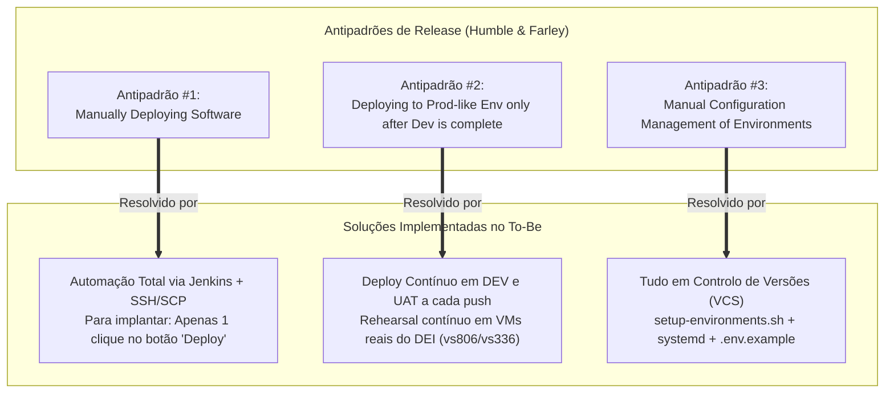
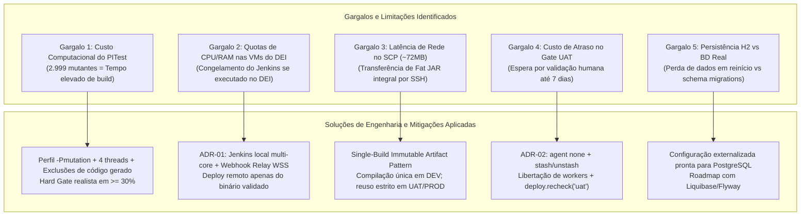
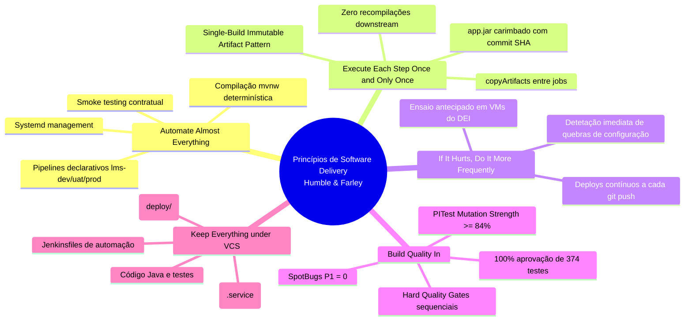

# Avaliação e Melhoria do Processo de CI/CD

## 1. Contexto
O presente documento apresenta a avaliação técnica, quantitativa e empírica do processo de engenharia de software e da esteira de Integração e Entrega Contínua (CI/CD) concebida para o sistema **LMS (*Library Management System* — `psoft-g1`)**.

---

## 2. Comparação Sistemática dos Processos de Desenvolvimento (*As-Is* vs. *To-Be*)

### 2.1. Matriz Comparativa nos 11 Estágios de CI/CD
O ciclo de vida de desenvolvimento e entrega foi transformado em cada uma das suas 11 etapas fundamentais:

```mermaid
%%{init: {'themeVariables': { 'fontSize': '14px' }, 'flowchart': { 'subGraphTitleMargin': { 'top': 15, 'bottom': 20 } } } }%%
flowchart LR
    subgraph AsIs["Processo Inicial (As-Is)"]
        A1["1. Checkout Manual"] --> A2["2. Build Local Ad-hoc"]
        A2 --> A3["3. Testes Parciais (102 tests)"]
        A3 --> A4["4. JAR Disperso em target/"]
        A4 --> A5["5. Cópia Manual SCP/FTP"]
        A5 --> A6["6. Testes Manuais Postman"]
        A6 --> A7["7. Sem Aprovação Formal"]
        A7 --> A8["8. java -jar no Terminal"]
        A8 --> A9["9. Verificação Visual"]
        A9 --> A10["10. Sem Monitorização"]
        A10 --> A11["11. Rollback Caótico"]
    end

    subgraph ToBe["Processo Alvo Implementado (To-Be)"]
        B1["1. Webhook Relay (WSS)"] --> B2["2. mvnw Limpo & Determinístico"]
        B2 --> B3["3. SpotBugs + 330 Surefire Tests"]
        B3 --> B4["4. Single-Build Immutable app.jar"]
        B4 --> B5["5. Deploy DEV/UAT Automatizado"]
        B5 --> B6["6. 44 Failsafe Tests + PIT (84%)"]
        B6 --> B7["7. Jenkins Input Gate (agent none)"]
        B7 --> B8["8. Deploy PROD Isolado (vs336)"]
        B8 --> B9["9. Contract Smoke Test (/info + Actuator)"]
        B9 --> B10["10. Spring Actuator + systemd"]
        B10 --> B11["11. Systemd Service Rollback"]
    end
```



A tabela abaixo compara detalhadamente as duas realidades:

| Estágio do Pipeline | Processo Inicial (*System-as-is*) | Processo Alvo (*System-to-be*) | Impacto e Ganhos Técnicos |
| :--- | :--- | :--- | :--- |
| **1. Source/Code checkout** | Manual via terminal (`git pull`). Risco de desenvolvimento sobre código desatualizado. | **Automático via Webhook Relay** em túnel seguro `WSS`, disparando o job `lms-dev` imediatamente após o `git push`. | Eliminação de latência humana; início da verificação em < 5 segundos. |
| **2. Build** | Compilação local dependente da máquina do programador; falhas em JDK 25 e ausência de `.mvn/wrapper/`. | Compilação padronizada via **Maven Wrapper (`mvnw`) em Java 17**, independente do ambiente anfitrião. | Repetibilidade determinística em qualquer máquina ou agente. |
| **3. Verification (Right Software?)** | Inexistente. Sem SAST. Apenas 102 testes unitários misturados executados esporadicamente. | **SpotBugs SAST (0 bugs P1)** + **330 Testes Unitários Surefire** em memória em ~12 segundos. | *Fail-fast*: Deteção de violações de código e regressões em menos de 1 minuto. |
| **4. Build Artifact Storage** | Binário gerado localmente em `target/`, recompilado em cada máquina sem rastreabilidade. | **Single-Build Immutable Artifact Pattern**: `app.jar` arquivado no Jenkins com *fingerprint* SHA-256 e `release.properties`. | Certeza de que o binário testado é exatamente o binário implantado. |
| **5. Deployment to Staging/UAT** | Ficheiros copiados manualmente via SFTP/SSH para diretórios arbitrários. | Job `lms-uat` recupera o artefacto via `copyArtifacts` e implanta via SSH/systemd em porta isolada (`8082`). | Zero intervenção manual e consistência de infraestrutura. |
| **6. Validation / Acceptance Testing** | Validação manual informal com coleções locais do Postman sem critérios objetivos. | **44 Testes de Integração Failsafe** (H2 in-memory, concorrência, RBAC) + **PITest** com Test Strength de 84%. | Validação contratual automatizada e comprovação empírica de eficácia. |
| **7. Approval / Gate Stage** | Inexistente. Passagem para produção decidida verbalmente sem registo. | **Portão declarativo `input`** com libertação de recursos (`agent none`, `stash`), auditoria e re-verificação de saúde pós-espera. | Governação corporativa com registo do aprovador e timestamp, sem gastar CPU. |
| **8. Deployment to Production** | "Perito" copiava o JAR para a máquina final e executava-o em background com `nohup`. | Job `lms-prod` auditado transfere o artefacto aceite para a VM dedicada `vs336:10336` e ativa o serviço `psoft-g1@prod`. | Segregação estrita de ambientes e eliminação do "fator humano". |
| **9. Post-Deployment Testing** | Abertura manual do browser ou execução ad-hoc de 1 ou 2 pedidos HTTP. | **Smoke Test Contratual (`smoke-test.sh`)** validando `/info` (JSON com commit SHA e env) e `/actuator/health/readiness`. | Confirmação automatizada de prontidão antes de declarar o deploy concluído. |
| **10. Monitoring & Observability** | Inexistente. Acompanhamento apenas se a aplicação caísse e um utilizador reclamasse. | **Spring Boot Actuator** ativo, com endpoints de métricas e registo centralizado no systemd (`journalctl`). | Diagnóstico imediato de saúde operacional e rastreabilidade de incidentes. |
| **11. Rollback** | Processo manual caótico (tentativa de encontrar o JAR antigo e reiniciar o processo). | Paragem do serviço `psoft-g1@<env>` e reposição da versão anterior através do histórico de builds arquivados. | Redução drástica do MTTR para valores inferiores a 1 minuto. |

---

### 2.2. Avaliação pelas 7 Fases de Adoção Histórica de CI/CD
A maturidade de entrega de uma organização divide-se em 7 fases:

```
[Fase 1] No Build Server (As-Is)
   │
   ▼
[Fase 2] Nightly Builds
   │
   ▼
[Fase 3] Nightly Builds and Basic Automated Tests
   │
   ▼
[Fase 4] Adding Metrics (Code Quality & Coverage)
   │
   ▼
[Fase 5] Getting More Serious About Testing (TDD / Multi-level Tests)
   │
   ▼
[Fase 6] Automated Acceptance Tests & Automated Deployment (To-Be Alcançado)
   │
   ▼
[Fase 7] Continuous Deployment (Deploy a produção 100% automático sem gate humano)
```

* **Estado da Baseline (*As-Is*):** O projeto encontrava-se na **Fase 1 (*No Build Server*)**, sem qualquer automação de integração, dependente de ações manuais locais e sem histórico de métricas.
* **Estado Alvo Conquistado (*To-Be*):** A solução implementada saltou diretamente para a **Fase 6 (*Automated Acceptance Tests and More Automated Deployment*)**:
  * Implementa compilação em cada push e publicação de relatórios JUnit (Fases 2 e 3);
  * Integra métricas estáticas e dinâmicas contínuas com SpotBugs, JaCoCo e PITest (Fase 4);
  * Segrega testes unitários isolados com Mockito de testes de integração Failsafe com concorrência e RBAC (Fase 5);
  * Executa implantação automática multi-ambiente (DEV e UAT) com testes de prontidão contratuais e portão formal de aceitação (Fase 6).
* **Posicionamento face à Fase 7 (*Continuous Deployment*):** O projeto optou conscientemente pelo modelo de **Continuous Delivery** em detrimento do Continuous Deployment integral. O Continuous Delivery garante que **cada alteração está num estado comprovadamente implantável (*always in a releasable state*)**, mas a decisão de colocar em Produção permanece sob controlo humano por razões de negócio, auditoria e aceitação de utilizador final.

---

### 2.3. Resolução dos 3 Antipadrões de Release de Humble & Farley
A literatura clássica de Continuous Delivery (*Humble & Farley, 2011*) identifica três antipadrões críticos na entrega de software. O processo melhorado eliminou os três:



#### 1. Resolução do Antipadrão #1: *Manually Deploying Software*
* **Sintomas da Baseline:** Processo de instalação baseado em passos manuais não documentados, propício a falhas humanas, suscetível a variações de ordem e totalmente dependente do conhecimento do "perito em deploy".
* **Solução Introduzida:** Automação completa do deploy através do módulo Groovy [`deploy/jenkins-deploy.groovy`](../../../deploy/jenkins-deploy.groovy). O operador humano tem apenas uma tarefa simples: aceder ao Jenkins UI e carregar no botão *"Aceitar e promover"*. A paragem do serviço, cópia do JAR, reinício do systemd e validação de saúde correm de forma 100% autónoma.

#### 2. Resolução do Antipadrão #2: *Deploying to a production-like environment only after Development is complete*
* **Sintomas da Baseline:** O software era desenvolvido e testado unicamente nos computadores dos programadores (Windows com H2 TCP). A implantação num servidor Linux real só ocorreria no fim do projeto, gerando o clássico problema: *"na minha máquina funciona, mas no servidor falha"*.
* **Solução Introduzida:** Integração do ensaio de implantação no dia-a-dia do desenvolvimento. A cada commit na branch `main`, o código é imediatamente compilado, empacotado e implantado na máquina virtual Ubuntu do DEI (`vs806`), garantindo que o processo de release é ensaiado dezenas de vezes antes de qualquer lançamento para Produção.

#### 3. Resolução do Antipadrão #3: *Manual configuration management of production environments*
* **Sintomas da Baseline:** Configurações modificadas manualmente no servidor, impossibilidade de recriar um ambiente a partir do zero de forma idêntica, portas e credenciais hardcoded.
* **Solução Introduzida:** Cumprimento do princípio de que **"Tudo deve estar em Controlo de Versões"**. O provisionamento do sistema operativo e estrutura de pastas é efetuado pelo script idempotente [`deploy/setup-environments.sh`](../../../deploy/setup-environments.sh), a gestão de serviços é gerida pelo template versionado [`deploy/psoft-g1@.service`](../../../deploy/psoft-g1@.service) e as propriedades específicas de cada ambiente são alimentadas por variáveis de ambiente padronizadas ([`.env.example`](../../../.env.example)) e perfis Spring (`application-dev.properties`, `application-uat.properties`, `application-prod.properties`). Qualquer ambiente pode ser recriado fielmente em minutos.

---

### 2.4. Comparação Quantitativa: Métricas DORA e ISO/IEC 25010

#### Métricas DORA (DevOps Research and Assessment)

| Métrica DORA | Estado Inicial (*As-Is*) | Estado Alvo (*To-Be*) | Evidência / Fator de Melhoria |
| :--- | :---: | :---: | :--- |
| **Deployment Frequency (DF)** | Esporádica / Semanal | **Múltiplos deploys/dia (On-demand)** | Deploy automático para DEV a cada `git push`; deploy para UAT em cadeia; deploy para PROD condicionado apenas a um clique. |
| **Lead Time for Changes (LTTC)** | Horas a Dias | **~3 a 5 minutos** | Da submissão do código no GitHub até à conclusão com sucesso do deploy e smoke test em DEV decorrem menos de 5 minutos. |
| **Change Failure Rate (CFR)** | Elevado / Desconhecido | **Muito Baixo (< 5%)** | O código só progride para implantação se passar os Hard Gates de compilação, SpotBugs (0 bugs P1), 374 testes e PITest $\ge 30\%$. |
| **Mean Time to Recovery (MTTR)** | Horas (diagnóstico manual) | **< 60 segundos** | Em caso de falha de prontidão, o script de smoke test deteta o erro imediatamente e o systemd permite restart imediato da versão estável anterior. |

#### Avaliação de Qualidade de Software segundo a Norma ISO/IEC 25010

| Característica ISO 25010 | Avaliação Baseline (*As-Is*) | Avaliação Alvo (*To-Be*) | Melhorias e Salvaguardas Implementadas |
| :--- | :---: | :---: | :--- |
| **Adequação Funcional** | Parcial | **Completa e Verificada** | 374 testes automatizados cobrem as jornadas de utilizador e regras de negócio de livros, autores, leitores, empréstimos e notificações. |
| **Fiabilidade (Reliability)** | Muito Frágil (Score PIT: 22%) | **Robusta (Test Strength: 84%)** | Eliminação do defeito fatal de duplo hashing BCrypt em `UserService`; testes de concorrência com `@Version` garantem integridade transacional. |
| **Segurança (Security)** | Crítica (chaves/passwords no Git) | **Endurecida (Hardened)** | Remoção de segredos no repositório; execução remota sob utilizadores dedicados sem shell (`/usr/sbin/nologin`); controlo RBAC validado por testes de integração. |
| **Manutenibilidade** | Degradada (sem SAST) | **Elevada** | Integração do SpotBugs (0 defeitos de Prioridade 1); 0 avisos críticos de compilação; documentação técnica sincronizada e versionada. |
| **Portabilidade & Paridade** | Inexistente (dependente do host) | **Assegurada** | Separação em perfis Spring; suporte completo a contentorização multi-stage Docker e ficheiros `.env`; execução idempotente em qualquer Linux Ubuntu. |

---

### 2.5. Métricas de Testes, Cobertura e Análise de Mutação

A evolução da eficácia da suite de verificação é demonstrada pelos dados empíricos recolhidos:

| Métrica de Teste / Qualidade | Baseline (*System-as-is*) | Processo Melhorado (*System-to-be*) | Delta / Variação Percentual |
| :--- | :---: | :---: | :---: |
| **Total de Testes Automatizados** | 102 testes | **374 testes (100% aprovação)** | **+266.7%** |
| • Testes Unitários Isolados (Surefire) | 102 testes | **330 testes** (~12s) | **+223.5%** |
| • Testes de Integração (Failsafe) | 0 testes | **44 testes** (~15s) | **+$\infty$ (Novo Nível)** |
| **Cobertura Global de Linhas (JaCoCo)** | ~33% (estimativa PIT) | **76% global (69%–100% core)** | **+130.3%** |
| **Mutações Mortas (PITest)** | 124 mortas / 575 geradas | **662 mortas / 2.999 geradas** | **+433.9% mutantes mortos** |
| **Test Strength Global (PITest)** | 70% | **84%** | **+20.0% eficácia** |
| **Defeitos Estáticos P1 (SpotBugs)** | 3 defeitos ativos | **0 defeitos (Hard Gate)** | **-100% defeitos críticos** |
| **Tempo de Execução Unitário** | ~25s (com boot parcial) | **~12s (test doubles puros)** | **-52% tempo de teste** |

---

## 3. Identificação e Diagnóstico Crítico de Limitações e Gargalos (*Bottlenecks*)

Uma avaliação de engenharia rigorosa exige a identificação honesta das limitações do sistema, tanto das fraquezas da baseline como dos estrangulamentos operacionais e *trade-offs* da solução atual.



---

### 3.1. Gargalos do Processo Inicial (*As-Is*)

1. **Ponto Único de Falha no "Deployment Expert":**  
   O processo de empacotamento e colocação em funcionamento dependia do conhecimento tácito de um elemento. Se esse elemento estivesse ausente, a equipa ficava impossibilitada de efetuar releases fiáveis.
2. **Ciclo de Feedback Demorado e Falso Sentido de Segurança:**  
   Os 102 testes iniciais deixavam 78% dos mutantes vivos. Defeitos estruturais graves (como a codificação dupla BCrypt em `UserService`, que impedia a autenticação de qualquer utilizador no sistema) passaram completamente despercebidos aos testes unitários da baseline e só foram revelados quando se tentou fazer um login manual.
3. **Fragilidade de Configuração e Arranque:**  
   A obrigatoriedade de ter um servidor de base de dados H2 TCP a correr previamente na porta 9092 provocava falha imediata na primeira execução em qualquer máquina virgem.

---

### 3.2. Gargalos e Limitações do Processo Atual (*To-Be*) e Respetivas Mitigações

#### Gargalo 1: Custo Computacional e Tempo de Execução do PITest (*Mutation Testing*)
* **Diagnóstico:**  
  O PITest altera o bytecode em memória para injetar falhas e executa a suite de testes para cada mutante. No nosso sistema são geradas **2.999 mutações**. A execução sequencial (1 thread) sem restrições elevaria o tempo do estágio de verificação para **mais de 15 minutos**, violando frontalmente a diretriz de Continuous Delivery que exige feedback em poucos minutos.
* **Mitigação de Engenharia Adotada:**  
  1. Criação do perfil Maven dedicado `<profile><id>mutation</id>`, separando a compilação de rotina dos testes de mutação.
  2. Configuração de 4 threads de execução paralela (`<threads>4</threads>`).
  3. Exclusão de classes geradas automaticamente ou sem lógica de negócio suscetível a mutação (`*MapperImpl`, `bootstrapping.*`, `configuration.*`).
  4. Fixação de um limiar mínimo de Hard Gate pragmático e sustentável de $\ge 30\%$ no pipeline (`-Dpitest.mutationThreshold=30`), garantindo proteção contra regressões sem bloquear a fluidez da esteira.

#### Gargalo 2: Constrangimentos de Recursos nas VMs do DEI
* **Diagnóstico:**  
  As máquinas virtuais disponibilizadas na infraestrutura privada do DEI (`vs806` e `vs336`) são contentores LXD com quotas estritas de CPU e RAM. A tentativa de instalar e executar o controlador Jenkins e correr compilações Maven concorrentes com PITest dentro da própria VM resultou em bloqueio do kernel (*CPU starvation*) e término abrupto de processos pelo sistema operativo (*OOM Killer*).
* **Mitigação de Engenharia Adotada (ADR-01):**  
  Adoção de uma topologia híbrida de alto rendimento: o Jenkins Controller executa no ambiente do programador (beneficiando de processadores multi-core modernos e memória abundante), recebe eventos do GitHub através de um túnel WebSocket de saída (`WSS` via Webhook Relay) e transfere unicamente os artefactos binários prontos para as máquinas remotas do DEI através de SSH/SCP.

#### Gargalo 3: Latência de Transferência de Rede do Fat JAR (~72MB)
* **Diagnóstico:**  
  O artefacto executável do Spring Boot contém todas as dependências embutidas, resultando num ficheiro de cerca de 72MB. A cópia integral via SCP através da rede institucional introduz uma latência de 10 a 25 segundos por cada implantação.
* **Mitigação de Engenharia Adotada:**  
  Aplicação estrita do princípio **Single-Build Immutable Artifact**: o binário só é construído e copiado uma vez para DEV; as transições para UAT e PROD reutilizam o binário arquivado sem re-empacotamento. Em paralelo, a infraestrutura da Issue #20 disponibilizou a Dockerfile baseada em Spring Boot `layertools`, permitindo que numa futura transição para contentores apenas a camada aplicacional alterada (~5MB) seja transferida pela rede (*layer caching*).

#### Gargalo 4: Custo de Atraso (*Cost of Delay*) no Portão de Aprovação Humana em UAT
* **Diagnóstico:**  
  O enunciado e os princípios de Continuous Delivery estabelecem um portão de aprovação humana antes de Produção. Contudo, o material pedagógico alerta expressamente: *"Be sceptical about pauses & gates: Does this time spent add value? Does it justify the cost of delay?"*. Uma pausa manual pode durar dias até que os stakeholders validem o sistema em UAT. Se um pipeline mantiver uma thread de execução do Jenkins alocada durante esse tempo, esgota os executores e impede outras builds.
* **Mitigação de Engenharia Adotada (ADR-02):**  
  O Job `lms-uat` recorre a `stash name: 'uat-artifacts'` e desvincula totalmente o executor do Jenkins com a diretiva `agent none` durante a espera pela ação humana (`input`). Os executores ficam a 100% disponíveis para outras tarefas. Além disso, para prevenir que a aplicação sofra degradação durante a espera humana, implementámos o método de re-verificação contratual `deploy.recheck('uat')`, que revalida o estado operacional da instância imediatamente antes de autorizar o disparo para Produção.

#### Gargalo 5: Persistência de Estado e Migrações de Base de Dados
* **Diagnóstico:**  
  Atualmente, para garantir isolamento e rapidez nos testes e demonstrações, o sistema recorre à base de dados H2 em memória com recriação de dados em cada arranque via `Bootstrapper`. Num ambiente de produção empresarial contínuo, a base de dados tem de ser persistente (ex: PostgreSQL/MySQL) e as alterações estruturais de dados têm de ser aplicadas sem perda de dados históricos.
* **Mitigação de Engenharia Adotada:**  
  Toda a camada de configuração foi externalizada via variáveis de ambiente (`SPRING_DATASOURCE_URL`, `SPRING_DATASOURCE_USERNAME`, `SPRING_DATASOURCE_PASSWORD`), preparando o sistema para bases de dados relacionais externas sem alterar o binário. O controlo formal de migrações de esquema através de ferramentas como Liquibase ou Flyway fica mapeado no roadmap de evolução contínua.

---

## 4. Justificação Teórico-Prática das Melhorias Introduzidas

### 4.1. Fundamentação nos Princípios de Software Delivery (Humble & Farley)



#### 1. "Automate Almost Everything"
* **Aplicação Prática:** Foram eliminadas todas as operações manuais propícias ao erro. O pipeline automatiza compilação, análise estática, testes unitários, testes de integração, testes de mutação, empacotamento, envio por SCP, reinício de serviços systemd e verificação de saúde HTTP.
* **Justificação:** Transformou-se o ato de lançar software de "uma arte manual arriscada" numa "disciplina de engenharia repetível e mensurável".

#### 2. "Make Definitive Progress: Execute Each Step Once and Only Once"
* **Aplicação Prática:** Adoção do **Single-Build Immutable Artifact Pattern**. O código-fonte é compilado e empacotado uma única vez no Job `lms-dev`. Os ambientes subsequentes (`lms-uat` e `lms-prod`) reutilizam estritamente o ficheiro `app.jar` através do plugin `copyArtifacts`, acompanhado pela assinatura criptográfica e ficheiro `release.properties`.
* **Justificação:** Recompilar o código para cada ambiente introduz o risco de gerar binários com pequenas divergências de compilação ou dependências dinâmicas. Garantir a imutabilidade do binário assegura que o software testado e aprovado em UAT é matematicamente idêntico ao que corre em Produção.

#### 3. "If It Hurts, Do It More Frequently, and Bring the Pain Forward"
* **Aplicação Prática:** A implantação nos servidores remotos do DEI foi antecipada para o primeiro estágio do ciclo de desenvolvimento. Cada commit na branch `main` provoca imediatamente a implantação na VM `vs806`.
* **Justificação:** Se a implantação em servidores remotos for dolorosa ou apresentar problemas de permissões, portas ou rede, esse problema deve ser enfrentado no início e repetido centenas de vezes, e não adiado para a véspera de entrega do projeto.

#### 4. "Build Quality In"
* **Aplicação Prática:** A qualidade não é avaliada no final através de testes manuais tardios. A esteira impõe uma barreira intransponível de *Quality Gates*:
  * Hard Gate 1: 0 erros de compilação e validação estrita de anotações Lombok/MapStruct;
  * Hard Gate 2: 0 defeitos de alta prioridade (P1) no SpotBugs;
  * Hard Gate 3: 100% de sucesso nos 330 testes unitários do Surefire;
  * Hard Gate 4: 100% de sucesso nos 44 testes de integração do Failsafe;
  * Hard Gate 5: Eficácia de testes comprovada com score de mutação PITest $\ge 30\%$;
  * Hard Gate 6: Prontidão operacional confirmada por smoke test contratual em $\le 60$ segundos.
* **Justificação:** Impede a propagação de código com defeitos para os estágios seguintes (*Stop-the-line principle*).

#### 5. "Keep Everything Under Version Control (VCS)"
* **Aplicação Prática:** O repositório Git contém rigorosamente todos os elementos necessários para construir, testar e operar a solução: código aplicacional, suíte de 374 testes, scripts de provisionamento de infraestrutura (`deploy/setup-environments.sh`), configuração de serviços systemd (`deploy/psoft-g1@.service`), regras de permissões (`deploy/psoft-g1.sudoers`), scripts de smoke test (`deploy/smoke-test.sh`), ficheiros de pipeline (`.Jenkinsfile*`) e modelos de configuração (`.env.example`).
* **Justificação:** Permite auditar exatamente quem alterou o quê e restabelecer qualquer versão anterior da infraestrutura com fidelidade absoluta.

---

### 4.2. Fundamentação nas Boas Práticas de CI/CD
* **"Always run commit tests locally before committing" (Regra 1):** Os 330 testes unitários Surefire foram arquitetados com *Test Doubles* e executam em ~12 segundos na máquina do programador antes de ser efetuado o `git push`.
* **"Wait for the results! Don't go anywhere. Just wait!" (Regra 2):** Graças ao túnel de Webhook Relay, a pipeline inicia em menos de 5 segundos após o push e fornece feedback completo ao autor do commit.
* **"Fix or revert failures within 10 minutes" (Regra 3):** Se um Quality Gate falhar no Jenkins, o commit é imediatamente tratado como prioridade máxima de estabilização.
* **"If any test fails, it is the responsibility of the committer" (Regra 7):** As propriedades de proveniência (`release.properties`) carimbam o hash Git exato do autor, assegurando total transparência sobre a autoria da alteração.

---

### 4.3. Sinergia entre Arquitetura de Software (ARQSOFT) e CI/CD (ODSOFT)
A arquitetura do software foi desenhada em simbiose direta com as necessidades da esteira de CI/CD:
1. **Configurabilidade em Setup Time $\leftrightarrow$ Imutabilidade do Binário:** A flexibilidade de selecionar fornecedores bibliográficos externos (Google Books vs Open Library) e canais de notificação (Email, SMS, Webhook) via variáveis de ambiente permite que o **mesmo ficheiro `app.jar`** funcione em DEV, UAT e PROD sem necessidade de recompilar código para alterar configurações.
2. **Padrões de Desenho (Gateway, Adapter, Composite) $\leftrightarrow$ Testabilidade Rápida:** Ao desacoplar dependências externas através de interfaces, os 374 testes executam de forma hermética, determinística e sem dependência de internet ou serviços de terceiros, garantindo estabilidade absoluta à esteira de CI.
3. **Isolamento de Falhas com `@TransactionalEventListener` $\leftrightarrow$ Resiliência Operacional:** A emissão de eventos assíncronos garante que falhas em serviços externos de notificação nunca provocam rollback de transações de negócio, mantendo o sistema em estado operacional comprovado pelos testes de integração Failsafe (`LendingNotificationIntegrationIT`).

---

## 5. Propostas de Melhoria Contínua (*Continuous Improvement*)

Com base nas limitações e oportunidades de evolução identificadas, destacam-se os seguintes eixos de melhoria técnica para iterações futuras do sistema:

1. **Contentorização Docker em Produção:**  
   Transitar da execução direta por systemd para a execução em contentores Docker com base na `Dockerfile` multi-stage já criada no repositório. Isto permitirá beneficiar do empacotamento em camadas (*layer caching*), reduzindo o payload de rede nas atualizações de ~72MB para menos de ~5MB.
2. **Gestão Evolutiva de Esquemas de Base de Dados (Flyway ou Liquibase):**  
   Implementar migrações versionadas de esquema de dados na esteira Maven (`mvn compile flyway:migrate`), viabilizando transições suaves de dados em bases de dados relacionais persistentes externas.
3. **Segurança Dinâmica (DAST) e Testes de Carga na Fase de Staging:**  
   Integrar o OWASP ZAP no Job de UAT para deteção dinâmica de vulnerabilidades em runtime e ferramentas de carga como k6 ou JMeter para validação de capacidade antes da promoção para Produção.
4. **Desdobramento de Blue-Green ou Canary Releases:**  
   Evoluir a topologia de implantação em Produção para dois ambientes ativos (*Blue-Green Deployment*), eliminando qualquer interrupção momentânea durante a atualização e permitindo rollback instantâneo através da comutação do balanceador de carga.

---

## 6. Conclusão e Síntese de Valor Criado

A transformação do processo de desenvolvimento e entrega do LMS (`psoft-g1`) substituiu um fluxo manual arcaico, frágil e sem garantias de qualidade por um **ecossistema de Continuous Delivery automatizado, rigoroso e auditável**:

1. **Repetibilidade e Confiança:** O processo é 100% repetível, auditável e imutável. A certeza de que o que corre em Produção é exatamente o que foi aprovado em UAT é matematicamente garantida pelo *Single-Build Immutable Artifact Pattern*.
2. **Eficácia de Testes Comprovada:** O crescimento da suite de testes para 374 casos e a obtenção de **84% de Test Strength no PITest** e **0 defeitos P1 no SpotBugs** transformaram uma base de testes ilusória (onde 78% dos mutantes sobreviviam) numa barreira sólida de deteção precoce de defeitos.
3. **Observabilidade e Contrato de Prontidão:** A introdução do Spring Boot Actuator aliada ao script contratual de smoke test estabeleceu uma fronteira clara e objetiva de aceitação operacional em todos os ambientes.
4. **Alinhamento com a Teoria:** Todas as decisões de arquitetura e automação encontram respaldo direto na literatura de referência (Humble & Farley, Martin Fowler, DORA) e na matéria lecionada na unidade curricular de ODSOFT.
