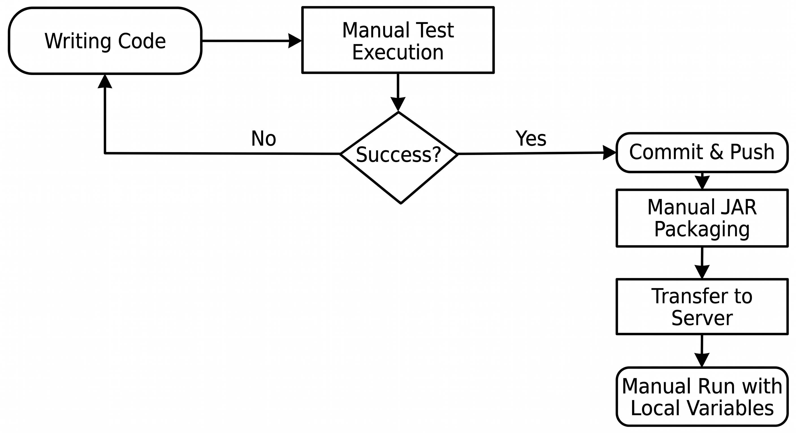

# System-as-is e Linha de Base (Análise do Sistema Atual)

## 1. Implementação e Deployment

### 1.1. Pilha Tecnológica e Configuração
- **Framework e Linguagem:** Java 17, Spring Boot 3.2.5. O projeto contém 144 ficheiros Java de produção, organizados modularmente por domínio de negócio e seguindo uma arquitetura em camadas interna: *Controlador REST -> Serviço aplicacional -> Repositório -> Entidade JPA*.
- **Gestão de Dependências:** Maven (`pom.xml`). O wrapper local estava incompleto (ausência de `.mvn/wrapper/maven-wrapper.properties`), impedindo compilações numa máquina limpa sem um runtime Maven pré-instalado globalmente.
- **Base de Dados e Persistência:** Base de dados H2. Configurada em `application.properties` através do modo servidor TCP (`jdbc:h2:tcp://localhost/~/psoft-g1;IGNORECASE=TRUE`). Isto exige um processo servidor H2 TCP externo em execução na porta `9092` e ficheiros pré-criados no diretório pessoal do utilizador, provocando falhas imediatas de execução em ambientes novos/limpos a menos que reconfigurado manualmente para em memória (`jdbc:h2:mem:testdb`). As credenciais da base de dados (`mysqluser`/`mysqlpass`) encontravam-se hardcoded no repositório.
- **Autenticação e Segredos:** Autenticação stateless por JWT com controlo de acessos baseado em perfis (perfis: `READER`, `LIBRARIAN`, `ADMIN`; palavras-passe cifradas com BCrypt). O sistema depende de pares de chaves assimétricas RSA (`rsa.private.key` e `rsa.public.key`) que estavam indevidamente comitadas em texto simples sob `src/main/resources`.
- **Documentação da API:** OpenAPI 3 e Swagger UI ativados (`/swagger-ui` e `/api-docs`).
- **Uploads e Armazenamento:** Armazenamento local no sistema de ficheiros (diretório `uploads-psoft-g1`). Existia uma inconsistência arquitetural: as regras de negócio/domínio impõem um limite de 20KB para fotografias, enquanto as `MultipartProperties` do Spring configuravam um limiar de 200MB. Armazenar uploads diretamente no sistema de ficheiros local impede a escalabilidade horizontal e a portabilidade.
- **Configurações de Runtime e CORS:** O perfil `bootstrap` estava permanentemente ativo por omissão (`spring.profiles.active=bootstrap`), semeando dados de teste no arranque. As políticas CORS eram globalmente permissivas (`Customizer.withDefaults()`), permitindo qualquer origem, cabeçalho e método.

### 1.2. Processo de Deployment Atual (Manual)
O processo de deployment existente era totalmente manual, frágil e não reprodutível:
1. **Sincronização Manual:** Os programadores obtinham o repositório localmente via `git pull`.
2. **Empacotamento Local:** Os programadores executavam manualmente `mvn clean package` nas suas máquinas.
3. **Transferência de Artefactos:** O ficheiro `.jar` resultante e ficheiros de configuração eram copiados manualmente para o servidor/máquina de destino via SSH/FTP ou partilha manual de ficheiros.
4. **Execução Manual:** A aplicação era iniciada manualmente em primeiro/segundo plano através de `java -jar psoft-g1-0.0.1-SNAPSHOT.jar`.

*Nota: Não existiam Dockerfiles, manifestos Docker Compose nem automação de infraestrutura como código. Os ambientes (Dev, Staging, Produção) careciam de paridade e isolamento.*

---

## 2. Práticas Existentes de Build e Testes

### 2.1. Fluxo de Trabalho
- **Planeamento e Desenvolvimento:** Orientado a funcionalidades e baseado em listas de verificação com recurso a ficheiros de documentação (`RestMapping.md` e `WorkPlanning.md`).
- **Ciclo de Vida de Build:** A compilação de código ocorria estritamente sob pedido nas máquinas locais dos programadores (`mvn clean compile` ou compilações no IDE). A configuração de build é sensível ao JDK instalado: falhava no JDK 25 devido a incompatibilidades de processamento de anotações do Lombok, compilando com sucesso apenas nos JDKs 17 e 21.
- **Separação do Ciclo de Vida de Testes:** O build Maven apenas configurava o plugin padrão `maven-surefire-plugin` (fase `test`). O `maven-failsafe-plugin` estava ausente, significando que não existia uma fase dedicada e isolada de testes de integração (`mvn verify`).
- **Políticas de Ramos e Gates de Revisão:** Commits e pushes eram efetuados diretamente sem regras de proteção de branches, gates de pull request ou verificações automáticas de qualidade.
- **Testes Automatizados:** Executados manualmente antes dos commits através do IDE ou `mvn test`. A pilha tecnológica compreendia Spring Boot Test, JUnit 5, Spring Security Test e Mockito (`@WebMvcTest`).
- **Validação Manual:** Os programadores dependiam fortemente da exploração manual de endpoints REST com recurso a coleções do Postman (`Psoft-G1.postman_collection.json`).
- **Pipeline de CI/CD:** Totalmente inexistente. Não existia qualquer servidor ou pipeline de integração contínua (ex.: GitHub Actions, Jenkins) configurado em `.github/workflows` para prevenir builds quebradas ou regressões.

### 2.2. Diagrama do Processo (As-Is)

---

## 3. Quantidade, Cobertura e Eficácia dos Testes

A suite de testes estava fortemente concentrada em validações de Value Objects de domínio, com cobertura escassa de serviços aplicacionais e ausência quase total de testes de controladores, segurança e integração.

| Métrica | Valor na Linha de Base (As-Is) | Observações e Evidências Empíricas |
| :--- | :--- | :--- |
| **Total de Testes Ativos** | 102 | Distribuídos por 19 classes de teste. A execução manual obtinha 100% de taxa de aprovação (0 falhas). |
| **Testes Incompletos** | Sim | Classes críticas de segurança (ex.: `TestAuthApi`) e segmentos de serviços de empréstimo estavam comentados no código-fonte. |
| **Rácio de Ficheiros** | 16.0% | 23 classes de teste face a 144 ficheiros Java de produção. |
| **Cobertura de Linhas** | 33% (Linha de Base PIT) | Relatórios globais de cobertura (JaCoCo) não estavam integrados no `pom.xml`. Uma execução empírica do PIT revelou apenas 345 de 1038 linhas cobertas (33%) nas classes testadas. |
| **Score de Mutação (Eficácia)** | 22% (124/575 mortos) | No teste de mutação inicial, apenas 124 em 575 mutantes gerados foram eliminados. 399 mutantes tinham zero cobertura de testes e o Test Strength era de 70%. |
| **Pontos Cegos de Teste** | Elevados | Não existiam testes automatizados para controladores REST, verificações de autorização/perfis, endpoints de upload de ficheiros ou consultas analíticas. |
| **Eficácia Global** | Baixa | Apesar de 102 testes unitários passarem, **78% das mutações injetadas sobreviviam**. Os testes limitavam-se predominantemente a verificar getters triviais ou restrições básicas, gerando uma falsa sensação de segurança e baixa capacidade de deteção de defeitos. |

---

## 4. Indicadores Relevantes de Qualidade de Software

### 4.1. Avaliação pelas Características de Qualidade ISO/IEC 25010

| Característica de Qualidade | Estado Atual | Risco | Avaliação e Impacto |
| :--- | :--- | :--- | :--- |
| **Adequação Funcional** | Parcial | Médio | As regras de negócio nucleares para gestão de biblioteca estão implementadas, mas carecem de validação automatizada em fluxos ponta a ponta. |
| **Fiabilidade e Tolerância a Falhas** | Baixa | **Elevado** | Com um score de mutação de 22% e ausência de testes de regressão automatizados, falhas lógicas e alterações disruptivas alcançam facilmente os ambientes de destino. |
| **Segurança** | Vulnerável | **Elevado** | Chaves privadas RSA (`rsa.private.key`) e credenciais de base de dados estavam comitadas no controlo de versões. Políticas CORS permissivas permitiam pedidos irrestritos entre origens. |
| **Manutenibilidade** | Moderada | Médio | Pacotes de domínio bem organizados (*Package-by-Feature* / *Screaming Architecture*), mas o débito técnico não podia ser monitorizado devido à ausência de ferramentas de análise estática de código (SpotBugs, SonarQube, Checkstyle). |
| **Portabilidade e Reprodutibilidade** | Frágil | **Elevado** | A ausência de automação de infraestrutura gerava problemas clássicos de "na minha máquina funciona". Forte dependência de caminhos locais do anfitrião (`uploads-psoft-g1/`, `~/psoft-g1`) e processos H2 TCP pré-existentes. |

### 4.2. Linha de Base dos Processos DevOps e Métricas DORA

| Métrica DORA | Linha de Base Atual (As-Is) | Causa Raiz |
| :--- | :--- | :--- |
| **Deployment Frequency** | Baixa / Esporádica | Etapas manuais de compilação e deployment criavam atrito considerável. |
| **Lead Time for Changes** | Elevado | As alterações exigiam compilação manual, testes manuais no Postman e cópia manual de artefactos. |
| **Change Failure Rate** | Elevada / Desconhecida | A ausência de gates de CI permitia que código quebrado fosse promovido para a branch `main` sem deteção imediata. |
| **Mean Time to Recovery (MTTR)** | Elevado | Ausência de rollbacks automatizados, artefactos imutáveis ou registos estruturados de deployment. |
