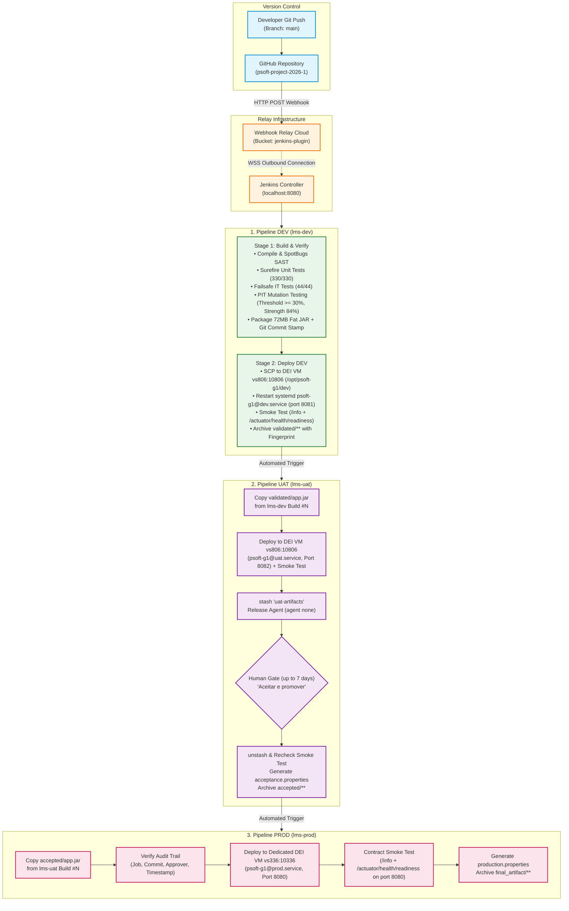

# System-to-Be: Target Development, CI/CD Pipeline, and Multi-Environment Deployment Architecture

## 1. Target Development and Continuous Delivery Architecture

### 1.1. Overview and Core Principles
The target development process transitions the team from a manual, unmonitored workflow to an **automated, repeatable, and verifiable Continuous Delivery (CD)** pipeline.

Following the pedagogical directives and institutional constraints established for the course (ODSOFT / ARQSOFT at ISEP):
* **Local Jenkins Controller with Webhook Relay:** The Jenkins automation controller runs on a dedicated developer workstation (`localhost:8080`), avoiding the severe CPU/memory bottlenecks of the DEI Virtual Servers (which freeze during multithreaded Maven compilation and PIT mutation testing). The controller receives automated GitHub push events through an outbound persistent WebSocket (`WSS`) connection managed by the **Webhook Relay Plugin**, eliminating the need for router port-forwarding or exposing insecure local HTTP ports to the internet.
* **Separation into 3 Dedicated Jenkins Jobs (4 Repository Files):** Rather than an unwieldy monolithic pipeline, the delivery flow is factored into three purpose-built pipelines across four repository files:
  1. [`.Jenkinsfile`](../../../.Jenkinsfile) — **`lms-dev` Job:** Triggered automatically on Git push. Compiles, tests, packages, executes PIT mutation testing, verifies quality gates, stamps the Git commit SHA (`-Drelease.commit`), deploys to **DEV** on DEI VM `vs806` (port 8081), runs the contract smoke test, and triggers UAT.
  2. [`.Jenkinsfile_uat`](../../../.Jenkinsfile_uat) — **`lms-uat` Job:** Parameterized job triggered by DEV. Copies the validated binary via `copyArtifacts`, deploys to **UAT** on DEI VM `vs806` (port 8082), releases the Jenkins agent (`agent none`) via `stash` while awaiting up to 7 days for human approval (`input` step), rechecks service health (`deploy.recheck('uat')`), and triggers PROD.
  3. [`.Jenkinsfile_prod`](../../../.Jenkinsfile_prod) — **`lms-prod` Job:** Parameterized job triggered by UAT. Copies the accepted binary, audits provenance, and deploys to **PROD** on the dedicated DEI VM `vs336` (port 8080).
  4. [`deploy/jenkins-deploy.groovy`](../../../deploy/jenkins-deploy.groovy) (and [`.Jenkinsfile_common.groovy`](../../../.Jenkinsfile_common.groovy)) — **Shared Deployment Module:** Encapsulates multi-VM SSH/SCP operations, Windows OpenSSH permission sanitization (`icacls`), parameterized systemd service management (`psoft-g1@<env>.service`), automatic runtime provisioning (Java 17, `curl`, `python3`), and contract-based HTTP readiness smoke testing ([`deploy/smoke-test.sh`](../../../deploy/smoke-test.sh)).
* **Multi-VM Isolation Strategy (DEI Cloud):**
  * **VM 1 (`vs806`, port 10806):** Hosts **Development (DEV)** on port `8081` (`/opt/psoft-g1/dev`) and **User Acceptance Testing (UAT)** on port `8082` (`/opt/psoft-g1/uat`), absorbing the continuous load of automated regression testing and build iterations.
  * **VM 2 (`vs336`, port 10336):** Dedicated exclusively to **Production (PROD)** on port `8080` (`/opt/psoft-g1/prod`), guaranteeing complete resource isolation, high stability, and protection from development activity.
* **Single-Build Immutable Artifact Pattern (*One Build, Many Deploys*):** Binaries (`app.jar`) are compiled and packaged **only once** in DEV. Downstream environments (UAT, PROD) strictly reuse the validated binary without recompilation.

---

### 1.2. Complete Continuous Delivery Pipeline Workflow



---

### 1.3. Pipeline Stages Specification Matrix

| Pipeline Job | Stage Name | Purpose | Execution Scope | Target Environment | Approval & Gate Criteria | Failure Action |
| :---: | :--- | :--- | :--- | :--- | :--- | :--- |
| **`lms-dev`** | **Build & Verify** | Clean build, static analysis, unit tests, integration tests, mutation testing | `mvnw -B -Pmutation clean verify -Dpitest.mutationThreshold=30 -Drelease.commit="${env.GIT_COMMIT}"` | Local Jenkins Agent | 0 compiler errors, 330/330 unit tests, 44/44 IT tests, PIT $\ge 30\%$ | Aborts build (`FAILURE`). Publishes JUnit/PIT reports. |
| **`lms-dev`** | **Deploy DEV** | Binary packaging, release tracking, remote deployment | `copy /B /Y`, `deploy/jenkins-deploy.groovy` (`scp` + `systemctl restart psoft-g1@dev`) | **DEV:** `vs806:8081` (`/opt/psoft-g1/dev`) | Contract smoke test (`/info` + `/actuator/health/readiness`) within 60s | Aborts deployment, displays `journalctl` / log tail. |
| **`lms-uat`** | **Deploy UAT** | Pull validated artifact from DEV build, deploy to staging | `copyArtifacts` from `validated/`, `deploy.call('uat')` | **UAT:** `vs806:8082` (`/opt/psoft-g1/uat`) | Matching `CI_BUILD` in `release.properties`, contract smoke test | Aborts UAT deployment. |
| **`lms-uat`** | **UAT Acceptance** | Free agent and await authorized stakeholder validation | `agent none`, `input` step with timeout 7 days | Jenkins UI Gate | Manual click on "Aceitar e promover" by authorized user | Aborts promotion upon timeout or reject. |
| **`lms-uat`** | **Promote to PROD** | Recheck UAT health, generate audit metadata, trigger PROD | `deploy.recheck('uat')`, write `acceptance.properties` | Local Jenkins Agent | UAT service verified healthy after wait period | Aborts promotion to PROD. |
| **`lms-prod`** | **Deploy PROD** | Audit trail verification, deployment to isolated production VM | `copyArtifacts` from `accepted/`, `deploy.call('prod')` | **PROD:** `vs336:8080` (`/opt/psoft-g1/prod`) | Valid audit trail, contract smoke test on port 8080 | Aborts deployment and logs service status. |

---

## 2. Target Multi-Environment Infrastructure Strategy

### 2.1. Environment Parity and Multi-VM Topology

To satisfy the **Twelve-Factor App (Factor X: Dev/Prod Parity)** and institutional resource constraints, the three environments are hosted on dedicated DEI Virtual Servers managed by parameterized systemd services ([`deploy/psoft-g1@.service`](../../../deploy/psoft-g1@.service)):

```
+---------------------------------------------------------------------------------------------------------------------+
|                                   INSTITUTIONAL MULTI-VM DEPLOYMENT TOPOLOGY                                        |
+---------------------------------------------------------------------------------------------------------------------+
|  DEI VIRTUAL SERVER 1: vs806 (DEV + UAT Host)                       |  DEI VIRTUAL SERVER 2: vs336 (PROD Host)      |
|  External Gateway: vsgate-ssh.dei.isep.ipp.pt:10806                 |  External Gateway: vsgate-ssh.dei.isep.ipp.pt:10336 |
|  Role: CI Validation & Acceptance Testing Host                      |  Role: Dedicated Isolated Production Host     |
|  -----------------------------------------------------------------  |  -------------------------------------------- |
|  1. DEVELOPMENT (DEV)             |  2. ACCEPTANCE TESTING (UAT)    |  3. PRODUCTION (PROD)                         |
|  - App Port: 8081                 |  - App Port: 8082               |  - App Port: 8080                             |
|  - WorkDir: /opt/psoft-g1/dev     |  - WorkDir: /opt/psoft-g1/uat   |  - WorkDir: /opt/psoft-g1/prod                |
|  - EnvFile: /etc/psoft-g1/dev.env |  - EnvFile: /etc/psoft-g1/uat.env|  - EnvFile: /etc/psoft-g1/prod.env           |
|  - Systemd: psoft-g1@dev.service  |  - Systemd: psoft-g1@uat.service|  - Systemd: psoft-g1@prod.service             |
|  - User: psoft-g1-dev             |  - User: psoft-g1-uat           |  - User: psoft-g1-prod                        |
|  - Smoke Test: /info (env=dev)    |  - Smoke Test: /info (env=uat)  |  - Smoke Test: /info (env=prod)               |
+---------------------------------------------------------------------------------------------------------------------+
```

#### 2.1.1. Development Environment (`dev`)
* **Host & Port:** `vs806` on port `8081` (`/opt/psoft-g1/dev`, unit `psoft-g1@dev.service`, user `psoft-g1-dev`).
* **Purpose:** Continuous integration target deployed automatically upon every successful build on `main`.
* **Configuration:** Managed via `/etc/psoft-g1/dev.env` (`DEMO_ENVIRONMENT=dev`, `PORT=8081`) and `application-dev.properties`.

#### 2.1.2. User Acceptance Testing Environment (`uat`)
* **Host & Port:** `vs806` on port `8082` (`/opt/psoft-g1/uat`, unit `psoft-g1@uat.service`, user `psoft-g1-uat`).
* **Purpose:** Pre-production verification and quality assurance environment where stakeholders validate release candidates prior to live promotion.
* **Resource Optimization:** During the human acceptance phase, the pipeline runs under `agent none`, ensuring that the Jenkins executor is immediately released back to the controller.

#### 2.1.3. Production Environment (`prod`)
* **Host & Port:** `vs336` on port `8080` (`/opt/psoft-g1/prod`, unit `psoft-g1@prod.service`, user `psoft-g1-prod`).
* **Purpose:** Dedicated live environment isolated on a separate virtual machine (`vs336`) to ensure that production workloads are never perturbed by development or testing activities.
* **Systemd Hardening:** Runs under least-privilege service accounts (`NoNewPrivileges=true`, `ProtectSystem=strict`, `ProtectHome=true`, `PrivateTmp=true`) with restricted sudoers permissions ([`deploy/psoft-g1.sudoers`](../../../deploy/psoft-g1.sudoers)).

---

### 2.2. Provenance Tracking & Production Audit Trail

The delivery architecture guarantees complete end-to-end auditability across the lifecycle:
1. **`release.properties` (Generated in DEV):**
   Records the original CI build number, job name, and Git commit SHA:
   ```properties
   job=lms-dev
   CI_JOB=lms-dev
   build=17
   CI_BUILD=17
   commit=08acb15e0febd30f7e5e451686997e1a1d90e979
   GIT_COMMIT=08acb15e0febd30f7e5e451686997e1a1d90e979
   ```
2. **`acceptance.properties` (Generated in UAT):**
   Records the upstream CI metadata, the authorized stakeholder who approved the release, the UAT job and build number, and the ISO 8601 approval timestamp:
   ```properties
   CI_JOB=lms-dev
   CI_BUILD=17
   UAT_JOB=lms-uat
   uat_job=lms-uat
   UAT_BUILD=7
   uat_build=7
   ACCEPTED_BY=Rasb
   accepted_by=Rasb
   approval_timestamp=2026-10-25T17:18:42+0000
   ```
3. **`production.properties` / `prod_deployment.properties` (Generated in PROD):**
   Records final deployment timestamp and execution parameters in `final_artifact/`:
   ```properties
   UAT_JOB=lms-uat
   UAT_BUILD=7
   PROD_JOB=lms-prod
   PROD_BUILD=5
   deployed_to=prod
   deployment_timestamp=2026-10-25T17:20:10+0000
   ```

---

## 3. Engineering Decisions Supporting the Design (ADRs)

### ADR-01: Local Jenkins Controller with Webhook Relay and Remote DEI Cloud Multi-VM Deployment

- **Status:** Accepted (Supersedes baseline cloud-hosted Jenkins proposal)
- **Context / Problem:** Running Jenkins and executing full Maven compilation with PIT mutation testing directly inside DEI LXD containers (`vs-ctl.dei.isep.ipp.pt`) causes frequent out-of-memory errors and server freezes due to strict institutional CPU and RAM quotas. Conversely, running deployments solely on developer workstations lacks authenticity and fails to demonstrate remote infrastructure operations.
- **Decision:** Run the **Jenkins automation controller locally (`localhost:8080`)** on a team workstation, receiving GitHub push triggers via the **Webhook Relay Plugin** (secure outbound WebSocket `WSS` tunnel). Configure the pipelines to deploy remotely to **two separate DEI Virtual Servers** via SSH/SCP: **VM 1 (`vs806`)** for DEV (8081) and UAT (8082), and **VM 2 (`vs336`)** for PROD (8080).
- **Consequences / Trade-offs:** Eliminates build failures caused by constrained VM resources while maintaining full multi-environment deployment authenticity on university cloud infrastructure. The local controller does not require router port-forwarding or public IP exposure. The trade-off is requiring the local workstation to be running during build trigger windows.

---

### ADR-02: Three-Tier Continuous Delivery Pipeline Architecture with Human Gate Stashing

- **Status:** Accepted
- **Context / Problem:** A monolithic `Jenkinsfile` executing compilation, testing, and deployment sequentially in a single job blocks Jenkins worker threads for the entire duration of human approval (up to 7 days), exhausting concurrency slots. Furthermore, rebuilding binaries between stages violates the *Build Once, Deploy Many* pattern.
- **Decision:** Split the pipeline into three decoupled declarative jobs (`lms-dev`, `lms-uat`, `lms-prod`) driven by [`.Jenkinsfile`](../../../.Jenkinsfile), [`.Jenkinsfile_uat`](../../../.Jenkinsfile_uat), [`.Jenkinsfile_prod`](../../../.Jenkinsfile_prod), and [`deploy/jenkins-deploy.groovy`](../../../deploy/jenkins-deploy.groovy). UAT utilizes `stash` and `agent none` during the `input` approval stage, copying immutable artifacts downstream with `copyArtifacts` and cryptographic fingerprinting.
- **Consequences / Trade-offs:** Zero resource consumption during human approval wait times; guarantees strict binary immutability from DEV to PROD; establishes complete auditability through `release.properties`, `acceptance.properties`, and `production.properties`. Requires the Jenkins Copy Artifact plugin to manage cross-job artifact dependencies.

---

### ADR-03: Static Analysis, Coverage, and Mutation Quality Gates

- **Status:** Accepted
- **Context / Problem:** The baseline codebase lacked automated quality enforcement, relying on unverified developer commits with 78% of generated mutations surviving.
- **Decision:** Integrate **SpotBugs** for static code analysis (zero P1 high-priority defects permitted), **JaCoCo** for line coverage reporting, and **PITest** with a mutation threshold of $\ge 30\%$ bound to the Maven `verify` lifecycle phase via a dedicated `<id>mutation</id>` profile.
- **Consequences / Trade-offs:** Shifting quality checks to automated gates prevents fault regressions from entering the deployment stream. Binding PITest to a Maven profile keeps standard local developer builds fast while strictly enforcing mutation coverage during CI pipeline runs.

---

### ADR-04: Parameterized Systemd Service Management and Contract-Based Readiness Smoke Testing

- **Status:** Accepted
- **Context / Problem:** Launching Java processes via ad-hoc background commands lacks process supervision, filesystem isolation, and clean lifecycle management. Furthermore, simple HTTP status checks cannot distinguish whether the correct application version, environment configuration, and Git commit were actually deployed.
- **Decision:** Provision parameterized systemd service units ([`deploy/psoft-g1@.service`](../../../deploy/psoft-g1@.service)) with dedicated least-privilege users (`psoft-g1-dev`, `psoft-g1-uat`, `psoft-g1-prod`) via [`deploy/setup-environments.sh`](../../../deploy/setup-environments.sh), and execute [`deploy/smoke-test.sh`](../../../deploy/smoke-test.sh) after every deployment to verify both `GET /info` (confirming `application="psoft-g1"`, target `environment`, and exact `commit` SHA) and `GET /actuator/health/readiness` (`status="UP"`) across up to 30 attempts (2s interval).
- **Consequences / Trade-offs:** Guarantees OS-level security isolation (`ProtectSystem=strict`, `NoNewPrivileges=true`) and automatic service supervision. Pipelines mathematically verify that the exact commit built in CI is running and healthy in the target environment before promoting or concluding the deployment.
