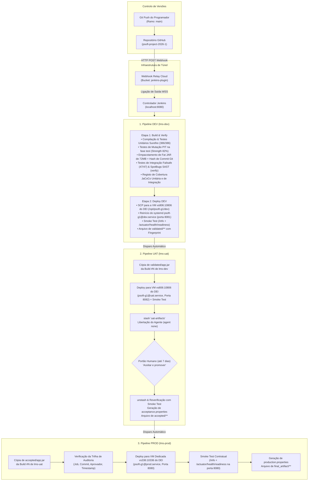

# System-to-Be: Arquitetura Alvo de Desenvolvimento, Pipeline CI/CD e Deployment Multi-Ambiente

## 1. Arquitetura Alvo de Desenvolvimento e Entrega Contínua

### 1.1. Visão Geral e Princípios Fundamentais
O processo de desenvolvimento alvo estabelece a transição de um fluxo manual e sem monitorização para um pipeline de **Entrega Contínua (Continuous Delivery - CD) automatizado, repetível e verificável**.

Em conformidade com as diretrizes pedagógicas e os requisitos da unidade curricular (ODSOFT / ARQSOFT no ISEP):
* **Controlador Jenkins Local com Webhook Relay:** O controlador de automação Jenkins é executado numa estação de trabalho dedicada de desenvolvimento (`localhost:8080`), contornando os constrangimentos severos de CPU/memória dos Servidores Virtuais do DEI (que bloqueiam durante compilações Maven multithread e testes de mutação PITest). O controlador recebe eventos automáticos de push do GitHub através de uma ligação persistente WebSocket de saída (`WSS`) gerida pelo **Webhook Relay Plugin**, dispensando o redirecionamento de portas (*port forwarding*) no router ou a exposição pública de portas HTTP locais.
* **Separação em 3 Jobs Jenkins Dedicados (4 Ficheiros no Repositório):** Em vez de um pipeline monolítico, o fluxo de entrega está decomposto em três pipelines específicos distribuídos por quatro ficheiros no repositório:
  1. [`.Jenkinsfile`](../../../.Jenkinsfile) — **Job `lms-dev`:** Disparado automaticamente no push de Git. Compila, executa testes unitários e testes de mutação PITest (fase `test`), empacota o binário, executa testes de integração e análise estática SpotBugs (fase `verify`), regista a cobertura JaCoCo (`unit-coverage` e `integration-coverage`), carimba o commit SHA do Git (`-Drelease.commit`), faz o deployment para **DEV** na VM `vs806` do DEI (porta 8081), corre o smoke test contratual e dispara o job de UAT.
  2. [`.Jenkinsfile_uat`](../../../.Jenkinsfile_uat) — **Job `lms-uat`:** Job parametrizado disparado por DEV. Recupera o binário validado através do `copyArtifacts`, faz o deployment para **UAT** na VM `vs806` do DEI (porta 8082), liberta o agente do Jenkins (`agent none`) com recurso a `stash` enquanto aguarda até 7 dias pela aprovação humana (passo `input`), revalida o estado do serviço (`deploy.recheck('uat')`) e dispara o job de PROD.
  3. [`.Jenkinsfile_prod`](../../../.Jenkinsfile_prod) — **Job `lms-prod`:** Job parametrizado disparado por UAT. Recupera o binário aceite, audita a proveniência e efetua o deployment para **PROD** na VM dedicada `vs336` do DEI (porta 8080).
  4. [`deploy/jenkins-deploy.groovy`](../../../deploy/jenkins-deploy.groovy) (e [`.Jenkinsfile_common.groovy`](../../../.Jenkinsfile_common.groovy)) — **Módulo Partilhado de Deployment:** Encapsula operações de SSH/SCP multi-VM, sanitização de permissões OpenSSH em Windows (`icacls`), gestão de serviços parametrizados no systemd (`psoft-g1@<env>.service`), provisionamento automático de runtime (Java 17, `curl`, `python3`) e validação de prontidão HTTP baseada em contratos ([`deploy/smoke-test.sh`](../../../deploy/smoke-test.sh)).
* **Estratégia de Isolamento Multi-VM (DEI Cloud):**
  * **VM 1 (`vs806`, porta 10806):** Aloja **Desenvolvimento (DEV)** na porta `8081` (`/opt/psoft-g1/dev`) e **Testes de Aceitação (UAT)** na porta `8082` (`/opt/psoft-g1/uat`), absorvendo a carga contínua de testes de regressão automatizados e iterações de build.
  * **VM 2 (`vs336`, porta 10336):** Dedicada exclusivamente a **Produção (PROD)** na porta `8080` (`/opt/psoft-g1/prod`), garantindo isolamento total de recursos e proteção contra a atividade de desenvolvimento.
* **Single-Build Immutable Artifact Pattern (*One Build, Many Deploys*):** Os binários executáveis (`app.jar`) são compilados e empacotados **apenas uma vez** em DEV. Os ambientes a jusante (UAT, PROD) reutilizam estritamente o binário validado sem qualquer recompilação.

---

### 1.2. Fluxo de Trabalho Completo do Pipeline de Entrega Contínua



---

### 1.3. Matriz de Especificação dos Estágios do Pipeline

| Job do Pipeline | Nome da Etapa | Objetivo | Âmbito de Execução | Ambiente de Destino | Critérios de Aprovação e Gate | Ação em Caso de Falha |
| :---: | :--- | :--- | :--- | :--- | :--- | :--- |
| **`lms-dev`** | **Build & Verify** | Build limpo, testes unitários, testes de mutação, empacotamento, testes de integração e análise estática | `mvnw -B -Pmutation clean verify -Djacoco.dataFile=target/jacoco.exec -Djacoco-it.dataFile=target/jacoco-it.exec -Dpitest.mutationThreshold=30 -Drelease.commit="${env.GIT_COMMIT}"` | Agente Jenkins Local | 0 erros de compilação, 386/386 testes unitários, PIT $\ge 30\%$ (82% strength), 47/47 testes IT, 0 bugs P1 SpotBugs | Aborta a build (`FAILURE`). Publica relatórios JUnit, JaCoCo e PITest. |
| **`lms-dev`** | **Deploy DEV** | Empacotamento binário, rastreio de release e deployment remoto | `copy /B /Y`, `deploy/jenkins-deploy.groovy` (`scp` + `systemctl restart psoft-g1@dev`) | **DEV:** `vs806:8081` (`/opt/psoft-g1/dev`) | Smoke test contratual (`/info` + `/actuator/health/readiness`) em menos de 60s | Aborta o deployment, apresenta `journalctl` / cauda de logs. |
| **`lms-uat`** | **Deploy UAT** | Obter artefacto validado da build de DEV e instalar em staging | `copyArtifacts` de `validated/`, `deploy.call('uat')` | **UAT:** `vs806:8082` (`/opt/psoft-g1/uat`) | Correspondência de `CI_BUILD` em `release.properties`, smoke test contratual | Aborta o deployment de UAT. |
| **`lms-uat`** | **UAT Acceptance** | Libertar agente e aguardar validação por interveniente autorizado | `agent none`, passo `input` com timeout de 7 dias | Portão na Interface do Jenkins | Clique manual em "Aceitar e promover" por utilizador autorizado | Aborta a promoção por timeout ou rejeição. |
| **`lms-uat`** | **Promote to PROD** | Revalidar saúde de UAT, gerar metadados de auditoria e disparar PROD | `deploy.recheck('uat')`, escrita de `acceptance.properties` | Agente Jenkins Local | Serviço UAT verificado como saudável após o período de espera | Aborta a promoção a PROD. |
| **`lms-prod`** | **Deploy PROD** | Verificação da trilha de auditoria e deployment para a VM isolada de produção | `copyArtifacts` de `accepted/`, `deploy.call('prod')` | **PROD:** `vs336:8080` (`/opt/psoft-g1/prod`) | Trilha de auditoria válida, smoke test contratual na porta 8080 | Aborta o deployment e regista o estado do serviço. |

---

### 1.4. Instalação e Configuração do Jenkins em Dois Contextos de Execução (C1.1)

Para validar a portabilidade, reprodutibilidade e os compromissos operacionais do pipeline, o Jenkins foi instalado, configurado e executado em **dois contextos de execução distintos**:

#### Contexto 1: Contentor Linux Institucional (VM `vs806` do DEI Cloud — Ubuntu 22.04 LTS, Porta `2226`)
1. **Topologia de Anfitrião e Rede:**
   * **Infraestrutura:** Servidores Virtuais da Cloud Privada do DEI (`vs-ctl.dei.isep.ipp.pt`), contentor LXD Ubuntu 22.04 LTS (`vs806`).
   * **Acesso SSH:** `ssh root@vsgate-ssh.dei.isep.ipp.pt -p 10806`.
   * **Gateway Web:** Encaminhado através de `vs-gate.dei.isep.ipp.pt` para a porta interna **`2226`** do contentor (reconfigurada a partir da porta padrão `8080` para evitar colisões com serviços aplicacionais).
2. **Aprovisionamento do Runtime e Jenkins:**
   ```bash
   sudo apt update && sudo apt install openjdk-21-jdk maven curl git nano -y
   curl -fsSL https://pkg.jenkins.io/debian/jenkins.io-2026.key | sudo tee /usr/share/keyrings/jenkins-keyring.asc > /dev/null
   echo "deb [signed-by=/usr/share/keyrings/jenkins-keyring.asc] https://pkg.jenkins.io/debian binary/" | sudo tee /etc/apt/sources.list.d/jenkins.list > /dev/null
   sudo apt update && sudo apt install jenkins -y
   ```
3. **Reconfiguração de Porta no Systemd (`/lib/systemd/system/jenkins.service`):**
   Configurado `Environment="JENKINS_PORT=2226"`, seguido de `sudo systemctl daemon-reload && sudo systemctl restart jenkins`.
4. **Limitação Empírica Observada:** Embora compilações simples terminassem com sucesso, a execução concorrente de compilações multithread do Maven combinadas com **3.798 mutações de bytecode do PITest** dentro do contentor LXD provocou throttling severo de CPU e o término dos processos pelo Linux OOM-Killer.

#### Contexto 2: Controlador na Estação de Trabalho Local (`localhost:8080`) + Webhook Relay (`WSS`) + Deployment Remoto via SSH
1. **Anfitrião e Runtime:** Estação de trabalho Windows 11 com Jenkins LTS (`2.479.x`) em Java 17/21 (`localhost:8080`), com ficheiro `.env` local definindo `PORT=8085` para testes locais da aplicação sem colidir com a porta do Jenkins em `8080`.
2. **Plugins Instalados e Capacidades:**
   * **Pipeline (`workflow-aggregator`):** Orquestração de pipelines declarativos (`.Jenkinsfile`, `.Jenkinsfile_uat`, `.Jenkinsfile_prod`).
   * **Git Plugin (`git`) & Credentials Binding:** Checkout autenticado do SCM e extração do hash do commit (`env.GIT_COMMIT`).
   * **Webhook Relay Plugin (`webhook-relay`):** Subscrição persistente WebSocket de saída (`WSS`) ao bucket `jenkins-plugin`, recebendo eventos de push do GitHub em tempo real (< 5s) atrás de NAT/firewall sem abertura de portas.
   * **Copy Artifact Plugin (`copyartifact`):** Aplica o padrão *Single-Build Immutable Artifact* entre `lms-dev` $\rightarrow$ `lms-uat` $\rightarrow$ `lms-prod` com fingerprinting SHA-256.
   * **JUnit Plugin (`junit`):** Publica relatórios XML e gráficos de tendência do Surefire (386 testes unitários) e Failsafe (47 testes de integração).
   * **Coverage Plugin (`coverage`):** Analisa relatórios XML do JaCoCo (`target/site/jacoco/jacoco.xml` e `target/site/jacoco-it/jacoco.xml`) via `recordCoverage` em dois dashboards dedicados (`Cobertura: testes unitários` e `Cobertura: testes de integração`) com treemaps e gráficos de complexidade ciclomática.
3. **Conetividade e Permissões:** Ligação SSH/SCP de saída para `vsgate-ssh.dei.isep.ipp.pt` (`10806` para `vs806`, `10336` para `vs336`) com chaves SSH dedicadas (sanitizadas em Windows via `icacls` no script `deploy/jenkins-deploy.groovy`) e regras de privilégio mínimo em `sudoers` (`deploy/psoft-g1.sudoers`).

#### Avaliação Comparativa dos Dois Contextos de Execução (Evidência C1.1)

| Dimensão | Contexto 1: Contentor DEI Cloud (`vs806:2226`) | Contexto 2: Controlador Local (`localhost:8080`) + VMs Remotas DEI |
| :--- | :--- | :--- |
| **Sistema Operativo & JVM** | Ubuntu 22.04 LTS (Linux x86_64), OpenJDK 21 | Windows 11 / PowerShell + Alvos Linux Remotos, OpenJDK 17/21 |
| **Execução de Comandos no `.Jenkinsfile`** | Executa o ramo `isUnix() == true` (`sh "./mvnw ..."`, `cp`). | Executa o ramo `isUnix() == false` (`bat "mvnw.cmd ..."`, `copy /B /Y`). |
| **Conetividade de Gatilho SCM** | Webhook HTTP direto via `vs-gate.dei.isep.ipp.pt` ou polling SCM (`H/5 * * * *`). | Túnel de saída `WSS` via **Webhook Relay** (bucket `jenkins-plugin`) — sem portas expostas. |
| **Desempenho Computacional (Build + PITest)** | **Limitado:** Quotas de CPU/RAM em LXD causam bloqueios ou builds >15 min sob 3.798 mutações PIT. | **Elevado e Determinístico:** CPU multi-core executa 386 unit + 47 IT + 3.798 mutações em **~5 min 01 s** (Build #38). |
| **Mecanismo de Deployment** | Cópia local/loopback na `vs806` + SSH remoto para a `vs336`. | SSH/SCP remoto via `deploy/jenkins-deploy.groovy` para ambas as VMs `vs806` (`10806`) e `vs336` (`10336`). |
| **Limitações e Riscos Operacionais** | Risco de aborto de builds pelo OOM-Killer; partilha de recursos com aplicações DEV/UAT em execução. | Exige que a estação de trabalho permaneça ligada durante as janelas de build; exige modo binário `copy /B /Y` em Windows. |

---

## 2. Estratégia de Infraestrutura Multi-Ambiente

### 2.1. Paridade de Ambientes e Topologia Multi-VM

Para respeitar a metodologia **Twelve-Factor App (Fator X: Paridade Dev/Prod)** e as restrições institucionais de recursos, os três ambientes encontram-se alojados em Servidores Virtuais dedicados do DEI geridos por serviços parametrizados do systemd ([`deploy/psoft-g1@.service`](../../../deploy/psoft-g1@.service)):

```
+---------------------------------------------------------------------------------------------------------------------------+
|                                    TOPOLOGIA MULTI-VM DE DEPLOYMENT INSTITUCIONAL                                         |
+---------------------------------------------------------------------------------------------------------------------------+
|  SERVIDOR VIRTUAL 1 DO DEI: vs806 (Anfitrião DEV + UAT)             |  SERVIDOR VIRTUAL 2 DO DEI: vs336 (Anfitrião PROD)   |
|  Gateway Externo: vsgate-ssh.dei.isep.ipp.pt:10806                  |  Gateway Externo: vsgate-ssh.dei.isep.ipp.pt:10336  |
|  Função: Anfitrião de Validação de CI e Testes de Aceitação         |  Função: Anfitrião Dedicado e Isolado de Produção    |
|  -----------------------------------------------------------------  |  -------------------------------------------------  |
|  1. DESENVOLVIMENTO (DEV)         |  2. TESTES DE ACEITAÇÃO (UAT)   |  3. PRODUÇÃO (PROD)                                 |
|  - Porta App: 8081                |  - Porta App: 8082              |  - Porta App: 8080                                  |
|  - Diretório: /opt/psoft-g1/dev   |  - Diretório: /opt/psoft-g1/uat |  - Diretório: /opt/psoft-g1/prod                    |
|  - Ficheiro Env: dev.env          |  - Ficheiro Env: uat.env        |  - Ficheiro Env: prod.env                           |
|  - Systemd: psoft-g1@dev.service  |  - Systemd: psoft-g1@uat.service|  - Systemd: psoft-g1@prod.service                   |
|  - Utilizador: psoft-g1-dev       |  - Utilizador: psoft-g1-uat     |  - Utilizador: psoft-g1-prod                        |
|  - Smoke Test: /info (env=dev)    |  - Smoke Test: /info (env=uat)  |  - Smoke Test: /info (env=prod)                     |
+---------------------------------------------------------------------------------------------------------------------------+
```

#### 2.1.1. Ambiente de Desenvolvimento (`dev`)
* **Anfitrião e Porta:** `vs806` na porta `8081` (`/opt/psoft-g1/dev`, unidade `psoft-g1@dev.service`, utilizador `psoft-g1-dev`).
* **Objetivo:** Alvo de integração contínua implantado automaticamente a cada build bem-sucedida na branch `main`.
* **Configuração:** Gerida através de `/etc/psoft-g1/dev.env` (`DEMO_ENVIRONMENT=dev`, `PORT=8081`) injetada pelo systemd no arranque.

#### 2.1.2. Ambiente de Testes de Aceitação (`uat`)
* **Anfitrião e Porta:** `vs806` na porta `8082` (`/opt/psoft-g1/uat`, unidade `psoft-g1@uat.service`, utilizador `psoft-g1-uat`).
* **Objetivo:** Ambiente de pré-produção onde intervenientes de negócio validam candidatos a release antes da promoção live.
* **Otimização de Recursos:** Durante a fase de aceitação humana, o pipeline corre sob `agent none`, garantindo que o executor Jenkins é imediatamente libertado.

#### 2.1.3. Ambiente de Produção (`prod`)
* **Anfitrião e Porta:** `vs336` na porta `8080` (`/opt/psoft-g1/prod`, unidade `psoft-g1@prod.service`, utilizador `psoft-g1-prod`).
* **Objetivo:** Ambiente live dedicado e isolado numa máquina virtual independente (`vs336`), assegurando que a carga de produção não é perturbada pelo desenvolvimento ou testes.
* **Hardening no Systemd:** Execução sob contas de serviço sem shell (`NoNewPrivileges=true`, `ProtectSystem=strict`, `ProtectHome=true`, `PrivateTmp=true`) com privilégios restritos em `sudoers` ([`deploy/psoft-g1.sudoers`](../../../deploy/psoft-g1.sudoers)).

---

### 2.2. Rastreabilidade de Proveniência e Trilha de Auditoria

A arquitetura de entrega garante auditabilidade integral ponta a ponta:
1. **`release.properties` (Gerado em DEV):**
   Regista o número da build de CI, nome do job e hash do commit Git:
   ```properties
   job=lms-dev
   CI_JOB=lms-dev
   build=38
   CI_BUILD=38
   commit=4e10baf1db04f1a904f87833a1b7a98c19e0f5a1
   GIT_COMMIT=4e10baf1db04f1a904f87833a1b7a98c19e0f5a1
   ```
2. **`acceptance.properties` (Gerado em UAT):**
   Regista os metadados de CI a montante, o interveniente autorizado que aprovou a release, a build de UAT e o timestamp ISO 8601 de aprovação:
   ```properties
   CI_JOB=lms-dev
   CI_BUILD=38
   UAT_JOB=lms-uat
   uat_job=lms-uat
   UAT_BUILD=7
   uat_build=7
   ACCEPTED_BY=Rasb
   accepted_by=Rasb
   approval_timestamp=2026-10-31T18:18:42+0000
   ```
3. **`production.properties` / `prod_deployment.properties` (Gerado em PROD):**
   Regista o timestamp final de deployment e parâmetros de execução em `final_artifact/`:
   ```properties
   UAT_JOB=lms-uat
   UAT_BUILD=7
   PROD_JOB=lms-prod
   PROD_BUILD=5
   deployed_to=prod
   deployment_timestamp=2026-10-31T18:20:10+0000
   ```

---

## 3. Decisões de Engenharia Arquitetural (ADRs)

### ADR-01: Controlador Jenkins Local com Webhook Relay e Deployment Remoto Multi-VM na Cloud do DEI

- **Estado:** Aceite (Substitui a proposta inicial de Jenkins integralmente alojado na cloud)
- **Contexto / Problema:** Executar o Jenkins e compilações Maven completas com testes de mutação PITest dentro dos contentores LXD do DEI (`vs-ctl.dei.isep.ipp.pt`) provoca bloqueios e falhas de memória devido às quotas estritas de CPU e RAM. Por outro lado, executar deployments apenas nas máquinas dos programadores não demonstraria a operação sobre infraestrutura remota real.
- **Decisão:** Executar o **controlador Jenkins localmente (`localhost:8080`)** na máquina da equipa, recebendo eventos de push do GitHub via **Webhook Relay Plugin** (túnel seguro WebSocket `WSS`). Configurar os pipelines para efetuar o deployment remoto para **dois Servidores Virtuais distintos do DEI** via SSH/SCP: **VM 1 (`vs806`)** para DEV (8081) e UAT (8082), e **VM 2 (`vs336`)** para PROD (8080).
- **Consequências / Compromissos:** Elimina falhas de compilação por exaustão de recursos nas VMs mantendo a autenticidade de deployment remoto na infraestrutura institucional. O controlador local não exige port forwarding nem IP público. O compromisso assumido é exigir que a estação de trabalho permaneça ativa durante as janelas de build.

---

### ADR-02: Arquitetura de Pipeline de Entrega Contínua em Três Níveis com Stash no Portão Humano

- **Estado:** Aceite
- **Contexto / Problema:** Um `Jenkinsfile` monolítico bloqueia os workers do Jenkins durante toda a espera por aprovação humana (até 7 dias), esgotando os executores. Adicionalmente, recompilar binários entre etapas viola o princípio *Build Once, Deploy Many*.
- **Decisão:** Dividir o pipeline em três jobs declarativos desacoplados (`lms-dev`, `lms-uat`, `lms-prod`) articulados por [`.Jenkinsfile`](../../../.Jenkinsfile), [`.Jenkinsfile_uat`](../../../.Jenkinsfile_uat), [`.Jenkinsfile_prod`](../../../.Jenkinsfile_prod) e [`deploy/jenkins-deploy.groovy`](../../../deploy/jenkins-deploy.groovy). O job de UAT utiliza `stash` e `agent none` durante a etapa `input`, promovendo artefactos imutáveis com `copyArtifacts` e fingerprinting criptográfico.
- **Consequências / Compromissos:** Zero consumo de recursos de computação durante a espera humana; garantia estrita de imutabilidade binária desde DEV até PROD; trilha completa de auditoria via `release.properties`, `acceptance.properties` e `production.properties`. Exige o plugin Copy Artifact para gerir as dependências entre jobs.

---

### ADR-03: Quality Gates Automatizados de Análise Estática, Cobertura e Mutação

- **Estado:** Aceite
- **Contexto / Problema:** A base de código original não possuía verificação automatizada de qualidade, com 78% das mutações geradas a sobreviver aos testes da baseline.
- **Decisão:** Integrar o **PITest** vinculado à fase `test` do Maven (avaliando a robustez dos testes unitários logo após o Surefire via perfil `<id>mutation</id>` com limiar $\ge 30\%$), o **JaCoCo** para relatórios separados de cobertura unitária e de integração (`jacoco.exec` e `jacoco-it.exec`), e o **SpotBugs** (objetivo `check` vinculado à fase `verify`, com zero defeitos de alta prioridade P1 permitidos).
- **Consequências / Compromissos:** Deslocar verificações de qualidade para gates automatizados impede que regressões progridam no fluxo de entrega. Vincular o PITest à fase `test` assegura a verificação dos testes unitários sem executar testes lentos de integração com base de dados para cada mutante, mantendo as compilações locais céleres.

---

### ADR-04: Gestão Parametrizada de Serviços Systemd e Smoke Testing Contratual de Prontidão

- **Estado:** Aceite
- **Contexto / Problema:** Iniciar processos Java através de comandos manuais em background carece de supervisão, isolamento no sistema de ficheiros e gestão de ciclo de vida. Além disso, verificações simples de estado HTTP não garantem se a versão, configuração e commit corretos foram de facto implantados.
- **Decisão:** Provisionar unidades parametrizadas de serviço no systemd ([`deploy/psoft-g1@.service`](../../../deploy/psoft-g1@.service)) com utilizadores dedicados de privilégio mínimo (`psoft-g1-dev`, `psoft-g1-uat`, `psoft-g1-prod`) via [`deploy/setup-environments.sh`](../../../deploy/setup-environments.sh), e executar [`deploy/smoke-test.sh`](../../../deploy/smoke-test.sh) após cada deployment para verificar tanto `GET /info` (confirmando `application="psoft-g1"`, `environment` e hash de `commit`) como `GET /actuator/health/readiness` (`status="UP"`) ao longo de até 30 tentativas (intervalos de 2s).
- **Consequências / Compromissos:** Garante isolamento de segurança ao nível do SO (`ProtectSystem=strict`, `NoNewPrivileges=true`) e supervisão automática de processos. Os pipelines verificam contratualmente se o commit exato construído em CI está ativo e saudável no ambiente de destino antes de promover a release.
