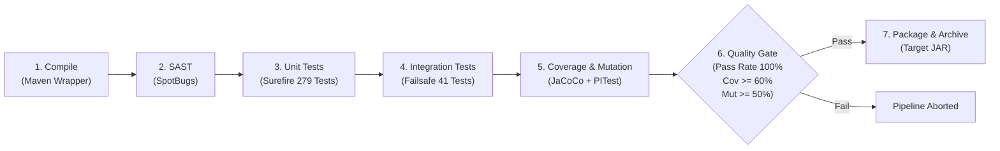

# Library Management System (LMS) — `psoft-g1`

Repositório unificado do Sistema de Gestão de Biblioteca (*Library Management System* - LMS) desenvolvido no âmbito do **Mestrado em Engenharia Informática (MEI)** do **Instituto Superior de Engenharia do Porto (ISEP)** para as unidades curriculares de:
* **ARQSOFT** — Arquitetura de Software
* **ODSOFT** — Organização e Desenvolvimento de Software

---

## Índice

1. [Visão Geral e Arquitetura (ARQSOFT)](#1-visão-geral-e-arquitetura-arqsoft)
2. [Engenharia de Software e Pipeline CI/CD (ODSOFT)](#2-engenharia-de-software-e-pipeline-cicd-odsoft)
3. [Pré-Requisitos](#3-pré-requisitos)
4. [Como Compilar e Executar a Aplicação](#4-como-compilar-e-executar-a-aplicação)
   - [4.1. Compilação](#41-compilação)
   - [4.2. Execução da Aplicação (Spring Boot)](#42-execução-da-aplicação-spring-boot)
   - [4.3. Execução da Pipeline de CI/CD (Jenkins)](#43-execução-da-pipeline-de-cicd-jenkins)
   - [4.4. Interfaces de Acesso e Documentação](#44-interfaces-de-acesso-e-documentação)
5. [Credenciais e Utilizadores de Teste (Bootstrap)](#5-credenciais-e-utilizadores-de-teste-bootstrap)
6. [Como Executar e Testar as Funcionalidades da API](#6-como-executar-e-testar-as-funcionalidades-da-api)
7. [Configurações do Sistema a Setup-Time](#7-configurações-do-sistema-a-setup-time)
8. [Como Executar os Testes e Métricas de Qualidade](#8-como-executar-os-testes-e-métricas-de-qualidade)
9. [Documentação do Projeto](#9-documentação-do-projeto)

---

## 1. Visão Geral e Arquitetura (ARQSOFT)

O sistema segue o estilo arquitetural **Monólito Modular** (*Modular Monolith*), orientado a subdomínios de negócio com decomposição interna em camadas segundo os princípios da **Clean Architecture / Onion Architecture**:

```
psoft-g1/
├── src/main/java/pt/psoft/g1/psoftg1/
│   ├── authormanagement/    # Gestão de autores e coautorias
│   ├── bookmanagement/      # Gestão de catálogo de livros, ISBN, e metadados externos
│   ├── lendingmanagement/   # Gestão de empréstimos, devoluções e multas
│   ├── readermanagement/    # Perfis de leitores, consentimentos GDPR e preferências
│   ├── usermanagement/      # Gestão de utilizadores, credenciais e perfis RBAC
│   ├── genremanagement/     # Classificação e géneros literários
│   ├── shared/              # Objetos de valor e serviços transversais partilhados
│   ├── configuration/       # Configurações de segurança (JWT), storage e plugins reflexivos
│   └── bootstrapping/       # Inicialização de dados para ambiente de desenvolvimento/teste
```

### Funcionalidade 1.3.3.1 — Informação Bibliográfica Externa Extensível
Implementada com recurso aos padrões **Ports and Adapters (Hexagonal)**, **Composite** e **Reflective Factory**:
* **Porta:** [`BookInfoProvider`](src/main/java/pt/psoft/g1/psoftg1/bookmanagement/services/BookInfoProvider.java)
* **Adaptadores:** [`GoogleBooksAdapter`](src/main/java/pt/psoft/g1/psoftg1/bookmanagement/infrastructure/gateways/GoogleBooksAdapter.java) e [`OpenLibraryAdapter`](src/main/java/pt/psoft/g1/psoftg1/bookmanagement/infrastructure/gateways/OpenLibraryAdapter.java)
* **Composição e Resiliência:** [`CompositeBookInfoProvider`](src/main/java/pt/psoft/g1/psoftg1/bookmanagement/infrastructure/gateways/CompositeBookInfoProvider.java) (tolerância a falhas, priorização e fusão inteligente de dados parciais)
* **Configurabilidade a Setup-Time:** Resolução dinâmica via propriedades em [`BibliographicConfig`](src/main/java/pt/psoft/g1/psoftg1/configuration/BibliographicConfig.java) sem necessidade de recompilar código para suportar novos provedores.

---

## 2. Engenharia de Software e Pipeline CI/CD (ODSOFT)

O projeto integra um pipeline automatizado de **Integração Contínua (CI)** declarado no ficheiro [`Jenkinsfile`](Jenkinsfile), contendo 7 estágios de verificação:



### Quality Gates Aplicados
* **Sucesso dos Testes:** 100% de testes unitários e de integração verdes sem regressões.
* **Análise Estática (SAST):** 0 novos *bugs* ou vulnerabilidades detetadas pelo SpotBugs.
* **Cobertura de Código:** Cobertura de instruções/linhas $\ge 60\%$ (JaCoCo).
* **Testes de Mutação:** *Mutation Score* $\ge 50\%$ e *Test Strength* $\ge 80\%$ (PITest).

---

## 3. Pré-Requisitos

Para compilar e executar o projeto localmente é necessário:
* **Java Development Kit (JDK):** Versão 17 (LTS)
* **Maven:** Versão 3.9+ (ou utilizar o Maven Wrapper incluído `./mvnw` / `mvnw.cmd`)
* **Git**
* Porta de rede `8080` livre para o servidor local

---

## 4. Como Compilar e Executar a Aplicação

### 4.1. Compilação
No terminal, na raiz do repositório:

* **Linux / macOS:**
  ```bash
  chmod +x ./mvnw
  ./mvnw clean compile
  ```
* **Windows (PowerShell / CMD):**
  ```powershell
  .\mvnw.cmd clean compile
  ```

### 4.2. Execução da Aplicação (Spring Boot)
Para arrancar o servidor com os dados de demonstração (*bootstrap* ativado por defeito):

* **Linux / macOS:**
  ```bash
  ./mvnw spring-boot:run
  ```
* **Windows (PowerShell / CMD):**
  ```powershell
  .\mvnw.cmd spring-boot:run
  ```

A aplicação arrancará em `http://localhost:8080`.

### 4.3. Interfaces de Acesso e Documentação
* **Swagger UI / Documentação Interativa da API:**  
  [http://localhost:8080/swagger-ui/index.html](http://localhost:8080/swagger-ui/index.html)
* **Especificação OpenAPI (JSON):**  
  [http://localhost:8080/api-docs](http://localhost:8080/api-docs)
* **Consola de Base de Dados H2:**  
  [http://localhost:8080/h2-console](http://localhost:8080/h2-console)
  * **Driver Class:** `org.h2.Driver`
  * **JDBC URL:** `jdbc:h2:mem:testdb;DB_CLOSE_DELAY=-1;IGNORECASE=TRUE`
  * **User Name:** `mysqluser`
  * **Password:** `mysqlpass`

### 4.4. Execução da Pipeline de CI/CD (Jenkins)
O repositório possui uma pipeline declarativa completa definida no ficheiro [`Jenkinsfile`](Jenkinsfile), configurada para ser executada no servidor oficial do ISEP:

* **Acesso ao Servidor Jenkins do ISEP:**
  * URL: [https://vs-gate.dei.isep.ipp.pt:10806/](https://vs-gate.dei.isep.ipp.pt:10806/)
* **Credenciais SCM:**
  * O job utiliza a credencial ID `Password_for_GitHub` (Personal Access Token / utilizador GitHub) para efetuar o checkout autenticado do repositório.
* **Como Disparar a Pipeline:**
  * **Automático (Webhook / Push):** Qualquer `git push` para a branch `main` despoleta automaticamente uma nova execução da pipeline via GitHub Webhook / SCM Polling.
  * **Manual:** No painel do projeto no Jenkins (ex.: `Jenkins_Demo_from_GitHub`), aceder ao menu lateral e clicar em **"Build Now"** (*Construir agora*).
* **Fluxo de Estágios Automatizados:**
  1. **Compile:** Validação e compilação multiplataforma via `./mvnw clean compile -B`.
  2. **Static Code Analysis (SAST):** Análise estática com SpotBugs e arquivo de `target/spotbugsXml.xml`.
  3. **Unit Tests:** Execução de 279 testes unitários (`mvn test`) com publicação de resultados JUnit.
  4. **Integration Tests:** Execução de 41 testes de integração com base de dados H2 (`mvn failsafe:integration-test failsafe:verify`).
  5. **Code Coverage & Mutation Testing:** Geração de relatórios JaCoCo (`jacoco:report`) e PITest (`pitest:mutationCoverage`).
  6. **Quality Gate:** Avaliação automática das regras de aprovação (100% testes verdes, cobertura $\ge 60\%$, mutação $\ge 50\%$).
  7. **Package & Archive:** Empacotamento do JAR executável (`psoft-g1-0.0.1-SNAPSHOT.jar`) e arquivamento dos relatórios para download.
* **Consulta de Relatórios no Jenkins:**
  * **Test Result:** Gráficos e listagem detalhada de falhas/sucessos de testes JUnit.
  * **Build Artifacts:** Relatórios HTML navegáveis do JaCoCo, relatórios PITest e binário JAR descarregável. 
---

## 5. Credenciais e Utilizadores de Teste (Bootstrap)

Quando o perfil `bootstrap` está ativo, os seguintes utilizadores são gerados automaticamente:

| Perfil / Função | Nome | Username / Email | Password |
| :--- | :--- | :--- | :--- |
| **Librarian (Bibliotecário)** | Maria Roberta | `maria@gmail.com` | `Mariaroberta!123` |
| **Reader (Leitor 1)** | Manuel Sarapinto | `manuel@gmail.com` | `Manuelino123!` |
| **Reader (Leitor 2)** | Marcelo Rebelo | `marcelo@gmail.com` | `Marcelosousa!123` |
| **Reader (Leitor 3)** | Luís Montenegro | `luis@gmail.com` | `Luismontenegro!123` |
| **Reader (Leitor 4)** | António Costa | `antonio@gmail.com` | `Antoniocosta!123` |
| **Reader (Leitor 5)** | André Ventura | `andre@gmail.com` | `Andreventura!123` |

---

## 6. Como Executar e Testar as Funcionalidades da API

### 6.1. Autenticação (Obter Token JWT)
Todos os endpoints protegidos requerem autenticação Bearer JWT.

```bash
curl -X POST http://localhost:8080/api/public/login \
     -H "Content-Type: application/json" \
     -d '{
       "username": "maria@gmail.com",
       "password": "Mariaroberta!123"
     }'
```
*A resposta devolve os cabeçalhos de autorização e o token JWT no cabeçalho `Authorization: Bearer <TOKEN>`.*

---

### 6.2. Consulta de Informação Bibliográfica Externa
Permite consultar metadados detalhados de livros através de fontes externas configuradas (*Google Books* e *Open Library*), unificando título, autores, descrição, editora, ano de publicação e capa num modelo normalizado.

```bash
curl -X GET http://localhost:8080/api/books/external/9780132350884 \
     -H "Authorization: Bearer <SEU_TOKEN_JWT>" \
     -H "Accept: application/json"
```

**Exemplo de Resposta:**
```json
{
  "isbn": "9780132350884",
  "title": "Clean Code",
  "description": "Even bad code can function. But if code isn't clean, it can bring a development organization to its knees...",
  "authors": ["Robert C. Martin"],
  "genre": "Computers",
  "publisher": "Pearson Education",
  "publishedYear": "2008",
  "coverUrl": "https://books.google.com/...",
  "sourceProvider": "googlebooks"
}
```

---

### 6.3. Registo de Livro com Auto-Enriquecimento
Ao registar um livro (`PUT /api/books/{isbn}`), um bibliotecário pode omitir campos como `title`, `description` ou `genre`. O sistema consulta automaticamente os provedores externos configurados para completar os metadados em falta:

```bash
curl -X PUT http://localhost:8080/api/books/9780201633610 \
     -H "Authorization: Bearer <TOKEN_LIBRARIAN>" \
     -F "authors=1"
```

---

### 6.4. Outros Endpoints de Referência
* **Pesquisa de Livros por Título:** `GET /api/books?title=Clean`
* **Top 5 Livros Mais Emprestados:** `GET /api/books/top5`
* **Sugestões de Leitura:** `GET /api/books/suggestions` *(apenas para Leitores)*
* **Criar Empréstimo:** `POST /api/lendings`
* **Devolver Empréstimo:** `PATCH /api/lendings/{year}/{lendingNumber}`
* **Consultar Empréstimos em Atraso:** `GET /api/lendings/overdue`

---

## 7. Configurações do Sistema a Setup-Time

As propriedades de configuração situam-se em `src/main/resources/application.properties` e `src/main/resources/config/library.properties`.

### Provedores Bibliográficos (`application.properties`)
```properties
# Provedores ativos e ordem de prioridade no CompositeBookInfoProvider
bibliographic.providers=googlebooks,openlibrary

# URLs base dos serviços externos
bibliographic.googlebooks.base-url=https://www.googleapis.com/books/v1
bibliographic.openlibrary.base-url=https://openlibrary.org

# Timeout para chamadas HTTP externas (resiliência)
bibliographic.timeout-ms=3000
```
> **Adicionar novo provedor:** Basta implementar a interface `BookInfoProvider`, registar o prefixo/classe em `BibliographicConfig`, e declarar o novo identificador na propriedade `bibliographic.providers`, sem alterar o código existente (**Open-Closed Principle**).

### Regras de Empréstimo e Sugestões (`library.properties`)
```properties
# Duração padrão do empréstimo em dias
lendingDurationInDays=15

# Valor da multa diária em cêntimos por atraso
fineValuePerDayInCents=200

# Limite de sugestões por género literário
suggestionsLimitPerGenre=2
```

---

## 8. Como Executar os Testes e Métricas de Qualidade

O projeto está estruturado segundo a pirâmide de testes e os 5 níveis de teste estipulados em ARQSOFT e ODSOFT:

### 8.1. Testes Unitários (Surefire)
Executa a suíte de 279 testes unitários isolados em memória (DTOs, regras de domínio, gateways mockados e serviços):
```bash
./mvnw test -B
```
*Relatórios gerados em: `target/surefire-reports/`*

### 8.2. Testes de Integração (Failsafe)
Executa os 41 testes de integração com subida do contexto Spring Boot, base de dados H2 real e controlo de acessos Spring Security MockMvc:
```bash
./mvnw failsafe:integration-test failsafe:verify -B
```
*Relatórios gerados em: `target/failsafe-reports/`*

### 8.3. Relatório de Cobertura de Código (JaCoCo)
```bash
./mvnw jacoco:report jacoco:report-integration -B
```
*Relatório HTML disponível em: `target/site/jacoco/index.html`*

### 8.4. Testes de Mutação (PITest)
Avalia a resiliência e eficácia dos testes eliminando mutantes introduzidos no bytecode:
```bash
./mvnw pitest:mutationCoverage -B
```
*Relatório HTML disponível em: `target/pit-reports/index.html`*

### 8.5. Análise Estática de Código (SpotBugs / SAST)
```bash
./mvnw spotbugs:check -B
```
*Relatório XML gerado em: `target/spotbugsXml.xml` (ou visualização gráfica com `./mvnw spotbugs:gui`)*

---

## 9. Documentação do Projeto

A documentação detalhada encontra-se organizada na pasta `Docs/`:

* **Arquitetura (ARQSOFT):**
  * [Documentação Global ARQSOFT (Vistas C4 e 4+1)](Docs/ARQSOFT/arqsoft-documentation.md)
  * [Engenharia Reversa do System-as-is](Docs/ARQSOFT/System-as-is/system-as-is.md)
  * [Processo ADD e Decisões de Design (System-to-be)](Docs/ARQSOFT/system-to-be/add-process.md)
  * [Fatores Arquiteturais e ASRs](Docs/ARQSOFT/system-to-be/architectural-factors.md)
  * [Táticas Arquiteturais de Modificabilidade e Testabilidade](Docs/ARQSOFT/system-to-be/architectural-tactics.md)
* **Engenharia de Software & CI/CD (ODSOFT):**
  * [Estratégia e Níveis de Testes Automatizados](Docs/ODSOFT/testing-strategy/testing-strategy.md)
  * [Pipeline CI, Cobertura, Mutação e Quality Gates](Docs/ODSOFT/pipeline/ci-testing-coverage-and-quality-gates.md)
  * [Análise e Correções do System-as-is](Docs/ODSOFT/system-fixes/system-fixes.md)
